# Monolith

An ultralight 91 Wh USB-C power bank for backpacking: 4S1P 21700 pack, two bidirectional USB-C PD ports designed for 100 W total, TI CC2340 Bluetooth LE MCU.

<p align="center">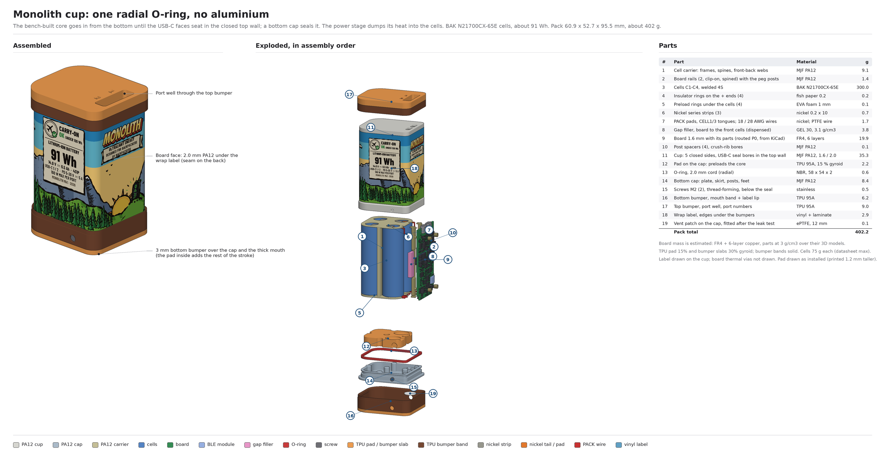</p>

## Where the project stands (2026-11-13)

Nothing has been built, assembled or bench-tested yet. Every number in this repo is a design or model value, not a measurement.

- **The design is complete on paper:** schematic, board layout, enclosure model with print files, assembly and bring-up procedures, and a parts tracker for the first five packs.
- **The board is the script-built layout on `master`** (Logan's choice on 2026-11-13; details in [The board layout and its predecessor](#the-board-layout-and-its-predecessor)). It passes DRC and was checked by solver, but it has not been reviewed by a person. Its JLC order files were made on 2026-11-14 ([`ORDER-NOTES.md`](hardware/Production/jlc/ORDER-NOTES.md)). The earlier hand-routed layout, approved on 2026-10-30, is history: its order files, reviews and board-specific studies are kept and labelled as such.
- **The enclosure has been through four drop studies and a thermal study**, the last a full 3D explicit drop model (2026-11-11 and 11-12) that added the rail spines under the board. See [Analysis](#analysis).
- **Next:** review the board in KiCad, fix three silkscreen items and order it, print the first cup (it is the fit test: there are no separate fit coupons), weld a pack, bring the board up, and run the drop and thermal tests that the models can only estimate.

Where to read more:

| | |
|---|---|
| [`docs/spec.md`](docs/spec.md) | The single source of truth for every decision (cells, thresholds, enclosure, firmware policy). Where this README and the spec disagree, the spec wins |
| [`hardware/Production/README.md`](hardware/Production/README.md) | The board's dated change log with the reasoning for each part choice |
| [`docs/analysis/`](docs/analysis/README.md) | Model studies: thermal, drop, bumper materials, switching loops, inner copper |
| [`docs/reviews/`](docs/reviews/README.md) | Board and enclosure reviews, with the full review history |
| [`docs/mechanical-design.md`](docs/mechanical-design.md), [`docs/viewer/`](docs/viewer/README.md) | The enclosure and its interactive 3D viewer |
| [`docs/production/`](docs/production/) | Assembly, spot welding, bring-up and gauge training |
| [`ordering/`](ordering/README.md) | What to buy, from where, and its status |

## Design overview

The goal is a hiking power bank that is lighter and better behaved than the off-the-shelf ones: under the 100 Wh carry-on limit, able to charge or run 20 V USB-C PD loads, with a proper fuel gauge and a phone app. The pack is four BAK N21700CX-65E cells (6.5 Ah, 3.5 V nominal) in 4S1P: 91 Wh typical, spot-welded with pure nickel strip and managed by a TI BQ40Z50-R2 gauge/protector with hardware second-level protection (BQ294700 plus a chemical fuse). Each of the two USB-C ports has its own TPS25751 PD controller and BQ25756 bidirectional buck-boost converter, so either port can charge the pack (including from a 5 V solar panel) or source up to 20 V / 5 A, with the pair thermally limited to 100 W; a TPS62933 buck supplies each port's 5 V source rail and a TPS62177 buck supplies the 3.3 V rail. A CC2340R5MODA Bluetooth LE module runs the charge policy, port power sharing and a custom GATT service for an iPhone app. The electronics live on one 43 × 74 mm 6-layer board along one face of the cells, inside an MJF nylon cup closed on five sides and sealed by a bottom cap with one radial O-ring, with TPU bumpers at both ends. There is no metal enclosure: the power stage sheds its heat into the cells through thermal vias and a gap filler.

| | |
|---|---|
| **Energy** | 91 Wh typical, 88.9 Wh minimum (4S1P, 14.0 V, 6.5 Ah, BAK N21700CX-65E cells), under the 100 Wh carry-on limit |
| **Ports** | 2 × USB-C, each bidirectional PD 5–20 V up to 5 A; 100 W total as a burst, then a linear thermal derate to a sustained ~40 W ([policy](docs/firmware/charge-and-thermal-policy.md)) |
| **Gauge / protection** | BQ40Z50-R2 (Impedance Track, SMBus), Infineon BSC007N04LS6 CHG/DSG FETs, 1 mΩ shunt; BQ294700 + chemical fuse as the independent second level |
| **MCU** | TI CC2340R5MODA (Cortex-M0+ Bluetooth LE module with integrated antenna) |
| **Board** | 43.2 × 74.35 mm, 6 layers, 1.6 mm, 2 oz outer / 0.5 oz inner copper, ENIG, filled and capped vias; JLCPCB assembly of F.Cu, B.Cu parts hand-fitted |
| **Enclosure** | MJF PA12 cup and bottom cap (one radial NBR O-ring), PA12 cell carrier and board rails, TPU 95A bumpers; 60.9 × 52.7 × 95.5 mm, about 402.2 g (modelled); IP67 is the target |
| **Tools** | KiCad 10 with Python scripts, TI SimpleLink Low Power F3 SDK, Xcode (app on the `app` branch) |

## Status

**Done**

- **Schematic:** six sheets, 289 footprints. Derived by script from an earlier bench design that went through four schematic reviews, with a netlist check that every surviving pin kept its net. Loss cuts, the BAK 65E cell change, the late part swaps (TVS2200 clone, KEMET T593V bulk caps, 2.0 mm inductors) and the UART_TX debug pin are in. ERC is clean (0 errors).
- **Board layout:** the script-built layout of 2026-11-10 (PR #66, commit `dd34285`), placed and routed by script into the outline the enclosure gives, DRC clean, and ahead of or level with the earlier hand-routed layout on loop inductance, copper loss and via current in the solver comparison. Logan made it the design on 2026-11-13. A whole-project pre-order review on 2026-11-07 found no wiring error in the schematic it implements.
- **Earlier hand-routed layout (history):** placed 2026-10-28, routed and reviewed revision by revision up to rev 12 on 2026-10-30, approved the same day (PR #44). It is the board file at commit `8dd9eb6`; its order files are in [`hardware/Production/retired/jlc-hand-routed/`](hardware/Production/retired/jlc-hand-routed/ORDER-NOTES.md).
- **Mechanical:** parametric cup enclosure with 129 clearance, seal, sealed-pressure and drop load-path checks, all passing, STL print files by material, STEP export and an interactive viewer ([`docs/mechanical-design.md`](docs/mechanical-design.md)). The cup carries the drop loads since 2026-11-03 (edge lands, lips, cradles, spacers) and props the board at mid-span since 2026-11-11 (rail spines).
- **Analysis:** thermal with both ports loaded, four drop studies ending in a full 3D explicit model, a bumper materials study, the inductance of every switching loop, and an inner copper weight study ([Analysis](#analysis)).
- **Cells and pack build:** BAK N21700CX-65E, BSC007N04LS6 protection FETs sized for its short-circuit current ([options](research_notes/protection-fets/options.md)), P20B spot welding with 0.2 × 10 mm pure nickel and wire PACK tails ([welding](docs/production/spot-welding.md), [assembly](docs/production/p0-assembly.md)), Parker GEL 30 gap filler, front-cell NTCs as SMD parts on the board under the gap filler (TH101 / TH104).
- **Firmware policy:** charge current and discharge power as linear ramps on the hottest cell temperature ([policy](docs/firmware/charge-and-thermal-policy.md)); a LaunchPad build of the firmware skeleton and TI's `basic_ble` runs.
- **Ordering:** every part for five packs is in [`ordering/parts-tracker.csv`](ordering/README.md). The two parts LCSC does not stock (TPS25751D, SiZ240DT) were pre-ordered at JLC on 2026-11-07.

**Remaining**

- Review the board in KiCad: it has been checked by DRC, script and solver only.
- Fix the silkscreen items in [`ORDER-NOTES.md`](hardware/Production/jlc/ORDER-NOTES.md) (the title text is off the board edge), rerun `hardware/Production/jlc/make_package.sh` after any board change, and go through the checkout checks there.
- Rerun the board-specific studies for this layout where the margin is small: the 3D drop model (of the four capacitors with the smallest wall margins, three moved by 5 to 13 mm and the fourth turned 90°) and the thermal runs.
- Order the board and the printed parts. The first real cup, cap and core are the fit test.
- Weld the pack, bring up the board and train the gauge ([`docs/production/p0-bringup-and-training.md`](docs/production/p0-bringup-and-training.md)).
- Firmware beyond the skeleton: the P0 pin map, gauge and PD-controller drivers, the TPS25751 patch bundle and its loader, charge policy, power sharing, BLE GATT, MCUboot OTA.
- Tests the models cannot replace: a witness-paint drop test on the first print, the 100 W thermal test, an IP67 dunk test, label ratings.
- Thermal rerun with the 1.6 mm cup walls and the rail spines (the spines take about 12 % of the gap filler's conductance; the thermal study predates them).
- iPhone app (SwiftUI + CoreBluetooth).

## Hardware

### The KiCad project

Everything for the board is in [`hardware/Production/`](hardware/Production/), KiCad 10. The symbol library, footprint library and 3D models are project-local, so the project opens with no extra setup.

| File | What it is |
|---|---|
| `Monolith.kicad_pro` | The project; open this |
| `Monolith.kicad_pcb` | The 6-layer board: the script-built layout (commit `dd34285`). The earlier hand-routed layout is the same file at commit `8dd9eb6` (see below) |
| `Monolith.kicad_sch` | Root sheet. Sub-sheets: `gauge.kicad_sch` (Cells and Gauge), `power.kicad_sch` (3V3 Rail), `mcu.kicad_sch` (MCU), and `usb_port.kicad_sch` used twice (USB Port 1, USB Port 2) |
| `MonolithDev.kicad_sym`, `MonolithDev.pretty/`, `3dmodels/` | Project-local symbol library, footprints and STEP models (wired up by `sym-lib-table` / `fp-lib-table`) |
| `Monolith.kicad_dru` | Custom DRC rules (net-class clearances, keep-outs) |
| `jlc/` | [`ORDER-NOTES.md`](hardware/Production/jlc/ORDER-NOTES.md): the JLCPCB order package for this board (gerber zip, BOM, CPL, hand-solder list, made 2026-11-14 by `make_package.sh`), the PCB options and the checkout checks |
| `retired/jlc-hand-routed/` | History: the complete order package of the hand-routed layout (gerber zip, BOM, CPL, hand-solder list). Not for today's board |
| `tools/` | Python scripts that generated the schematic, stack-up, outline and mechanical keep-outs from the enclosure model ([table](hardware/Production/README.md#tools)) |
| `groundup/` | The tools, passes and solver comparison behind the script-built layout ("ground-up" in that folder's notes; [README](hardware/Production/groundup/README.md)) |
| `README.md` | Dated change log: every part choice and change with its reasoning |

The board outline, peg holes, wire holes and keep-outs come from the enclosure model (`hardware/mechanical/monolith_shell.py`) through `tools/make_board.py`, so mechanical changes go there first. Reference designators follow the sheets: 1xx cells and gauge, 2xx 3V3 rail, 3xx MCU, 4xx port 1, 5xx port 2.

### The board layout and its predecessor

Two layouts of the same schematic exist. On 2026-11-13 Logan chose the script-built one as the design. Both use the same outline, holes, USB-C connectors, wire pads, NTCs, antenna module, bottom-side parts and main inductors, so both fit the same cup; 246 of the 289 footprints have a different position or rotation (234 moved by more than 0.1 mm).

| | Script-built board (the design) | Hand-routed board (history) |
|---|---|---|
| **Where** | `Monolith.kicad_pcb` on `master` (commit `dd34285`, PR #66, 2026-11-10) | `Monolith.kicad_pcb` at commit `8dd9eb6` |
| **How it was made** | Placed and routed by script from the schematic, with a DC and loop-inductance solver in the loop, in two fix passes ([`groundup/`](hardware/Production/groundup/README.md)) | Placed and routed by hand in KiCad |
| **Review** | DRC clean (0 errors, 0 unconnected); compared by solver against the hand-routed board ([`groundup/compare/`](hardware/Production/groundup/compare/README.md)); **not yet reviewed by a person** | Reviewed revision by revision up to rev 12 and a final blocker review on 2026-10-30, approved (PR #44) |
| **Solver comparison (model values)** | Charger hot loops 0.50 to 0.56 nH; gate loops 44 nH in sum; copper loss at 100 W 435 / 358 mW (port 1 / port 2); 5.3 / 5.7 min at 100 W before the derate; 258 mm of signal track in a ground plane | 0.54 to 0.67 nH; 49 nH; 469 / 415 mW; 5.0 / 5.3 min; 34 mm |
| **Order files** | None yet. Gerbers, BOM and CPL are made together after the review ([`jlc/ORDER-NOTES.md`](hardware/Production/jlc/ORDER-NOTES.md)) | Complete set, kept in [`retired/jlc-hand-routed/`](hardware/Production/retired/jlc-hand-routed/ORDER-NOTES.md) |
| **Renders, plots, mechanical board data** | Regenerated from this board on 2026-11-13; all 129 enclosure checks pass with its part positions | In git history (pictures at `401b2ee` and earlier; part meshes kept as `hardware/mechanical/board/monolith_board_handrouted.npz`) |
| **Reviews and studies** | The solver comparison only. The drop and thermal studies have not been rerun for its part positions | Every board review in [`docs/reviews/`](docs/reviews/README.md) and every study in [`docs/analysis/`](docs/analysis/README.md) used this board |

As of 2026-11-13, open PR #68 holds a cleaned-up version of the script-built board (a tidiness pass on 2026-11-11) and would replace the board file on `master` if merged; the pictures can be made again with [`docs/hardware/board_pictures.py`](docs/hardware/board_pictures.py). Never mix files between the two layouts: gerbers made from the board on `master` with the CPL in `retired/jlc-hand-routed/` would place almost every part in the wrong spot.

### Schematics, renders and plots

- [`docs/hardware/monolith-p0-schematic.pdf`](docs/hardware/monolith-p0-schematic.pdf): all six sheets, exported from the current schematic on 2026-11-13. It is the same for both layouts.
- [`docs/hardware/monolith-p0-layers.pdf`](docs/hardware/monolith-p0-layers.pdf): the script-built board, front and back (copper, mask, silk), then every copper layer (F.Cu, In1–In4, B.Cu), one page each, plotted on 2026-11-13 from master's board (`dd34285`).
- A 3D STEP of the whole assembly can be generated with `hardware/mechanical/monolith_step.py`.

#### The board

Raytraced in KiCad 10 (`kicad-cli pcb render`, all 3D models) on 2026-11-13 from the board on `master` (`dd34285`) by [`docs/hardware/board_pictures.py`](docs/hardware/board_pictures.py), which also writes the plots and the layers PDF.

<p align="center"><a href="docs/hardware/monolith-p0-render-iso-top.png">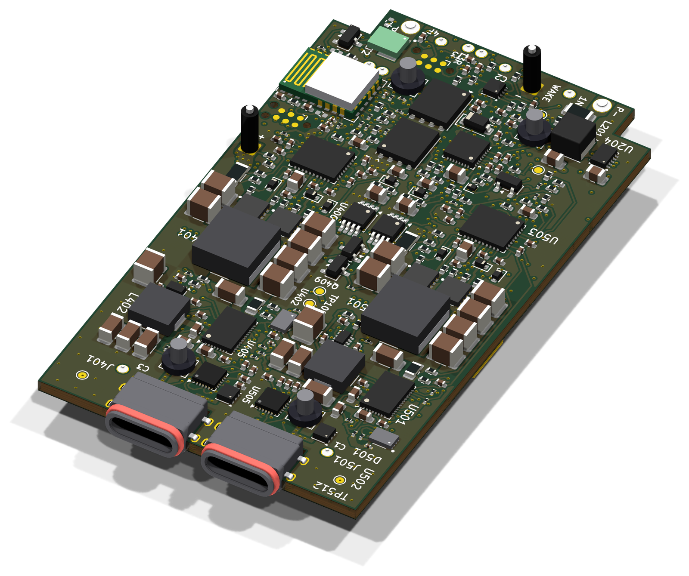</a></p>

| Top (F.Cu side, faces the cup wall) | Bottom (B.Cu side, faces the cells) |
|---|---|
| [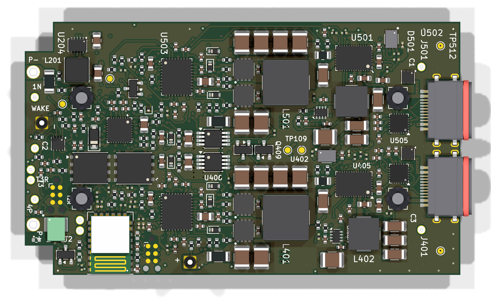](docs/hardware/monolith-p0-render-top.png) | [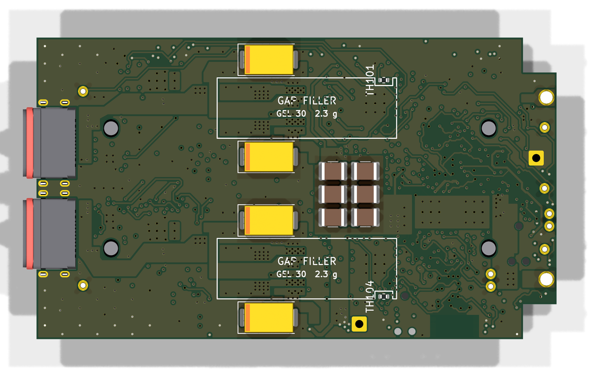](docs/hardware/monolith-p0-render-bottom.png) |

<p align="center"><a href="docs/hardware/monolith-p0-render-iso-bottom.png">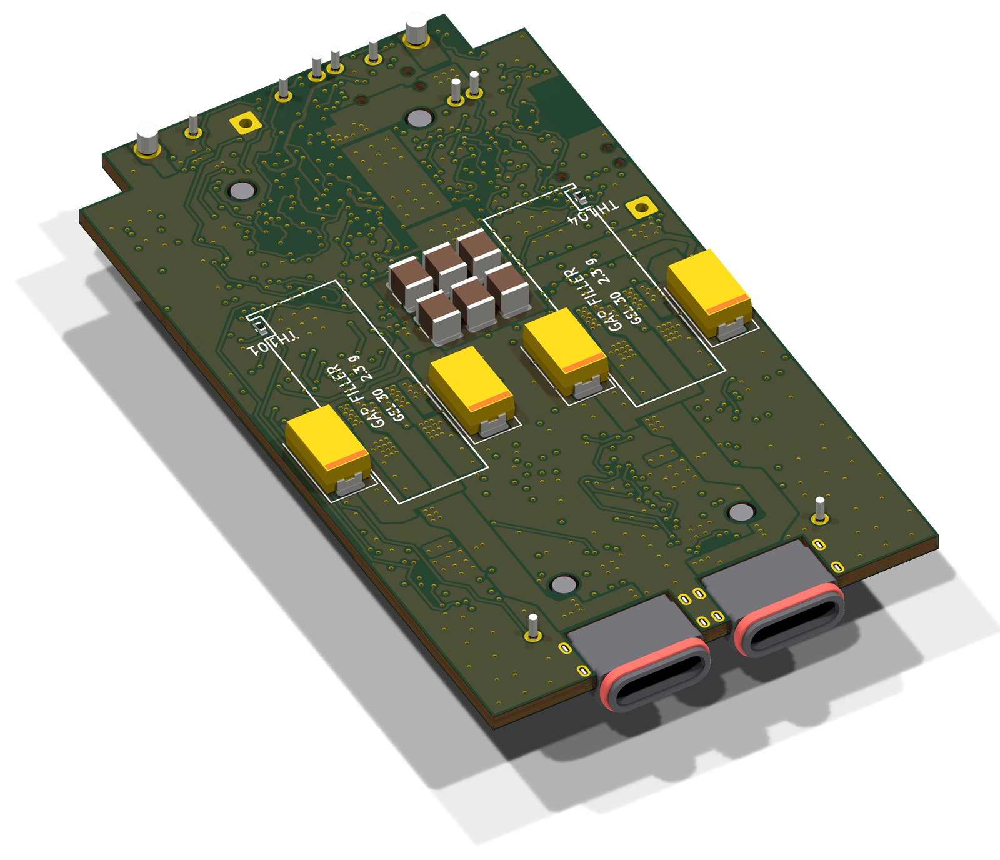</a></p>

#### Board plots

| Front (F.Cu, mask, silk) | Back (B.Cu, mask, silk, mirrored) |
|---|---|
| [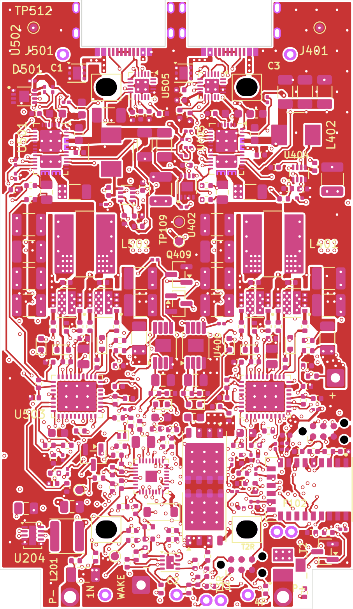](docs/hardware/monolith-p0-board-front.png) | [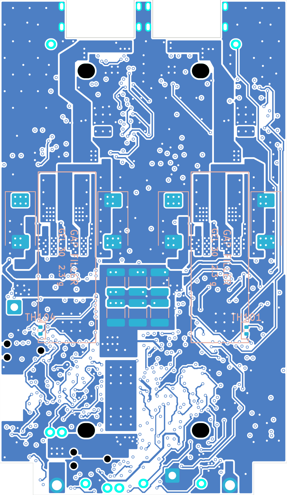](docs/hardware/monolith-p0-board-back.png) |

The USB-C ports are at the top edge of the plots (the right edge of the flat renders), the cell wire holes (PACK−, PACK+ and the Kelvin senses) at the bottom tab, and the two power stages fill the middle: USB1's stage (L401) toward +y and USB2's (L501) toward −y. The bare copper boxes on the back are the gap-filler pads that couple the stages to the cells.

### Per port

- TPS25751D USB-C PD controller, configured from its own M24512 EEPROM (patch-bundle programming notes in [`docs/firmware/tps25751-eeprom-programming.md`](docs/firmware/tps25751-eeprom-programming.md)).
- BQ25756 bidirectional buck-boost, 5 mΩ sense resistors, two SiZ240DT 40 V half-bridges, Coilcraft XGL7030-332 3.3 µH at 500 kHz, and a 9 V gate-drive LDO (TPS7A4101), off by default and enabled through the TPS25751's GPIO6 when the pack is above 10 V. Gate resistors fitted as 0 Ω links with DNP RC snubbers so ringing can be fixed without a respin.
- TPS62933 5 V buck for the port's 5 V source rail; TPD6S300 CC protection (24 V short-to-VBUS, IEC ESD); TVS2200 flat clamp on VBUS.
- Shou Han IP68 right-angle USB-C receptacle, 5 A / 20 V.

### Pack and supervision

- BQ40Z50-R2 with four cell NTCs (the two front ones are SMD parts on the board, TH101 / TH104; the back two are wired to their cans), cell balancing and JEITA; BSC007N04LS6 CHG/DSG FETs; 1 mΩ shunt; BQ294700 per-cell OVP that fires the WSFB1514 chemical fuse independently of the gauge.
- One wire-ORed interrupt line (both PD controllers, gauge BTP) into the MCU; CHG_INH pulled up so a reset, hang or unprogrammed MCU stops charging.
- Idle current about 400 µA (estimate, [budget](docs/devboard/power-budget.md)), with a gauge ship mode for storage.

Datasheets and app notes the design was checked against are in `datasheets/`: [`datasheets/README.md`](datasheets/README.md) maps each file to its part.

### Earlier bench design

`hardware/DevBoard/` and `docs/devboard/` hold the bench "dev board" (rev A8) that P0 was derived from: its four schematic reviews, circuit description and budgets. It was never ordered (P0 is the first build since 2026-10-18) and is kept only as the reviewed reference and history.

## Enclosure

The enclosure is a parametric Python model in [`hardware/mechanical/`](hardware/mechanical/) (`monolith_shell.py`, `monolith_parts.py`, `monolith_cup.py`). The model runs its own 129 checks (clearances against the board's part meshes, an insertion sweep, seal squeeze, sealed pressure, drop load-path gaps and bearing stresses) and writes the print files, the pictures in this README and the viewer. [`docs/mechanical-design.md`](docs/mechanical-design.md) describes the design and its checks.

- **Printed parts:** cup, bottom cap, cell carrier, two board rails and four post spacers in MJF PA12; top and bottom bumpers (one piece each, 30 % gyroid slabs) and the cap pad in FDM TPU 95A. Print files by material: [`hardware/mechanical/stl/`](hardware/mechanical/stl/README.md).
- **Sealing:** one 58 × 54 × 2 mm NBR O-ring between cup and cap, the two USB-C receptacles' own seal rings in the cup's bores, and a 12 mm ePTFE vent patch on the cap under the bottom bumper.
- **What holds the core:** the cup carries the loads. Edge lands and lips hold the board's long edges, cradles hold the front cells, the rails ride on the front cans and prop the board at mid-span with a spine across the gap-filler zone, and the cap's feet and overtravel posts catch the core in a cap-end drop.
- **Interactive 3D viewer:** [`docs/viewer/`](docs/viewer/README.md) (parts on and off, section cuts).
- **Assembly:** [`docs/production/p0-assembly.md`](docs/production/p0-assembly.md), with the step pictures in `hardware/mechanical/assembly_steps/`.
- **Label:** the wrap label artwork and print file are in [`hardware/label/`](hardware/label/README.md).

<p align="center">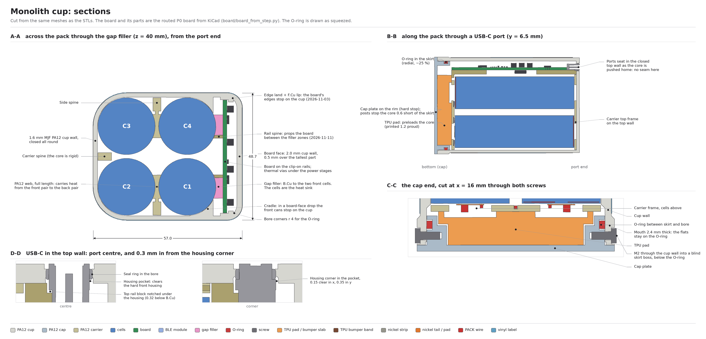</p>

## Analysis

Model studies of the whole pack, each in its own folder under [`docs/analysis/`](docs/analysis/README.md) with the scripts, the numbers as JSON and every figure. Every study was run on the earlier hand-routed board (its copper and its part positions) and the cup as it was on the study's date; none has been rerun for the script-built board that is now the design. The enclosure findings carry over, because the cup, the outline and the parts the cup keys on are the same. The board-specific numbers (copper loss, loop inductance, the parts next to the rail spines in the drop model) describe the hand-routed layout; where the solver comparison in [`groundup/compare/`](hardware/Production/groundup/compare/README.md) has the same number for the script-built board, it is given. Each README opens with a status block that says which geometry it ran on and what became of each finding. Every number is a model value until the bench tests.

| Study | Date | What it answered |
|---|---|---|
| [Thermal, 25 W + 20 W](#thermal-usb1-at-25-w-and-usb2-at-20-w-together) | 2026-10-31 | Both ports loaded from full to empty at 25, 35 and 40 °C |
| [Drop, six poses](#drop-1-m-onto-concrete) | 2026-10-31 | First 1 m drop model; three housing fixes |
| [Bumper materials](#bumper-materials-and-structure) | 2026-11-01, 11-05 | Elastic resins and engineered slabs against FDM TPU |
| [Drop with part-to-part contact](#drop-1-m-onto-concrete) | 2026-11-04, 11-05 | Loads and stress in every part; cup fixes |
| [Inner copper weight](#inner-copper-weight) | 2026-11-05 | 0.5, 1 or 2 oz inner layers |
| [Switching loops](#switching-loop-inductance) | 2026-11-06 | Inductance and ringing of every hot loop and gate loop |
| [Drop in 3D](#drop-1-m-onto-concrete) | 2026-11-11, 11-12 | Full explicit model of the back-face drop; rail spines |

### Thermal: USB1 at 25 W and USB2 at 20 W together

[`docs/analysis/2026-10-31-thermal-25w-20w/`](docs/analysis/2026-10-31-thermal-25w-20w/README.md). Both ports deliver from full to empty (45 W, USB1 at 15 V, USB2 at 9 V) in the 3D pack model ([`research_notes/Pack thermal BAK 65E/`](research_notes/Pack%20thermal%20BAK%2065E/README.md)) with the hand-routed board's copper losses and the firmware derate in the loop.

- **At 25 °C** the pack runs the whole battery at 45 W (118 min, 88.4 Wh) and cuts to 40 W only for the last 3 minutes. The hottest board part peaks at 51 °C, the hottest point in any cell at 45.7 °C, the outside at 46.6 °C.
- **At 35 °C** the derate starts at 20 min and settles at 30 W (USB1 down to 10 W, USB2 kept at 20 W); the hottest part reaches 56 °C and the cells 51 °C. At 40 °C USB1 is cut to 0 W for most of the run.
- **Heat** at 45 W is 2.4 W: 0.8 W in the USB1 stage, 1.0 W in the USB2 stage, 0.5 W in the cells. The 6-layer board keeps itself within 3.6 K end to end.
- Even with the derate switched off at 35 °C (a firmware failure) the cells stop at 55.4 °C, under their 60 °C discharge limit.
- **Not rerun since.** The model's cup has 1.2 mm side walls and no rail spines. The cup now has 1.6 mm walls, and the spines cross the gap-filler zone and take about 12 % of its conductance, so these temperatures are probably slightly optimistic. The copper losses are the hand-routed board's. For the script-built board only the 100 W burst was run, in the solver comparison: 5.3 / 5.7 min before the derate (port 1 / port 2) against 5.0 / 5.3, with the hottest part at 58.1 / 58.9 °C against 59.4 / 60.2 °C.

<p align="center">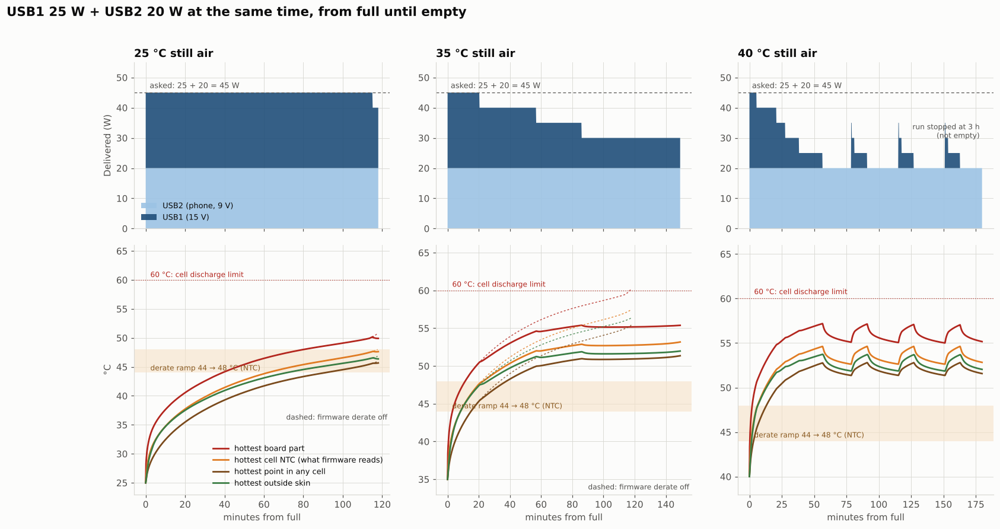</p>
<p align="center">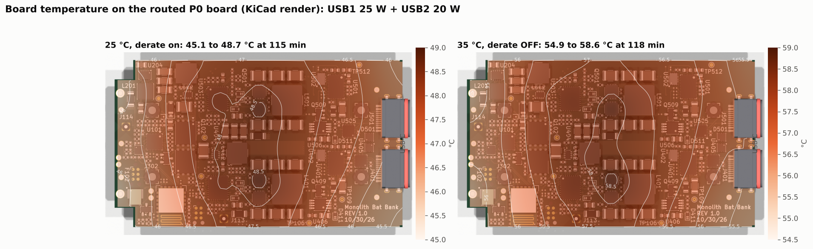</p>
<p align="center">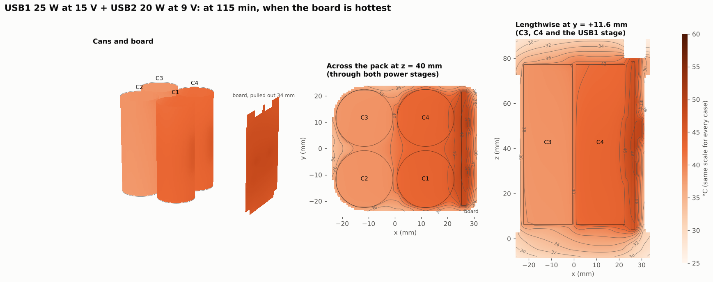</p>

### Inner copper weight

[`docs/analysis/2026-11-05-inner-copper/`](docs/analysis/2026-11-05-inner-copper/README.md). The board is specified with 2 oz outer and 0.5 oz inner copper. This study solved the hand-routed board's power-path resistance and reran the 100 W burst with 1 oz and 2 oz inner layers. The script-built board has the same stack-up; the study has not been repeated on its copper.

| Inner copper | Path resistance, port 1 / port 2 | Port 1 copper loss at 100 W | Minutes at 100 W before the derate, port 1 / port 2 | Hottest part, port 1 / port 2 |
|---|---|---|---|---|
| 0.5 oz (as specified) | 8.63 / 7.50 mΩ | 0.29 W | 5.0 / 5.33 | 59.4 / 60.2 °C |
| 1 oz | 6.95 / 5.75 mΩ | 0.24 W | 5.33 / 5.67 | 57.2 / 57.9 °C |
| 2 oz | 5.96 / 4.68 mΩ | 0.20 W | 5.83 / 6.0 | 54.9 / 55.3 °C |

The gain is almost all heat spreading, not lower I²R: the outer layers carry the high-current copper already. The extra mass is about 1.4 g at 1 oz and about 4 g at 2 oz. 1 oz inner was recommended if JLC's price difference is small; it has not been decided, and the board stays 2 oz / 0.5 oz until it is.

<p align="center">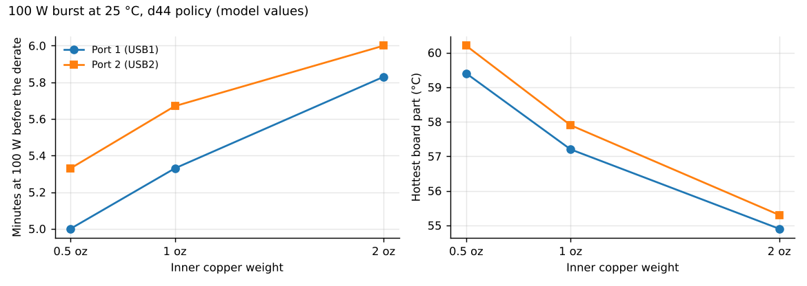</p>

### Drop: 1 m onto concrete

Three models of increasing depth, each built because the one before could not answer the next question. All are for a 1 m drop at 4.43 m/s onto a rigid floor.

1. **Six poses, lumped** ([`2026-10-31-drop-1m/`](docs/analysis/2026-10-31-drop-1m/README.md)). The bumpers' crush law, a finite-element stiffness of the cup and its contents, and a plate model of the board, for a flat drop on each end, the board face, a narrow side, and a corner at each end. It found the 20 % gyroid port-end slab bottoming out (2685 g on the cells and board) and led to three fixes (PR #50): the bumper slabs at **30 % gyroid**, the two M2 screw heads **counterbored 0.8 mm** so they sit below the bumper band, and **pockets in the board-face wall** over the two inductors.
2. **Contact between every moving part** ([`2026-11-04-drop-stress/`](docs/analysis/2026-11-04-drop-stress/README.md)). Each moving part is its own body with contacts to its neighbours, finite-element compliance and stress per part, and the board as a plate on one-sided supports. It gives part loads and stresses for the five flat drops (edges and corners are not usable in this model). It led to the 2026-11-05 cup fixes (PR #64): bottom rail tongues set back, larger cap overtravel posts plus a fifth, and cradle reliefs under two bulk capacitors. It also showed about 8,000 µε in the board in the back-face and board-face drops, which is what the 3D study took up.
3. **Full 3D explicit model of the back-face drop** ([`2026-11-11-drop-3d/`](docs/analysis/2026-11-11-drop-3d/README.md)). OpenCourant, about 900k nodes, quadratic tetrahedra for the nylon and TPU parts, for the worst pose of the lumped studies: flat onto the back (cell) face, where the board's own inertia bends it toward the cells and then swings it into the board-face wall on the rebound. On the cup as it was before this study the board bent across its middle (about 5,000 µε in a full-width band) and the rebound pushed several F.Cu capacitors and inductors into the wall. The fixes (PR #69): **rail spines** that prop the board at mid-span (one clip-on rail per side, its bottom and top blocks joined across the gap-filler zone), ribs on the cup under the board's long edges, 1.5 mm of travel past the bottom rail tongue tips so the rails ride on the front cans, and 0.7 mm inductor pockets. Run 9 checked the merged geometry: board strain 3,089 µε at the 99th percentile and 4,022 µε peak, no F.Cu part reaches the wall, and the tongue tips stop 0.12 mm short. The cap overtravel posts yielded at their sharp top rims, so their tops now have a 0.3 mm chamfer (PR #70, not rerun).

Where each pose stands today, from the newest model that covers it:

| Pose | Newest result | State |
|---|---|---|
| Flat on the port end | 572 g on the cells and board, slab crush 2.6 of 6 mm (lumped, 30 % slab); every part under 7 MPa (contact model) | Fixed by the 30 % slab |
| Flat on the cap end | 1182 g (lumped); overtravel posts 42 MPa, was 107 MPa (contact model) | Open: about 280 N on each bottom rail tongue, and about 1.15 kN on the two M2 screws in the rebound (a lumped estimate) |
| Flat on the back (cell) face | Board 3,089 µε p99, 4,022 µε peak; closest F.Cu part 0.02 mm from the wall (3D, run 9) | Mid-span bending fixed by the rail spines. Open: about 4,000 µε on the board's long edges where the spines end, local yield in the carrier webs, and capacitor margins below the model's resolution |
| Flat on the board face | Board 7,800 µε p99, C434 / C531 0.06 mm from the wall (contact model) | Open. Not rerun since the rail spines and not run in 3D |
| Flat on a narrow side | 4013 g (lumped); cup wall 178 MPa and cradles 143 MPa on a coarse mesh (contact model) | Open: the bottom bumper band is only 1 mm of solid TPU on this side |
| Corners | 2611 g port end, 1550 g cap end (lumped) | No usable stress result in any of the three models |

The lumped g values are from the 2026-10-31 rerun on the 399.6 g cup, before the lands, cradles and spines were added; they have not been rerun on today's 402.2 g cup. The gap filler is carried as mass only: a sensitivity bracket in the contact study suggests it could cut the back-face strain by about 18 % but could also drag parts toward the wall on the rebound. A **witness-paint drop test on the first print** is the planned check for the open items.

The part names and part-to-wall gaps in this table are for the hand-routed board. The script-built board keeps the parts the cup keys on (L401 / L501, the bulk capacitors, the NTCs, the USB-C connectors, the antenna module, the holes), and it passes the model's static clearance checks, but the four capacitors with the smallest margins are not where the studies had them: C434 and C524 moved about 13 mm and C420 about 5 mm; C531 moved 0.4 mm and turned 90°. The margins of 0.02 to 0.06 mm therefore say nothing about the new layout until the contact and 3D models are rerun with its part positions.

<p align="center">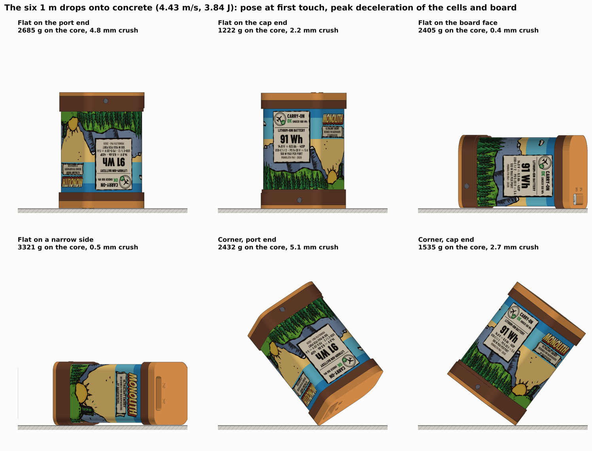</p>
<p align="center">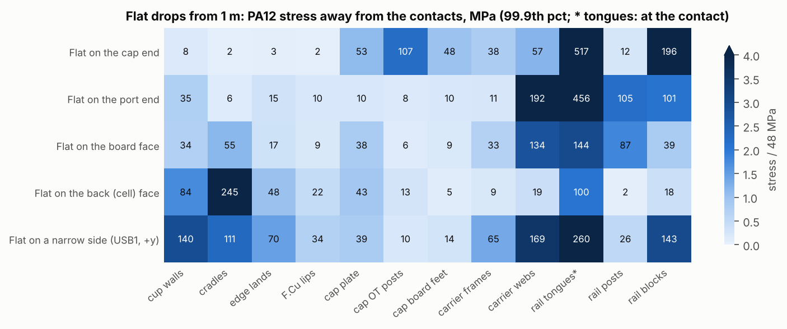</p>
<p align="center">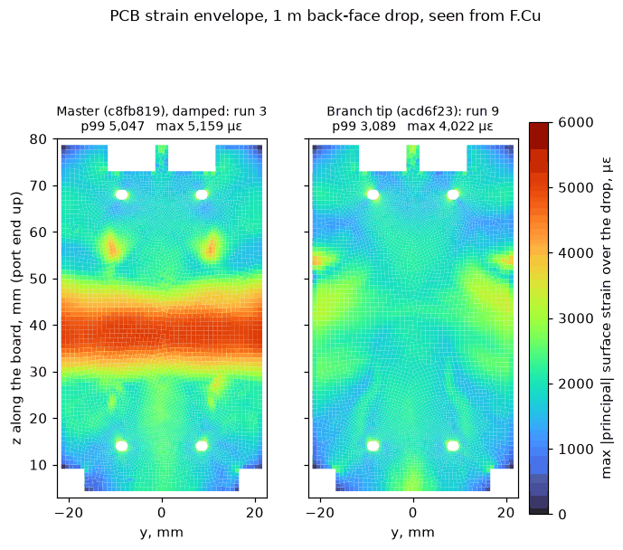</p>
<p align="center">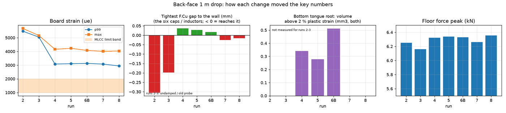</p>

### Bumper materials and structure

[`docs/analysis/2026-11-01-bumper-materials/`](docs/analysis/2026-11-01-bumper-materials/README.md). The 2026-10-31 drop model rerun with other materials and slab structures. Analysis only: the design keeps FDM TPU 95A bumpers with 30 % gyroid slabs.

- **Formlabs elastic resins** in the same 6 mm port-end slab give 1,888 to 3,362 g against 572 g for the TPU slab. Flexible 80A V2 needs a 10 mm slab to match, and Flexible 50A never gets below about 1,270 g.
- **PEBA 85A** (studied on 2026-10-31, in the drop study's folder) is 10 to 20 % gentler in the bands but bottoms out worse at the port end, so TPU stays.
- **An engineered slab** does better than a softer material: a vertical-wall honeycomb in TPU 95A at 15 to 17 % gives 397 to 557 g at 1 m with about half the slab mass of today's gyroid (4.6 to 5.3 g against 9.3 g). It has not been adopted in the model.
- **A Flexible 50A cap pad** would hold its preload after heat far better than TPU (compression set 3.1 % against 90 % at 70 °C). It is an idea only.

<p align="center">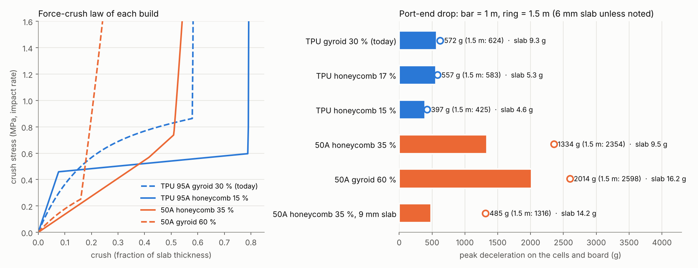</p>

### Switching-loop inductance

[`docs/analysis/2026-11-06-loop-area/`](docs/analysis/2026-11-06-loop-area/README.md). A 3D partial-inductance solve on the hand-routed board's real copper for every hot loop (the four BQ25756 half-bridge legs, the two 5 V bucks, the 3V3 buck) and the eight gate-drive loops, with ringing estimates.

- **Hot loops:** 0.53 to 0.66 nH on the BQ25756 legs, 0.54 and 0.60 nH on the 5 V bucks, 1.39 nH on the 3V3 buck. The 0402 capacitor next to each FET carries 58 to 68 % of the edge current.
- **Ringing:** the BQ25756 switch nodes ring at about 395 to 425 MHz with an expected peak of 18.8 to 22.4 V; the worst-case bound with an instant edge is 32 to 33 V against the FETs' 40 V rating.
- **Gate loops:** 2.9 to 9.2 nH. The tightest margin is the low-side Miller bounce, about 0.46 V against a 1.1 V minimum threshold.
- **No loop needs a fix.** Two optional tweaks are listed in the study. These numbers are for the hand-routed board.
- **Script-built board:** the same solver steered and checked the new layout ([`groundup/compare/`](hardware/Production/groundup/compare/README.md)). Its four charger hot loops are 0.50 to 0.56 nH, the three small bucks 0.30 to 1.22 nH, and the eight gate loops 3.3 to 8.0 nH, 44 nH in sum. That comparison re-solved the hand-routed board with its own ground setting and got 0.54 to 0.67 nH, 0.53 to 1.40 nH and 49 nH in sum, so compare within one run, not across the two. The ringing estimates were not redone for the script-built board.

<p align="center">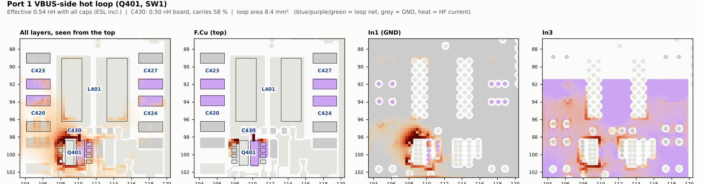</p>

### Reviews

Board and enclosure reviews are in [`docs/reviews/`](docs/reviews/README.md), with a table of the whole review history. The board-layout reviews are history: they reviewed the hand-routed layout, and the script-built board has had no review by a person yet. The routed-board review of 2026-10-30 has the copper resistance of every power path and the current-sense tap checks of that layout (its fix list was closed in the later revisions that day), and its solver tools are the ones the script-built layout was checked with. The schematic findings of the reviews apply to both layouts. The mouth-band review (2026-10-31) and the rail-retention review (2026-11-03) are the enclosure decisions behind the thick cup mouth and the cup-carried drop loads.

## Firmware

`firmware/` targets the CC2340R5MODA with TI's SimpleLink Low Power F3 SDK. Until a board exists it runs on the LP-EM-CC2340R53 LaunchPad, which has the same silicon and memory. The firmware has not changed since 2026-10-29.

- **Toolchain:** TI Arm Clang 5.1.1.LTS, SysConfig 1.26.4 and `gmake` from Code Composer Studio 21.0.1, the LPF3 SDK 9.23.00.27, and UniFlash 9.7.0 / DSLite with an XDS110 probe. Everything is driven from a `Makefile`; install steps and version pins are in [`firmware/README.md`](firmware/README.md).
- **Structure:** `boards/<board>.syscfg` holds the pin map and CCFG per target (P0's is still to write); SysConfig generates the driver configuration into `build/<board>/syscfg/`; `app/` is the application. NoRTOS for bring-up, moving to FreeRTOS when the BLE stack comes in.
- **State:** the skeleton (banner and reset reason on UART, heartbeat LED, a button standing in for the IRQ line) and TI's `basic_ble` (in `ble/`) build and run on the LaunchPad.
- **Planned:** the P0 board file `boards/p0.syscfg`, the TPS25751 patch bundle with a host-side I2C loader (needed before bring-up), SMBus gauge driver, TPS25751 4CC commands, the [charge and thermal policy](docs/firmware/charge-and-thermal-policy.md) with a once-a-second readback of the charger's limits, port power sharing, settings in flash, BLE GATT service, MCUboot signed OTA. The full list is in the spec.

## Repo layout

```
.
├── README.md
├── LICENSE
├── .claude/skills/        Electrical design techniques from this project as skills for AI agents (index: README.md)
├── hardware/
│   ├── Production/        KiCad 10 project "Monolith" (P0): schematic, board, libraries, order notes, generator scripts, the layout tools (groundup/), retired order files
│   ├── mechanical/        Enclosure model (Python → STL/STEP/DXF), print files by material, renders
│   ├── label/             Wrap label for the cup
│   └── DevBoard/          Earlier bench design, never built (reference only)
├── docs/
│   ├── spec.md            The current design spec: the single source of truth
│   ├── analysis/          Model studies: thermal, three drop models, bumper materials, switching loops, inner copper
│   ├── reviews/           Board and enclosure reviews with figures, and the review history
│   ├── hardware/          Schematic and layer PDFs, renders and board plots exported from KiCad
│   ├── production/        P0 assembly (the cup), spot welding, bring-up and gauge training
│   ├── firmware/          Charge and thermal policy, TPS25751 EEPROM programming
│   ├── mechanical-design.md
│   ├── viewer/            Interactive 3D viewer of the pack (one HTML file)
│   ├── devboard/          Bench design record (reviews 1–4, budgets, simulations), history
│   └── archive/           Superseded notes, kept for history
├── firmware/              CC2340 firmware: Makefile, boards/*.syscfg, app/, ble/
├── ordering/              Parts tracker for the first five packs (CSV is the source, README is generated)
├── datasheets/            Manufacturer datasheets and app notes (README.md is the index)
├── reports/               Research reports (potting and drop protection; the 2026-10-21 enclosure concept study that led to the cup)
├── research_notes/        Working notes and models: pack thermal model (BAK 65E), loss reduction, protection FETs, enclosure concepts
└── tools/                 fetch_datasheets.sh
```
