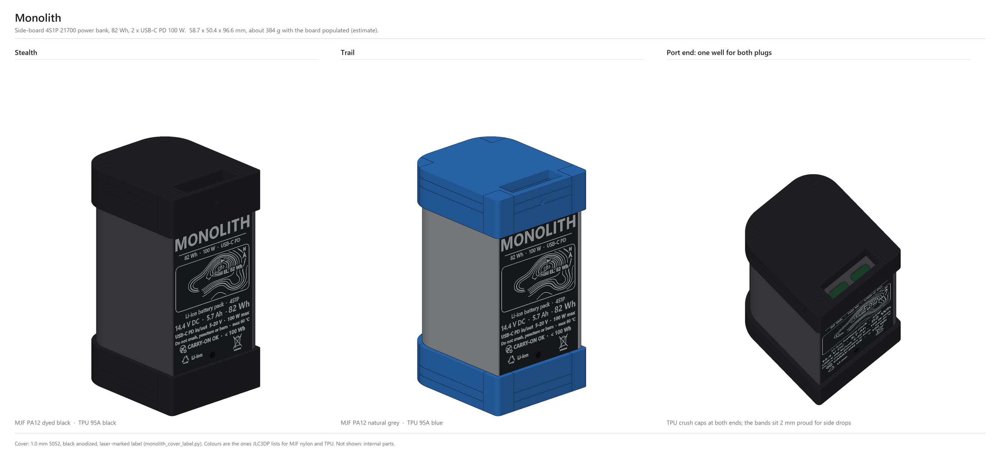
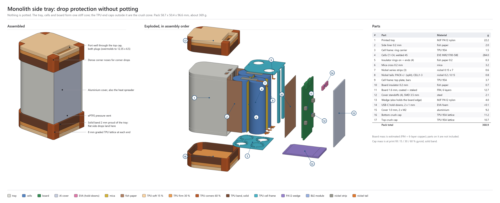
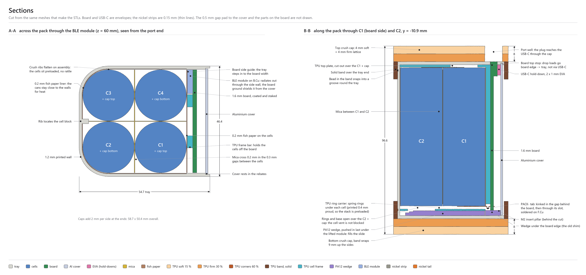
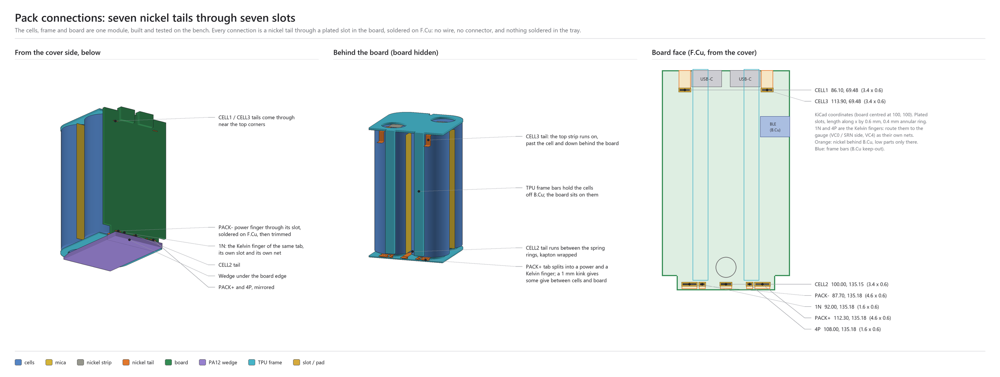
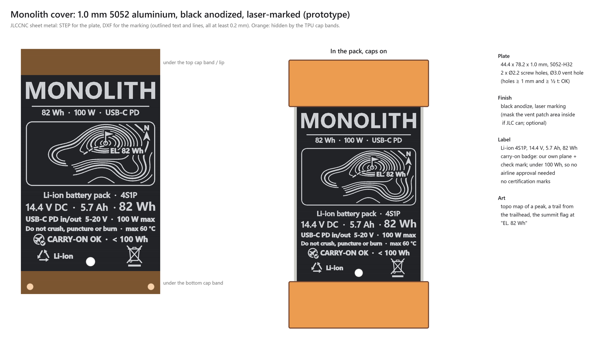
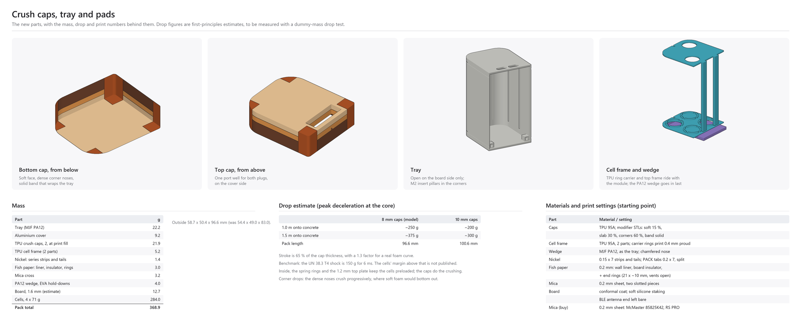
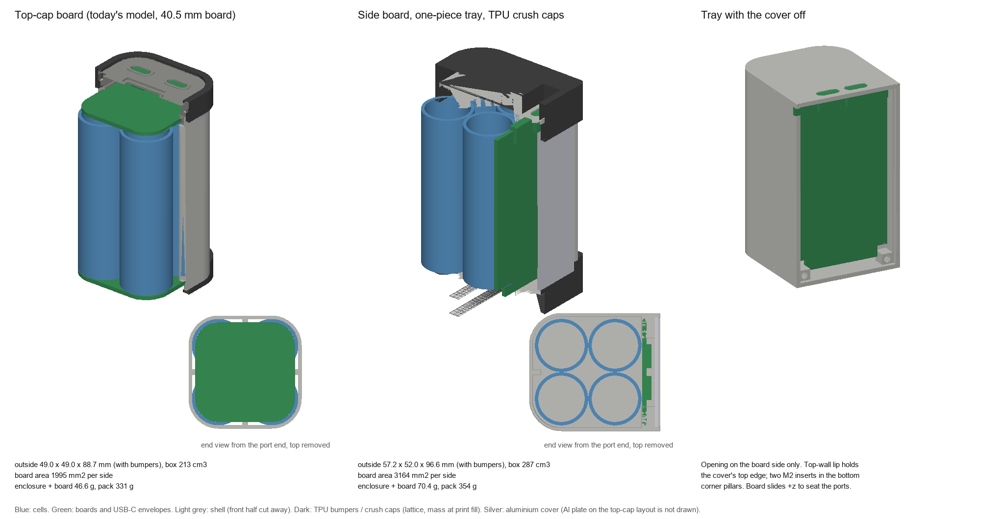
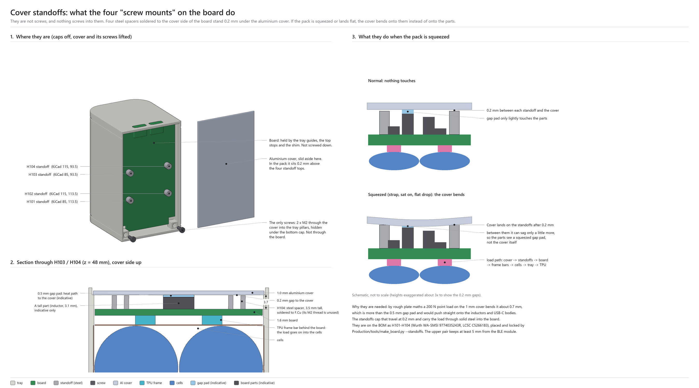

# Monolith battery bank

An ultralight 100 W USB-C battery bank for backpacking. Four EVE INR21700-58E cells sit in a one-piece MJF nylon tray, with TPU crush caps and a laser-marked aluminium cover that is also the heatsink. It has two USB-C PD ports and Bluetooth.

| | |
|---|---|
| **Energy** | 82 Wh: 4S1P, 14.4 V, 5.7 Ah. Under the 100 Wh carry-on limit. |
| **Power** | 2 × USB-C PD in/out, 100 W max |
| **Size** | 58.7 × 50.4 × 96.6 mm with the caps |
| **Mass** | about 376 g (estimate: 361 g modelled, plus the board's parts) |
| **Build** | MJF PA12 tray and TPU 95A caps (JLC3DP), 1.0 mm 5052 cover, black anodized and laser-marked (JLCCNC) |
| **Drop** | No potting. 8 mm TPU crush caps outside a stiff core ([report](reports/Battery%20pack%20potting%20and%20drop%20protection.md)) |

**Status (2026-10-18):** nothing has been built, test-fitted or bench-tested yet.
- **Production P0** (`Production/`) is the first build; the dev board is skipped.
    - The schematic is the dev board's rev A8 with the production changes.
    - The side-board outline is set, and layout is in progress.
    - Start with [`Production/README.md`](Production/README.md).
- **Mechanical** (`mechanical/`): the side-tray design is modelled, with drop, thermal, vibration and assembly checks. See [Mechanical design](#mechanical-design) below.
- **Firmware** (`firmware/`): a bring-up skeleton for the LP-EM-CC2340R53 LaunchPad, not built yet.
    - It targets TI's LPF3 SDK (SysConfig, TI Arm Clang, XDS110 debugger).
    - Install steps are in [`firmware/README.md`](firmware/README.md).
- **Dev board** (`DevBoard/`): the bench version of the electronics. It stays as the reference for P0 and won't be built.

## The design in pictures

<table>
<tr>
<td width="50%"> <b>Exploded view and parts list.</b> Everything goes in through the open side, then the caps go on.</td>
<td width="50%"> <b>Sections.</b> A-A passes through the BLE module on B.Cu, and B-B along C1 and C2: crush caps, pads, vent cut-outs, board stops.</td>
</tr>
<tr>
<td width="50%"> <b>Pack connections.</b> The PACK± strips wrap under the board's bottom edge, the CELL1–3 sense wires run through plated holes, and KiCad positions are given.</td>
<td width="50%"> <b>Cover.</b> 1.0 mm anodized 5052 with a laser-marked label, our own carry-on badge and a topo-map trail graphic.</td>
</tr>
<tr>
<td width="50%"> <b>Parts, mass and drop estimate.</b> Cap print zones, the tray, the floor spacer and EVA pads, and the print settings.</td>
<td width="50%"> <b>Layout comparison.</b> The original top-cap tube against the side-board tray.</td>
</tr>
<tr>
<td width="50%"> <b>Assembly.</b> The cell module is built on the bench, then the tray, then the board over five leads, then the cover and caps. See <a href="docs/production/p0-assembly.md">p0-assembly.md</a>.</td>
<td width="50%"> <b>Cover standoffs.</b> Four steel spacers on the board carry crush loads off the parts. The two real screws are shown alongside.</td>
</tr>
</table>

All of these come from the Python models in `mechanical/`. Re-run the scripts after changing a parameter (see [Mechanical design](#mechanical-design)).

## Contents

- `Production/` is the production P0 KiCad 10 project: start with [`Production/README.md`](Production/README.md).
- `firmware/` holds the MCU firmware (CC2340, LPF3 SDK, command-line build).
- `DevBoard/` is the dev board's KiCad 10 project.
    - It has its own library, its generator and placement scripts, and a costed BOM (`bom_cost.csv`).
    - Start with [`DevBoard/README.md`](DevBoard/README.md): files, board rules, status and the full change log.
- `docs/devboard/` holds the dev board documents:
    - the circuit description;
    - schematic reviews 1–3;
    - the cost-down list;
    - the power budget and the MCU pin-by-power-state plan (STM32-era, rewrite pending);
    - the CC2340R5MODA pin budget (`cc2340-pin-budget.md`);
    - the bring-up configuration checklist;
    - the LP-EM-CC2340R53 LaunchPad plan (`launchpad-cc2340-plan.md`);
    - changes planned for rev 2.
- `docs/project/` holds project notes: next actions, cell datasheet notes, TPS25751 EEPROM programming.
- `datasheets/` holds the datasheets and app notes the designs were checked against, indexed in `datasheets/sources.csv`.
- `mechanical/` holds the enclosure models (STL, DXF, STEP), the Python scripts that generate them, and the renders above. See [Mechanical design](#mechanical-design).
- `reports/` holds research reports (potting and drop protection), with their sourced notes in `research_notes/`.
- `tools/fetch_datasheets.sh` fetches the datasheets.

## Mechanical design

The original top-cap tube is still in `mechanical/` (`monolith_shell.py`), alongside the current design:

- **Side-board layout (2026-10-18, the current design).** The board runs along one face of the cells, inside a one-piece printed tray whose only opening is the board side.
    - **Closing it:** a recessed 1 mm aluminium cover (also the heat spreader). Its top edge tucks under a lip in the top wall, and two M2 screws go into the bottom corner pillars (thread-forming screws straight into the MJF nylon, or heat-set inserts).
    - **Ports:** the power module (cells, frame and board, joined on the bench) drops in, then lifts 2.5 mm toward the top so the USB-C mating faces pass into their holes in the top wall. A PA12 wedge pushed in under it holds it there.
    - **Venting:** no airflow vents; one ePTFE pressure vent over a hole in the cover.
    - **Drop protection (2026-10-18):** no potting. The basis is `reports/Battery pack potting and drop protection.md`. The tray, cells and board form one stiff core, and TPU end caps outside it are the crush zone.
        - **End caps:** 8 mm of TPU lattice, graded soft-outside and firm-behind. Corner noses are dense. A solid band, 2 mm proud of the tray, wraps 9 mm over each end, so flat side drops land on the bands. The top cap has one port well for both plugs.
        - **Inside (2026-10-21: a printed TPU cell frame replaces all the foam; sheet stock is 0.2 mm mica and 0.2 mm fish paper):**
            - **TPU cell frame, two parts** (`monolith_side_ring_carrier.stl`, `monolith_side_cell_frame_top.stl`). Both ride with the module.
                - **Ring carrier:** a thin base and a slotted spring ring under each cell, printed 0.4 mm proud to preload the stack. It's open over the + caps.
                - **Top frame:** a 1.2 mm top plate (+ cap cut-outs) and two bars down the board side that hold the cells off B.Cu.
                - The floor zone gave up 0.2 mm for the top plate, so the board outline is unchanged.
            - **PA12 wedge** (`monolith_side_wedge.stl`): 2.5 mm under the ring carrier, and up to the board's bottom edge under the board, so it is also the old shim. It goes in last, nose first, and the cover traps it.
            - Fish paper, 0.2 mm, in three places: a liner round the cells (the cans stay close to the walls for heat), a sheet on the cells' board-side face (it also covers the B.Cu parts), and rings on the four + ends (21 mm OD, about 10 mm hole).
            - The frame bars sit behind B.Cu at |y| 6.0–11.2 mm. Keep B.Cu parts out of them (`BCU_FRAME_BARS` on the board DXF) and under 2.3 mm tall elsewhere. `sb_lanes()` now returns the bars, so `make_board.py`'s keep-outs follow.
            - A 0.2 mm mica cross between the cells.
            - Board top stops, so drop loads reach the tray through the board edge rather than the USB-C.
            - 2 x 1 mm EVA hold-downs over the USB-C bodies.
        - **No rupture windows:** removed 2026-10-18. No consumer power bank found has a designed burst point (UL 2056 has no venting requirement), and a printed tray splits anyway. The pad cut-outs stay so the cells' own vents aren't blocked.
        - **Cost of the protection:** the pack is now 58.7 × 50.4 × 96.6 mm, and about 369 g modelled, including the frame, wedge and mica. The estimated peak is about 250 g at 1.0 m and about 375 g at 1.5 m. These are estimates, to be measured.
        - **Unchanged:** the board outline and ports (the tray only widens in the cell zone).
        - **Pack connections (2026-10-21): one power module.** The cells, TPU frame and board are joined on the bench by seven nickel tails through seven plated slots, soldered on F.Cu, and the module is programmed and tested before it goes into the tray. Nothing is soldered in the tray (`monolith_side_tabs.png`, `monolith_side_assembly.png`, `docs/production/p0-assembly.md`).
            - **PACK− and PACK+:** a 0.2 × 7 mm nickel tab on the C1 and C4 bottoms. Near the board it splits into a 4.2 mm power finger and a 1.2 mm Kelvin finger (1N / 4P), each through its own slot, and a 1 mm kink in the gap behind the board gives it some give.
            - **CELL2:** a 3 mm tail off the bottom strip, along the channel between the spring rings (kapton wrapped), into its slot at the bottom edge.
            - **CELL1 and CELL3:** the top strips run on past the cells, outside the frame bars, down the gap behind the board and through slots near the top corners.
            - **On the board DXF:** `TAB_SLOTS` (finished slots, 0.6 mm wide) and `TAB_SLOT_PADS`; `BCU_TAIL_RUNS` marks where nickel runs about 1.1 mm behind B.Cu (low parts only).
            - 1N and 4P are separate nets from the PACK power pads: they carry the gauge's Kelvin sense.
        - **Vibration and trail durability (2026-10-18):**
            - **Cells are preloaded everywhere:**
                - crush ribs on the cell-zone walls flatten 0.25 mm into the liner;
                - the ring carrier prints 0.4 mm taller than its zone, which takes up MJF's ±0.3 mm;
                - the frame bars press the cells against the walls through the liner.
            - **Cover:**
                - It has a 0.3 mm joint all round, because nylon grows about 0.35 mm more than aluminium over 60 K.
                - The joint is sealed with a bead of neutral-cure silicone, which acts as the gasket.
                - Four SMD standoffs (about 3.6 mm, `COVER_STANDOFFS` on the board DXF) carry crush loads instead of the parts.
                - Use M2 thread-forming screws with a nylon patch or a plastic-safe threadlocker.
            - **Caps:**
                - A bead inside each cap band snaps into a 0.3 mm groove round the tray.
                - The top cap has a drain channel from the port well.
            - **Assembly:**
                - Give the PACK strips a small S-bend, and keep their solder joints away from the bend.
                - Weld at the cells.
                - Tack the sense wires in their slots with neutral-cure silicone.
            - **Part heights:** the 7.7 mm bulk cans (C421/C521, C208) didn't fit the 3.2 mm F.Cu height. Fixed in the production schematic on 2026-10-18: every bulk cap is now 3.1 mm or less (`Production/README.md`, *Low-profile bulk*).
        - **BLE antenna:** the CC2340R5MODA goes on B.Cu at the right board edge (+y, the C4 / PACK+ side), antenna end at the edge, centre 19.1 mm below the top edge (KiCad about 116.6, 81.9).
            - That leaves 10 mm of ground above it and 10 mm to the USB-C bodies.
            - The board's ground plane sits between it and the aluminium cover, and it radiates out through the printed side wall. The cover stays whole.
            - To make room for it, the board sits 2.3 mm further from the cells (`SB_BCU_H`); the outline and ports didn't change.
            - `monolith_side_pcb.dxf` shows it on `BLE_MODULE_BCU`.
    - **Board:** 1.6 mm thick (for cost; the pack is 0.8 mm wider than with a 0.8 mm board). The outline is on the production board as well (`Production/tools/make_board.py` imports it from `monolith_shell.py`).
    - **Files:** parts are `monolith_side_*.stl`; the board outline (with corner notches for the pillars) is `monolith_side_pcb.dxf`; the cover's flat pattern is `monolith_side_cover.dxf`.
    - **Running it:** parameters are `SB_*` in `monolith_shell.py`, which also prints the assembly clearance checks. `python monolith_parts.py side` builds only these parts.
- **Home-print kit:** `monolith_print_kit.py` writes `print_kit/`. It holds FDM print-pose STLs of the side tray, fit coupons, the TPU caps with their modifiers, ballastable dummy cells, a dummy board and a cover stand-in. Settings, ballast and assembly are in `print_kit/README.md`. It also needs trimesh and manifold3d.
- `monolith_render.py` renders both layouts side by side to `monolith_layout_compare.png` and prints a size and mass table. It needs numpy, scipy and Pillow.
- `monolith_side_renders.py` renders the side tray's drop design:
    - `monolith_side_exploded.png`: assembled and exploded views;
    - `monolith_side_sections.png`: sections A-A and B-B;
    - `monolith_side_parts.png`: the cap zones, the tray and the pads, plus mass, drop and print-setting tables;
    - `monolith_side_tabs.png`: the nickel strips and sense wires, and the board face with the pad and hole positions;
    - `monolith_side_hero.png`: the assembled pack with its laser-marked label, in two colourways JLC3DP sells (MJF PA12 black or grey, TPU black or blue).
    - `monolith_side_standoffs.png` (`monolith_standoff_detail.py`): what the four cover standoffs H101–H104 do, with a 3D view, a section through two of them, and the squeeze load path, next to the two real cover screws.
    - `monolith_side_assembly.png` (`monolith_assembly_steps.py`): assembly in six steps. The written procedure is [`docs/production/p0-assembly.md`](docs/production/p0-assembly.md).
    - `monolith_side_standoff_zones.png` (`monolith_standoff_zones.py`): where the cover standoffs may go around the current board placement.
- **Cover heatsink and label (prototype):** `monolith_cover_label.py` builds the aluminium cover for JLCCNC sheet metal: 1.0 mm 5052, black anodized, laser-marked.
    - It needs shapely and matplotlib as well, and KiCad 10's `kicad-cli` for the STEP.
    - **Outputs:**
        - `monolith_side_cover.step`: the plate (JLCCNC requires a STEP);
        - `monolith_side_cover_marking.dxf` / `.svg`: the marking as outlined shapes, every line at least 0.2 mm (JLCCNC asks for outlined, double-line text);
        - `monolith_side_cover_preview.png`.
    - **Label:** Li-ion 4S1P, 14.4 V, 5.7 Ah, 82 Wh (from `docs/project/eve-58e-datasheet-notes.md`), the USB-C PD ratings, warnings, the recycling and WEEE symbols, and our own carry-on badge (an airliner in a ring with a check disc, "CARRY-ON OK · < 100 Wh"). It carries no certification marks.
    - **Graphic:** a topo map with a dashed trail from the trailhead to a summit flag at "EL. 82 Wh".
    - The script checks the art stays between the cap bands, clear of the vent, and has no line under 0.2 mm. Ratings are prototype values, to confirm before the final.
- **Cap print zones:** each cap prints as one TPU body. Load the `*_mod_soft` and `*_mod_corner` STLs as slicer modifiers.

## Dev board main parts

- **Gauge and protection:** BQ40Z50-R2 gauge with CHG/DSG FETs and a 1 mΩ shunt. A BQ294700 second-level protector drives a chemical fuse.
- **Each USB-C port:**
    - TPS25751D PD controller with EEPROM;
    - TPD4S201 CC/SBU protection and liquid detection;
    - BQ25756 buck-boost charger with four discrete PGQ04N070 FETs;
    - TPS62933 5 V source.
- **Supply and sleep current:** TPS62177 3.3 V rail, and INA190 amplifiers on a 10 Ω R_MEAS for measuring sleep current.
- **MCU:** TI CC2340R5MODA Bluetooth LE module (rev A7; was the STM32WB1MMC). Its 10 usable GPIOs are all assigned.
- **Board temperature:** no dedicated sensors (rev A8). The gauge reports the four cell NTCs and the protection-FET temperature; each charger's NTC is read through its PD controller. The USB-C connectors are not monitored.

## Known open items

**Dev board:**
- silkscreen pass;
- routing;
- LCSC numbers, stock and price for the rev A7 parts (CC2340R5MODA, RF match);
- antenna match tuning (C314/C315) and a BLE range check on the real board;
- rewrite of the MCU pin-by-power-state plan for the CC2340;
- the U403/U503 footprint library warning;
- ~~production board thickness~~: decided 2026-10-18, 1.6 mm for cost (`Production/README.md`).

Details are in `DevBoard/README.md`, and rev 2 changes in `docs/devboard/rev2-changes.md`.

**Mechanical:**
- a fit print of the tray, caps and board dummy, with real cells;
- a drop test with dummy cells (1.0 and 1.5 m);
- a 100 W thermal run;
- confirm the label ratings before ordering the cover.
