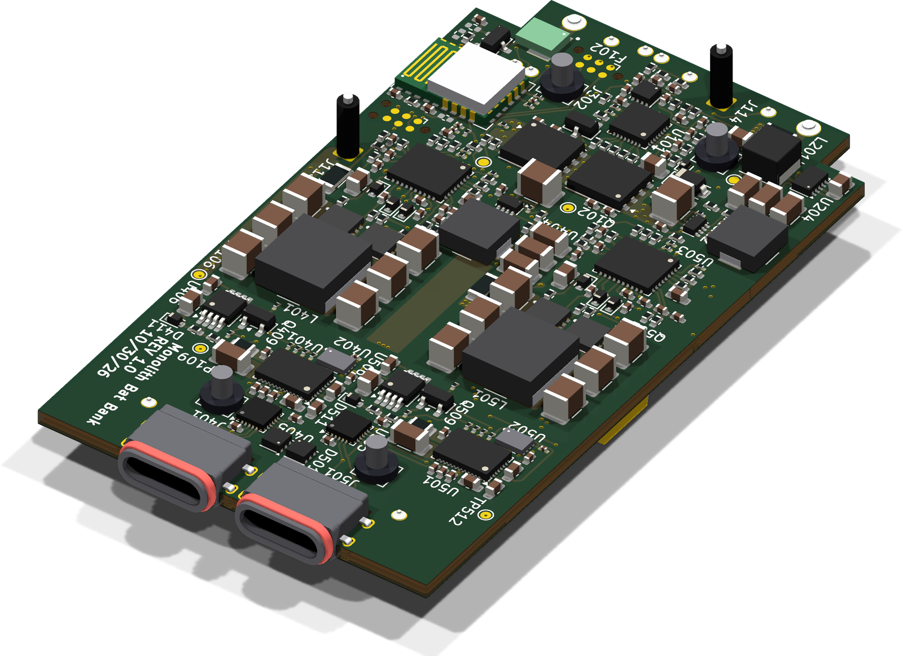
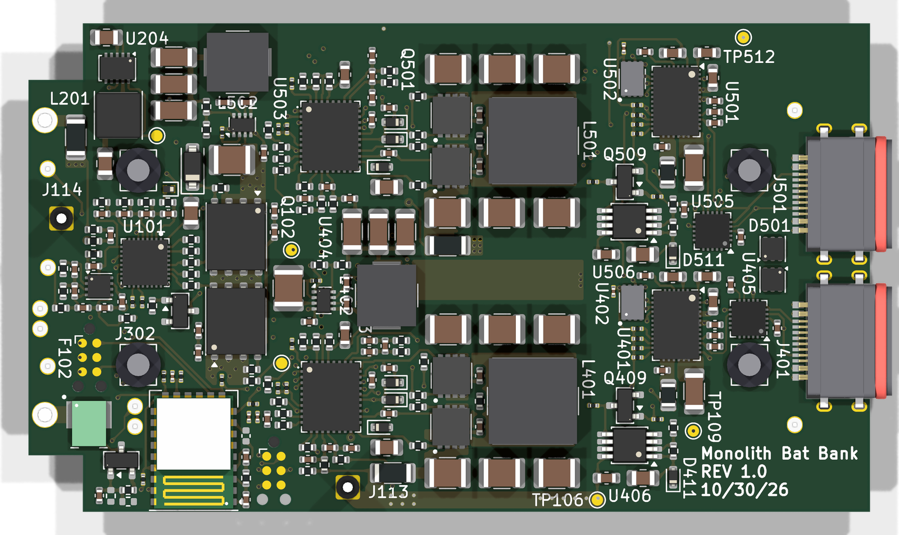
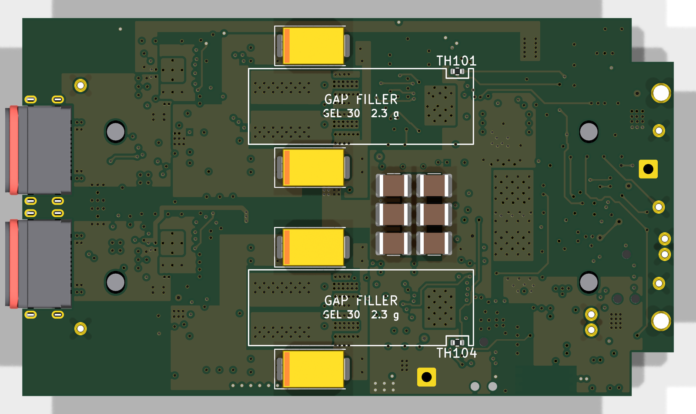
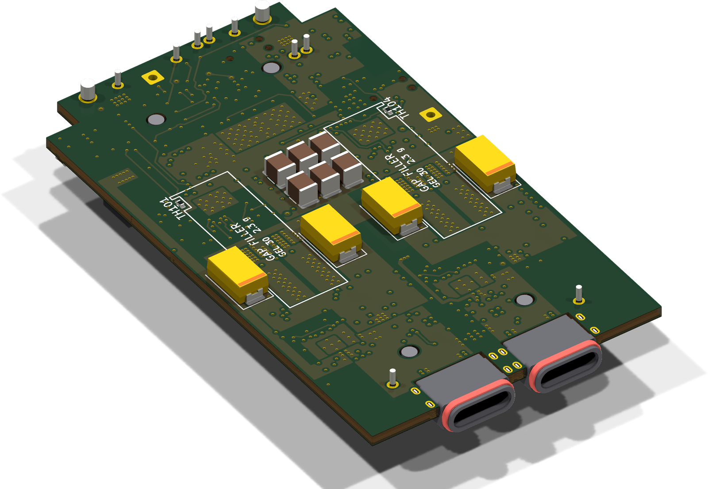
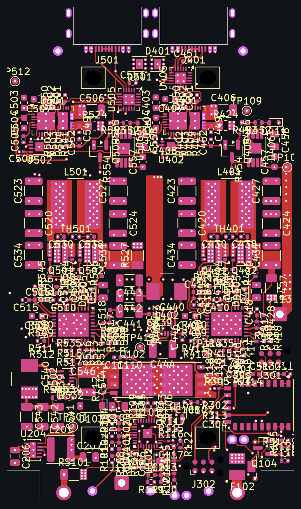
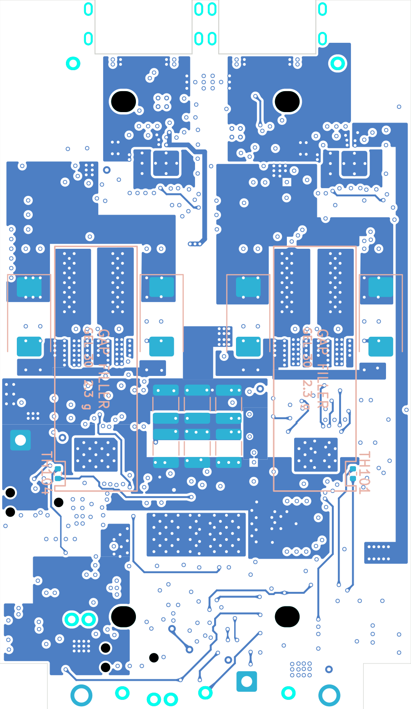
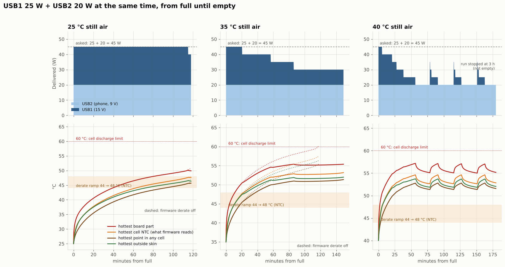
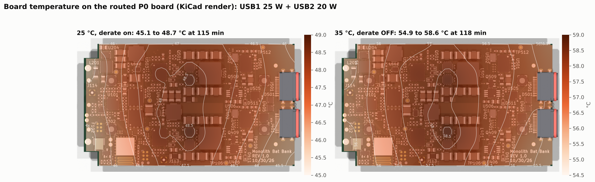
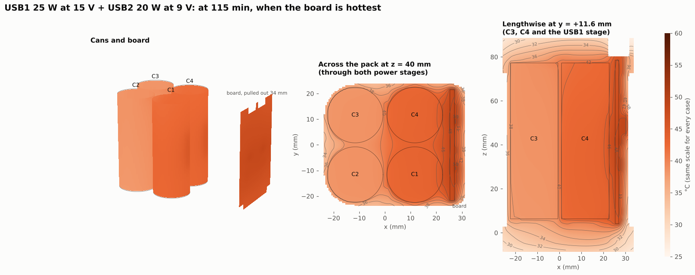

# Monolith

An ultralight 91 Wh USB-C power bank for backpacking: 4S1P 21700 pack, two bidirectional USB-C PD ports designed for 100 W total, TI CC2340 Bluetooth LE MCU.

<p align="center"></p>

## For reviewers: start here

The P0 production board is fully routed and in review (2026-10-30). Nothing has been built yet.

1. **Open the KiCad project:** [`hardware/Production/Monolith.kicad_pro`](hardware/Production/) in **KiCad 10**. The symbol library, footprint library and 3D models are project-local, so it opens with no extra setup. Details are in [The KiCad project](#the-kicad-project) below.
2. **Or look without KiCad:** [schematic PDF](docs/hardware/monolith-p0-schematic.pdf), [all copper layers PDF](docs/hardware/monolith-p0-layers.pdf), and the [board plots](#board-plots) below.
3. **Read the latest review:** [`docs/reviews/2026-10-30-routed-board/`](docs/reviews/2026-10-30-routed-board/README.md) has the open fix list before fab, the copper resistance of every power path, the current-sense tap issue on port 2, and what the routed copper does to the thermal model.
4. **The design rules and the reasons behind them:** [`docs/spec.md`](docs/spec.md) is the single source of truth for every decision (cells, thresholds, enclosure, firmware policy). Where this README and the spec disagree, the spec wins. [`hardware/Production/README.md`](hardware/Production/README.md) is the board's dated change log with the reasoning for each part choice.

**Where the review stands.** The open must-fix items are a port 2 sense-resistor Kelvin tap that makes the BQ25756 read about 1.8× its real current, the CC2340 antenna keep-out on only two layers, and BOM flags on four wire pads. The should-fix items are mainly port 1 PACK_P copper (6.4 mΩ; two B.Cu links take it to 2.3 mΩ). The routed copper adds about 0.63 W at 100 W, which shortens the full-power burst from 5.8 to 4.5 min; temperatures stay within limits because the firmware derates. Fresh eyes are most useful on the power stages (BQ25756 + SiZ240DT half-bridges), the gauge and protection path, and anything that would stop the board working on first power-up.

## Design overview

The goal is a hiking power bank that is lighter and better behaved than the off-the-shelf ones: under the 100 Wh carry-on limit, able to charge or run 20 V USB-C PD loads, with a proper fuel gauge and a phone app. The pack is four BAK N21700CX-65E cells (6.5 Ah, 3.5 V nominal) in 4S1P: 91 Wh typical, spot-welded with pure nickel strip and managed by a TI BQ40Z50-R2 gauge/protector with hardware second-level protection (BQ294700 plus a chemical fuse). Each of the two USB-C ports has its own TPS25751 PD controller and BQ25756 bidirectional buck-boost converter, so either port can charge the pack (including from a 5 V solar panel) or source up to 20 V / 5 A, with the pair thermally limited to 100 W; a TPS62933 buck supplies each port's 5 V source rail and a TPS62177 buck supplies the 3.3 V rail. A CC2340R5MODA Bluetooth LE module runs the charge policy, port power sharing and a custom GATT service for an iPhone app. The electronics live on one 43 × 74 mm 6-layer board along one face of the cells, inside an MJF nylon cup closed on five sides and sealed by a bottom cap with one radial O-ring, with TPU bumpers at both ends. There is no metal enclosure: the power stage sheds its heat into the cells through thermal vias and a gap filler.

| | |
|---|---|
| **Energy** | 91 Wh typical, 88.9 Wh minimum (4S1P, 14.0 V, 6.5 Ah, BAK N21700CX-65E cells), under the 100 Wh carry-on limit |
| **Ports** | 2 × USB-C, each bidirectional PD 5–20 V up to 5 A; 100 W total as a burst, then a linear thermal derate to a sustained ~40 W ([policy](docs/firmware/charge-and-thermal-policy.md)) |
| **Gauge / protection** | BQ40Z50-R2 (Impedance Track, SMBus), Infineon BSC007N04LS6 CHG/DSG FETs, 1 mΩ shunt; BQ294700 + chemical fuse as the independent second level |
| **MCU** | TI CC2340R5MODA (Cortex-M0+ Bluetooth LE module with integrated antenna) |
| **Board** | 43.2 × 74.35 mm, 6 layers, 1.6 mm, 2 oz outer / 0.5 oz inner copper, ENIG, filled and capped vias; JLCPCB assembly of F.Cu, B.Cu parts hand-fitted |
| **Enclosure** | MJF PA12 cup and bottom cap (one radial O-ring), PA12 cell carrier, TPU 95A bumpers; 60.7 × 52.3 × 95.9 mm, about 394.1 g (modelled) |
| **Tools** | KiCad 10 with Python scripts, TI SimpleLink Low Power F3 SDK, Xcode (app on the `app` branch) |

## Status

Nothing has been built, assembled or bench-tested yet; every number in this repo is a design value, not a measurement.

**Done**

- **P0 schematic:** 283 parts, 6 sheets. Derived by script from an earlier bench design that went through four schematic reviews, with a netlist check that every surviving pin kept its net. Loss cuts, the BAK 65E cell change and the cup changes are in.
- **P0 layout:** placed (2026-10-28, with a placement review), fully routed (2026-10-30, 0 unconnected), first routed review done and its schematic bugs fixed (TPD6S300 CC1 on GND, the 9 V gate-drive enable). Second routed review: [`docs/reviews/2026-10-30-routed-board/`](docs/reviews/2026-10-30-routed-board/README.md).
- **Mechanical:** parametric cup enclosure with drop, thermal-expansion, vibration and assembly-clearance checks, STL/STEP/DXF outputs and renders ([`docs/mechanical-design.md`](docs/mechanical-design.md)); mechanical review fixes applied 2026-10-24; vent removed 2026-10-28 (vacuum-jar leak test instead).
- **Thermal and loss models:** a 3-D model of the BAK 65E pack in the cup with the firmware policy in the loop ([`research_notes/Pack thermal BAK 65E/`](research_notes/Pack%20thermal%20BAK%2065E/README.md)), now including the routed copper losses, and a loss-reduction study ([summary](research_notes/Loss%20reduction/summary.md)) whose four cuts were adopted.
- **Cells and pack build:** BAK N21700CX-65E, BSC007N04LS6 protection FETs sized for its short-circuit current ([options](research_notes/protection-fets/options.md)), P20B spot welding with 0.2 × 10 mm pure nickel and wire PACK tails ([welding](docs/production/spot-welding.md), [assembly](docs/production/p0-assembly.md)), Parker GEL 30 gap filler, front-cell NTCs as SMD parts on the board under the gap filler (TH101 / TH104).
- **Firmware policy:** charge current and discharge power as linear ramps on the hottest cell temperature ([policy](docs/firmware/charge-and-thermal-policy.md)); a LaunchPad build of the firmware skeleton and TI's `basic_ble` runs.

**Remaining**

- Close the routed-board review items and get DRC clean; order P0 from JLCPCB.
- Weld the pack, bring up the board and train the gauge ([`docs/production/p0-bringup-and-training.md`](docs/production/p0-bringup-and-training.md)).
- Firmware beyond the skeleton: gauge and PD-controller drivers, charge policy, power sharing, BLE GATT, MCUboot OTA.
- Fit print of the cup, cap and carrier; drop and 100 W thermal tests; label ratings.
- iPhone app (SwiftUI + CoreBluetooth).

## Hardware

### The KiCad project

Everything for the board is in [`hardware/Production/`](hardware/Production/), KiCad 10:

| File | What it is |
|---|---|
| `Monolith.kicad_pro` | The project; open this |
| `Monolith.kicad_pcb` | The routed 6-layer board |
| `Monolith.kicad_sch` | Root sheet. Sub-sheets: `gauge.kicad_sch` (Cells and Gauge), `power.kicad_sch` (3V3 Rail), `mcu.kicad_sch` (MCU), and `usb_port.kicad_sch` used twice (USB Port 1, USB Port 2) |
| `MonolithDev.kicad_sym`, `MonolithDev.pretty/`, `3dmodels/` | Project-local symbol library, footprints and STEP models (wired up by `sym-lib-table` / `fp-lib-table`) |
| `Monolith.kicad_dru` | Custom DRC rules (net-class clearances, keep-outs) |
| `tools/` | Python scripts that generated the schematic, stack-up, outline and mechanical keep-outs from the enclosure model ([table](hardware/Production/README.md#tools)) |
| `README.md` | Dated change log: every part choice and change with its reasoning |

The board outline, peg holes, wire holes and keep-outs come from the enclosure model (`hardware/mechanical/monolith_shell.py`) through `tools/make_board.py`, so mechanical changes go there first. Reference designators follow the sheets: 1xx cells and gauge, 2xx 3V3 rail, 3xx MCU, 4xx port 1, 5xx port 2.

### Schematics, renders and plots

- [`docs/hardware/monolith-p0-schematic.pdf`](docs/hardware/monolith-p0-schematic.pdf): all six sheets (2026-10-30).
- [`docs/hardware/monolith-p0-layers.pdf`](docs/hardware/monolith-p0-layers.pdf): front and back (copper, mask, silk), then every copper layer (F.Cu, In1–In4, B.Cu), one page each, from the approved board (master 50c5625).
- A 3-D STEP of the whole assembly can be generated with `hardware/mechanical/monolith_step.py`.

#### The approved P0 board

Raytraced in KiCad 10 (`kicad-cli pcb render`, all 3-D models) from the board as approved on 2026-10-30 (master 50c5625):

<p align="center"><a href="docs/hardware/monolith-p0-render-iso-top.png"></a></p>

| Top (F.Cu side, faces the cup wall) | Bottom (B.Cu side, faces the cells) |
|---|---|
| [](docs/hardware/monolith-p0-render-top.png) | [](docs/hardware/monolith-p0-render-bottom.png) |

<p align="center"><a href="docs/hardware/monolith-p0-render-iso-bottom.png"></a></p>

#### Board plots

| Front (F.Cu, mask, silk) | Back (B.Cu, mask, silk, mirrored) |
|---|---|
| [](docs/hardware/monolith-p0-board-front.png) | [](docs/hardware/monolith-p0-board-back.png) |

The USB-C ports are at the top edge of the plots (the right edge of the flat renders), the cell wire holes (PACK−, PACK+ and the Kelvin senses) at the bottom tab, and the two power stages fill the middle: USB1's stage (L401) toward +y and USB2's (L501) toward −y. The bare copper boxes on the back are the gap-filler pads that couple the stages to the cells.

### Per port

- TPS25751D USB-C PD controller, configured from its own M24512 EEPROM (patch-bundle programming notes in [`docs/firmware/tps25751-eeprom-programming.md`](docs/firmware/tps25751-eeprom-programming.md)).
- BQ25756 bidirectional buck-boost, 5 mΩ sense resistors, two SiZ240DT 40 V half-bridges, Coilcraft XGL7030-332 3.3 µH at 500 kHz, and a 9 V gate-drive LDO (TPS7A4101), off by default and enabled through the TPS25751's GPIO6 when the pack is above 10 V. Gate resistors fitted as 0 Ω links with DNP RC snubbers so ringing can be fixed without a respin.
- TPS62933 5 V buck for the port's 5 V source rail; TPD6S300 CC protection (24 V short-to-VBUS, IEC ESD); TVS2200 flat clamp on VBUS.
- Shou Han IP68 right-angle USB-C receptacle, 5 A / 20 V.

### Pack and supervision

- BQ40Z50-R2 with four cell NTCs (the two front ones are SMD parts on the board, TH101 / TH104; the back two are wired to their cans), cell balancing and JEITA; BSC007N04LS6 CHG/DSG FETs; 1 mΩ shunt; BQ294700 per-cell OVP that fires the WSFB1514 chemical fuse independently of the gauge.
- One wire-ORed interrupt line (both PD controllers, gauge BTP) into the MCU; CHG_INH pulled up so a reset, hang or unprogrammed MCU stops charging.
- Idle current about 400 µA (estimate, [budget](docs/devboard/power-budget.md)), with a gauge ship mode for storage.

Datasheets and app notes the design was checked against are in `datasheets/`: [`datasheets/README.md`](datasheets/README.md) maps each file to its part.

### Earlier bench design

`hardware/DevBoard/` and `docs/devboard/` hold the bench "dev board" (rev A8) that P0 was derived from: its four schematic reviews, circuit description and budgets. It was never ordered (P0 is the first build since 2026-10-18) and is kept only as the reviewed reference and history.

## Analysis

Model studies of the whole pack, each in its own folder under [`docs/analysis/`](docs/analysis/) with the scripts, the numbers as JSON and every figure. They use the approved P0 board and the current cup (master 50c5625, including the mechanical polish of PR #46 and #47). Every number is a model value until the bench tests.

### Thermal: USB1 at 25 W and USB2 at 20 W together

[`docs/analysis/2026-10-31-thermal-25w-20w/`](docs/analysis/2026-10-31-thermal-25w-20w/README.md). Both ports deliver from full to empty (45 W, USB1 at 15 V, USB2 at 9 V) in the 3-D pack model with the routed-board copper losses and the firmware derate in the loop.

- **At 25 °C** the pack runs the whole battery at 45 W (118 min, 88.4 Wh) and cuts to 40 W only for the last 3 minutes. The hottest board part peaks at 51 °C, the hottest point in any cell at 45.7 °C, the outside at 46.6 °C.
- **At 35 °C** the derate starts at 20 min and settles at 30 W (USB1 down to 10 W, USB2 kept at 20 W); the hottest part reaches 56 °C and the cells 51 °C. At 40 °C USB1 is cut to 0 W for most of the run.
- **Heat** at 45 W is 2.4 W: 0.8 W in the USB1 stage, 1.0 W in the USB2 stage, 0.5 W in the cells. The 6-layer board keeps itself within 3.6 K end to end.
- Even with the derate switched off at 35 °C (a firmware failure) the cells stop at 55.4 °C, under their 60 °C discharge limit.

<p align="center"></p>
<p align="center"></p>
<p align="center"></p>

### Drop: 1 m onto concrete, six poses

[`docs/analysis/2026-10-31-drop-1m/`](docs/analysis/2026-10-31-drop-1m/README.md). Flat on each end, flat on the board face, flat on a narrow side, and on a corner at each end, at 4.43 m/s (3.84 J), with the bumpers' crush, a finite-element model of the cup and its contents, and a plate model of the routed board.

| Pose | Peak g on cells and board | Bumper crush | Worst issue |
|---|---|---|---|
| Flat on the port end | 2685 g | 4.8 of 6 mm | the 20 % gyroid slab bottoms out (272 g at 0.75 m) |
| Flat on the cap end | 1222 g | 2.2 mm | slab bottoms out, the pad and posts catch it |
| Flat on the board face | 2405 g | 0.4 mm | board bows 0.68 mm, 0.02 mm left over L401 / L501 |
| Flat on a narrow side | 3321 g | 0.5 mm | M2 screw heads 0.3 mm proud of the bumper hit first |
| Corner, port end | 2432 g | 5.1 mm | local stress in the cup under the corner |
| Corner, cap end | 1535 g | 2.7 mm | local stress in the cup and cap under the corner |

Three fixes came out of it and are now in the model: the bumper slabs at **30 % gyroid** (port end 2685 → 569 g), the two M2 heads **counterbored 0.8 mm** into the cup mouth so they sit below the bumper band, and **0.5 mm pockets in the board-face wall** over the two inductors (0.51 mm left after the board's bow, was 0.02 mm). The rerun is in the analysis README.

<p align="center"></p>
<p align="center"></p>
<p align="center"></p>

## Firmware

`firmware/` targets the CC2340R5MODA with TI's SimpleLink Low Power F3 SDK. Until a board exists it runs on the LP-EM-CC2340R53 LaunchPad, which has the same silicon and memory.

- **Toolchain:** TI Arm Clang, SysConfig and `gmake` from Code Composer Studio 21, the LPF3 SDK 9.23, and UniFlash/DSLite with an XDS110 probe. Everything is driven from a `Makefile`; install steps and version pins are in [`firmware/README.md`](firmware/README.md).
- **Structure:** `boards/<board>.syscfg` holds the pin map and CCFG per target (P0's is still to write); SysConfig generates the driver configuration into `build/<board>/syscfg/`; `app/` is the application. NoRTOS for bring-up, moving to FreeRTOS when the BLE stack comes in.
- **State:** the skeleton (banner and reset reason on UART, heartbeat LED, a button standing in for the IRQ line) and TI's `basic_ble` (in `ble/`) build and run on the LaunchPad.
- **Planned:** SMBus gauge driver, TPS25751 4CC commands and EEPROM patch loading, the [charge and thermal policy](docs/firmware/charge-and-thermal-policy.md), port power sharing, settings in flash, BLE GATT service, MCUboot signed OTA.

## Repo layout

```
.
├── README.md
├── LICENSE
├── hardware/
│   ├── Production/        KiCad 10 project "Monolith" (P0): schematic, routed board, libraries, generator scripts
│   ├── mechanical/        Enclosure models (Python → STL/STEP/DXF) and renders for the cup
│   ├── label/             Wrap label for the cup
│   └── DevBoard/          Earlier bench design, never built (reference only)
├── docs/
│   ├── spec.md            The current design spec: the single source of truth
│   ├── reviews/           Board reviews with figures (latest: 2026-10-30-routed-board/)
│   ├── analysis/          Whole-pack model studies: thermal at 25 W + 20 W, 1 m drop
│   ├── hardware/          Schematic and layer PDFs and board plots exported from KiCad
│   ├── production/        P0 assembly (the cup), spot welding, bring-up and gauge training
│   ├── firmware/          Charge and thermal policy, TPS25751 EEPROM programming
│   ├── mechanical-design.md
│   ├── devboard/          Bench design record (reviews 1–4, budgets, simulations), history
│   └── archive/           Superseded notes, kept for history
├── firmware/              CC2340 firmware: Makefile, boards/*.syscfg, app/, ble/
├── datasheets/            Manufacturer datasheets and app notes (README.md is the index)
├── reports/               Research reports (potting and drop protection; ground-up mechanical design)
├── research_notes/        Working notes and models: thermal (BAK 65E), loss reduction, protection FETs, mechanical concepts
└── tools/                 fetch_datasheets.sh
```
