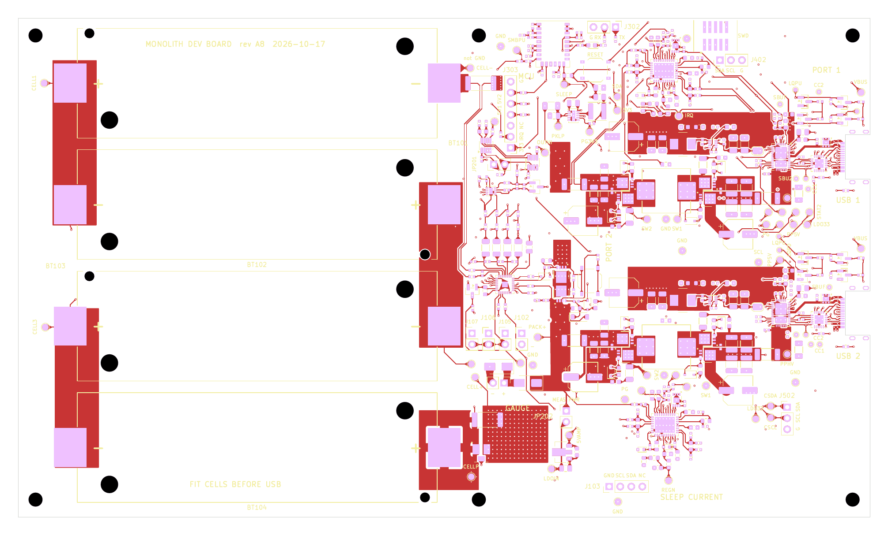
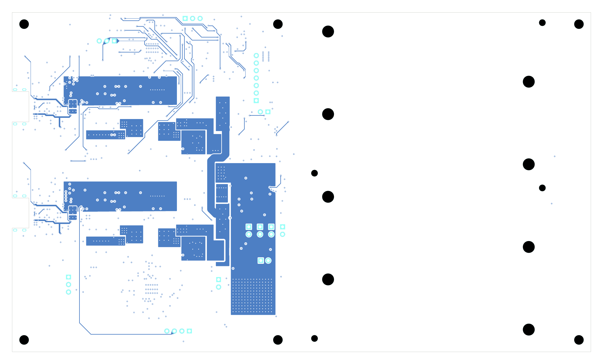

# Monolith

An ultralight 91 Wh USB-C power bank for backpacking: 4S1P 21700 pack, two bidirectional USB-C PD ports designed for 100 W total, TI CC2340 Bluetooth LE MCU.

<p align="center"></p>

## Design overview

The goal is a hiking power bank that is lighter and better behaved than the off-the-shelf ones: under the 100 Wh carry-on limit, able to charge or run 20 V USB-C PD loads, with a proper fuel gauge and a phone app. The pack is four BAK N21700CX-65E cells (6.5 Ah, 3.5 V nominal) in 4S1P: 91 Wh typical, spot-welded with pure nickel strip and managed by a TI BQ40Z50-R2 gauge/protector with hardware second-level protection (BQ294700 plus a chemical fuse). Each of the two USB-C ports has its own TPS25751 PD controller and BQ25756 bidirectional buck-boost converter, so either port can charge the pack (including from a 5 V solar panel) or source up to 20 V / 5 A, with the pair thermally limited to 100 W; a TPS62933 buck supplies each port's 5 V source rail and a TPS62177 buck supplies the 3.3 V rail. A CC2340R5MODA Bluetooth LE module runs the charge policy, port power sharing and a custom GATT service for an iPhone app. The electronics live on one 43 × 74 mm 6-layer board along one face of the cells, inside an MJF nylon cup closed on five sides and sealed by a bottom cap with one radial O-ring, with TPU bumpers at both ends. There is no metal enclosure: the power stage sheds its heat into the cells through thermal vias and a gap filler.

| | |
|---|---|
| **Energy** | 91 Wh typical, 88.9 Wh minimum (4S1P, 14.0 V, 6.5 Ah, BAK N21700CX-65E cells), under the 100 Wh carry-on limit |
| **Ports** | 2 × USB-C, each bidirectional PD 5–20 V up to 5 A; 100 W total as a burst, then a linear thermal derate to a sustained ~40 W ([policy](docs/firmware/charge-and-thermal-policy.md)) |
| **Gauge / protection** | BQ40Z50-R2 (Impedance Track, SMBus), Infineon BSC007N04LS6 CHG/DSG FETs, 1 mΩ shunt; BQ294700 + chemical fuse as the independent second level |
| **MCU** | TI CC2340R5MODA (Cortex-M0+ Bluetooth LE module with integrated antenna) |
| **Board** | 43.2 × 74.35 mm, 6 layers, 1.6 mm, 2 oz outer copper, ENIG, filled and capped vias; JLCPCB assembly |
| **Enclosure** | MJF PA12 cup and bottom cap (one radial O-ring), PA12 cell carrier, TPU 95A bumpers; 61.9 × 53.8 × 98.5 mm, about 389 g (modelled, after the 2026-10-24 review fixes) |
| **Tools** | KiCad 10 with Python scripts, TI SimpleLink Low Power F3 SDK, Xcode (app on the `app` branch) |

## Status

In progress. Nothing has been built, assembled or bench-tested yet; every number above is a design value, not a measurement.

**Done**

- Schematic: four reviews of the bench "dev board" schematic (rev A8, about 430 parts), then the production P0 schematic derived from it by script (283 parts) with a netlist check that every surviving pin kept its net. Design notes, reviews and simulations are in `docs/devboard/` and `hardware/Production/README.md`.
- Dev board layout: 196 × 115 mm, 6 layers, routed, DRC clean apart from known footprint-library warnings, JLC fab outputs generated (`hardware/DevBoard/fab/`). It was not ordered: the decision on 2026-10-18 was to skip it and build P0 directly.
- Production board: stack-up, outline and USB-C placement locked to the enclosure model (`hardware/Production/tools/make_board.py` imports the outline from `hardware/mechanical/monolith_shell.py`). Placement is in progress on the `Production` branch, which is where the live board is.
- Mechanical: parametric enclosure model with drop, thermal-expansion, vibration and assembly-clearance checks, STL/STEP/DXF outputs and renders (`docs/mechanical-design.md`). On 2026-10-21 a ground-up study (five concepts, cross-examined) replaced the side tray and its aluminium cover with the heatsink-free cup ([report](reports/Ground-up%20mechanical%20design.md), models in `research_notes/Ground-up mechanical concepts/`).
- Firmware: a command-line build for the LP-EM-CC2340R53 LaunchPad that compiles with no warnings (about 10 KB flash) and runs on the LaunchPad: Day 1 and plan tests T1, T3, T5 and T6 (TI's `basic_ble`) passed on 2026-10-20 ([plan](docs/devboard/launchpad-cc2340-plan.md)).
- Research: potting versus crush-zone drop protection, with sources (`reports/`).
- Thermal and loss models: a 3-D model of the BAK 65E pack in the cup with the policy in the loop ([`research_notes/Pack thermal BAK 65E/`](research_notes/Pack%20thermal%20BAK%2065E/README.md)), the earlier lumped models (`research_notes/Ground-up mechanical concepts/model/`), and a five-area loss-reduction study ([summary](research_notes/Loss%20reduction/summary.md)). All four P0 loss cuts were adopted on 2026-10-23.
- Cell choice: BAK N21700CX-65E 6500 mAh (2026-10-23), replacing the FEB 21700G, which had replaced the EVE 58E. The charge limit is register-only (R413/R513 = 0 Ω) with firmware readback and a 5 A gauge backstop.
- Protection FETs for the 65E's short-circuit current: BSC007N04LS6 ([options](research_notes/protection-fets/options.md)).
- Pack build: AWithZ P20B spot welding with 0.2 × 10 mm pure nickel, and wire PACK tails ([welding](docs/production/spot-welding.md), [assembly](docs/production/p0-assembly.md)); Parker GEL 30 gap filler; front-cell NTCs as SMD parts on the board under the gap filler (TH101 / TH104, 2026-10-28), in place of wired beads on the cans.
- Charge and thermal policy for firmware: charge current and discharge power as linear ramps on the hottest cell temperature ([policy](docs/firmware/charge-and-thermal-policy.md)).
- One spec: [`docs/spec.md`](docs/spec.md) collects every current decision; superseded notes are in [`docs/archive/`](docs/archive/README.md).

**Remaining**

- Place and route the production board on the `Production` branch; apply the 65E, cup and loss-cut changes from the spec's P0 checklist; DRC.
- Order P0 from JLCPCB, weld the pack, train the gauge (`docs/production/p0-bringup-and-training.md`).
- Firmware beyond the skeleton: gauge and PD-controller drivers, charge policy, power sharing, BLE GATT, MCUboot OTA.
- Fit print of the cup, cap and carrier, and an O-ring dunk coupon; drop and 100 W thermal tests; label ratings.
- iPhone app (SwiftUI + CoreBluetooth).

The current design, decisions and the working checklist are in [`docs/spec.md`](docs/spec.md), the single source of truth for the project. Where this README and the spec disagree, the spec wins.

## Hardware

The KiCad 10 sources are in `hardware/`, with the production board as the design of record and the dev board kept as the reviewed reference it was derived from.

| Project | Path | What it is |
|---|---|---|
| **Production P0** | [`hardware/Production/`](hardware/Production/) | First board to be built. The live board is on the `Production` branch; `master`'s copy lags behind it. The dev-board schematic with the bench-only parts removed, JLC extended/0201 passives, SiZ240DT half-bridge FETs, low-profile bulk capacitors, Tag-Connect SWD and gauge-training pads. Generated and checked by the scripts in `tools/`. [README](hardware/Production/README.md) has every change with its reasoning. |
| **Dev board** | [`hardware/DevBoard/`](hardware/DevBoard/) | Bench version with cell holders, test points, jumpers and a sleep-current measurement section. Routed and fab-ready, not ordered. [README](hardware/DevBoard/README.md) is the change log (items 1–50) and board rules. |
| **Mechanical** | [`hardware/mechanical/`](hardware/mechanical/) | Python-generated enclosure (the cup: `monolith_cup.py`; the retired tube and side-tray outputs were removed on 2026-10-29 and are in git history) as STL/STEP/DXF, plus the renders. Notes in [`docs/mechanical-design.md`](docs/mechanical-design.md). |

**Schematics (PDF)**

- [`docs/hardware/monolith-p0-schematic.pdf`](docs/hardware/monolith-p0-schematic.pdf): production P0, 6 sheets (root index, cells and gauge, 3V3 rail, MCU, USB port 1, USB port 2).
- [`docs/hardware/monolithdev-schematic.pdf`](docs/hardware/monolithdev-schematic.pdf): dev board rev A8.

**Board plots (dev board, the routed one; P0 is not routed yet)**

| Front (F.Cu, mask, silk) | Back (B.Cu, mask, silk, mirrored) |
|---|---|
| [](docs/hardware/monolithdev-board-front.png) | [](docs/hardware/monolithdev-board-back.png) |

**Per port**

- TPS25751D USB-C PD controller, configured from its own M24512 EEPROM (patch-bundle programming notes in `docs/firmware/tps25751-eeprom-programming.md`).
- BQ25756 bidirectional buck-boost, 5 mΩ sense resistors, two SiZ240DT 40 V half-bridges (dev board: four PGQ04N070 singles); gate resistors fitted as 0 Ω links with DNP RC snubbers so ringing can be fixed without a respin. Adopted loss cuts, in the P0 schematic since 2026-10-28 and on the `Production` board (placed, not yet routed): Coilcraft XGL7030-332 3.3 µH at 500 kHz (was 2.2 µH at 600 kHz) and a 9 V gate-drive LDO per port, fitted but off by default.
- TPS62933 5 V buck for the port's 5 V source rail; TPD6S300 CC protection (24 V short-to-VBUS, IEC ESD); TVS2200 flat clamp on VBUS.
- Shou Han IP68 right-angle USB-C receptacle, 5 A / 20 V.

**Pack and supervision**

- BQ40Z50-R2 with four cell NTCs (the two front ones are SMD parts on the board, TH101 / TH104; the back two are wired to their cans), cell balancing and JEITA; BSC007N04LS6 CHG/DSG FETs; 1 mΩ shunt; BQ294700 per-cell OVP that fires the WSFB1514 chemical fuse independently of the gauge.
- One wire-ORed interrupt line (both PD controllers, gauge BTP) into the MCU; CHG_INH pulled up so a reset, hang or unprogrammed MCU stops charging.
- Idle current budgeted by state in `docs/devboard/power-budget.md` (dev board rev A8 estimate about 230 µA; P0's TPD6S300 CC protectors add about 175 µA, so roughly 400 µA), with a gauge ship mode for storage.

Datasheets and app notes the design was checked against are in `datasheets/`: [`datasheets/README.md`](datasheets/README.md) maps each file to its part and says whether it is used on P0, the dev board or kept as history, and `datasheets/sources.csv` lists where each came from.

## Firmware

`firmware/` targets the CC2340R5MODA with TI's SimpleLink Low Power F3 SDK. Until a board exists it runs on the LP-EM-CC2340R53 LaunchPad, which has the same silicon and memory.

- **Toolchain:** TI Arm Clang, SysConfig and `gmake` from Code Composer Studio 21, the LPF3 SDK 9.23, and UniFlash/DSLite with an XDS110 probe. Everything is driven from a `Makefile` in the style of TI's SDK examples; CCS itself is only used for debugging. Install steps and version pins are in [`firmware/README.md`](firmware/README.md).
- **Structure:** `boards/<board>.syscfg` holds the pin map and CCFG per target (LaunchPad and dev board now; P0's is still to write); SysConfig generates the driver configuration and linker includes into `build/<board>/syscfg/`; `app/` is the application. NoRTOS for bring-up, moving to FreeRTOS when the BLE stack comes in.
- **State:** the skeleton (banner and reset reason on the XDS110 UART, heartbeat LED, a button standing in for the IRQ line) builds and runs on the LaunchPad, and TI's `basic_ble` example (in `ble/`, on FreeRTOS) builds and advertises; bring-up results are in [`docs/devboard/launchpad-cc2340-plan.md`](docs/devboard/launchpad-cc2340-plan.md).
- **Planned:** SMBus gauge driver, TPS25751 4CC commands and EEPROM patch loading, the charge and thermal policy in [`docs/firmware/charge-and-thermal-policy.md`](docs/firmware/charge-and-thermal-policy.md), port power sharing, settings in flash, BLE GATT service, MCUboot signed OTA.

## Repo layout

```
.
├── README.md
├── LICENSE
├── hardware/
│   ├── Production/        KiCad 10 project "Monolith" (P0): schematic, board, library, generator scripts
│   ├── DevBoard/          KiCad 10 project "MonolithDev": schematic, routed board, library, fab/, tools/, 3dmodels/
│   ├── mechanical/        Enclosure models (Python → STL/STEP/DXF) and renders for the cup
│   └── label/             Wrap label for the cup (Python → print/cut PDF and SVG in out/; README says which file to order)
├── firmware/              CC2340 firmware: Makefile, boards/*.syscfg, app/, ble/ (TI basic_ble), tools.mak.example
├── docs/
│   ├── hardware/          Schematic PDFs and board plots exported from KiCad
│   ├── devboard/          Dev board record: circuit description, schematic reviews 1–4, power and pin budgets, simulations
│   ├── spec.md            The current design spec: the single source of truth
│   ├── production/        P0 assembly (the cup), spot welding, bring-up and gauge training
│   ├── firmware/          Charge and thermal policy, TPS25751 EEPROM programming
│   ├── mechanical-design.md
│   └── archive/           Superseded notes (old cells, the side tray, the 10-17 status deck, the PACK tail options), kept for history
├── datasheets/            Manufacturer datasheets and app notes (README.md is the index; sources.csv lists where each came from)
├── reports/               Research reports (potting and drop protection; ground-up mechanical design)
├── research_notes/        Dated working notes: potting, the ground-up concepts, loss reduction, protection FETs, the BAK 65E thermal model
└── tools/                 fetch_datasheets.sh
```
