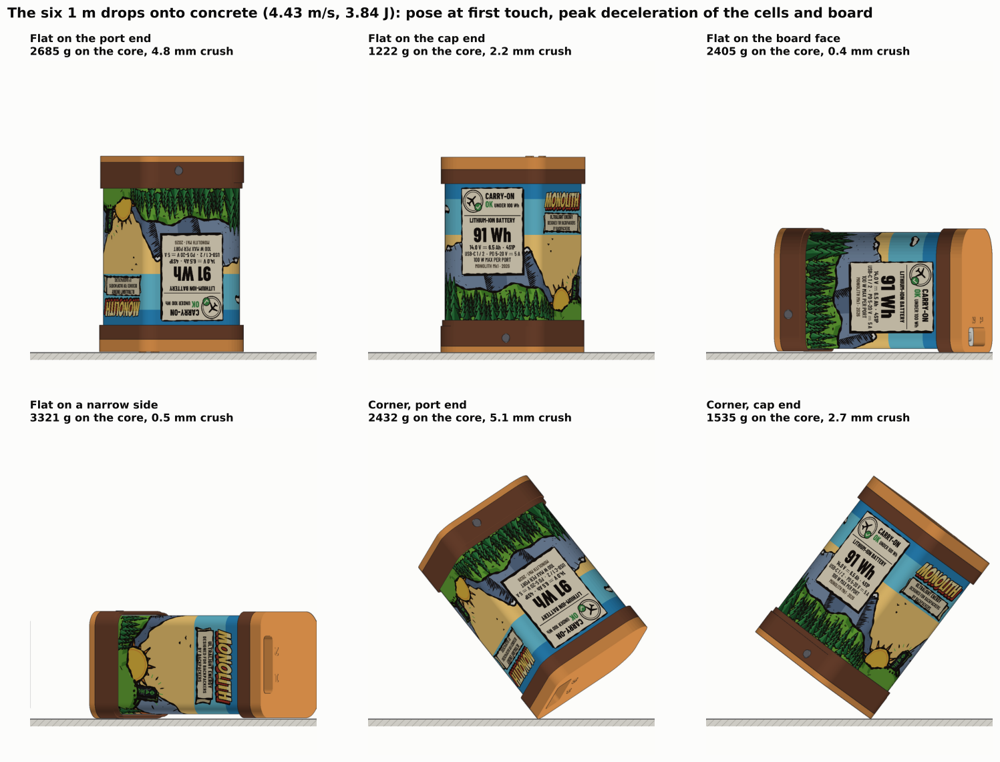
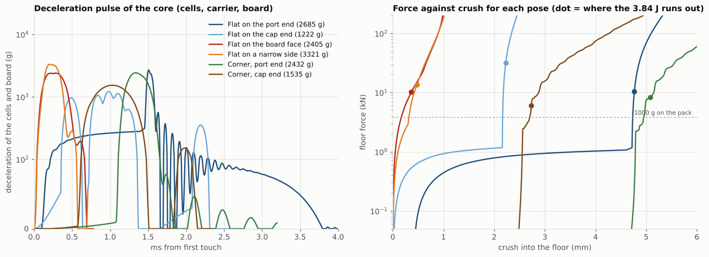
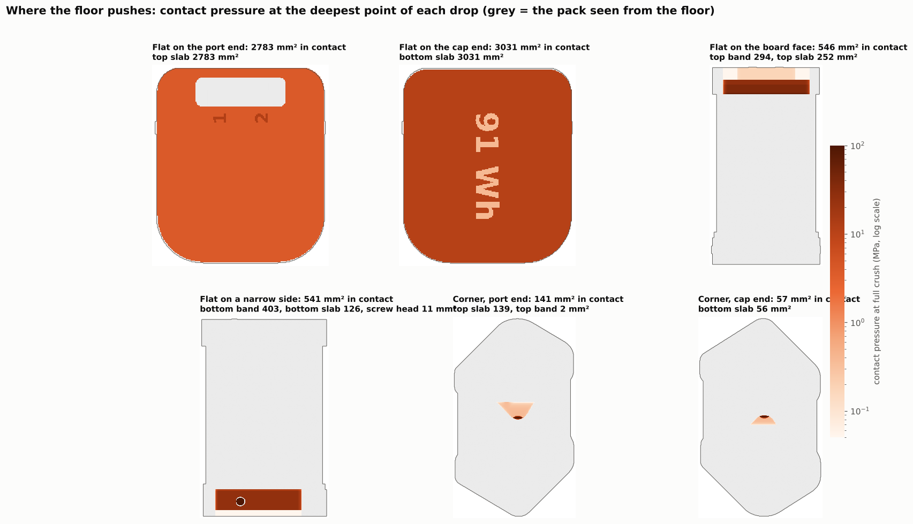
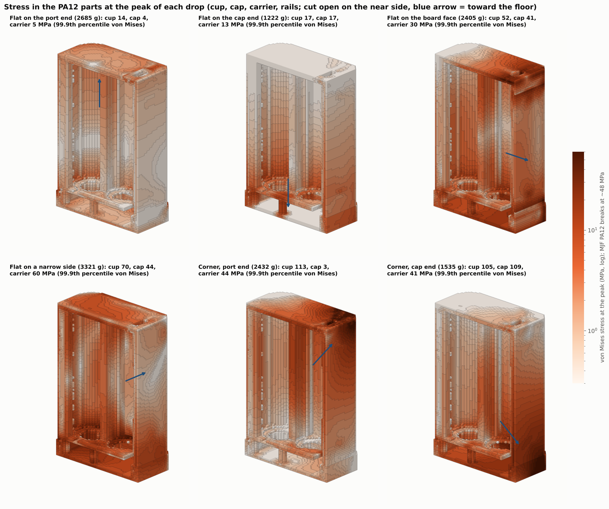
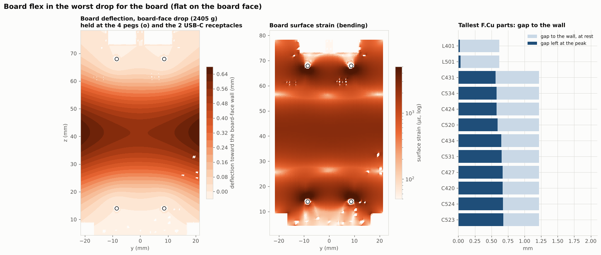
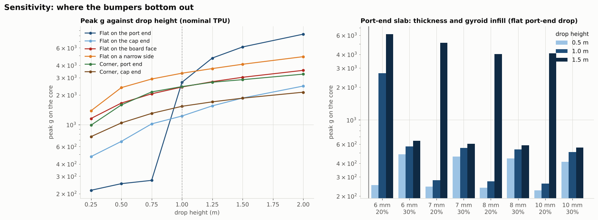

# Drop: 1 m onto concrete, six poses (2026-10-31)

What happens to the pack when it falls 1 m onto concrete: flat on each end, flat on the board face, flat on a narrow side, and on a corner at each end. It lands at 4.43 m/s with 3.84 J to absorb. For each pose this works out how far the TPU bumpers crush, the peak deceleration of the cells and board, the stress in the nylon parts, and how far the board flexes.

The geometry is the current cup from [`hardware/mechanical/monolith_cup.py`](../../../hardware/mechanical/monolith_cup.py) on master 50c5625, which includes the mechanical polish of PR #46 (mass trim) and PR #47 (2.4 mm thick cup mouth instead of the cap collar) and the real routed board: 391.2 g, 60.7 × 52.9 × 95.9 mm. Every number here is a model value, not a measurement.

**Short answer.** The pack survives every 1 m drop in the model, but two things need fixing before a real drop test:

1. **The 6 mm, 20 % gyroid slab on the port end bottoms out at 1 m.** It crushes 4.8 of its 6 mm, and the last 0.5 mm goes solid, so the cells and board see 2685 g instead of about 270 g. The cliff is right at 1 m (272 g at 0.75 m). Printing the slab at **30 % gyroid** (same 6 mm, about 2 g more) keeps it off the end: 572 g at 1 m and 641 g at 1.5 m. A thicker slab at 20 % only moves the cliff to somewhere between 1 and 1.5 m.
2. **The two M2 screw heads stand 0.3 mm proud of the bottom bumper band** on both narrow sides (±y). The pan heads are 1.3 mm tall and the band over the cup mouth is 1.0 mm, with a pocket cut through it for each head. In a drop flat on a narrow side the steel heads hit the concrete first and the bumper takes over 0.3 mm later. A 0.5 mm counterbore in the 2.4 mm mouth wall under each head (or a head no taller than 0.8 mm) puts them 0.2 mm below the band.

The other results, roughly in order of how much they matter:

- **The board in a drop flat on the board face.** The board bows up to 0.68 mm toward the board-face wall between its four pegs. That uses all but 0.02 mm of the 0.62 mm gap over the two 3.3 µH inductors (L401, L501), so they may just touch the wall. The bending strain is about 1500 µε over most of the board and up to 4000 µε near the pegs, which is in the range where large MLCCs and solder joints can crack. It is worth looking at the board after the drop test. A soft pad on the wall over L401 / L501, or a support in the middle of the board, would take most of this away.
- **Peak deceleration** on the cells and board is 1200 to 3300 g across the six poses, over pulses of 0.5 to 1.4 ms. The worst is flat on a narrow side (3321 g), where only the 1 mm side of the bottom band and the screw heads are between the cup and the floor. The cells themselves are not the weak point: the cell safety standard (IEC 62133-2) drops bare cells 1 m onto concrete, which is at least as hard on a cell as these drops.
- **The nylon parts.** In the two end drops every PA12 part stays under 20 MPa (99.9th percentile; MJF PA12 breaks at about 48 MPa in tension). In the board-face and narrow-side drops the cup reaches 52 and 70 MPa, the carrier 60 MPa (narrow side) and the board rails 79 MPa (board face, where the peg posts carry the wall's push onto the rails), each in a small region. In the two corner drops the cup and cap reach about 110 MPa right under the corner. That is bearing stress where the model puts the whole floor force on a 57 to 141 mm² patch without the bumper spreading it, so it overstates the real stress, but the corners are where whitening or a crack would show first.
- **The cap end** is fine: the 3 mm slab there also bottoms out, but the 10 % pad and the overtravel posts behind it keep the core at 1222 g.

## Results

| Pose | Lands on | Crush | Floor force | Peak g on cells and board | Pulse | Bottoms out? | Cup / cap / carrier / rails stress (p99.9) |
|---|---|---|---|---|---|---|---|
| Flat on the port end | top slab (6 mm, 20 % gyroid) | 4.8 mm | 10.5 kN | **2685 g** | 1.37 ms | **yes**, last 0.5 mm | 14 / 4 / 5 / 5 MPa |
| Flat on the cap end | bottom slab (3 mm), then the 10 % pad and posts | 2.2 mm | 31 kN on the slab | 1222 g | 0.54 ms | slab yes, pad no | 17 / 17 / 13 / 19 MPa |
| Flat on the board face | top bumper band (0.6 mm prouder than the bottom band) | 0.4 mm | 10.2 kN | 2405 g | 0.59 ms | band, 2 mm solid TPU | 52 / 41 / 30 / 79 MPa |
| Flat on a narrow side (+y, USB1) | screw head, then bottom band and slab edge | 0.5 mm | 13.5 kN | **3321 g** | 0.48 ms | band, 1 mm solid TPU | 70 / 44 / 60 / 34 MPa |
| Corner, port end | top slab corner | 5.1 mm | 8.3 kN | 2432 g | 0.64 ms | slab corner | 113 / 3 / 44 / 88 MPa |
| Corner, cap end | bottom slab corner | 2.7 mm | 6.1 kN | 1535 g | 0.97 ms | slab corner | 105 / 109 / 41 / 97 MPa |

"Peak g on cells and board" is the deceleration of everything inside the cup (339 g of the 391 g). The corner poses have the centre of mass straight over the corner, which is the hardest corner landing. The narrow-side case is the +y side (USB1); the −y side is the mirror image.

## Visuals

**Deceleration pulse and the force-crush curve of each pose.** The port-end curve (dark blue) runs soft for 4.7 mm and then goes vertical where the slab densifies; the dot shows where the 3.84 J is used up.

**Where the floor pushes**, at the deepest point of each drop. In the narrow-side drop the screw head (the dot in the band) is the first thing to touch.

**Stress in the nylon parts** at the peak of each drop, cut open on the near side. The arrow points toward the floor.

**The board in the board-face drop**: how far it bows toward the wall, the bending strain, and the gap left over the tallest parts.

**Sensitivity.** Left: the peak g against drop height. Every pose grows smoothly except the port end, which jumps tenfold between 0.75 and 1 m when the slab bottoms out. Right: the port-end slab at other thicknesses and infills. At 30 % it stays under 650 g up to 1.5 m at any thickness.

The TPU properties matter less than the build: halving or raising the solid TPU stiffness by 50 % moves the flat side and board-face results by about ±10 %. The port end is the exception again: with the gyroid 25 % stiffer than assumed it no longer bottoms out (344 g), and 25 % softer it bottoms out harder (4511 g). That sensitivity is another reason to move to 30 %. All of these are in `out/sens.json`.

## Board loads in the other poses

The board only bends when the drop pushes it across its thickness, which happens in the board-face drop and the two corners (they hit at an angle). In the corners the deflection is 0.35 mm (port end) and 0.20 mm (cap end) with at least 0.31 and 0.44 mm left over every part, and the strain half or less of the board-face case. In the end and narrow-side drops the board is loaded in its own plane, held at the pegs and the USB-C receptacles; the heaviest parts are the two receptacles, about 1 g each, so 12 to 33 N on each at the peak depending on the pose.

## PEBA instead of TPU (2026-10-31)

Logan asked how PEBA bumpers would compare. JLC3DP prints PEBA by FDM at 85A and 1.0 g/cm³. `peba.py` re-runs the same six poses with the bumpers in PEBA and the cap pad left in TPU. The PEBA properties are estimates, because there is no PEBA compression data yet:
- 0.45 × the stiffness of TPU 95A (range 0.3–0.6);
- 17 % lighter at the same build;
- bouncier on unloading;
- 1.3 × stiffer at −20 °C, against about 2.5 × for TPU.

The table gives the peak g on the cells and board, at 1 m unless marked.

| Bumpers (both slabs) | Mass | Port end | Port end 1.5 m | Port end −20 °C | Cap end | Board face | Narrow side | Narrow side −20 °C | Corner, port end |
|---|---|---|---|---|---|---|---|---|---|
| TPU 95A, 20 % (now) | 12.1 g | **2685** | 6129 | 602 | 1222 | 2406 | 3321 | 3769 | 2430 |
| TPU 95A, 30 % | 15.2 g | **569** | 639 | 1128 | 1070 | 2429 | 3359 | 3781 | 2466 |
| PEBA 85A, 20 % | 10.1 g | 4660 | 6458 | 4393 | 1821 | 2172 | 2959 | 3040 | 2128 |
| PEBA 85A, 30 % | 12.6 g | 2919 | 4867 | 1851 | 1478 | 2166 | 2955 | 3036 | 2023 |
| PEBA 85A, 40 % | 15.2 g | 1780 | 3914 | 618 | 1446 | 2160 | 2953 | 3056 | 2079 |

- **Port end (the slab that bottoms out):** PEBA is worse. It is softer, so the gyroid gives way at a lower load and runs out of stroke sooner. Even PEBA at 40 %, which is the same mass as TPU at 30 %, still sits near the cliff: 1780 g at 1 m and 3914 g at 1.5 m. Across the stiffness range it gives anything from 628 to 2758 g at 1 m. TPU at 30 % stays under 650 g up to 1.5 m.
- **Solid bands (board face, narrow side, corners):** PEBA is about 10–15 % gentler, because a softer solid band spreads the hit. At −20 °C the gap grows to about 20 %, since TPU stiffens and PEBA barely does.
- **Cap end:** TPU is better (1070 g against 1478 g at 30 %).
- **Cold, port end:** cold actually helps TPU at 20 %. The stiffer lattice no longer bottoms out (602 g), but at 30 % cold makes the hit harder (1128 g).

**Verdict:** stay with TPU 95A and print the slabs at 30 %. PEBA only wins on the band hits, by 10–20 %. Matching TPU on the port end would take 40 % infill or more, and that is no lighter and not as safe. Its stiffness is also the least certain number in the model. If the real drop tests show the band hits as the problem, a thicker TPU band is the simpler fix.

## Method

1. **Geometry.** The cup assembly is meshed from `monolith_cup.py` (`geom.py`, cached). Each part has a mass, so the model knows the centre of mass and splits the pack into a 52 g "shell" (the bumpers, label and outer skin that hit first) and a 339 g "core" (cells, carrier, board and everything inside the cup).
2. **Contact.** For each pose the outer surface is ray-cast onto the floor plane at 0.25 mm. Each ray knows which part it hits first and how thick that part is along the ray (`contact.py`). The bumpers crush as a bed of independent columns: solid TPU 95A as a neo-Hookean material (E 40 MPa, with a factor of 3 for the confinement of a thin layer), the gyroid slabs as a cellular material with a stress plateau and densification at a strain of 1 − 1.4 ρ, and PA12 or steel as near-rigid. This gives the floor force against crush for each pose.
3. **Structure stiffness.** The cup, cap, carrier, rails, cells, board and filler are voxelised at 1 mm (190 000 bricks) and solved as a linear finite-element model with springs to the floor over the contact patch and a 1 g body force (`fe.py`). That gives the stiffness between the floor patch and the core, and the stress pattern, which is scaled by the peak g of the drop.
4. **Impact.** A two-mass model (shell on the floor force curve, core on the structure stiffness with 3 % damping; the bumpers unload at 35 % of their loading force, which stands in for the TPU's hysteresis) is stepped through the impact at 0.1 µs (`drop.py`). The cap-end pose adds the 10 % gyroid pad and the overtravel posts behind the slab.
5. **Board.** The routed board is a 1.6 mm FR-4 plate (Kirchhoff, Morley elements on the board outline), held at its four peg holes and the two USB-C receptacles, with each placed part's mass on it, loaded with the component of the core's peak g across the board (`board_flex.py`). The clearance to the wall comes from each part's height over the board.

## Assumptions and limits

- **Concrete floor, rigid.** Wood, carpet or a pack in a rucksack is far gentler.
- **Rigid-body landing.** The pack does not rotate during the hit. In the board-face drop the pack really lands on the top band first and rocks onto the bottom band, so treating it as one flat hit on the top band overstates the force. The corners use the worst corner orientation (centre of mass over the corner).
- **Quasi-static structure.** The board's first bending mode is about 0.9 kHz, near the frequency of the 0.5 to 0.6 ms pulses, so the real board deflection could be up to about 1.5 times the quasi-static value. This is why the inductor clearance is worth a pad even though the model leaves 0.02 mm.
- **TPU and gyroid properties are estimates**, not coupon tests: 95A TPU E ≈ 40 MPa, the 20 % gyroid at E 2 MPa with a 0.3 MPa plateau, 30 % scaled by ρ². The 30 % result should be checked by compressing one printed slab before relying on it.
- **Stress is linear elastic** on a 1 mm voxel model. Peaks at sharp voxel corners and under the floor patch are overstated, which is why the table uses the 99.9th percentile and not the maximum. PA12 is fairly ductile (about 15 to 20 % elongation for MJF), so a local overload whitens or dents before it cracks.
- **The cells and the gap filler are lumped.** Cells are a solid with E 2 GPa; the nickel welds and wire tails are not modelled.

## Files

| File | What it is |
|---|---|
| `geom.py` | Meshes the assembly from `monolith_cup.py` into `cache/assembly.npz` (run again after any mechanical change) |
| `contact.py` | Ray-cast contact maps and the bumper material laws |
| `fe.py` | The voxel finite-element model (pyamg solver) |
| `drop.py` | The six drops: `python drop.py` → `out/drop.json` and `cache/<pose>.npz` (about 10 min) |
| `board_flex.py` | Board plate model and per-part clearance |
| `sens.py` | Height, material and slab-build sweeps → `out/sens.json` |
| `peba.py` | PEBA 85A bumpers against TPU 95A at 20–40 %, 1 m, 1.5 m and −20 °C → `out/peba.json` |
| `poses.py`, `figs.py` | The figures here and `out/checks.json` (stress percentiles, board results) |
| `out/` | The results as JSON |

Needs numpy, scipy, matplotlib, pyamg, scikit-fem, manifold3d and cairosvg (the same as `hardware/mechanical/`).
