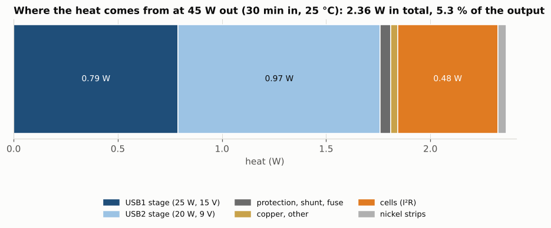
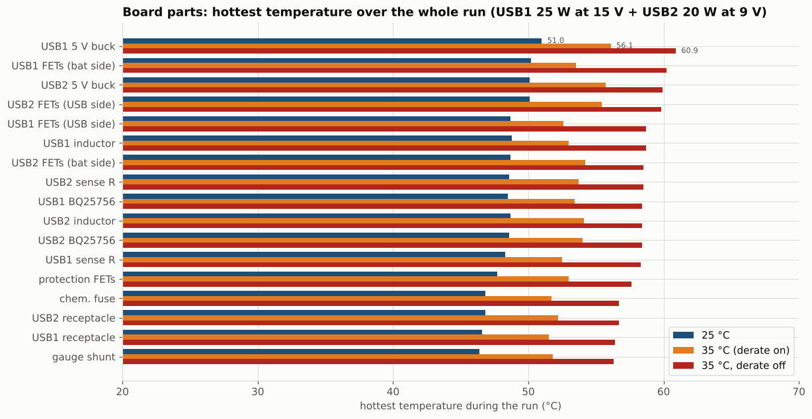
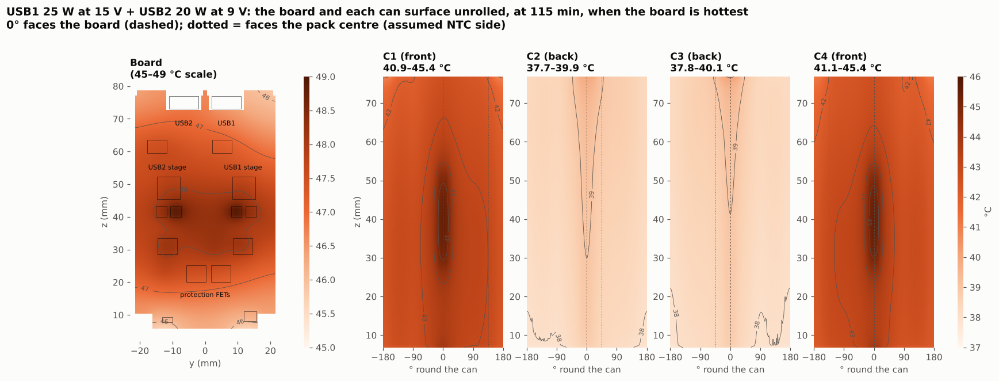
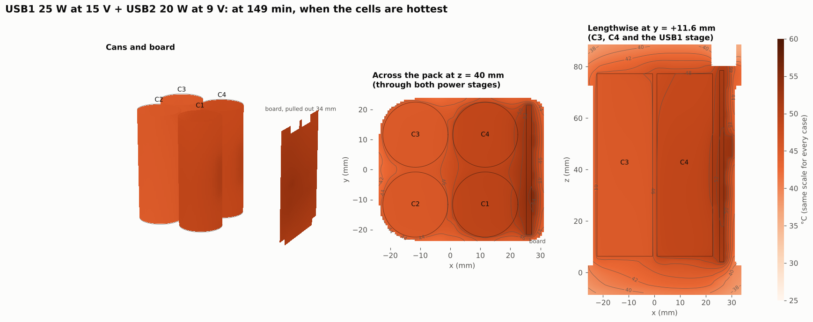
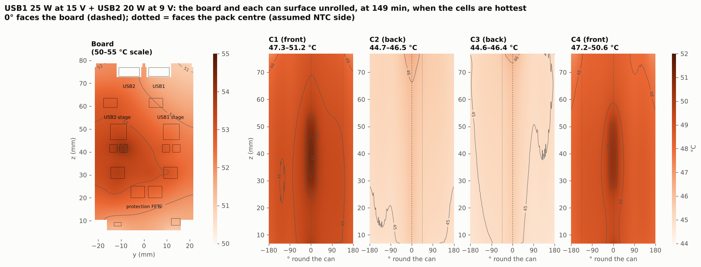
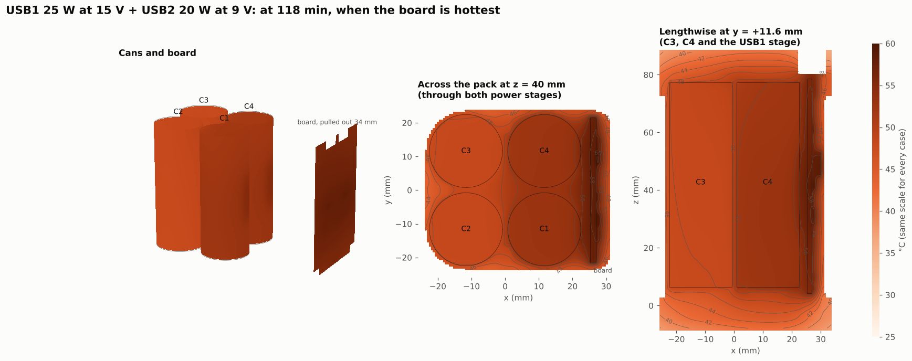
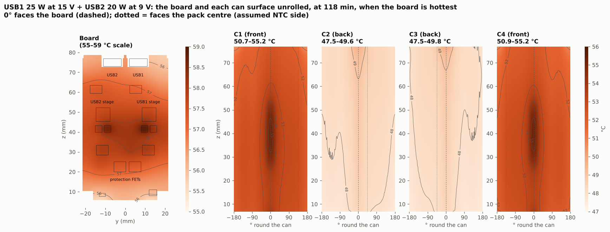

# Thermal: USB1 at 25 W and USB2 at 20 W at the same time (2026-10-31)

Both ports deliver at once, from full until empty: USB1 a 25 W device at 15 V, and USB2 a 20 W phone at 9 V, so 45 W total. The question is how hot the routed board and the pack get, and when the firmware has to cut power.

**Short answer.** At 25 °C the pack runs the whole battery (118 min, 88.4 Wh) at the full 45 W. It cuts to 40 W only for the last 3 minutes. The hottest board part peaks at 51 °C, the hottest point in any cell at 45.7 °C, and the outside at 46.6 °C. At 35 °C the derate starts at 20 min and settles at 30 W (USB1 down to 10 W, USB2 kept at 20 W); the hottest part reaches 56 °C. At 40 °C USB1 is cut to 0 W for most of the run. Every part stays far below its rating: the limit that matters is the cells' 60 °C discharge limit, and the firmware holds the cells under 53 °C even at 40 °C. With the derate switched off at 35 °C (a firmware failure), the cells reach 55.4 °C and the hottest part 60.9 °C after two hours, which is still under the cell limit.

The model is the same one used for the routed-board review: `research_notes/Pack thermal BAK 65E/` with the rev 7 routed-copper losses (`cu_losses_rev7.json`), every heat source at its place on the routed board, the d44 firmware policy (derate 44 → 48 °C on the hottest cell NTC, down to 40 W total) and TH101 / TH104 as SMD NTCs under the gap filler. Still air, h = 10 W/m²K, the pack standing in free air. The seven runs ran on Logan's PC (30 processes, 16 min). Every number here is a model value, not a measurement.

## Results

| Case | Ambient | Full 45 W until | Settles at | To empty | Energy out | Hottest board part | Hottest cell point | Hottest NTC | Outside skin |
|---|---|---|---|---|---|---|---|---|---|
| Derate on (the product) | 25 °C | 115 min (end) | 40 W | 118 min | 88.4 Wh | 51.0 °C (USB1 5 V buck) | 45.7 °C | 47.7 °C | 46.6 °C |
| Derate on | 35 °C | 20.5 min | 30 W (USB1 10 W) | 149 min | 88.3 Wh | 56.1 °C | 51.4 °C | 53.2 °C | 52.0 °C |
| Derate on | 40 °C | 5.5 min | 20 W (USB1 0 W) | not empty at 3 h | 76.1 Wh in 3 h | 57.4 °C | 52.8 °C | 54.6 °C | 53.7 °C |
| Derate OFF | 25 °C | the whole run | 45 W | 118 min | 88.4 Wh | 51.4 °C | 46.0 °C | 48.0 °C | 46.8 °C |
| Derate OFF | 35 °C | the whole run | 45 W | 118 min | 88.5 Wh | 60.9 °C | 55.4 °C | 57.5 °C | 56.4 °C |
| USB1 at 9 V (derate on) | 25 °C | 66.8 min | 40 W | 123 min | 87.7 Wh | 51.6 °C | 46.3 °C | 48.3 °C | 48.0 °C |
| USB1 at 20 V (derate on) | 25 °C | 111 min | 40 W | 118 min | 88.3 Wh | 51.1 °C | 45.8 °C | 47.8 °C | 46.5 °C |

- **Heat.** At 45 W the pack makes 2.36 W of heat (5.3 % of the output): 0.79 W in the USB1 stage, 0.97 W in the USB2 stage (9 V at 2.2 A has more conduction loss than 15 V at 1.7 A), 0.48 W in the cells and about 0.1 W in the protection path, shunt, fuse, copper and nickel. For comparison, one port at 100 W makes about 6.1 W. USB1 loses 3.2 % of its 25 W and USB2 4.9 % of its 20 W; part of each is fixed overhead (0.2 W for the BQ25756 and its gate drive, 0.1 W for the 5 V buck) that doesn't grow with load.
- **Steady state.** No case settles before the pack is empty. The pack's thermal time constant is about 30 min, so with the derate off the temperatures are still climbing slowly at 118 min; they end 21 to 26 K above ambient.
- **Which part is hottest.** The two 5 V bucks (about 0.1 W each, modelled as a fixed loss) and the half-bridge FETs on the high-current side of each stage (USB1 battery side, USB2 USB side at 2.2 A). They sit within 3 K of each other because the 6-layer board spreads the heat: the whole board stays within 3.6 K at the peak (map below).
- **USB1 voltage.** Running USB1 at 9 V instead of 15 V adds 0.45 W of stage loss (more current through the same FETs, inductor and sense resistor). It makes the derate start at 67 min instead of 115 min at 25 °C, but the pack still delivers 87.7 Wh. At 20 V the stage is in boost and costs about the same as 15 V.
- **Port priority.** The firmware keeps up to 20 W on USB2 and cuts USB1 first. At 35 °C that leaves USB1 at 10 W, and at 40 °C at 0 W for most of the run. If USB1 carries the device that matters more (a laptop or a Starlink), set port priority to USB1 (it is a user setting).

## Visuals

**Where the heat comes from** (30 min in, 25 °C):

**The board at its hottest, on the KiCad render of the routed board** (left: 25 °C with the derate on, at 115 min; right: 35 °C with the derate off, the worst case). The two hot spots sit over the two power stages; the gap filler under them carries their heat into the front cells.

**Every board part's hottest temperature over the run:**

**The whole pack at 25 °C, when the board is hottest (115 min):** the cans and the board in 3-D, a section across the pack through both stages, and a lengthwise section through C3, C4 and the USB1 stage. Same 25–60 °C scale on every pack figure.

**The board and each can unrolled, 25 °C.** The front cells (C1, C4) carry a hot stripe facing the board where the gap filler lands; the back cells (C2, C3) run 5 K cooler.

**35 °C with the derate on**, when the cells are hottest:

**35 °C with the derate off** (firmware failure), when the board is hottest:

## Files

| File | What it is |
|---|---|
| `run_dual.py` | The seven runs. Copy it into the rev 7 model folder (the BAK 65E model plus `cu.py`, `smd.py`, `ntc.py`, `cu_losses_rev7.json`) and run `python run_dual.py` with `NPROC` set. Results go to `results/p0f/dual*.npz` (17–21 MB each, not in git). |
| `figs.py` | Every figure here and `summary.json`: `MODEL=<model folder> RENDER=<KiCad top render> python figs.py` |
| `summary.json` | The numbers in the table, per run, including every part's peak temperature |

## Assumptions and limits

- Cell DC resistance 14 mΩ at 25 °C (assumed; BAK gives only ≤ 8 mΩ AC). Stage losses from the loss model in `pack3d.py` with the four loss cuts and the 9 V gate drive off.
- Copper losses are the rev 7 routed board's. The later fixes before the board was approved (sense-tap moves, keep-outs) don't change the power copper.
- The pack is in still air at a uniform ambient. In a pocket or a pack (less air) it runs hotter; sun on it adds more. The 2026-10-23 sensitivity run put a pocket (h = 4 W/m²K) at about 3 Wh less in the first 40 min at 100 W.
- The derate reads the two SMD NTCs under the gap filler (TH101 / TH104) and the two wired back-cell NTCs; the board ramp (55 → 70 °C on the charger TS NTCs) never acts here.
