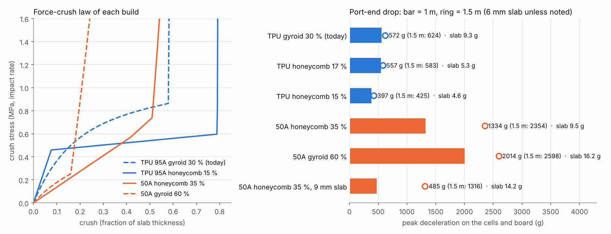

# Bumper materials: Formlabs resins against FDM TPU, and engineered slabs (2026-11-01, 2026-11-05)

> **Status (2026-11-13): analysis only. Nothing here changed the design.**
> - Run 2026-11-01 and 2026-11-05 on the geometry of master a4ac02e to ece80e6 (the cup model did not change in between): 1.6 mm side walls, 6 mm top and 3 mm bottom bumper slabs at 30 % gyroid, 15 % gyroid cap pad 0.3 mm from the overtravel posts, the same geometry as `out/drop-pad15.json` of the 2026-10-31 study (399.6 g). It uses that study's two-mass model and its structure stiffness, so it has that model's limits, and the cup has changed since (see the end).
> - The design keeps FDM TPU 95A bumpers with 30 % gyroid slabs: `SLAB_FILL = 0.30` in [`hardware/mechanical/monolith_cup.py`](../../../hardware/mechanical/monolith_cup.py) on master 415007f, and the code has no honeycomb slab.
> - The vertical-wall honeycomb slab in TPU 95A modelled better than the gyroid at 4 to 4.7 g less (both slabs), but it has **not** been adopted.
> - A Flexible 50A cap pad is an idea only.

Logan asked (2026-11-01) whether all the TPU parts (the two bumpers, the cap pad and the board sleeves) could be printed on a Formlabs printer in one of its elastic resins instead. On 2026-11-05 he asked whether an engineered structure in Flexible 50A would do better than a plain block. This study answers both through the 1 m drop model of [`../2026-10-31-drop-1m/`](../2026-10-31-drop-1m/README.md). PEBA 85A, the other flexible that JLC3DP prints, was compared there on 2026-10-31 (`peba.py`, [PEBA instead of TPU](../2026-10-31-drop-1m/README.md#peba-instead-of-tpu-2026-10-31)). Every number is a model value, not a measurement.

**Short answer.** Keep FDM TPU 95A for the bumpers and the sleeves. At the same 6 mm port-end slab every resin build gives 1,888 to 3,362 g on the cells and board at 1 m, against 572 g for the 30 % TPU gyroid. Flexible 80A V2 needs a 10 mm slab at 40 % (344 g, about 5 g and 4 mm more) to match it. Flexible 50A never gets below about 1,270 g as a gyroid slab. The resins are 10 to 15 % gentler in the solid-band drops (board face, narrow side). The one place a resin could help is the cap pad, where Flexible 50A keeps its preload far better (compression set 3.1 % at 70 °C, against 90 % for the TPU). The engineered structures say the same thing: the structure helps, but in TPU 95A, not in 50A. A vertical-wall honeycomb slab in TPU 95A at 15 to 17 % gives 397 to 557 g at 1 m and 425 to 583 g at 1.5 m, with 4.6 to 5.3 g of slab against 9.3 g for the gyroid.

<p align="center"></p>

## Materials

Data-sheet values, post-cured for the resins (Formlabs), and Ultrafuse TPU 95A for the FDM part:

| Material | Hardness | Tensile strength | Tear strength | Compression set | Other |
|---|---|---|---|---|---|
| Flexible 50A (was Elastic 50A V2, renamed 2026-06) | 55A | 3.4 MPa | 12.3 kN/m | 3.1 % at 70 °C | |
| Flexible 80A V2 | 83A | 10 MPa | 28 kN/m | 32 % at 23 °C, 85 % at 70 °C | Tg −49 °C, 1.09 g/cm³, $199 per litre |
| Rebound (86A) | 86A | | 110 kN/m | 16 % / 40 % | partnership only, not for sale |
| FDM TPU 95A (Ultrafuse) | 95A | | 90 kN/m in the layer plane, 8-14 kN/m across layers | 38 % at 23 °C (72 h), 90 % at 70 °C | Tg −25 °C |

A Form 4 printer costs $2,625 (basic package). SLA cannot print a skinned gyroid (resin is trapped inside), so a resin slab or pad would need an open lattice or solid pillars.

In the model each resin's stiffness is scaled from its stress at 50 % elongation against FDM TPU 95A (`resin.py`, `MATS`): 80A V2 0.32×, Rebound 0.38×, 50A 0.10×, with densities of 1.09, 1.10 and 1.05 g/cm³ (TPU 1.20) and unloading at 60, 60 and 50 % of the loading force (TPU 35 %). The engineered-slab runs (`bumper_struct.py`) use impact-rate moduli: TPU 95A 40 MPa (the drop model's value) and Flexible 50A 2.6 MPa static × 1.5 = 3.9 MPa.

## Model

- **Drop model:** the two-mass model of the 2026-10-31 study (`contact.py`, `drop.py`): the shell crushes the bumpers on the floor, the core sits on the structure stiffness from `out/drop-pad15.json`, and in the cap-end pose the cap pad and the overtravel posts sit behind the slab. 1 m (4.43 m/s) and 1.5 m onto concrete.
- **Resin runs** (`resin.py`): bands, slabs and pad all swapped to the resin. Gyroid lattice stress scales as ρ² from the TPU 20 % law. The soft-part mass change goes into the shell mass. `thick.py` grows the port-end slab from 6 to 12 mm. `mix.py` tries mixed slab and pad materials in the cap-end pose.
- **Engineered slabs** (`bumper_struct.py`): analytic crush laws in the same model, top and bottom poses.
  - Gyroid: bending-dominated, plateau about ρ².
  - Vertical-wall hexagonal honeycomb (walls along the crush, FDM-friendly): axial until the walls buckle at 3.4 E ρ³, then a gently rising plateau.
  - An ideal flat plateau as a bound.
  - All densify at a strain of 1 − 1.4 ρ.
  - `thick50.py` adds 9 and 12 mm 50A slabs, TPU honeycomb at 15-16 % and the 50A modulus at ×0.67 / ×1.5.
- **Pad preload** (`resin.py`, `pad_preload`): static force of the cap pad printed 1.2 mm proud, at the static modulus (impact modulus / 1.5).

## Results: resins

Peak g on the cells and board. TPU 95A row is today's build (slabs 30 %, pad 15 %). From `out/resin_top.json` and `out/resin_bottom_board_side_corner_top_corner_bottom.json`.

| Build (slabs, pad) | Soft parts | Port end 1 m / 1.5 m | Cap end 1 m / 1.5 m | Board face 1 m | Narrow side 1 m | Corner port end 1 m | Corner cap end 1 m |
|---|---|---|---|---|---|---|---|
| **TPU 95A, 30 %, 15 %** | 17.4 g | **572 / 624** | 1183 / 1554 | 2534 | 4013 | 2606 | 1550 |
| Flexible 80A V2, 30 %, 30 % | 17.9 g | 3329 / 4815 | 1817 / 2408 | 2302 | 3429 | 2105 | 1445 |
| Flexible 80A V2, 45 %, 30 % | 22.1 g | 2517 / 3913 | 1733 / 2398 | 2307 | 3439 | 2075 | 1462 |
| Flexible 80A V2, 55 %, 30 % | 24.9 g | 2768 / 3902 | 1795 / 2502 | 2309 | 3478 | 1954 | 1495 |
| Flexible 80A V2, 65 %, 30 % | 27.7 g | 3362 / 4277 | 1940 / 2413 | 2306 | 3517 | 1541 | 1476 |
| Rebound, 30 %, 25 % | 17.4 g | 3078 / 4698 | 1735 / 2383 | 2234 | 3486 | 2171 | 1449 |
| Rebound, 50 %, 25 % | 23.0 g | 2301 / 3759 | 1722 / 2300 | 2236 | 3570 | 2069 | 1498 |
| Flexible 50A, 50 %, 45 % | 24.7 g | 2138 / 2828 | 1856 / 2312 | 2461 | 3497 | 1565 | 1290 |
| Flexible 50A, 70 %, 45 % | 30.1 g | 2269 / 2835 | 1627 / 2084 | 2441 | 3508 | 1442 | 1319 |
| Flexible 50A, solid, 45 % | 38.2 g | 1888 / 2412 | 1602 / 2081 | 2509 | 3541 | 2006 | 1494 |

**Thicker port-end slab** (`out/thick_top.json`, 1 m; extra mass against the 6 mm slab):

| Material | 6 mm | 8 mm | 10 mm | 12 mm |
|---|---|---|---|---|
| TPU 95A 30 % | 570 | 533 (+2.0 g) | 505 (+4.1 g) | 481 (+6.1 g) |
| Flexible 80A V2 40 % | 2630 | 1653 (+2.5 g) | **344 (+5.0 g)** | 329 (+7.4 g) |
| Flexible 80A V2 50 % | 2574 | 1761 | 906 | 484 (+9.3 g) |
| Rebound 40 % | 2250 | 872 | 392 (+5.0 g) | 374 |
| Flexible 50A 55 % | 2069 | 1666 | 1456 | 1271 (+9.9 g) |
| Flexible 50A solid | 1891 | 1643 | 1428 | 1307 (+17.9 g) |

- **Port end.** The softer resins give way at a lower load, use up the 6 mm stroke and hit their densified end. Only a thicker slab (10 mm or more in 80A V2 or Rebound) gets them to the TPU's level, and that adds about 4 mm to the pack's length.
- **Band hits.** The solid bands in resin are gentler: board face 2,234 to 2,309 g against 2,534 g in 80A V2 and Rebound, narrow side 3,429 to 3,570 g against 4,013 g.
- **Cap end.** Every resin is worse than TPU (1,602 to 1,940 g against 1,183 g). The pad material barely changes the cap-end drop (`mix.py`).
- **Pad preload** (`resin.py`, 1.2 mm proud): TPU 15 % 62 N, 80A V2 30 % 81 N, 50A 45 % 61 N. So a 50A pad at 45 % matches today's TPU pad, and keeps it after heat (compression set 3.1 % at 70 °C).
- **Sleeves.** Their grip scales with the modulus: 80A V2 would hold about 1/3 and 50A about 1/10 of the TPU's. (The TPU sleeves were replaced by PA12 crush-rib spacers on 2026-11-03, PR #61.)

## Results: engineered slabs (2026-11-05)

Port-end drop, 6 mm slab, peak g on the cells and board at 1 m / 1.5 m, crush at 1 m, and the mass of both slabs (`out/struct.log`, `out/bumper_struct.json`; rows marked † are from `thick50.py`, whose printout was not saved, as recorded in the project note of 2026-11-05):

| Build | 1 m | 1.5 m | Crush | Both slabs |
|---|---|---|---|---|
| TPU 95A gyroid 20 % | 2545 | 5975 | 4.36 mm | 6.2 g |
| **TPU 95A gyroid 30 % (today)** | **572** | **624** | 2.60 mm | **9.3 g** |
| TPU 95A gyroid 40 % | 916 | 1018 | 1.75 mm | 12.3 g |
| TPU 95A honeycomb 14 % | 332 | 1883 | 3.51 mm | 4.3 g |
| TPU 95A honeycomb 15 % † | 397 | 425 | | 4.6 g |
| **TPU 95A honeycomb 17 %** | **557** | **583** | 2.23 mm | **5.3 g** |
| TPU 95A honeycomb 20 % | 856 | 902 | 1.63 mm | 6.2 g |
| Flexible 50A gyroid 30 % | 2815 | 3749 | 4.08 mm | 8.1 g |
| Flexible 50A gyroid 60 % | 2014 | 2598 | 1.81 mm | 16.2 g |
| Flexible 50A honeycomb 30 % | 1469 | 2594 | 3.77 mm | 8.1 g |
| Flexible 50A honeycomb 35 % (best at 6 mm) | 1334 | 2354 | 3.28 mm | 9.5 g |
| Flexible 50A honeycomb 35 %, 9 mm slab † | 485 | 1316 | | 14 g |
| Ideal flat plateau 0.4 MPa (bound) | 516 | | 3.43 mm | |

- TPU honeycomb below about 15 % bottoms out at 1.5 m (14 %: 1,883 g).
- A 50A slab would need a plateau of about 9 % of its own modulus, which no printable structure gives it at 6 mm. With the 50A modulus 1.5× higher than assumed, the 30 % honeycomb gives 495 g † at 1 m.
- Cap-end drop (3 mm slab, 1 m): TPU gyroid 30 % 1,183 g; TPU honeycomb 14 % and 17 % 1,006 and 1,243 g; 50A honeycomb 30-35 % 1,386 to 1,411 g.

**Conclusion.** The structure gain is real, but in TPU 95A: vertical walls along the crush print well on FDM and give a flatter plateau than the gyroid, for about half the slab mass. Flexible 50A is too soft for a 6 mm slab in any structure. Neither result has been adopted. A honeycomb slab would want a crush test on a printed coupon first, since its buckling law is analytic.

A rerun of two rows on a checkout of ece80e6 (2026-11-13) reproduced them exactly: TPU gyroid 30 % 572 g, 2.60 mm, 9.26 g; TPU honeycomb 17 % 557 g, 2.23 mm, 5.25 g (pack 399.6 g).

## Run

```
python resin.py top                                   # out/resin_top.json
python resin.py bottom board side corner_top corner_bottom
python thick.py                                       # out/thick_top.json
python mix.py                                         # prints the cap-end mixes
python bumper_struct.py > out/struct.log              # out/bumper_struct.json
python thick50.py                                     # prints the 9 / 12 mm 50A and TPU 15-16 % runs
python fig.py                                         # img/engineered-bumper-2026-11-05.png (values typed in)
```

The scripts import `contact.py` and `drop.py` from `../2026-10-31-drop-1m/`, which mesh whatever `hardware/mechanical/monolith_cup.py` holds now (`cache/assembly.npz` there, built on first use). To reproduce the numbers above, run them on a checkout of master ece80e6; the cup has changed since (cradles, edge lands and lips on 2026-11-03, the 2026-11-05 cap posts, the 2026-11-11 rail spines), so a run on today's master gives somewhat different numbers. The floor ray-casts are cached in `cache/` here. Needs numpy, scipy, matplotlib, pyamg and manifold3d.

## Limits

- The two-mass model and its limits (rigid landing, no rotation, quasi-static structure) carry over from [`../2026-10-31-drop-1m/`](../2026-10-31-drop-1m/README.md). The later contact and 3D studies ([`../2026-11-04-drop-stress/`](../2026-11-04-drop-stress/README.md), [`../2026-11-11-drop-3d/`](../2026-11-11-drop-3d/README.md)) did not revisit the bumper material.
- Resin stiffness comes from tensile data at 50 % elongation, not from compression or impact tests. The gyroid ρ² and honeycomb ρ³ laws are textbook scalings, not coupon results.
- The TPU pad itself may lose much of its preload at 40-48 °C (compression set). A pad-force check after a heat cycle is worth adding to the bench tests.
