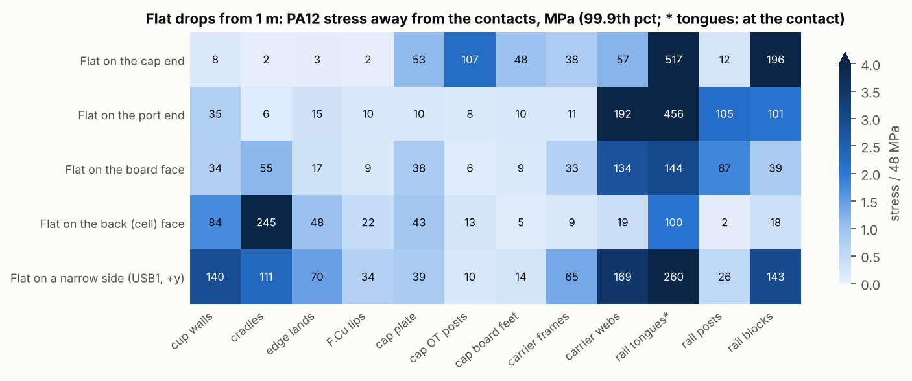

# 1 m drop: contact model, stress in every part (2026-11-04)

> **Status (2026-11-13).** This is the contact (lumped 1-DOF) study. Its cup-side fixes are in the design. Its board finding led to the 3D study, which supersedes it for the back-face drop.
>
> - **Geometry.**
>   - The 17-pose PC run (2026-11-04, mesh 0.75) used master after PR #61: cup lands, F.Cu lips, front-can cradles, PA12 post spacers and cap board feet, 401.8 g.
>   - The results below are the 2026-11-05 rerun of the five flat drops (mesh 1.0) on the fixed cup (commit 2a19bf6, 402.1 g). That rerun went to master in PR #64 on 2026-11-07.
>   - Since then: the top tongues went back to full frame height on 2026-11-07, and the 2026-11-11 rail spines, B.Cu lands, 1.5 mm bottom tongue tip clearance and 0.7 mm wall pockets (PR #69) and the 2026-11-12 cap post chamfer (PR #70) were added. None of these was run in this model. Today's cup is 402.2 g.
> - **Board data.** The hand-routed P0 board that Logan approved on 2026-10-30, from the mechanical model's board data of that time (kept as `hardware/mechanical/board/monolith_board_handrouted.npz`, which `bodies.py` reads), with C421 / C456 / C521 / C556 trimmed to the 2.0 mm T593V. It was the design's board then; since 2026-11-13 the design is the script-built board on `master` (commit `dd34285`), for which this study has not been rerun. The part names and part-to-wall gaps below (C434, C531 and others) are for the hand-routed positions.
> - **What became of each finding:**
>   - *Cap-end tongue load, cap overtravel posts at 107 MPa, C421 / C556 striking the cradles:* **fixed** on 2026-11-05 (`TONGUE_SETBACK` 0.3, `OT_R` 2.5 plus a fifth post, `CRADLE_CAP_RELIEF`; PR #64). Three model errors are corrected on the way (below).
>   - *Board strain about 8,000 µε (p99) in the back-face and board-face drops; mid-board support needed:* **taken up** by the 3D study [`../2026-11-11-drop-3d/`](../2026-11-11-drop-3d/README.md). On master c8fb819, which has these cup fixes, the 3D back-face drop gives about 5,000 µε (runs 2 and 3: 5,477 and 5,047). The rail spines (`rail_spines()`, PR #69) take it to about 3,100 µε (run 9: 3,089 p99, 4,022 max) with no F.Cu part reaching the wall. Use the 3D study for the back-face drop.
>   - *Board-face drop (7,800 µε, C434 / C531 0.06 mm from the wall, USB-C tabs about 25,000 µε and about 200 N per receptacle):* still **open**. The board-face drop has not been run in 3D or rerun here with the spines.
>   - *Bottom tongues about 280 N each in the cap-end drop:* still **open**. The tongue geometry changed on 2026-11-11 (tip clearance, root chamfer) and has not been rerun in the cap-end pose.
>   - *M2 screws and cup mouth about 1.15 kN in the cap-end rebound:* still **open**. This is a lumped-shell estimate; test it on a real cup.
>   - *Narrow side wall 178 MPa and cradles 143 MPa:* still **open**. The mesh is coarse (1-2 bricks through the wall).
>   - *Rail post tips about 270 N, 69 MPa in the board-face drop:* still **open**; they dent.
>   - *Post-tip gap 0.5 mm:* **rejected** (below).
>   - *GEL 30 as a load path:* bracketed only (below). Its viscosity at drop rates is unknown, and a witness-paint drop test is suggested.
>   - *Edges and corners:* **not usable** in this model (it needs a 3-DOF `dyn.py`), and no other study covers them.

The 2026-10-31 study ([`../2026-10-31-drop-1m/`](../2026-10-31-drop-1m/README.md)) treated the bank as two masses with the inside bonded to the cup, so it could
not see the inside parts hitting each other. This one keeps every part that can move as its own body, finds where they
touch on the real master geometry, and runs the impact in 17 orientations from 1 m onto concrete.

## Results (1 m onto concrete, with the 2026-11-05 cup fixes)

The five flat drops are where the model is exact (no rotation needed). Stresses are linear-elastic: past about
48-55 MPa a PA12 part yields or crushes there, so read the numbers as "how far over", not as the stress it sees.
Inside loads move about +-20 % with the contact stiffness, cell stiffness and damping (x0.5 to x2), and a 1.5 m drop
adds about 20 % (`sens.py` -> `out/sensitivity.json`, from the 11-04 geometry).



| Part | Worst drop | Demand | Limit | What happens |
|---|---|---|---|---|
| Board | back face, board face | bows 1.0-1.2 mm, surface strain ~8000 ue (99th pct); USB-C tabs ~25 000 ue, ~200 N per receptacle; F.Cu C434 / C531 0.06 mm off the wall | 1000-2000 ue | MLCC cracking, USB-C solder joints. Nothing props the middle of the board; the fix is a mid-board support (added on 2026-11-11 as the rail spines, see the 3D study) |
| Rail tongues (bottom pair) | cap end | the front cans still reach them, ~280 N each (was ~460); 307 MPa at the contact, block bodies 136 MPa | 48 MPa | tongue tips crush, the small blocks can crack. The cans sink ~0.5 mm into the bottom frame at the nickel strips before the tongues touch |
| Cup side wall, cradles | narrow side | 178 MPa in the wall near the cap end, cradles 143 MPa (coarse mesh: 1-2 bricks through the wall) | 48 MPa | local yield likely, watch item |
| M2 screws / cup mouth | cap end | in the rebound the core still pushes the cap while the floor has let go, so the cup (~48 g) hangs on the two radial screws: ~1.15 kN (was ~0.74 kN), lumped-shell estimate | ~400 N | the screws load the 1.3 mm of cup mouth below their holes in shear-out; test it on the real cup |
| Cap overtravel posts (5 x r2.5) | cap end | 3.4 kN on the posts, 42 MPa bearing (was 107 on 4 x r1.5) | ~55 MPa | fine now |
| Rail post tips | board face | ~270 N each on the wall, 69 MPa | ~55 MPa (bearing ~85) | tips dent |

Fine: cells (up to 3.0 kN radial and 2700 g against a 13 kN crush test and ~10^4 g for a bare cell), nickel strips
(may yield a little, ductile; the welds sit at about their shear strength, so pull-test them), the O-ring, the gel
filler (13 % stretch), the PA12 post spacers (28 MPa), the cap board feet (88 MPa bearing, 1.3 kN: they dent but
carry), the F.Cu lips, the carrier (frames 45, webs 31 MPa), and the whole port-end drop (everything under 7 MPa).
C421 / C456 / C521 / C556 clear the cans by 1.75-1.9 mm and nothing on B.Cu lands in any flat drop.

The cap-end floor force swings between runs (2.5 kN here, 11 kN on 11-04) because the bottom bumper works right at
its knee: 1.7-1.8 mm of crush, where its force climbs from 2 kN to 90 kN per mm. The cap plate stress (33 MPa here,
53 before) follows it; a 1.5 m drop would bottom it out.

Edges and corners (`out/edges_corners_2026-11-04/`, PC run on the 11-04 geometry, before the inertia relief and the
carrier fixes below): the inside parts there can only move along the drop direction, so a core stopped in one
direction can't slide on in the other, and the cup pivoted on its corner footprint in the FE. Their contact forces
are upper bounds and their stresses are not usable; that needs a 3-DOF version of `dyn.py`. Only the impact
(`dyn_*`) and board (`board_*`) results are kept there; the part stress files were removed on 2026-11-13.

## Cup-side fixes (2026-11-05)

Logan picked the cup-side fixes from the 11-04 results (`hardware/mechanical/monolith_cup.py`, 402.1 g):

* Rail tongues set back 0.3 mm from the frame faces (`TONGUE_SETBACK`): the cell-to-tongue gap goes 0.40-0.45 to
  0.70-0.75 mm. Since 2026-11-07 the bottom tongues only: on the 0.95 mm top frame the setback left a 0.65 mm tongue,
  under JLC's 1.0 mm MJF wall, and the port-end tongue load was the model error described below. A top tongue sits
  against the top wall, so a can pushing on it loads it in compression. The top tongues are back to 0.95 mm, the full
  frame height; the bottom ones are 1.30 mm.
* Overtravel posts r1.5 to r2.5 (`OT_R`), plus a fifth post under the front cells (`OT_POSTS`).
* Cradle tops cut to x <= 20.5 under C421 / C556 (`CRADLE_CAP_RELIEF`).
* The 0.5 mm post-tip gap was run as a variant (see below) and is not in the model.

| Drop | Item | 11-04 | 11-05 |
|---|---|---|---|
| cap end | overtravel posts | 2.7 kN, 107 MPa | 3.4 kN, 42 MPa |
| cap end | cells on the bottom tongues | 920 N, tongues 517 MPa, blocks 196 MPa | 555 N, 307 MPa, 136 MPa |
| cap end | cap board feet | 960 N, 48 MPa | 1345 N, 9 MPa (99.9th pct away from the contact) |
| port end | cells on the top tongues | 2.2 kN, blocks 101 MPa | none, blocks 3 MPa (a model error, below) |
| back face | C421 / C556 on the cradles | 1.9 kN, cradles 245 MPa | none, cradles 38 MPa |
| back face | board strain | 4300 ue | 8100 ue (the caps no longer prop the board mid-span) |
| board face | board strain, post tips | 8900 ue, 312 N | 7800 ue, 269 N |
| narrow side | cup wall, cradles, rail blocks | 140, 111, 143 MPa | 178, 143, 104 MPa |

Three model errors were found and fixed on the way. The 11-04 numbers above are as they were reported, so part of each
change is the model, not the cup:

* **Carrier top frame missing.** At the 1.0 mm cloud mesh the 0.95 mm top frame had no bricks at all, so in a port-end
  drop the core sank 1 mm onto the top tongues. The carrier is now meshed at 0.5 mm or finer (`fe_core.H_CARRIER`). The
  PC run at 0.75 mm had the frame, but the next error gave the same result there.
* **Carrier give.** The carrier's give where it bears on the cup was a unit load spread over the whole contact patch,
  held at the cells' patches. Where the frame lies flat on a wall, that bends the parts of the frame the cells don't
  back, which the real contact never loads, so a frame flat on the top wall came out ~100 N/mm. Now both sides are
  rigid flats: the cells' patches are held, and the cup's patch is pushed in by a set displacement (`fe_core.compliance`).
  That is a stiffness upper bound, which is what a contact that puts its pressure where the part is stiff gives.
* **C421 / C456 / C521 / C556 height.** KiCad's 3D model is the 2.8 mm AVX 7343-30. The BOM part is the KEMET T593V
  (7343-20, 2.0 mm), so `monolith_parts.real_board()` now trims them to 2.0 mm. Their gap to the cradle tops was 1.68
  mm, not 0.88, before the trim (2.7 mm after it), so most of the 11-04 back-face cap strike came from the model.

The board plate model (`board_dyn.py`) also gained the B.Cu side: every B.Cu part within 3 mm of a can or a cradle top
(`cache/board_bcu.json`) is a one-sided stop, with the cans moving with the core. None land in the flat drops.

**Post-tip gap 0.5 (variant, not adopted).** Opening the rail post tips to 0.5 mm under the board-face wall means the
post spacers go to 0.5 too (they must stop at or below the tips). In the board-face drop that takes the tips from
269 to 223 N each (69 to 57 MPa) but lets the board travel further: it bows 1.82 mm (was 1.20), strain 9300 ue (was
7800), and L201, C531 and L501 reach the wall (L201 by 0.18 mm). The tips are the smaller problem, so the gaps stay at
0.3 / 0.4.

## Model

* **Bodies** (`bodies.py`): the shell (cup, cap, bumpers, label, screws, O-ring, pad, vent: 64 g), the four cells (each
  with its share of nickel, tails, insulators, foam and gel: about 75 g), the carrier (9.1 g), the four rail blocks
  (0.25-0.32 g each) and the board (22.6 g with spacers and half the gel). Built from `hardware/mechanical/monolith_cup.py`
  on master, with the crush ribs and bore ribs left off (they are meant to give).
* **Gaps** (`gapcheck.py` -> `out/gaps.json`): the first-touch gap of every pair along +-x, +-y, +-z. They match the
  design gaps (cradles 0.15, post tips 0.3, spacers 0.4, lips 0.5, lands 0.12, feet 0.2, OT posts 0.3).
* **Contact law** (`contacts.py`, `tables.py`): force = K_W x the overlap volume of the two solids (manifold3d booleans),
  K_W = E / 2.5 mm = 680 N/mm^3 for PA12. Tables of overlap against travel for every pair and both senses, per pose.
* **Impact** (`dyn.py`): one degree of freedom per body along the drop direction (no rotation), 4.43 m/s at touch-down,
  explicit time steps of 0.05 us. The floor pushes the shell through the bumpers (the 10-31 gyroid / TPU law). Each
  contact has a series spring: the cell (8 kN/mm radial, 30 kN/mm axial), the USB-C receptacle (3 kN/mm), and the
  structure's own give from the FE below. Damping 10 % of critical per contact, bumper hysteresis 0.35.
* **Structure** (`fem.py`, `fe_shell.py`, `fe_core.py`): voxel bricks (H for the cup + cap, at most 0.5 mm for the
  carrier, H / 2 for the rail blocks), AMG-preconditioned CG. The 11-05 runs use H 1.0.
  * The cup + cap stands on the floor at the bumper footprint. On a flat landing every bumper within 1 mm of the first
    touch carries too (the cap-end bumper sits 0.55 mm proud of the port-end one on the board face, and the model has
    no rotation). The rest of the outer skin can reach the floor through the label (one-sided stops, active set).
  * The compliance of each contact patch is the secant at the contact's peak, with all the shell's loads applied
    together, and it goes back into the impact as that contact's series spring. The impact is then run again.
  * The carrier's give where it bears on the cup: the cells' patches held and the cup's patch pushed in, both as rigid
    flats (`fe_core.compliance`).
  * Stress: every contact force on its patch at the peak instants, plus the part's own inertia. The carrier and rail
    blocks are free bodies, held by weak surface springs for the moment that the no-rotation model leaves over.
* **Board** (`board_dyn.py`): a Morley plate (60 modes) driven by the cup's motion, on one-sided supports (spacers 0.4,
  lips 0.5, USB-C housings 0.17-0.20, rail posts moving with the core, and the B.Cu parts nearest the cans and cradle
  tops). Strain envelope and part clearances.
* **Checks** (`checks.py`): every part against its limit. PA12 48 MPa tensile, ~55 MPa compressive; board strain
  1000 ue warn, 2000 ue bad; nickel strip ~240 N; a P20B weld ~250 N in shear; M2 pull-out ~200 N per screw.

## Run

```
python run_all.py --nproc N --h 0.75      # all 17 poses; ~2 GB per worker at H 0.75, ~3-4 GB at H 0.5
python run_all.py --nproc 4 --h 1.0 side board back bottom top   # the five flat drops (~50 min on 4 cores)
python figs.py                            # figs/*.png
python facefig.py                         # figs/fig_faces.png (the five flat drops)
python sens.py                            # out/sensitivity.json
python board_anim.py board back           # cache/board-flex.html: the animated board-flex page (~3.6 MB)
python anim.py --tag _1105 --label "..."  # figs/anim_*_back_*: C421 / C556 over the cradles in the back-face drop
```

The C421 / C556 animations (`anim.py`, from `cache/dyn_back.npz`, every body at its computed position, true scale):
`figs/anim_1_back_section_1104.gif` and `figs/anim_2_back_board_1104.gif` are the 11-04 PC run, where the 2.9 mm
caps closed a 0.88 mm gap and took 2200 N on the cradles. `figs/anim_1_back_section_1105.gif` and
`figs/anim_2_back_board_1105.gif` are the same drop on the 11-05 geometry (caps at 2.0 mm, cradle relief). The GEL 30
is drawn in them (pink), squeezed between the board and the cells' computed motions; it carries no load there.

## GEL 30 as a load path (`gel_sens.py`, 2026-11-05)

The drop model carries the gap filler as mass only. `gel_sens.py` adds it to the board plate model over the two fill
zones (|y| 7-16, z 27-53, bond line 2.75-3.8 mm) as a compression-only spring plus a squeeze film (strip 9 mm wide,
both ways, tension capped at 0.1 MPa), with the cells moving as `dyn.py` has them, and brackets it. As a spring it is
nothing (datasheet: 40 % deflection at 1 psi, ~0.14 MPa tangent near 50 %). As a squeeze film it is not: the paste's
flow rate puts it near 1200 Pa s at slow shear, and it shear-thins at drop rates, so 50-1200 Pa s brackets it.

| Drop | GEL 30 | strain p99 | USB-C tabs | bow to cells / wall | gel push | F.Cu closest to the wall |
|---|---|---|---|---|---|---|
| back | mass only (as run) | 7960 ue | 21.8 / 24.1k ue | 2.12 / 0.79 mm | 0 | C444 0.68 mm |
| back | spring 0.14 MPa | 7830 | 21.7 / 24.0k | 2.09 / 0.76 | 17 N | C444 0.54 |
| back | + film 50 Pa s | 6540 | 21.0 / 23.3k | 1.62 / 1.19 | 122 N | C444 0.08 |
| back | + film 160 Pa s | 6560 | 21.1 / 23.4k | 1.30 / 1.31 | 237 N | C434 -0.06 |
| back | 1.4 MPa + 500 Pa s | 6850 | 26.8 / 29.5k | 1.24 / 1.55 | 379 N | C434 -0.28 |
| back | 1.4 MPa + 1220 Pa s | 7190 | 28.5 / 31.3k | 1.32 / 1.69 | 568 N | C531 -0.41 |
| board | mass only (as run) | 7800 | 27.4 / 28.9k | 1.29 / 1.21 | 0 | C434 0.06 |
| board | spring 0.14 MPa | 7770 | 24.2 / 26.0k | 1.29 / 1.21 | 29 N | C434 0.06 |
| board | + film 50 Pa s | 7780 | 23.0 / 24.9k | 1.27 / 1.22 | 255 N | L501 0.04 |
| board | + film 160 Pa s | 7970 | 23.0 / 25.0k | 1.26 / 1.39 | 441 N | C531 -0.13 |
| board | 1.4 MPa + 500 Pa s | 8280 | 23.2 / 25.1k | 1.30 / 1.63 | 662 N | C531 -0.39 |
| board | 1.4 MPa + 1220 Pa s | 8460 | 23.3 / 25.2k | 1.33 / 1.85 | 846 N | C531 -0.60 |

The gel props the middle of the board in the back-face drop (bow toward the cells 2.1 -> 1.2-1.6 mm, strain about
-18 %), but it does not help the USB-C tabs, and through it the cells (300 g) drag the board back toward the
board-face wall in the rebound. From about 160 Pa s up, C434, C531, L501 and C524 on F.Cu reach the wall in both face
drops (by up to 0.4-0.6 mm), where they clear it without the gel. The gel's viscosity at drop rates is the unknown; a
drop test with witness paint on the wall over those parts, or a gel squeeze test at speed, would settle it.

`run_all.py` builds the contact tables if they are missing (`cache/`, not committed), then per pose: impact with a
rigid structure, the FE compliance, the impact again with the structure's give, the FE stress, the board, and at the
end `checks.py`.

## Limits of the model

* No rotation: edges and corners land with the centre of mass over the contact point, which is the hardest case.
* Linear-elastic PA12: a stress well past 48-55 MPa means the part yields or crushes locally there, not that it sees
  that stress. Thin edges that crush give way and hand the load on; a whole feature past the limit can break.
* The contact stiffness, cell stiffness and damping are estimates; their effect is checked by the sensitivity runs.
