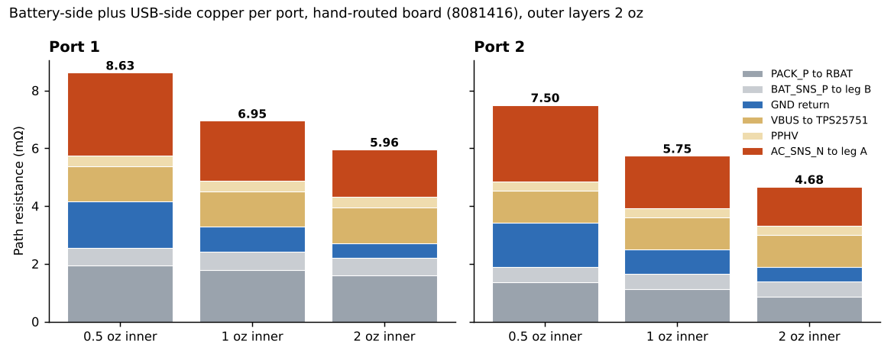
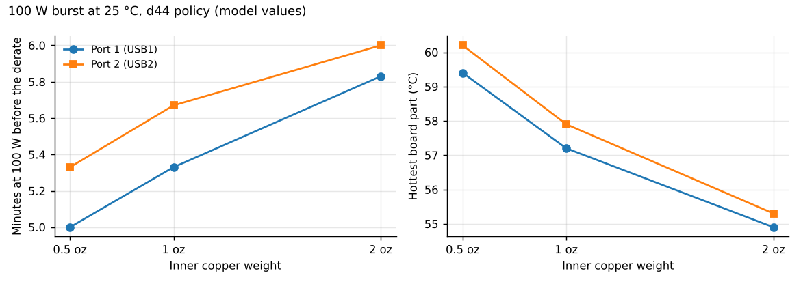

# Inner copper weight: 0.5 vs 1 vs 2 oz (2026-11-05)

**Board: the hand-routed board** that Logan approved on 2026-10-30. Since 2026-11-13 the design is the script-built
board on master (commit `dd34285`, PR #66), which has the same stack-up; this study has not been repeated on its copper. The copper was solved on `hardware/Production/Monolith.kicad_pcb` at commit `8081416` (the approval commit).
The later commit `8dd9eb6` adds the 2026-11-08 silk, UART route and corner ground fills to the same board.

The board is ordered with 6 layers, 2 oz outer and 0.5 oz inner copper (`hardware/Production/jlc/ORDER-NOTES.md`,
`docs/spec.md`). Logan asked on 2026-11-05 what heavier inner layers would buy: less copper loss, a cooler board, a
longer 100 W burst? Every number here is a model value: nothing has been built or measured.

**Short answer.** Going from 0.5 to 1 oz inner cuts the port 1 power-path resistance from 8.6 to 7.0 mΩ and the copper
loss at a 100 W burst from 0.29 to 0.24 W. The 100 W burst before the derate gets 20 s longer (5.0 to 5.3 min on port
1) and the hottest part 2.2 K cooler. Almost all of that comes from the board spreading heat better, not from the lower
I²R. 2 oz inner adds a little more. The recommendation was **1 oz inner if JLC's price difference is small**. Logan has
not decided; the board as specified and ordered stays **2 oz outer / 0.5 oz inner**.

<p align="center"></p>

*Battery-side plus USB-side copper of each port, by segment. Only the segments that run in the inner layers (GND
return in In1 / In4, AC_SNS_N in In3, part of PACK_P in In2) get shorter bars.*

## The model

**Copper.** The DC grid solver of the 2026-10-30 routed-board review (`docs/reviews/2026-10-30-routed-board/tools/`, the
same `solve.py` as `hardware/Production/groundup/compare/k/solve.py`) with the per-port path list of `lossmap.py`
(`hardware/Production/groundup/compare/k/lossmap.py`). Each port has a battery-side path (PACK_P from Q102 to the battery
sense resistor, BAT_SNS_P to leg B, GND from the shunt RS101 to the stage) and a USB-side path (VBUS from the connector to
the TPS25751, PPHV, AC_SNS_N to leg A). Sheet resistance is 0.246 mΩ/sq for 2 oz outer and 0.983 mΩ/sq for 0.5 oz inner;
the inner value scales inversely with the weight (0.491 mΩ/sq at 1 oz, 0.246 mΩ/sq at 2 oz).

The study switched the inner weight with an `INNER_OZ` environment variable patched into a copy of the solver. That
patch is not in the repo and the patched copy was not kept. `lossmap_oz.py` here does the same thing as a wrapper: it
scales the inner entries of the solver's sheet-resistance table and runs `lossmap.py` unchanged. On 2026-11-13 it gave
the resistances of `cu_oz1.json` to within 1e-10 mΩ on all four paths. The loss-tile lists come out with one to three
fewer 2 mm tiles per path than the study's files (116 against 118 on port 1's battery side, for example), so the study's
copy also differed slightly in how small tiles were cut; the tiles only place the heat in the thermal model.

**Thermal.** The pack thermal model in the rev 7 routed-board setup (`pack3d.py`, `smd.py`, `ntc.py`, `cu.py` in
`research_notes/Pack thermal BAK 65E/`, the same files this study used): d44 firmware policy, the
SMD NTCs TH101 / TH104 at the `out29` spot, 25 °C still air. For each weight `run_oz.py` changes two things:
1. the routed-copper I²R and its 2 mm loss tiles (`cu_oz<w>.json`);
2. the board's in-plane conductivity, scaled with the total copper thickness:
   K_BOARD_IN = 38 W/mK × (2 × 70 + 4 × t_inner) / 210 µm, which is 38, 50.7 and 76 W/mK at 0.5, 1 and 2 oz.

Cases: `dis100` (100 W out of USB1, port 1) and `dis100u2` (100 W out of USB2, port 2). The six runs ran on Logan's PC
through Remote Control on 2026-11-05. Their output (`results/p0f/*.npz` and `oz_metrics.json`) stayed on the PC; the
numbers below are from the study note of 2026-11-05, kept in `thermal_pc.json`.

## Results

### Copper resistance (mΩ)

Battery side plus USB side, from `cu_oz<w>.json`. The segments are in `paths_oz<w>.txt`.

| Inner copper | Port 1 battery side | Port 1 USB side | **Port 1 total** | Port 2 battery side | Port 2 USB side | **Port 2 total** |
|---|---|---|---|---|---|---|
| 0.5 oz (as ordered) | 4.15 | 4.47 | **8.63** | 3.42 | 4.08 | **7.50** |
| 1 oz | 3.29 | 3.66 | **6.95** | 2.50 | 3.24 | **5.75** |
| 2 oz | 2.72 | 3.25 | **5.96** | 1.89 | 2.79 | **4.68** |

The study note gives 8.62, 5.74 and 5.97 for three of these: those are sums of the rounded parts.

What moves and what does not (`paths_oz<w>.txt`):

| Segment, port 1 / port 2 | 0.5 oz | 1 oz | 2 oz |
|---|---|---|---|
| GND, shunt to stage (In1, In4) | 1.59 / 1.53 | 0.88 / 0.84 | 0.51 / 0.49 |
| AC_SNS_N, RAC to leg A (In3 and B.Cu) | 2.88 / 2.65 | 2.07 / 1.81 | 1.65 / 1.35 |
| PACK_P, Q102 to RBAT (B.Cu, part In2) | 1.94 / 1.35 | 1.79 / 1.12 | 1.59 / 0.86 |
| BAT_SNS_P, VBUS, PPHV (outer layers) | unchanged | unchanged | unchanged |

The cell side is outer copper and does not change: CELL_P 1.29 mΩ, CELL_N 0.32 mΩ, FET_MID 0.09 mΩ, CELL_P_RAW 0.25 mΩ.

### Copper loss at the 100 W burst

6.6 A on the battery side and 5 A on the USB side (R_battery × 6.6² + R_USB × 5²):

| Inner copper | Port 1 (W) | Port 2 (W) |
|---|---|---|
| 0.5 oz | 0.29 | 0.25 |
| 1 oz | 0.24 | 0.19 |
| 2 oz | 0.20 | 0.15 |

Port 1 is from the study note; port 2 is the same formula applied to `cu_oz<w>.json`. Against the roughly 6.1 W of
heat that one port makes at 100 W (see the 2026-10-31 thermal study), a saving of 0.06 to 0.10 W is small.

### Thermal, 100 W burst at 25 °C

| Inner copper | K_BOARD_IN (W/mK) | Burst before derate, port 1 / port 2 (min) | Hottest board part, port 1 / port 2 (°C) | Energy in the first 40 min (Wh) | Hottest can (°C) |
|---|---|---|---|---|---|
| 0.5 oz | 38 | 5.0 / 5.33 | 59.4 / 60.2 | 44.8 | 46.3 |
| 1 oz | 50.7 | 5.33 / 5.67 | 57.2 / 57.9 | 45.5 | 46.2 |
| 2 oz | 76 | 5.83 / 6.0 | 54.9 / 55.3 | 46.3 | 46.05 |

The model steps the burst in 20 s, so 5.0 against 5.33 min is one step. The note gives the energy and the hottest can
as one value per weight without naming the port.

<p align="center"></p>

*Burst length and hottest board part against inner copper weight, both ports.*

### Mass

About 1.4 g more copper for 1 oz inner and about 4 g for 2 oz (estimate from the study note).

## Conclusion

- The gain is almost all heat spreading. Thicker inner planes raise the board's in-plane conductivity by a third (1 oz)
  or double it (2 oz), which pulls heat away from the power stages to the gap filler and the cans. The copper loss
  falls by only 0.06 to 0.10 W.
- The cans hardly change (46.3 to 46.05 °C), so the cells are not what limits the burst. The hottest board part does:
  2.2 K cooler at 1 oz and 4.5 K cooler at 2 oz on port 1.
- 1 oz inner is the recommended change if JLC charges little for it: one extra 20 s step of 100 W burst on each port,
  2.2 to 2.3 K cooler parts, about 1.4 g. 2 oz gains about as much again (another 0.33 to 0.5 min and
  2.3 to 2.6 K) for about 4 g.
- **Status: Logan has not decided.** The board as specified (`docs/spec.md`) and the order notes stay at 2 oz outer /
  0.5 oz inner.

## Limits

- K_BOARD_IN scales with total copper thickness as if the inner planes were full sheets. Real inner layers have
  clearances, anti-pads and via fields, so the real gain is somewhat smaller.
- Copper losses are DC. The thermal model's stage losses and policy are those of the rev 7 setup; only the copper and
  K_BOARD_IN change between runs.
- The thermal results come from runs on Logan's PC whose output is not in the repo; the values are as recorded in the
  study note.
- The mass is an estimate, not from the fab.
- The script-built (ground-up) board on master (PR #66), the design since 2026-11-13, was not run here. Its own copper and thermal comparison, at 0.5 oz inner, is
  in [`hardware/Production/groundup/compare/`](../../../hardware/Production/groundup/compare/README.md).

## How to rerun

Copper (needs numpy, scipy, Pillow and pyamg; several minutes per weight):

```sh
git show 8081416:hardware/Production/Monolith.kicad_pcb > /tmp/hand_routed.kicad_pcb
cd docs/analysis/2026-11-05-inner-copper
for w in 0.5 1 2; do PCB=/tmp/hand_routed.kicad_pcb INNER_OZ=$w python3 lossmap_oz.py; done
```

This writes `cu_oz<w>.json` (and `lossmap_oz<w>_*.npy`, which are not kept) in the current folder. The per-path lines
it prints have a different layout from `paths_oz<w>.txt`, which is the study's own printout, but the same values.

Thermal (`NPROC` sets the number of processes, 6 by default): copy `run_oz.py`, `analyze_oz.py` and
the three `cu_oz<w>.json` into a copy of `hardware/Production/groundup/compare/thermal/` and run

```sh
python run_oz.py dis100,dis100u2 0.5,1,2     # results/p0f/<case>_oz<w>.npz
python analyze_oz.py                         # prints and writes results/p0f/oz_metrics.json
```

Figures: `python3 figs.py` (needs matplotlib) writes `img/path-resistance.png` and `img/thermal.png` from
`paths_oz<w>.txt`, `cu_oz<w>.json` and `thermal_pc.json`.

## Files

| File | What it is |
|---|---|
| `lossmap_oz.py` | Copper solver with a chosen inner weight (`INNER_OZ`); wraps `hardware/Production/groundup/compare/k/lossmap.py` (added 2026-11-13 in place of the study's patched copy, which was not kept) |
| `cu_oz0.5.json`, `cu_oz1.json`, `cu_oz2.json` | Per-port resistance and 2 mm loss tiles, in the thermal model's `cu.py` format |
| `paths_oz0.5.txt`, `paths_oz1.txt`, `paths_oz2.txt` | The solver printout of the study: resistance of every path segment and of the cell side |
| `run_oz.py` | The thermal runs: sets the copper file and K_BOARD_IN per weight |
| `analyze_oz.py` | Burst minutes, energy in 40 min, hottest can and part per run |
| `thermal_pc.json` | The thermal results as recorded in the study note |
| `figs.py`, `img/` | The two figures |
