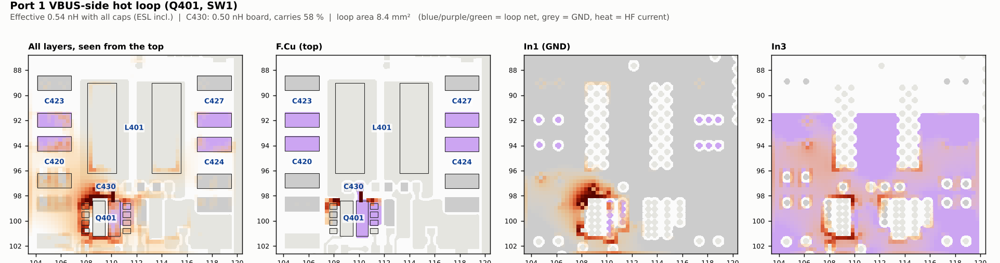
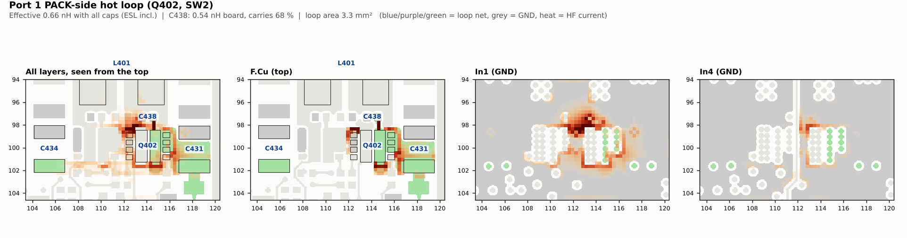
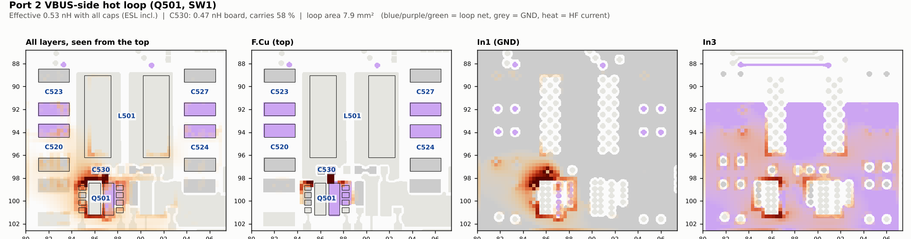
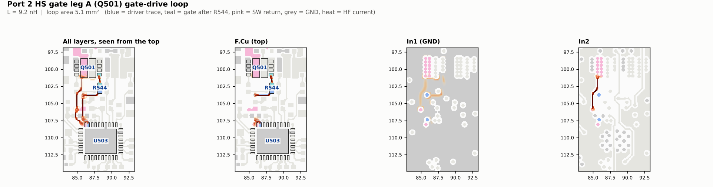
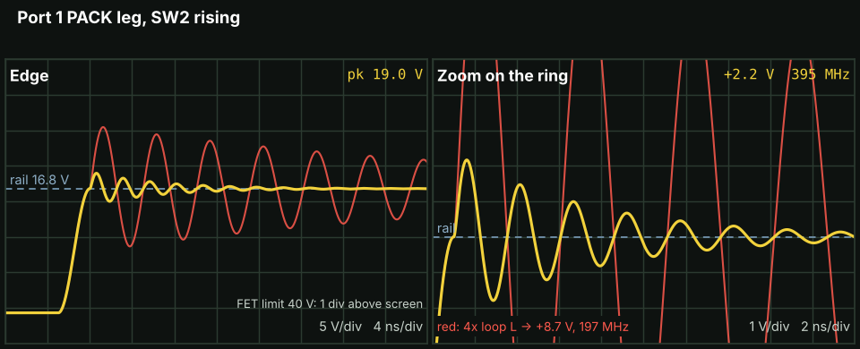
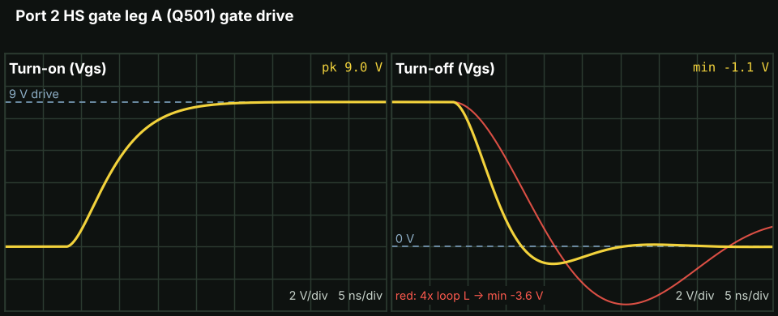

# Switch-node, hot-loop and gate-loop inductance (2026-11-06)

**Board: the hand-routed board** that Logan approved on 2026-10-30. Since 2026-11-13 the design is the script-built
board on master (commit `dd34285`, PR #66); its loops were solved with the same tools in
`hardware/Production/groundup/compare/` (charger hot loops 0.50 to 0.56 nH, gate loops 3.3 to 8.0 nH), not here. The study ran on Logan's local save of 2026-11-04 02:20Z. The committed version of that board is
`hardware/Production/Monolith.kicad_pcb` at commit `8dd9eb6` (the same file as `36dad0c`, which added the 2026-11-08 silk,
UART and corner fills). The 2026-11-04 save differed from the committed file only in one port 2 BAT_SNS_P trace. A
rerun on `8dd9eb6` on 2026-11-13 gave the same port 1 PACK-leg loop to the last digit (0.656 nH) and the same port 2
PACK-leg loop (0.600 nH, one more mesh node).

Logan asked on 2026-11-06 how much inductance each switching loop on the board has: the four BQ25756 half-bridge legs, the
two 5 V bucks and the 3V3 buck (the hot loops), the eight gate-drive loops, and how large the switch nodes are. He then
asked what that means for ringing. Every number here is a model value: nothing has been built or measured.

**Short answer.** No loop needs a fix. With all their capacitors the BQ25756 hot loops are 0.53 to 0.66 nH, the 5 V
bucks 0.54 and 0.60 nH and the 3V3 buck 1.39 nH. The 0402 HF capacitor next to each BQ25756 FET carries 58 to 68 % of
the edge current. The hot loops ring at about 395 to 425 MHz, with an expected switch-node peak of 18.8 to 22.4 V and a
worst-case (instant-edge) bound of 32 to 33 V against the FETs' 40 V. The gate loops are 2.9 to 9.2 nH. The worst is the
port 2 high-side leg A loop, where the drive and its return are on different layers over a jump. The tightest margin
is the low-side Miller bounce, about 0.46 V against the FET's 1.1 V minimum threshold. Two small optional fixes are
listed below.

<p align="center"></p>

*Port 1 VBUS-side hot loop (Q401, SW1). First panel: all layers seen from the top; the others: the busiest layers.
Darker orange is more HF current. C430 sits above Q401 but the SW pad lies between its GND pad and the source pins, so
its return dives to In1 and comes back up at the source vias (the hot spot at x 108 to 110, y 97 to 99).*

## The model

- **Solver.** A partial-element (PEEC) inductance solve on the real board copper, in the high-frequency limit (current
  set by inductance only, no resistance). The copper of the loop's nets is rasterised per layer on a square grid; each
  pair of neighbouring cells of one net gets an x or y bar, each via a vertical bar. Partial inductances between bars
  come from the filament formula with a geometric-mean-distance floor. Ideal parts are stamped on top: shorts for the
  FET and IC pins, and each capacitor as its package inductance. The loop inductance is the port voltage for unit
  current. The solver is `peec.py`; it is already in the repo at `hardware/Production/groundup/compare/peec.py`, where the
  ground-up comparison reuses it, so it is not copied here.
- **Grid.** 0.3 mm cells for the hot loops, 0.15 mm for the gate loops, 0.05 mm for the switch-node areas.
- **Stack-up** (from the KiCad board): 0.07 mm outer copper (2 oz), 0.0175 mm inner copper (0.5 oz), dielectric
  0.2 / 0.3 / 0.39 / 0.3 / 0.2 mm. In1 and In4 are the ground planes.
- **Hot loops.** The switch is a short between the FET's drain and source pads (the IC's VIN and GND pins for the
  bucks). Each capacitor between the loop's supply net and GND is solved alone (board inductance of that capacitor's
  loop) and then all together with their package inductance (0.30 nH 0402, 0.40 nH 0603, 0.50 nH 0805, 0.60 nH 1206 and
  1210, 1.5 nH tantalum), which gives the effective loop inductance and each capacitor's share of the edge current.
- **Gate loops.** From the BQ25756 driver pin, through the 0 Ω gate resistor, to the FET gate, and back through the
  return pins (SW for the high side, GND for the low side). Ground copper is kept only on F.Cu and In1 for these loops.
- **Ringing.** Assumptions from the 2026-11-06 follow-up: 0.3 nH of FET package added to each hot loop, Coss 170 pF
  at 20 V for the BQ25756 FETs (80 pF for the 5 V bucks, 30 pF for the 3V3 buck), Q = 8, 3 ns edges (2 ns for the
  small bucks), switched current 5 A on the VBUS legs, 6.8 A on the PACK legs, 3 A for the 5 V bucks and 0.5 A for the
  3V3 buck. The BQ25756 switches at 500 kHz (R412 49.9 kΩ) and the TPS62933 at 1.2 MHz (RT to GND); the ring
  formulas do not use the switching frequency. For the gate loops: loop L plus 1 nH package, Ciss 1180 pF
  (high side) or 1070 pF (low side), 3.4 Ω pull-up or 1.0 Ω pull-down plus 2.3 Ω internal gate resistance, 9 V drive.

**Check.** `test_peec.py` solves two stacked strips (F.Cu over In1, 10 mm long, 2 or 4 mm wide, shorted at the far end)
and prints the result next to the plain parallel-plate value μ0·l·d/w. On 2026-11-13 it gave 1.12 and 0.60 nH at
0.5 mm cells and 1.15 and 0.62 nH at 0.25 mm cells, against 1.53 and 0.77 nH for the plate formula. The plate formula
ignores fringing and so reads high for strips this narrow against their 0.24 mm spacing; halving the cell changes
the result by 2 to 3 %. The study note of 2026-11-06 records agreement within 4 % with a stacked-strip formula; that
formula is not in the copied script.

## Ringing basics

When a FET switches, the current in the hot loop changes in a few nanoseconds. The loop's inductance and the FET's
output capacitance (Coss) form a resonant circuit, so the switch node overshoots the rail and rings at
f = 1 / (2π √(L·C)) until the loop resistance damps it. Two numbers bound the overshoot. With a finite edge (time tr)
the extra voltage is about L·I / tr, which is what a real board shows. With an instant edge it is I·√(L/C), which is the
worst case. A loop with four times the inductance rings at half the frequency and overshoots about four times as much;
the red traces in the scope views show that case for comparison.

A gate loop is a series R-L-C: the driver resistance, the loop inductance and the FET's input capacitance. If the
damping ratio ζ = (R/2)·√(C/L) is well below 1, the gate rings, and at turn-off it swings below 0 V. What matters at
turn-off is whether the swing, plus the Miller bounce that the other FET's edge couples into the gate, can lift the gate
back over its threshold.

## Results

### Hot loops

Names as in `hot_all.json`. "Effective" is all capacitors together with their package inductance, seen from the FET.
"HF cap" is the capacitor with the lowest board inductance. Ringing columns from `ring.json` (`ring.py` recomputes
them).

| Loop | Effective L (nH) | HF cap: board L, share | Loop area (mm²) | Ring (MHz) | Expected SW peak (V) | Instant-edge bound (V) | Rating (V) |
|---|---|---|---|---|---|---|---|
| P1 VBUS leg (Q401) | 0.54 | C430: 0.50 nH, 58 % | 8.4 | 421 | 22.4 (21 V rail) | 32.1 | 40 |
| P1 PACK leg (Q402) | 0.66 | C438: 0.54 nH, 68 % | 3.3 | 395 | 19.0 (16.8 V rail) | 32.9 | 40 |
| P2 VBUS leg (Q501) | 0.53 | C530: 0.47 nH, 58 % | 7.9 | 423 | 22.4 (21 V rail) | 32.1 | 40 |
| P2 PACK leg (Q502) | 0.60 | C538: 0.46 nH, 68 % | 2.9 | 407 | 18.8 (16.8 V rail) | 32.4 | 40 |
| P1 5V buck (U404) | 0.54 | C444: 0.69 nH, 31 % (C446 0.71 nH, 40 %) | 3.6 | 615 | 18.1 | 26.5 | 30 |
| P2 5V buck (U504) | 0.60 | C546: 0.46 nH, 70 % | 0.9 | 593 | 18.2 | 26.9 | 30 |
| 3V3 buck (U204) | 1.39 | C206: 0.89 nH, 100 % | 3.6 | 707 | 17.2 | 20.6 | 30 |

- On the BQ25756 legs the 0402 0.1 µF capacitor (C430, C438, C530, C538) carries 58 to 68 % of the edge current. The 22 µF
  bulk capacitors return through In3 (AC_SNS_N) and In4.
- **P1 PACK leg:** C434 hangs off a B.Cu band that necks to 0.29 mm at the LG1 via (108.08, 102.11), so its loop is
  4.62 nH and it carries only 7 %. On port 2 the same band stays 1.0 mm wide and C534 is 2.92 nH.
- **P1 5V buck:** C446 (0402) and C444 (1210) share the edge current; the pair gives 0.54 nH.
- **3V3 buck:** a single 2.2 µF 0805 (C206) with 0.89 nH of board. The buck carries 0.5 A, so the effect is small.
- The 2026-11-06 note puts the BQ25756 legs at about 300 MHz with 5 V in.

### Gate-drive loops

Names as in `gate.json`. Ring frequency, damping and overshoot from `gate_ring.json` (written by `ring.py`); the
turn-off minimum from `scope.json` (written by `scope.py`).

| Loop | L (nH) | Loop area (mm²) | Ring (MHz) | ζ at turn-off | Turn-off overshoot | Vgs minimum at turn-off (V) | Same with 4× L (V) |
|---|---|---|---|---|---|---|---|
| P1 HS gate leg A (Q401) | 7.4 | 6.7 | 51 | 0.62 | 8 % | −0.75 | −3.24 |
| P1 LS gate leg A (Q401) | 5.2 | 1.4 | 62 | 0.69 | 5 % | −0.46 | −2.85 |
| P1 HS gate leg B (Q402) | 7.7 | 7.2 | 50 | 0.61 | 9 % | −0.81 | −3.30 |
| P1 LS gate leg B (Q402) | 3.5 | 1.3 | 73 | 0.81 | 1 % | −0.12 | −2.25 |
| P2 HS gate leg A (Q501) | 9.2 | 5.1 | 46 | 0.56 | 12 % | −1.07 | −3.60 |
| P2 LS gate leg A (Q501) | 6.2 | 6.2 | 57 | 0.64 | 8 % | −0.67 | −3.14 |
| P2 HS gate leg B (Q502) | 8.6 | 9.2 | 47 | 0.58 | 11 % | −0.96 | −3.48 |
| P2 LS gate leg B (Q502) | 2.9 | 3.3 | 78 | 0.87 | 0 % | −0.04 | −1.99 |

- **Worst loop, P2 HS gate leg A:** HIDRV1 jumps on B.Cu while the SW1 return jumps on In2, so drive and return are two
  planes apart over the jump.
- **Tightest margin:** the low-side Miller bounce, about 0.46 V against the FET's minimum threshold of 1.1 V (from
  the 2026-11-06 note).
- **Tuning knobs if the bench shows ringing:** the 0 Ω gate resistors R444 to R447 and R544 to R547, and the BQ25756
  setting in register 0x3B.

### Switch-node copper

From `swarea.json` (0.05 mm grid). The capacitance is a parallel-plate estimate to the neighbouring ground planes
(εr 4.4 over 0.2 mm for the outer layers, 4.5 over 0.3 mm on both sides for the inner layers).

| Node | F.Cu (mm²) | B.Cu (mm²) | Each inner layer (mm²) | Total (mm²) | Vias | C to ground (pF) |
|---|---|---|---|---|---|---|
| Port 1 SW1 | 38.96 | 38.59 | 6.08 | 101.87 | 32 | 21.6 |
| Port 1 SW2 | 37.51 | 38.52 | 6.63 to 8.29 | 104.21 | 33 | 22.3 |
| Port 2 SW1 | 37.33 | 39.06 | 6.46 to 7.47 | 103.24 | 34 | 22.0 |
| Port 2 SW2 | 37.86 | 39.20 | 6.46 | 102.90 | 34 | 21.9 |
| Port 1 SW_5V | 6.50 | | | 6.50 | 0 | 1.3 |
| Port 2 SW_5V | 7.12 | | | 7.12 | 0 | 1.4 |
| SW_3V3 | 4.42 | | | 4.42 | 0 | 0.9 |

The outer-layer copper of each BQ25756 switch node (about 39 mm² on each side) accounts for about 15 pF. Keep the B.Cu
copies: they are part of the heat path into the gap filler.

### Optional fixes

None is needed for the P0 order. If the layout is touched again:
1. **P1 C434 feed.** Widen the B.Cu band to C434 where it necks to 0.29 mm at the LG1 via (108.08, 102.11). On port 2 the
   same band is 1.0 mm and C534 is 2.92 nH against C434's 4.62 nH.
2. **P1 SW_5V clearance.** SW_5V runs about 0.2 mm from PPHV along x 105.4 to 105.8, y 104 to 107.2 (0.18 mm on the
   0.05 mm grid of `swarea.json`). More space there would reduce the coupling of the 5 V buck's edge into PPHV.
3. A thinner prepreg between F.Cu and In1 lowers the hot loops by only 5 to 10 % (`thin.py`), not worth a stack-up change.

## Figures

Each figure's title names its loop. File names follow the loop names in the JSON files, not a list position (see
"Fixed during the study" below).

**Hot loops.** Blue, purple or green is the loop's supply net, grey is GND, and orange is the HF current with all
capacitors in place.

<p align="center"></p>

*Port 1 PACK-side hot loop (Q402, SW2): C438 carries 68 %; C434 at the far left barely takes part.*

<p align="center"></p>

*Port 2 VBUS-side hot loop (Q501, SW1): a mirror of port 1, about 5 % lower, with the same C530 return through In1.*

The other four: [`img/hot-p2-pack-q502.png`](img/hot-p2-pack-q502.png) (port 2 PACK leg),
[`img/hot-p1-5v-u404.png`](img/hot-p1-5v-u404.png) and [`img/hot-p2-5v-u504.png`](img/hot-p2-5v-u504.png) (5 V bucks),
[`img/hot-3v3-u204.png`](img/hot-3v3-u204.png) (3V3 buck).

**Gate loops.** Blue is the driver trace, teal the gate after the 0 Ω resistor, pink the SW return.

<p align="center"></p>

*Port 2 HS gate leg A (Q501), the worst gate loop (9.2 nH): the HIDRV1 jump on B.Cu and the SW1 return on In2 are two
planes apart.*

The other seven are `img/gate-p<port>-<hs|ls>-<a|b>-<FET>.png`, for example
[`img/gate-p1-ls-b-q402.png`](img/gate-p1-ls-b-q402.png).

**Scope views** (`img/scope/`). For the hot loops these are drawn from the ringing numbers above, not simulated: a
3 ns raised-cosine edge from −0.7 V to the rail, then a ring at the computed frequency sized by L·I/tr and decaying with
Q = 8. A stiff circuit simulation with a switch-resistance edge gives peaks close to the instant-edge bound (26 to 34 V),
which would contradict the table, so it was not used. For the gate loops they are a series R-L-C simulation without
the Miller plateau, so real turn-on has a flat step part way up; the ringing below 0 V at turn-off is the part to
compare. Yellow is this layout; red is the same loop with four times the inductance.

<p align="center"></p>

*Port 1 PACK leg, SW2 rising: 19.0 V peak, +2.2 V ring at 395 MHz. With four times the loop inductance it would be
+8.7 V at 197 MHz.*

<p align="center"></p>

*Port 2 HS gate leg A: turn-on through 3.4 Ω, turn-off through 1.0 Ω. It dips to −1.07 V at turn-off, and to −3.6 V
with four times the loop inductance.*

A real probe needs a short ground spring at the FET; a probe's ground lead adds ringing that is not on the board.

The interactive page of this study (a 3D loop viewer and all the cards, 3.7 MB) is not in the repo: no other study
here commits an interactive page of that size. `run3d.py`, `viewer_data.py` and `viewer_snippet.html` make its 3D
viewer data.

### Fixed during the study

`fig2.py` draws the hot loops in a different order from `hot_all.json` (both VBUS legs, then both PACK legs), and
`scope.py` used the `hot_all.json` order. Numbered file names therefore pointed at different loops in the two sets,
and the second version of the web page showed the port 1 PACK leg and port 2 VBUS leg cards with each other's current
maps. The page was fixed on 2026-11-06. Here both scripts name their files after the loop (`hot-p1-pack-q402.png` and
so on), `scope.py` checks that each `ring.json` entry matches its loop, and each figure in `img/` was checked against
its title.

## Limits

- High-frequency limit only: no skin-effect resistance, so the damping (Q = 8) is an assumption, not a result.
- Package inductances of the capacitors and FETs are typical values, not from the part datasheets.
- Coss, Ciss, the edge times and the currents are assumptions (listed above). Real edges depend on the gate resistors and
  the BQ25756 setting in register 0x3B.
- The gate loops keep ground copper on F.Cu and In1 only. The ground-up comparison of 2026-11-10 re-solved this board
  (`base`) with a different ground setting (see its notes on the method) and got 3.0 to 8.6 nH for the gate loops and 0.54 to 0.67 nH for the
  charger hot loops: see [`hardware/Production/groundup/compare/`](../../../hardware/Production/groundup/compare/README.md).
- The switch-node capacitance is a plate estimate without fringing.
- Nothing here is measured. The bench check is a scope on each switch node and gate with a ground spring.

## How to rerun

Needs Python 3 with numpy, scipy, Pillow and matplotlib. The solver and the board reader live in
`hardware/Production/groundup/compare/` (`peec.py`, `loops.py`, `board.py`, `sx.py`, `run_all_defs.py`); every script
here adds that folder to its path. The board is read from the `PCB` environment variable and the scripts stop if it is
not set, because the board on master is the script-built one and this study is of the hand-routed board:

```sh
git show 8dd9eb6:hardware/Production/Monolith.kicad_pcb > /tmp/hand_routed.kicad_pcb
export PCB=/tmp/hand_routed.kicad_pcb
cd docs/analysis/2026-11-06-loop-area
python3 test_peec.py                 # solver check, a few seconds
python3 run_all.py                   # hot loops, writes hot_all.json, maps_all.pkl (about 1 min per BQ25756 leg)
python3 run_gate.py                  # gate loops, writes gate.json, maps_gate.pkl
python3 swarea.py                    # switch-node copper, writes swarea.json
python3 ring.py                      # ringing numbers, checks ring.json, writes gate_ring.json (no board needed)
python3 fig2.py img                  # current maps (needs the two .pkl files)
python3 scope.py img/scope           # scope views and scope.json (no board needed)
python3 thin.py                      # thinner-prepreg variant of the two port 1 BQ25756 hot loops
python3 run3d.py hot; python3 run3d.py gate; python3 viewer_data.py   # 3D viewer data
```

`run_all.py 0 1` runs only some loops and writes `hot_0_1.json`. The `.pkl` maps are large and not kept.

## Files

| File | What it is |
|---|---|
| `run_all.py` | Hot-loop runs (loop definitions inline; the same list is `run_all_defs.py` in the solver folder) |
| `run_gate.py` | Gate-loop runs |
| `swarea.py` | Switch-node copper area, neighbours within 0.5 mm, plate capacitance |
| `thin.py` | The two port 1 BQ25756 hot loops with a thinner F.Cu to In1 prepreg |
| `test_peec.py` | Solver check on two stacked strips |
| `ring.py` | Ringing formulas; checks `ring.json`, writes `gate_ring.json` (added 2026-11-13, the original script was not kept) |
| `fig2.py` | Current-map figures `img/hot-*.png`, `img/gate-*.png` |
| `scope.py` | Scope-view figures `img/scope/*.png` and `scope.json` |
| `run3d.py`, `viewer_data.py`, `viewer_snippet.html` | Data and markup of the 3D viewer of the web page |
| `hot_all.json` | Hot loops: per-capacitor board L, effective L, current shares, loop area vectors (mm²) |
| `gate.json` | Gate loops: L and loop area vector |
| `ring.json` | Hot-loop ringing: L with package, f, Z0, dv, expected peak, instant-edge bound, decay time, rating |
| `gate_ring.json` | Gate-loop ring frequency, damping ratio and turn-off overshoot |
| `scope.json` | Peaks and minima of the scope views |
| `swarea.json` | Switch-node copper per layer, neighbouring nets with their distance, capacitance |
| `img/` | 7 hot-loop and 8 gate-loop current maps; `img/scope/` the 15 scope views |
