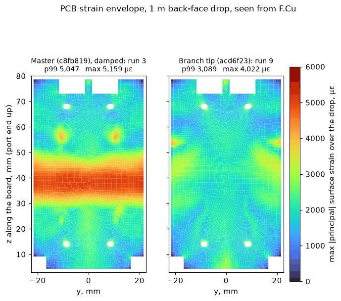
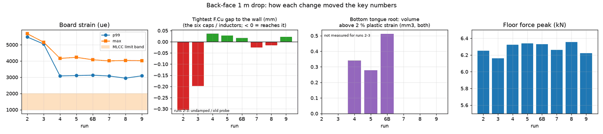
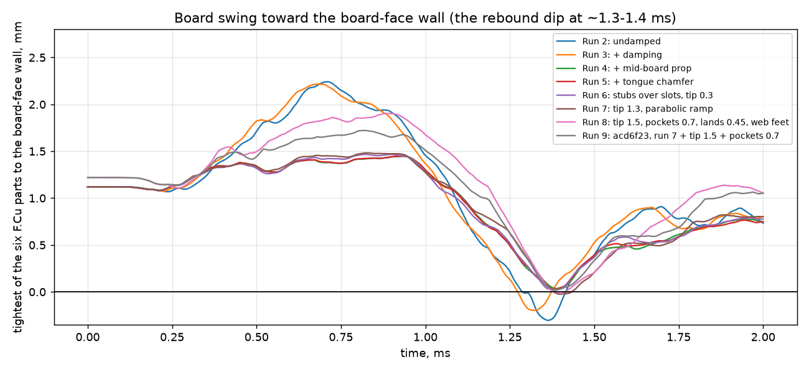
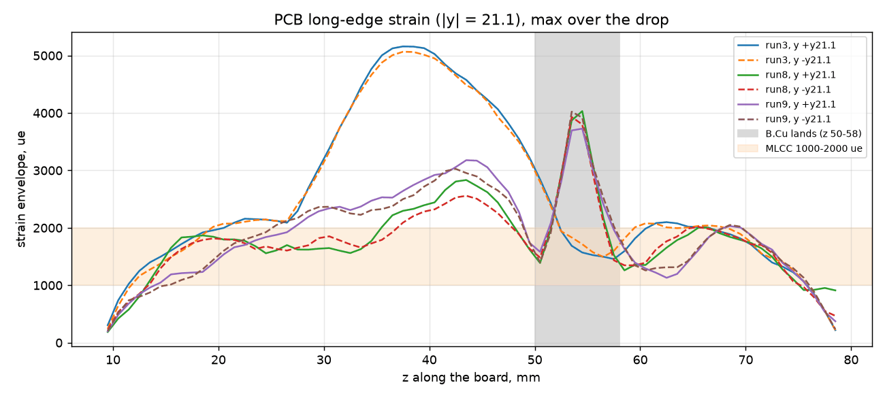
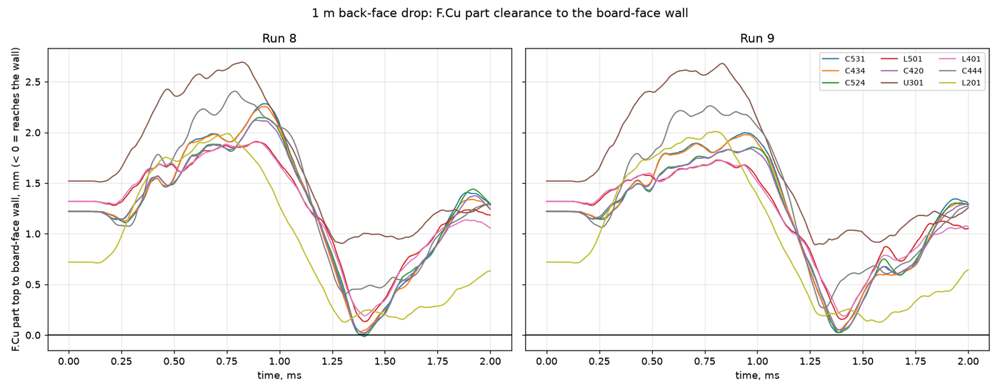
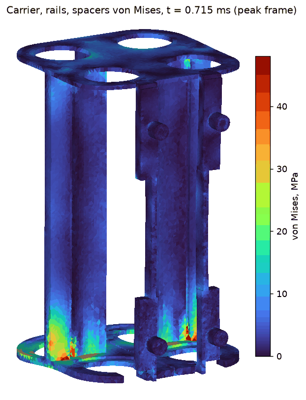
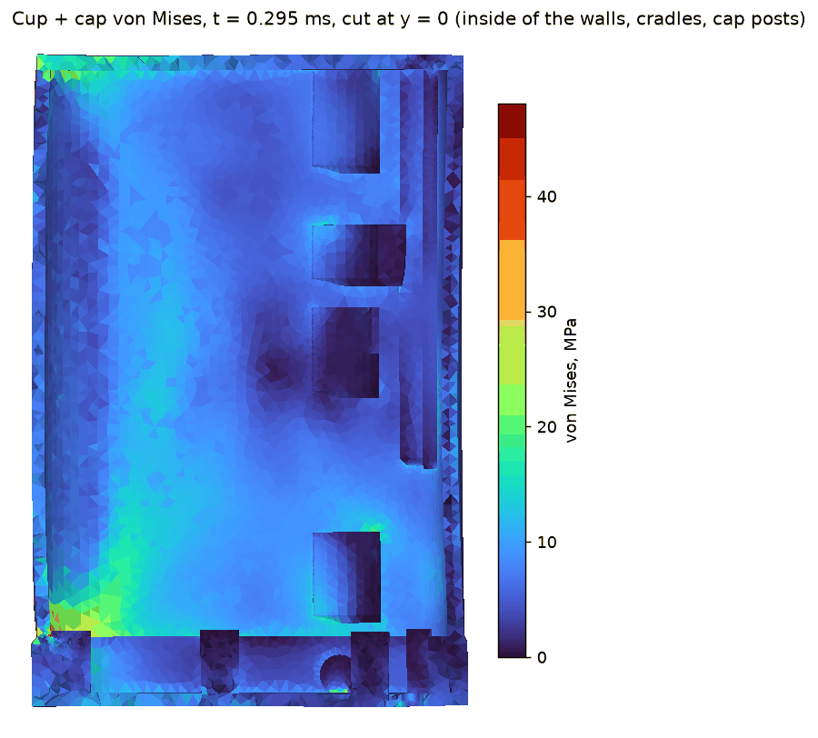

# 3D explicit drop study: 1 m flat onto the back (cell) face

The study ran 2026-11-10/11 on Logan's PC, outside the repo (`C:\Users\Logan\Documents\BatteryBank-fea\drop_back`). Each run
uses the geometry of one commit, exported with `git archive`. It follows on from the 2026-11-04 lumped study and checks the
board, the rails and the cup in 3D for the back-face drop, which is the worst case in that study.

Every figure and run, interactively: https://claude.ai/artifact/5e8FgYGjQaZCfDvVeQPFwm (private to the project owner).

> **Status:** runs 2-9 are complete. Run 9 is the validation run on the merged geometry (acd6f23, master since PR #69). Its first attempt stalled at
> 0.44 ms on one collapsed tet at a cap-post top, a meshing problem rather than a design one. The rerun has a 0.3 mm mesh
> at the five post tops and is otherwise identical. It ended normally: 2 ms in 57 min.

## Setup

| Item | Value |
|---|---|
| Solver | OpenCourant (community fork of OpenRadioss), explicit, Intel MPI 16 ranks, about 50 min per 2 ms run |
| Units | t, mm, s (N, MPa) |
| Load | every node starts at −4,430 mm/s toward the floor (1 m drop), no gravity; rigid floor (`/RWALL`, friction 0.3) |
| Duration | 2.0 ms: impact, floor peak at about 0.48 ms, separation at about 0.98 ms, rebound swing |
| Mesh | about 900k nodes. fTetWild tets: TETRA10 for the PA12 and TPU parts, TETRA4 for cells and USB-C bodies. QEPH shell for the PCB |
| PCB | 1.6 mm FR4 shell, E 22 GPa, with the outline and the four peg slots; the 259 parts are lumped masses on their footprints (5.2 g) |
| Contact | 16 TYPE24 penalty interfaces, friction 0.2 (0.5 for the bumpers on the cup); USB-C bodies tied to the PCB |
| Time step | 1e-7 s with nodal mass scaling (adds about 0.5 % mass, mostly late in the run) |
| Total mass | 401.8-402.1 g, matching the CAD mass budget |

**Materials** (assumed, not measured):
- MJF PA12: E 1,700 MPa, yield 48 MPa plus hardening (Johnson-Cook).
- TPU 95A bands: E 40 MPa (impact rate), yield 10 MPa.
- TPU 30 % gyroid slabs: E 4.5 MPa, plateau 0.675 MPa.
- Cells: homogenised elastic, E 2 GPa, at their full mass.
- USB-C receptacles: homogenised, E 8 GPa.

**Damping (runs 3 on):** frequency-range damping over 0.5-3 kHz. PA12 2.5 %, PCB 2 %, TPU 7 %. It stands in for the TPU
hysteresis and the structural damping that the material laws lack.

**Checks:**
- **TETRA10 node order:** proven on a cantilever, with the first frequency within 0.3 % of beam theory. Plain TETRA4 locks about 1.8× too stiff.
- **Energy (run 2, undamped):** closes within 0.5 % once contact (friction) energy is counted.
- **Energy (damped runs):** read about −7.5 % at the floor peak and −15 % at 2 ms. That gap is the damping work, which the solver does not report.
- **F.Cu clearance probes:** sit on each part's hull faces and follow the board under them.

## Runs

| Run | Commit | What changed | Board strain p99 / max (µε) | Tightest F.Cu gap to the wall (mm) | Floor (kN) | Notes |
|---|---|---|---|---|---|---|
| 2 | c8fb819 (master) | baseline, undamped | 5,477 / 5,680 | −0.30 (C531) | 6.25 | mid-span band across the board; rebound swings 8 F.Cu parts into the wall |
| 3 | c8fb819 | + damping | 5,047 / 5,159 | −0.20 (C531) | 6.16 | 7 F.Cu parts still reach the wall; bottom −y tongue yields |
| 4 | 4c5cda1 | + mid-board prop (spined rails) | 3,081 / 4,160 | +0.04 (L501) | 6.32 | board strain −39 %; hot spot moves to the B.Cu land's lower end; tongue root yields 0.34 mm³ |
| 5 | 75f0196 | + tongue root chamfer | 3,105 / 4,226 | +0.03 (L501) | 6.34 | root yield only −11 to −25 % (0.28 mm³) |
| 6 | b0bd253 | stubs over the key slots | (stalled at 0.47 ms) | | | 0.1 mm block-face sliver crushed; fixed as variant B |
| 6B | 34dca5f | variant B, tip gap 0.3 | 3,129 / 4,077 | +0.02 (L501) | 6.33 | tips bottom out with 60 N; root yield 0.51 mm³ |
| 7 | 0ce9b68 | tip gap 1.3, 4 mm parabolic land ramp | 3,076 / 4,007 | −0.03 (L501) | 6.26 | **tongue elastic** (tip 5 N); board load goes into the cans; L501 / L401 reach their pockets |
| 8 | d6af475 | tip gap 1.5, 0.7 mm pockets, lands 0.45, web feet | 2,943 / 4,032 | −0.02 (C524) | 6.36 | pockets clear L401 / L501 (+0.19 / +0.13); edge peak stays about 4,000 µε; web-foot hot spot 54 % |
| **9** | **acd6f23, merged in PR #69** | run 7 + tip gap 1.5 + 0.7 mm pockets (lands and web feet backed out) | **3,089 / 4,022** | **+0.02 (C531), no strikes** | 6.22 | L401 / L501 +0.19 / +0.15; tongue tips close to 0.12 mm (3-5 N graze), root 30-33 MPa; web max 21 % |

The MLCC strain limit is roughly 1,000-2,000 µε. "Tightest F.Cu gap" is the minimum over C531, C434, C524, L501, C420 and
L401, the six parts closest to the board-face wall. A negative gap means the part reaches the wall. Runs 2-3 used an older
probe that put points beside the parts, so their gaps are approximate (it gave U301 a false −0.62 mm, since corrected).

## Figures

*PCB strain envelope seen from F.Cu, one colour scale: master (run 3, damped) against the merged geometry (run 9). Master has a
full-width band at mid-length, where nothing props the board. With the spined rails the band is gone, and the peak sits on
the long edges at z 53-55.*

*How each change moved board strain, the tightest F.Cu gap, the bottom tongue's yield and the floor force.*

*Tightest F.Cu gap against time. The dip at about 1.3-1.4 ms is the rebound, when the board swings toward the board-face
wall as the wall breathes inward.*

*Strain along the board's long edges (y ±21.1). The peak has stayed at about 4,000 µε since run 5, moving up the B.Cu
land as its shape changed.*

*Gap from each F.Cu part to the board-face wall over time, run 8 against run 9. In run 9 none reaches the wall.*

*Run 9: carrier, rails and spacers at their peak frame (0.715 ms), von Mises, 0-48 MPa (red is at yield). The hot spots
are where the webs and spines meet the bottom frame. Drawn with matplotlib.*

*Run 9: cup and cap cut at y = 0 at the cup's peak frame (0.295 ms), von Mises, 0-48 MPa. Back face on the left, board
face on the right, cap and its posts at the bottom. Drawn with matplotlib.*

## Run 9 (acd6f23) against runs 7 and 8

| | Run 7 (0ce9b68) | Run 8 (d6af475) | **Run 9 (acd6f23)** |
|---|---|---|---|
| Board strain p99 / max (µε) | 3,076 / 4,007 | 2,943 / 4,032 | **3,089 / 4,022** |
| Board-edge peak +y / −y (µε), z 53-55 | 3,869 / 4,007 | 4,032 / 3,930 | 3,727 / 4,022 |
| F.Cu C531 / C434 / C524 / L501 / C420 / L401 (mm) | +0.02 / +0.01 / +0.01 / −0.03 / +0.02 / −0.01 | +0.01 / +0.04 / −0.02 / +0.13 / +0.02 / +0.19 | **+0.02 / +0.05 / +0.03 / +0.15 / +0.05 / +0.19** |
| Bottom tongue tip: start → min gap | 1.3 → −0.03 (5 N) | 1.5 → +0.25 | 1.5 → +0.12 (3-5 N graze) |
| Tongue root: peak von Mises / elements over 2 % | 37 MPa / ≈0 | 43 MPa / 0 | 30-33 MPa / 4 on +y (max 6 %), 0 on −y |
| Board → rail / blocks → cans / spine → cans, impact (N per rail) | 412-430 / 222-225 / 242-252 | 591-610 / 215-228 / 433-461 | 407-413 / 216-219 / 243-251 |
| Board edge onto the B.Cu land: start gap / force per side | 0.25 mm / 126-132 N | 0.445 mm / 98-103 N | 0.25 mm / 128-132 N |
| Carrier webs: p99.9 / max / volume over 2 % | 4.4 % / 24 % / 11.0 mm³ | 4.6 % / 54 % / 9.0 mm³ | 4.1 % / 21 % / 12.7 mm³ |
| Cradles, plastic p99.9 | 0.1 % | 5.4 % | 0.5 % |
| Floor force | 6.26 kN | 6.36 kN | 6.22 kN |
| Energy balance, floor peak / 2 ms | −7.6 / −15.2 % | −7.5 / −15.15 % | −7.5 / −15.2 % |

**Cap overtravel posts.** These are the core's 0.3 mm hard stop. The carrier comes down onto them in the back-face drop:

| Post | +x (board face) | centre | +y / −y | −x (back face) |
|---|---|---|---|---|
| Peak contact force | 34 N (from 0.385 ms to the end) | 30 N (0.49-1.25 ms) | 19 / 26 N (0.45-0.68 ms) | none |
| Peak von Mises | 42 MPa | 39 MPa | 49 / 50 MPa | 25 MPa |
| Single-element plastic strain at the top rim | 47 % | 22 % | 2 % | 0 |

The rim strains come from a sharp edge carrying the load, and they grow as the mesh is refined (runs 7 and 8 gave 23 % and
36 % on the +x rim with a coarser mesh). Runs 7 and 8 saw the same 14-35 N contacts.

## Conclusions

1. **The mid-board prop is the big win.** Spined rails cut board strain from about 5,000 to about 3,000 µε (p99) and
   remove the full-width mid-span band. The rebound no longer pushes F.Cu parts into the wall by 0.1-0.3 mm.
2. **The bottom tongue needs tip clearance, not a chamfer.** With 1.3-1.5 mm between the tip and the slot bottom, the
   root stays elastic (37-43 MPa) and the board load goes into the cans: about 220 N through each block's cell face and
   250-460 N through each spine at impact.
3. **The 0.7 mm wall pockets clear L401 and L501.** C524, C531 and C420 keep only −0.02 to +0.02 mm against the flat wall
   in the rebound, so that wall area is marginal.
4. **The board-edge peak (about 4,000 µε at z 53-55) has not moved with land shape or land height.** It sits where the
   rail spine ends (z 55.5) and the top rail block begins, so it is most likely set by that change of support. It is
   still about 2× the MLCC limit band, so parts near the long edges at z 50-58 should keep clear or be soft-terminated.
5. **Carrier webs yield locally** (p99.9 4-5 %), more once the cans carry the board load. The run 8 web foot added a
   54 % single-element peak at its inner end, so it was backed out. In run 9 the peak is back to 21 %.
6. **The merged geometry (acd6f23) passes the back-face drop as well as any run so far.**
   - No F.Cu part reaches the board-face wall; the closest is C531 at +0.02 mm.
   - The tongues stay essentially elastic.
   - The rails, cans and lands carry the same loads as in run 7.
   - What remains is the about 4,000 µε board-edge peak at z 53-55 (point 4) and the local web yield (point 5).
7. **The cap overtravel post tops yield at their rims** under only 20-35 N, because the carrier lands on a sharp edge. A
   0.3-0.5 mm radius or chamfer on the post-top rim would spread the contact. That is a small change. **Done after
   run 9:** the post tops now have a 0.3 mm × 45° chamfer (`OT_CHAMFER` in `monolith_cup.py`). The stop height is
   unchanged; the posts grow to r2.8 below the chamfer so the flat tops keep their r2.5 bearing area for the cap-end drop.
   It has not been re-run in 3D.

## Limits

- Back-face drop only. Other faces, edges and corners have not been run in 3D.
- Material data are handbook or assumed values, with no rate effects, no failure and no TPU hysteresis. Damping is a
  band-limited ratio, so the undamped run 2 is the upper bound on the rebound swing.
- Cells are homogenised elastic solids. Crush ribs, the O-ring and the foam are mass only. The cup and cap are glued
  (the M2 screws are not modelled), so stress at the back corner next to the cap is partly an artifact.
- Board parts are lumped masses, so solder-joint and component-body strain is not resolved; board surface strain is
  the proxy. The USB-C bodies are tied over their whole footprint.
- Margins of a few hundredths of a mm (C531 +0.02, C524 +0.03) are below what the model can resolve. Treat that
  wall area as touching-possible.
- Penalty contact lets surfaces overlap by about 0.05 mm under peak load. Gaps under ±0.05 mm are within the model's
  resolution.
