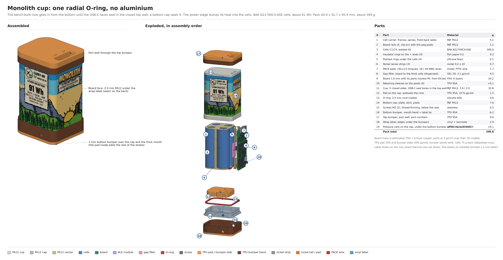
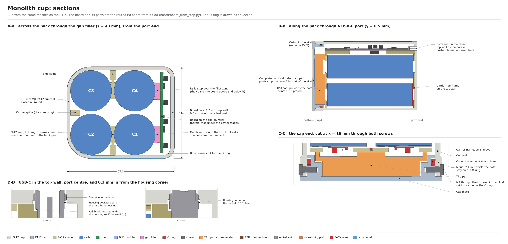
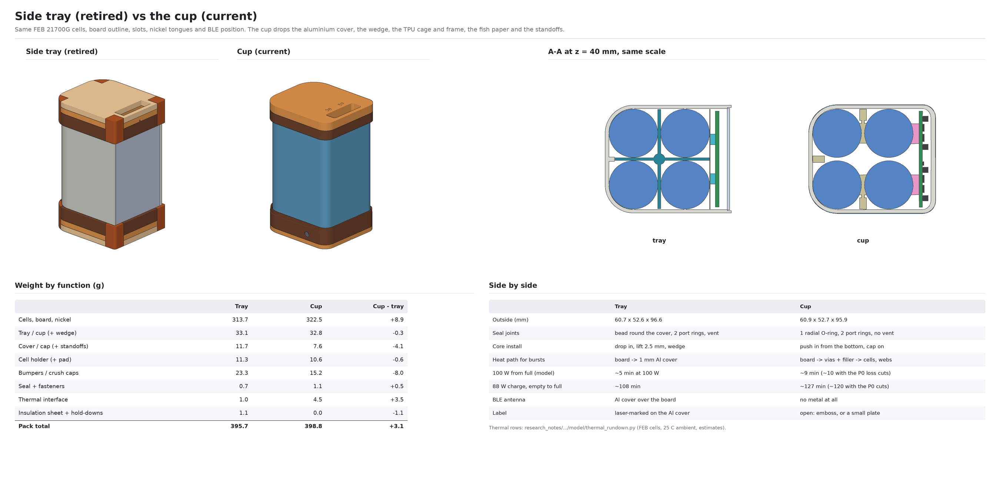

# Mechanical design

_Moved from the root README on 2026-10-18; rewritten 2026-10-21 for **the cup**, the current enclosure; cleaned up 2026-10-24 for the BAK N21700CX-65E cells, with the retired side tray and top-cap tube moved to [`archive/side-tray-mechanical.md`](archive/side-tray-mechanical.md). The models and renders live in `hardware/mechanical/`. Decisions and open items are in [`spec.md`](spec.md) (Boards and enclosure)._

## Renders

<table>
<tr>
<td width="50%"> <b>Exploded view and parts list.</b> The bench-built core (cells, PA12 carrier, board) goes in from the bottom; the cap seals it with one radial O-ring.</td>
<td width="50%"> <b>Sections.</b> A-A through the gap filler and webs, B-B through a USB-C port, C-C through the cap screws and O-ring.</td>
</tr>
<tr>
<td width="50%"> <b>Tray vs cup.</b> Weight by function and the differences.</td>
<td width="50%"></td>
</tr>
</table>

All of these come from the Python models in `hardware/mechanical/`. Re-run the scripts after changing a parameter (see below).

## The cup (2026-10-21, the current design)

`monolith_cup.py`; design study in `research_notes/Ground-up mechanical concepts/` and [`../reports/Ground-up mechanical design.md`](../reports/Ground-up%20mechanical%20design.md).

- **Shell:** an MJF PA12 cup closed on five sides, 1.6 mm walls (2.0 mm on the board face, 1.85 mm top wall, 2.4 mm round the mouth; the side walls were 1.2 mm until 2026-10-31), with the two USB-C seal bores in its closed top wall. The bores are the connector's rev A4 ring (10.35 × 4.57 mm) minus 0.15 mm a side, rounded rectangles like the ring (corner R 1.82). Under each bore the wall's inside face has a 0.47 mm pocket round the connector's hard front housing, which sits 0.35 mm into the wall and is wider than the bore at its corners; the ring squeezes in over a 0.25 mm lead-in at the top of the pocket (2026-10-30, found with the real board model). No aluminium cover, no wedge, no standoffs.
- **Core:** the cells sit in a one-piece PA12 carrier (two frames, spines, full-length front-back webs). The four board rails are separate clip-on blocks that key into the frames after the cells are in, so the front cells can be loaded. The board rides on the rails' peg posts, which run on to 0.3 mm under the board-face wall with TPU sleeves, so a drop on that face loads the carrier and not the inductors. Fish-paper rings insulate each + end from its own crimp shoulder, and foam rings under the cells take up the axial play.
- **Closing it:** the core goes in from the bottom, port end first, until the USB-C faces seat in the top wall. A PA12 bottom cap seals it with one 2.0 mm radial O-ring in its skirt (~25 % squeeze, skirt 2.6 mm thick). The cup's wall is 2.4 mm thick over the bottom 7.5 mm so the mouth flats can't bow off the O-ring (this replaced a 1.5 mm collar on the cap, which flexed too much; plate model in `docs/reviews/2026-10-31-mouth-band/`). Two radial M2 × 5 thread-forming screws go through it into blind pilots below the seal (no through-path into the pack), their heads in 0.8 mm counterbores so they sit 0.5 mm below the bumper band. Four overtravel posts land on the frame as the hard stop, and a TPU pad printed 1.2 mm proud on the cap preloads the core.
- **Heat:** no heat spreader. The power stage dumps its heat through thermal vias and a dispensed gap filler into the two front cells (~300 J/K of thermal mass), and the PA12 webs share it with the back pair. The gap filler is about 4.5 g of Parker Chomerics THERM-A-GAP GEL 30 (decided 2026-10-24). Thermal model: `research_notes/Pack thermal BAK 65E/`; derate policy: `docs/firmware/charge-and-thermal-policy.md`.
- **Drop:** TPU bumpers at both ends (6 mm slab over the port end with a port well, 3 mm over the cap, slabs 30 % gyroid, solid bands over the edges, the top band 7 mm tall), plus the pad inside the cap (10 % gyroid). Trimmed from 8 / 4 mm and 9 mm on 2026-10-31; the slabs went to 20 % in that trim and back to 30 % after the 1 m drop analysis (`docs/analysis/2026-10-31-drop-1m/`) showed the port-end slab bottoming out. The board-face wall has 0.5 mm pockets inside over L401 / L501, which the board bows toward in a board-face drop.
- **Pressure vent (2026-10-31):** Logan removed the board-face vent on 2026-10-28 and asked for one back on 2026-10-31, behind a bumper and with no hole in the label. It is a Gore VE70205 adhesive ePTFE vent (5 mm, over a 2 mm hole) on the outside of the cap plate, in the free strip between the cells and the board, sitting in a pocket through the bottom bumper slab with a breather groove out to the board-face edge. No label hole and no PCB change (`VENT_*` in `monolith_cup.py`). The pocket leaves 0.5 mm round the disc, the 3 mm slab keeps it off the ground, and the groove lets it breathe when the pack stands on a table. Inside, the hole opens into the 8 mm air space under the board's bottom edge. With the vent the pack no longer holds pressure; the figures below are what the walls see if the vent clogs. Sealed, the cup keeps the air it was closed with, and at altitude it pushes out: about +25 kPa in an airliner, +40 kPa at 4300 m and about +50 kPa there with the pack warm. The side walls went from 1.2 to 1.6 mm on 2026-10-31 (Logan) for this: at +25 kPa (an airliner) the side flats now see about 8.7 MPa, under the ~15 MPa where nylon starts to creep (1.2 mm gave 15.5), and at +50 kPa about 17 MPa (was 25–31) with a bulge under about 1.7 mm (linear bound). The cap pushes out with about 120 N at +50 kPa, which the two M2 screws take as about 9.5 MPa of shear in the 2.4 mm mouth band under their holes (`sealed_pressure()` in `monolith_cup.py`). Cooling after closing pulls it the other way, about −10 kPa, which the 2.0 mm board face and the peg posts already cover. Close the cap in dry indoor air. The leak test is a vacuum-jar bubble test on the closed pack with the vent hole taped, before the vent goes on (`production/p0-assembly.md`, step 6).
- **Size and mass:** 60.9 × 52.7 × 95.9 mm, about 398.8 g modelled (2026-10-31, after the bumper / pad trim, the thick cup mouth, the drop fixes and the 1.6 mm side walls; board parts estimated at 3 g/cm³ over their 3D models; `python3 monolith_cup.py none` prints the part table). The model is designed to a 21.85 mm cell diameter (cell pitch 23.25 mm), so measure each cell's diameter before assembly.
- **PACK tails (option C, 2026-10-24):** nickel pads welded to the C1 and C4 bottoms, with an 18 AWG PTFE power wire and a 28 AWG Kelvin wire soldered to each; they pass through one notch per side in the carrier's bottom frame (`wire_notches()`) into two Ø1.5 mm plated holes and two Ø0.8 mm holes on the board (`sb_pack_holes()`).
- **Sense wires (2026-10-24):** the three cell taps are 28 AWG PTFE wires too, into Ø0.8 mm plated holes in 1.5 × 1.4 mm pads (`sb_slots()`). CELL1 and CELL3 solder to a flat tongue on their top strip (`_top_tongue()`); CELL2 solders to the middle of the bottom strip and runs in a 1.0 × 0.95 mm channel in the bottom frame (`sense_channel()`). Details: [`production/p0-assembly.md`](production/p0-assembly.md).
- **Board:** same outline and cell-tap positions as the tray. New: sense-wire holes in place of the tab slots, four peg slots (H101–H104, the former cover-standoff references), the gap-filler zone on B.Cu with thermal vias, the rails split at z 25–55 mm, the PACK wire holes; the cover standoffs are gone.
- **Label:** a printed vinyl wrap label (Borderlands bear art, 2026-10-28) in the cup's label relief; art and order files in [`hardware/label/`](../hardware/label/README.md).
- **Open:** the three coupons (cup mouth on its cap, a clip-on rail block, a USB-C bore with its housing pocket), the drop series, the push-in force.

## The real board in the model (2026-10-30)

The model now uses the routed P0 board from KiCad instead of the old slab and USB-C envelopes:

- `kicad-cli pcb export step --subst-models --no-dnp` writes `hardware/mechanical/board/Monolith_board.step` (git-ignored, ~13 MB), and `board/board_from_step.py` turns it into `board/monolith_board.npz`, one mesh per footprint in the pack frame. Re-run both after any board change.
- `monolith_cup.py` draws it in the renders and checks every part against the cup, rails, sleeves, carrier, cells, cap and pad (`board_checks()`: convex hull per part, so the gaps are lower bounds), the tallest part under the board-face wall, and the USB-C connectors sliced through the top wall and the rail blocks. J113 / J114 (learning-load wires) are left out as bench-only.
- `monolith_step.py` puts the KiCad board itself (true B-rep, every part's model, names and colours) in `parts/09_board_kicad.step` and in the pack assembly.
- What it found: the USB-C front housing (d 1.5–2.5 mm behind the face) hit the seal bore's corners by 0.55 mm and hung 0.32 mm below B.Cu into the top rail blocks. Fixed with the housing pocket above and a notch in the rail blocks (`rail_usb_relief()`). The polish pass also opened the foam pockets into the weld windows (a 0.1 mm lip before), kept them 1.0 mm inside the frame edge (0.2 mm skin before), widened the CELL2 solder pocket into them, and took the post sleeves to Ø3.8 for R313.
- L502 (now 2.0 mm tall) clears the cup by 0.95 mm; the worst part to the cup is L401 at 0.62 mm; R313 is 0.33 mm from its post sleeve.

## Board geometry shared with the retired side tray

The cup kept the side-board layout's board, so these still apply. They are generated from the side-tray parameters in `monolith_shell.py`.

- **BLE antenna:** (superseded: U301 is on F.Cu on the routed board, see above; the B.Cu note is kept for the history) the CC2340R5MODA goes on B.Cu at the right board edge (+y, the C4 / PACK+ side), antenna end at the edge, centre 19.1 mm below the top edge (KiCad about 116.6, 81.9).
    - That leaves 10 mm of ground above it and 10 mm to the USB-C bodies, and it radiates out through the printed side wall.
    - To make room for it, the board sits 2.3 mm further from the cells (`SB_BCU_H`).
    - `monolith_side_pcb.dxf` shows it on `BLE_MODULE_BCU`.
- **Board:** 1.6 mm thick (for cost). The outline is on the production board as well (`hardware/Production/tools/make_board.py` imports it from `monolith_shell.py`).
- **Files:** the board outline is `monolith_side_pcb.dxf`, with the `SENSE_WIRE_HOLES`, `SENSE_WIRE_PADS`, `BCU_TAIL_RUNS`, `BCU_WIRE_RUNS` and frame-bar layers that `make_board.py` follows.
- **Running it:** parameters are `SB_*` in `monolith_shell.py`, which also prints the assembly clearance checks.

The side tray itself (aluminium cover, wedge, TPU cell cage, cover label), the original top-cap tube and the scripts that render them are described in [`archive/side-tray-mechanical.md`](archive/side-tray-mechanical.md).
