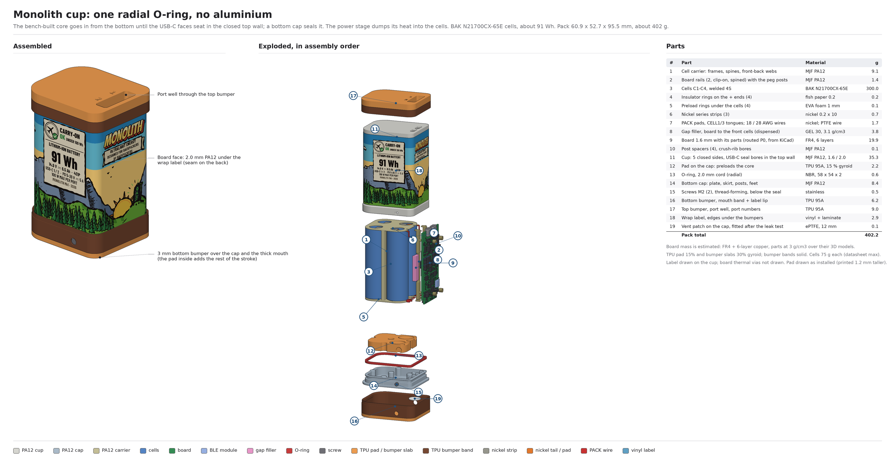
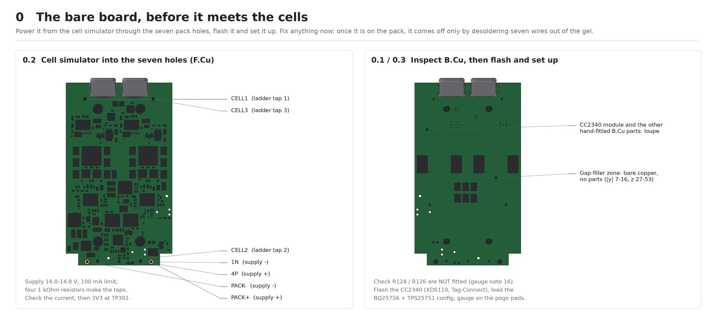
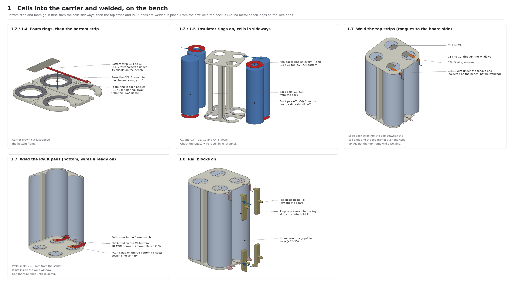
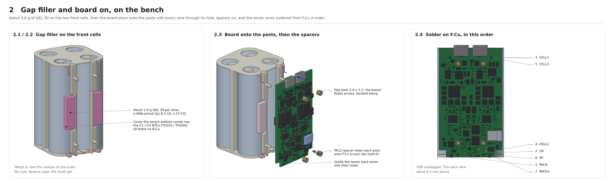
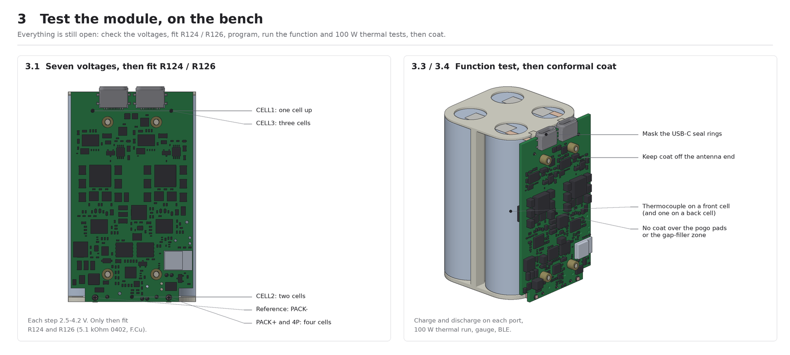
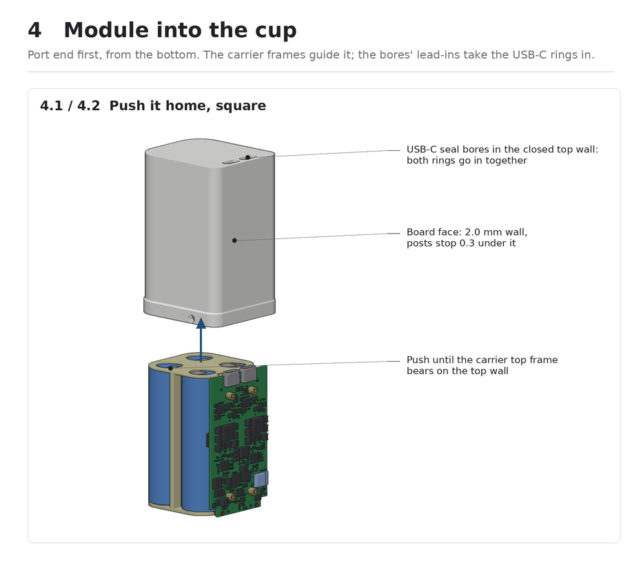
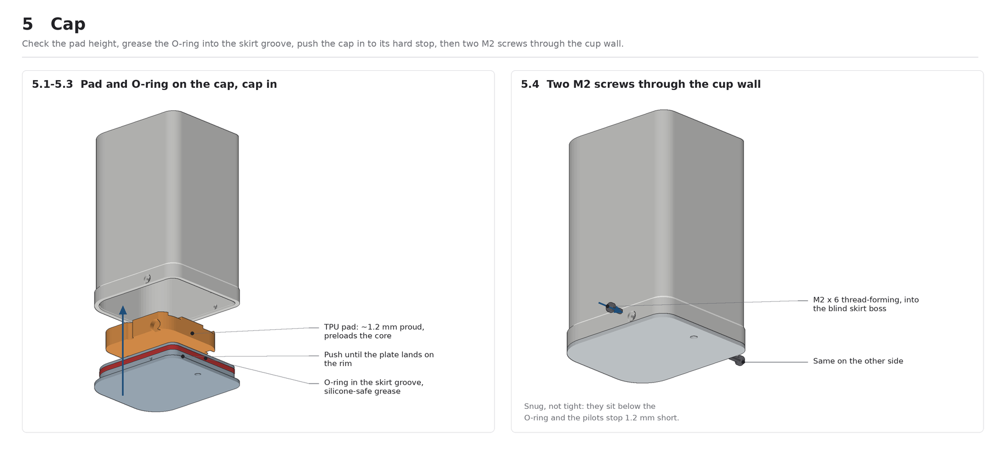
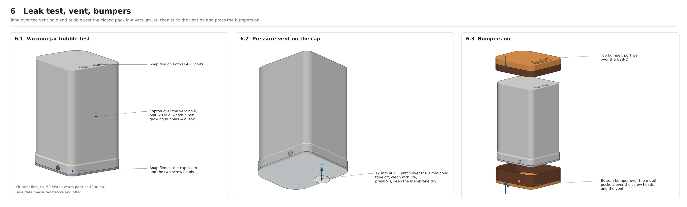

# P0 assembly: one power module, then the cup

How a Monolith P0 goes together, from the mechanical model in `hardware/mechanical/` (**the cup**, `monolith_cup.py`; adopted 2026-10-21, it replaces the side tray). Parts and views: `hardware/mechanical/monolith_cup_exploded.png` and `monolith_cup_sections.png`, and a picture sheet for each step below (`hardware/mechanical/assembly_steps/`); the connections are in the table below (the old nickel-tail drawing, `monolith_side_tabs.png`, is history: removed 2026-10-29, in git at `5cf521e`).

**Status:** a plan. Nothing has been built yet, so expect it to change at the first fit print. Cells: BAK N21700CX-65E 6500 mAh (`docs/spec.md`, Cells and pack). Which of the board changes below are already on the `Production` branch is tracked in the spec's P0 checklist.

## The idea

The cells, their PA12 carrier and the board become **one rigid power module, built and tested on the bench**:
- **Every connection is a wire** (Logan, 2026-10-24): the two PACK leads are 18 AWG (TE 100G0111-1.00-0), and the five sense leads (CELL1–CELL3, the 1N / 4P Kelvin leads) are 28 AWG XL-ETFE (TE 55A0111-28-9), each soldered into a plated hole on F.Cu. No nickel goes into the board, and there's no connector or spring contact.
- The board sits on two clip-on rails (a bottom and a top block on each side, joined by a spine since 2026-11-11) that key into the carrier's frames, so cells and board move together; the wires only take up tolerance, not drops. The rails' peg posts run through the board to just under the cup's board-face wall, so a hit on that face goes into the cells, not the parts.
- **In a drop, the cup carries the loads, not the rail blocks (2026-11-03).** Ribs inside the cup catch the board's long edges (sideways and toward the board face) and the front cans (toward the board face), and feet on the cap catch the board's bottom edge (a drop on the cap end). The rail blocks' tongues, the posts and their spacers only locate parts on the bench. See *Drop load paths* below and `docs/reviews/2026-11-03-rail-retention/`.
- The board is powered and programmed on its own first (step 0), then joined to the pack, tested at 100 W with everything open, and only then goes into the cup.
- Nothing is soldered in the cup.

The cup is closed on five sides, with the two USB-C seal bores in its top wall. The module goes in **from the bottom**, port end first, and is pushed home until the USB-C faces seat in the top wall. A bottom cap seals it with one radial O-ring; the cup's wall is 2.4 mm thick round the mouth so it stays on the O-ring, and two M2 screws through it into blind bosses hold the cap. There is no aluminium: the power stage's heat goes into the front cells through thermal vias and a dispensed gap filler, and the carrier's full-length PA12 webs share it with the back pair.

**Changed on 2026-11-03** (rail-block retention study, `docs/reviews/2026-11-03-rail-retention/`): edge lands, F.Cu lips and front-can cradles inside the cup; the USB-C housing pockets opened in y and a shell-lip relief in front of the seal ring; 1.8 × 2.0 mm obround posts; PA12 post spacers instead of the TPU sleeves. Nothing on the board, the carrier or the cell loading changed.

**Changed on 2026-10-24** after the five-reviewer mechanical review (report: https://claude.ai/artifact/3tGQPMVpdSpkVSX3okK4EF): the sense wires; insulator rings on the + ends; foam preload rings under the cells; clip-on rails; posts to the board-face wall and a 2.0 mm wall there; a cap collar (replaced on 2026-10-31 by a 2.4 mm thick cup mouth), blind screw pilots, a taller skirt and overtravel posts; a softer pad; a 1.85 mm top wall with resized USB-C bores; R124 / R126 left off the board until the pack is wired; and a bare-board step 0.

## Connections

| Connection | From | Lead | Hole (KiCad x, y) |
|---|---|---|---|
| PACK− | C1 bottom (can) | 0.2 × 7 nickel pad + 18 AWG wire, through the C1 notch | J108, Ø1.5 at (86.97, 135.73) |
| 1N (gauge Kelvin) | PACK− pad | 28 AWG XL-ETFE wire, same notch | J115, Ø0.8 at (91.28, 135.48) |
| CELL2 | middle of the C2+ / C3− strip, bottom | 28 AWG XL-ETFE wire, along the channel in the bottom frame | J110, Ø0.8 at (100.00, 135.45) |
| 4P (gauge Kelvin) | PACK+ pad | 28 AWG XL-ETFE wire, through the C4 notch | J116, Ø0.8 at (108.72, 135.48) |
| PACK+ | C4 bottom (+ cap) | 0.2 × 7 nickel pad + 18 AWG wire, same notch | J112, Ø1.5 at (113.03, 135.73) |
| CELL1 | C1+ / C2− strip, top | 28 AWG XL-ETFE wire from the strip's tongue, down behind the board | J109, Ø0.8 at (86.10, 69.48) |
| CELL3 | C3+ / C4− strip, top | the same, mirrored | J111, Ø0.8 at (113.90, 69.48) |
| TS3 / TS3 return | back-cell NTC | insulated NTC leads | J119 / J120, Ø0.8 at (103.63, 136.14) / (105.41, 136.14) |
| TS2 / TS2 return | back-cell NTC | insulated NTC leads | J117 / J118, Ø0.8 at (114.05, 127.76) / (112.27, 127.76) |

**Get the holes right.** The holes all look alike (silk labels are being added for P0, 2026-11-07; until then use this table as a 1:1 map). A 4P Kelvin wire in J118 or J120 (CELL_1N) shorts the whole stack through 28 AWG wire with no fuse in the path. Both NTC pairs sit on the +y side of the board; the gauge doesn't care which back cell is TS2, so wire the +y back cell (C3) to whichever pair gives the shorter run, and route the TS2 leads clear of the right-bottom rail block and of the gel zone near TH104. The NTC routes are not in the model yet.

The positions come from `sb_slots()` and `sb_pack_holes()` in `hardware/mechanical/monolith_shell.py`. The five sense holes sit where the plated slots for the old nickel tails were, each Ø0.8 in a 1.5 × 1.4 mm pad (2026-10-24: the old 4.2 mm oval pads at J109 / J111 overlapped the USB-C courtyards, and nothing was routed to them yet). They're on the `SENSE_WIRE_HOLES` / `SENSE_WIRE_PADS` layers of `monolith_side_pcb.dxf`.

**Details:**
- **PACK wire tails (option C, 2026-10-24).** Each PACK end is a 0.2 × 7 mm nickel pad welded to the cell inside the weld window, with two wires soldered to it on the bench before welding: an 18 AWG power wire and a 28 AWG Kelvin wire. No wire fits the 0.25 mm gap between the frame and the cell end, so both run through one notch per side in the carrier's bottom frame (`wire_notches()` in `monolith_cup.py`; two notches left a loose chip of frame between them), cross the 2.6 mm gap and go into the board. The Kelvin wire carries no current, so it gives the gauge a true sense at the pad. 1N and 4P must stay separate nets on the board, routed to VC0 / SRN side and VC4.
- **Sense wires (2026-10-24).** 28 AWG XL-ETFE (TE 55A0111-28-9, 0.74 mm OD at most), the same wire as the Kelvin leads.
    - **CELL1 / CELL3:** the top strip runs on past its cell as a 3 mm wide tongue, out to 1.45 mm past the top frame (`SB_TONGUE_X`). Solder the wire under the tongue's end on the bench, before the strip goes in; the wire drops about 6 mm down the gap behind the board and turns into its hole.
    - **CELL2:** solder the wire to the middle of the bottom strip on the bench (that spot is under the frame, between C2 and C3, not under a window). The wire runs in a 1.0 × 0.95 mm channel in the bottom frame's cell-side face along y = 0, with a 3 mm pocket under the joint, between the C1 and C4 rims, out past the frame and up into its hole. About 40 mm long.
    - The wires take up cell-length tolerance and board movement by bending, with no kink to form and no bending jig.
- **Power loss:** about 0.66 mΩ per PACK end (7 mm of pad plus 15 mm of 18 AWG), so about 0.06 W each at 9.4 A. The sense wires carry only balancing current.
- **Short risk:** keep every solder joint inside the weld window, over the pad, and at least 3 mm from a weld spot. On C4 the bottom is the + cap and the rim is the can (−), so a joint out at the rim could short the cell.
- **+ ends:** a 0.2 mm fish-paper ring on each + end (C1 and C3 top, C2 and C4 bottom), on the crimp shoulder, under the nickel. The frames bear on the nickel outside the Ø14 windows, which is over the shoulder, at the cell's own negative; without the ring, a strip pushed into a window in an end-on drop could short the cell. Measure the BAK + cap diameter and how far it stands proud before cutting the rings (`INSUL` in the model: 21.2 OD, 9.4 ID).
- **Cell preload:** the carrier's frames are a fixed 71.95 mm apart, and the 65E is 71.0 mm at most, so the cells would float 0.55 mm or more on their welds. A foam ring (1 mm EVA since 2026-10-31; was silicone) in a 0.6 mm pocket under each cell's bottom end pushes the cells up onto the top frame. On C1 and C4 only the half away from the PACK pads gets foam. Measure the gap with the cells in: the model leaves 0.7 mm for a 71.1 mm cell, so 1 mm squeezes about 30 % (about 15 % on a 70.95 mm nominal cell, none under about 70.85 mm; then use 1.5 mm). EVA takes more compression set than silicone when warm, so check the cells are still snug after the first few charge cycles.
- **Behind B.Cu:** the sense wires cross the gap in the old tail-run areas (`BCU_TAIL_RUNS`, the board's `KO_B_tail_*`), about 1 mm behind B.Cu: only low parts (≤ 0.6 mm) there. The PACK and Kelvin wires cross in the `BCU_WIRE_RUNS` areas: no B.Cu parts at all there.
- **Board rails (2026-10-24; one piece per side since 2026-11-11):** two clip-on PA12 rails. Each is a bottom and a top block, each block with a tongue that slides into a key slot in the frame's board-side face, joined by a spine across the gel zone (*Mid-board prop* below). The bottom tongues have a 0.5 mm 45° chamfer in their root corner (`KEY_ROOT_CHAMFER`), where the 2026-11-11 3D drop yielded them. Two crush ribs on each tongue (0.15 mm into the slot walls, 2026-10-28) hold the blocks in until the board is soldered; in the cup, the board-face wall, the top wall and the cap pad capture them. The tongue joint only locates the block: it would break under a drop load (about 200 N per block in a 1 m narrow-side drop puts 150–310 MPa in the tongue), so since 2026-11-03 the cup takes those loads instead and the joint sees only the block's own weight, about 10–13 N. No CA glue is needed; use it only if a block falls out on the bench. As part of the carrier they blocked the front cells from going in. They stand 0.15 mm off the front cans and carry the board's four peg posts. Below z 7.3 the bottom blocks keep only a stub at |y| ≤ 7.4 mm (`RAIL_RELIEF_Y`), clear of the PACK wires; since 2026-11-11 the stub sits wholly over its key slot, so it never bears on a sliver of the frame face (the 3D drop crushed a 0.1 mm strip there).
- **Posts and spacers (2026-11-03):** the peg posts are 1.8 mm (across the board) × 2.0 mm (along it) obrounds (round Ø2 until 2026-11-03). They run through the board's 2.6 × 2.2 mm slots to 0.3 mm under the board-face wall, which is 2.0 mm thick. The slots give the board ±0.4 mm of float across its width (±0.3 with the old Ø2 posts), so the USB-C seal bores centre the ports along the rings' long side when the cup goes on, and the cup's edge lands (0.12 mm off) always stop the board before a post bears. Along the board's length they stay ±0.1 mm, so a cable push can't slide the board down and pull the rings out of the top wall.
    - A **Ø4 PA12 spacer** on each post (`spacers()`, 3.3 mm tall: from F.Cu to 0.4 mm under the board-face wall) holds the board on the rails. Four crush ribs in its bore (0.15 mm into the post) hold it on the bench. Push each one down until it touches F.Cu, not hard enough to clamp the board. In a board-face drop the board can only lift 0.4 mm before the spacers hit the wall. The 1 mm TPU sleeves they replace held it by friction alone, so the board could jump until its parts hit the wall.
- **Drop load paths (2026-11-03).** The 2026-11-03 study (`docs/reviews/2026-11-03-rail-retention/`) found four overloads in the old design: the rail-block tongues (150–310 MPa at 200 N), the Ø2 PA12 posts (about 60 MPa shear, and a rattle simulation puts the peak nearer 560 N per post), and, worst, a board-face drop, where the whole core (about 300 g × 2500 g ≈ 7.5 kN) had nothing to stop it but the four post tips. The fourth is a drop on the cap end: the board, rail blocks and spacers (about 250 N at the 1182 g of the 2026-10-31 drop analysis) hung on the pegs, and the rail blocks are held along z only by their tongues' crush ribs (the key slots are open top and bottom), so the board could slide down until its corners hit the cap skirt 1.15 mm lower. 0.63 mm of slide pulls the USB-C seal rings out of their bores. The cup and cap now carry all four:
    - **Edge lands** on both side walls, 0.12 mm off the board's long edges, from z 27 to the top wall with a 1 mm lead-in (`lands()`). They start above the BLE module (U301, z 15.4–22.4). A narrow-side drop goes board edge → land → cup wall: about 10 MPa on the board edge at 800 N, about 39 MPa at a 3.2 kN rattle peak.
    - **F.Cu lips** over the board's long edges, 0.5 mm off F.Cu, same z span. With the spacers they hold the board in a board-face drop; the board's bow at L401 / L501 drops from about 0.63 to 0.33 mm.
    - **Front-can cradles** (`cradles()`): the cup's inside follows the outer front quarter of C1 and C4, 0.15 mm off, in three bands (z 5–17, 35–47, 65 to the top wall) with 1 mm lead-ins, clear of the gel. In a board-face drop the core lands on them after about 0.17 mm, before the post tips (0.3 mm) touch the wall, at about 10–15 MPa.
    - The cradles touch the cans about 25° off the board-face direction, so they also push C1 and C4 toward each other (up to about half the load). Friction at the cradles and the webs' seats take most of it; past that, the two cans meet across their 1.4 mm gap, which they already do in today's narrow-side drop. Check both in the drop series.
    - **Board feet** on the cap (`board_feet()`): four PA12 ribs on the skirt's inside face come up under the board's bottom edge, 0.2 mm below it, at |y| 3–6 and 14.4–16.2 (clear of the vent hole, the CELL2 and Kelvin wires and the PACK wires). In a cap-end drop the board lands on them after 0.2 mm, with the core stopping on the overtravel posts after 0.3 mm, so the pegs only see the difference inside their ±0.1 mm float. About 26 MPa on the board edge if only the two inner feet bear. 0.43 mm of seal ring band stays in the bore with the board on its feet. A hard USB-C plug push now ends on the feet too.
    - **Mid-board prop (2026-11-11).** A 3D explicit drop study (OpenCourant on Logan's PC; 1 m onto the back face) found the board bowing 1.2 mm into the cells at mid-length (about 5,000 µε across its whole width), with six tall F.Cu parts swinging into the board-face wall on the rebound. Nothing on the cup can reach mid-board, because the core slides in along z and every board column has parts above mid-span, so the props are:
        - **Rail spines** (`rail_spines()`): a 1.2 mm spine at |y| 7.0–8.2 joins each side's bottom and top block across z 25–55, flush with the rails under B.Cu (on the gel zone's inner strip, which has no parts) and 0.15 mm off the front can. The board's mid-span now bears on the cells: about 400 N at impact and 600 N on the rebound, with no yield. It displaces about 15 % of the gel, roughly 12 % of the gel's B.Cu-to-can conductance.
        - **B.Cu edge lands** (`bcu_lands()`): the cup reaches up under the board's long edges, 0.25 mm below B.Cu, at |y| ≥ 16.4 and z 50–58, above C421 / C556 so they pass as the core slides in.
        - Result (damped model, 3D run 4): board strain p99 5,050 → 3,080 µε, the mid-span band gone; the six F.Cu parts now keep 0.04–0.07 mm off the wall (was −0.08 to −0.20). What remains is 3,000–4,000 µε along the long edges, peaking where they land on the B.Cu edge lands. Results in `BatteryBank-fea\drop_back\RESULTS.md` on Logan's PC.
    - **USB-C:** the housing pockets are opened from 0.15 to 0.35 mm in y, and the bore 0.25 mm per side over its front 0.49 mm (in front of the ring band), so the connectors are no longer the first sideways stop (before, the housing touched at 0.15 mm and the shell lip at 0.20 mm, inside the slot float). The ring band left in the full bore at full rise is 0.64 mm.

**Board changes (on the `Production` branch):**
- Five sense holes, Ø0.8 in 1.5 × 1.4 mm pads: J109–J111 (CELL1–CELL3), J115 / J116 (1N / 4P). Done 2026-10-24; DRC still to run.
- Two Ø1.5 mm plated holes with a 0.4 mm ring for the 18 AWG PACK wires (J108, J112). Done 2026-10-24.
- **R124 and R126 are DNP** (gauge sheet note 16, 2026-10-24). They connect the BQ294700 output and the gauge FUSE pin to Q104's gate. With them off, nothing can blow F102 while the pack is being wired; fit them by hand after the seven voltages read right (step 3.1).
- Route 1N and 4P as Kelvin nets to the gauge.
- Keep-outs: the carrier rails (`BCU_FRAME_BARS`, split: no rail at z 25–55 mm), the tail runs (`BCU_TAIL_RUNS`), the wire runs (`BCU_WIRE_RUNS`), and the **gap-filler zone** on B.Cu (|y| 7–16 mm, z 27–53 mm: no parts, solid copper, a dense thermal-via array to the power stages on F.Cu).
- Four slots for the peg posts (2.6 × 2.2 mm NPTH, long across the board, H101–H104 at y ±8.6, z 14 and 68). The Ø4 post spacers (2026-11-03; Ø3.8 TPU sleeves before) reach 2.4 mm from a slot's centre across the board at full float (±0.4 mm). On the routed board the nearest F.Cu part is R313, 0.23 mm clear of its spacer (`board_checks()`); U405 was moved off H104 in layout.

## Materials and tools

- **Cells:** 4 × BAK N21700CX-65E 6500 mAh, same batch, matched to within 10 mV and to within 1 mΩ on an AC (1 kHz) meter. Measure each cell's diameter and length: the cup is designed to 21.85 × 71.1 mm, and the datasheet gives 21.7 × 71.0 maximum.
- **Nickel:**
    - 0.2 × 10 mm pure nickel for the three series strips (loss cut 4). The top two run on past their cells as 3 mm wide tongues for the CELL1 / CELL3 wires.
    - 0.2 × 7 mm pure nickel for the two PACK pads, about 10 mm long.
- **Wire (2026-10-31, Logan):** TE **100G0111-1.00-0** for the two PACK power leads (Zerohal 100G, VG 95218-20 Type E: 1.00 mm² / 18 AWG, 19/0.25 tinned copper, 1.17–1.26 mm conductor, 1.69–1.80 mm OD, 20.0 Ω/km max, 125 °C, black; the frame notches and B.Cu keep-outs are sized for 1.8 mm since 2026-10-24, so it sits at the limit); TE **55A0111-28-9** for the five sense leads (Raychem Spec 55, the twin of M22759/32-28: 7/36 tinned copper, radiation cross-linked ETFE, 0.64–0.74 mm OD, 150 °C, white). The 100G insulation is a halogen-free polymer blend, not a fluoropolymer: solder it quickly and keep the iron off the jacket, and try one scrap joint first. Fallback for 18 AWG: TE 55A0111-18 / M22759/32-18 (19/30, 1.47–1.57 mm OD, 150 °C XL-ETFE, sold in 10 ft cuts). The old picks, M22759/11-18 and M16878/6 Type ET, fit the same holes. Anything thicker than 1.8 / 0.75 mm doesn't fit. About 25 mm each, 45 mm for CELL2.
    - Source, and how to check the nickel is real: `spot-welding.md`.
- **Insulation:** four 0.2 mm fish-paper rings for the + ends (self-adhesive "barley" rings, cut to fit the measured + cap). Kapton tape.
- **Foam:** 1 mm closed-cell EVA sheet (EARCOOH, 86 kg/m³, no adhesive), punched into four preload rings.
- **Printed parts:**
    - the cup (1.6 mm side walls, 2.0 mm on the board face, 1.85 mm top wall, 2.4 mm mouth band) and the bottom cap (MJF PA12);
    - the cell carrier (MJF PA12): two frames, spines and the front-back webs;
    - the two board rails and the four post spacers (MJF PA12);
    - in TPU 95A: the pad (inside the cap, 15 % gyroid) and the two bumpers. Each bumper is a single print, outer end face on the bed, with 5 walls, 4 top and bottom layers and 30 % gyroid: the bands come out solid and the slab gets the gyroid.
- **Seal and fixings:** a 2.0 mm silicone O-ring (60A, ~25 % squeeze in the skirt groove), 2 × M2 × 5 mm pan-head thread-forming screws for plastic (heads in 0.8 mm counterbores; 3.3 mm of thread in each boss), silicone grease, and one 12 mm adhesive ePTFE vent patch (VOSAREA lamp vent; a Gore VE80308 also fits) for the 3 mm hole in the cap (2026-10-31).
- **Thermal:** Parker Chomerics THERM-A-GAP GEL 30, one 10 cc syringe (65-00-GEL30-0010), about 4.5 g between the board and the two front cells. A 0.01 g scale and a 14–16 gauge tapered tip.
- **Other:** conformal coat.
- **Tools:** an AWithZ P20B spot welder with handheld pens (`spot-welding.md`), soldering iron, a multimeter, calipers, the gauge and programming setup (EV2400 on the J302 "GAUGE" Tag-Connect, XDS110 on J301, one TC2030-IDC-NL cable for both), a current-limited bench supply and a cell simulator for step 0, and a clear vacuum jar with a hand pump and gauge (a food-vacuum or resin-degassing pot) plus leak-detection fluid or soapy water for the leak test.
- **Cell simulator** (for step 0): a bench supply at 14.0–14.8 V, current-limited to 100 mA, and a ladder of four equal resistors (1 kΩ) across it, with pins that drop into the seven holes: PACK− and 1N on the supply's −, the three taps on the ladder's joints, 4P and PACK+ on its +. It powers the gauge's cell inputs and the BQ294700, not the board: the board's rails run from PACK_P, fed on J113 / J114 (step 0.2).

## Steps

Each step has a sheet of pictures, numbered to match the sub-steps below. Each panel draws what's already built in muted colours and the parts that step adds in full colour, pulled out along the way they go on. They're rendered from the same model as the STLs by `hardware/mechanical/monolith_cup_assembly_steps.py`, so re-run it after a geometry change. The NTCs, gel bead and solder joints aren't modelled; they're shown as callouts.

### 0. The bare board, before it meets the cells

0. **Fit the 12 B.Cu parts by hand** (JLC assembles F.Cu only): C208–C213 (22 µF 1210, PACK_P), C421 / C456 / C521 / C556 (KEMET T593V 68 µF; the + band goes to pad 1, AC_SNS_N, the closed end of the silk outline) and TH101 / TH104 (0402 NTCs). **Preheat the board on a hot plate to 120–150 °C first**: a 1210 MLCC cracked by an iron on the 2 oz PACK_P plane becomes a resistive short across the pack that no protection trips. Iron on the pad only, never on the ceramic, ≤ 350 °C for ≤ 3 s. Then measure PACK_P–GND and AC_SNS_N–GND on both ports, and TS1 / TS4 to CELL_1N (about 10 kΩ at 25 °C).
1. **Inspect** the 12 B.Cu parts and the USB-C shell legs (4 per connector; solder them from B.Cu if JLC left them dry) under a loupe, and check that R124 and R126 are not fitted.
2. **Power PACK_P from the bench supply on J113 (+) / J114 (−)**, 12 V at a 50 mA limit, then 14.4 V at 100 mA. Check the current draw, then 3V3 at TP301. The cell simulator alone can't do this: it only reaches CELL_P, and a factory gauge keeps Q101 / Q102 off (`FET_EN` = 0) until BQStudio toggles them, which needs 3V3 up first.
3. **Flash the CC2340**, load the BQ25756 and TPS25751 configuration (I2C loader on J302, `p0-bringup-and-training.md` Equipment and section 3a), and check the gauge talks through J302. Bring-up logs come out on J301 pin 6 (UART_TX).
4. **Add the cell simulator** on the seven holes, then check the cell readings, the FET toggles and the rest of stages 4–5 in `p0-bringup-and-training.md` (Bare board without cells).
5. If anything is wrong, fix it now: once the board is on the pack it can't come off without desoldering seven wires, and it is bedded in gel.

### 1. Cells into the carrier and welded, on the bench

1. **Check the cells.** Measure each cell's voltage, AC resistance, diameter and length; reject outliers. Measure a + cap's diameter and height above the shoulder.
2. **Insulator rings** on the four + ends (they are the + ends at C1 and C3 top, C2 and C4 bottom).
    - **Side strips (2026-11-07 review):** the C1 can (PACK−) and the C4 can (three cells up, to 12.6 V) face each other across a 1.4 mm gap with no web, and the cradles push them together in a board-face drop. Lay a 0.1–0.2 mm fish-paper or Kapton strip along the C1–C4 and C2–C3 facing lines, check the cradle fit still closes on the first fit print, and inspect every sleeve under a loupe for nicks.
3. **Prepare the strips and pads on the bench,** with no cell present (strip and tin each wire, solder it, let it cool):
    - CELL2: the wire under the middle of the bottom strip, about 3 mm of lap, pointing +x.
    - CELL1 / CELL3: the wire under the end of each top strip's tongue, about 1.5 mm of lap, pointing down.
    - PACK pads: the power wire on the pad's outer side (toward the PACK hole), the Kelvin wire on the inner side, about 3 mm from the board-side end.
4. **Bottom strip and foam first:** lay the foam rings in their pockets, then the bottom strip (C2+ → C3−) on the empty bottom frame, with its CELL2 wire pressed into the channel.
5. **Cells into the carrier**, loaded sideways: the back pair (C2, C3) from the back corners (the back spine is 0.8 mm in the way of a straight push) and the front pair (C1, C4) from the board side, with the rails still off. The webs hold the front and back pairs apart. Positions per `SB_CELLS`: C1 and C3 + up, C2 and C4 + down. Check that the CELL2 wire is still in its channel.
6. **Qualify the weld first** on two spare cells (`spot-welding.md`), at the settings you'll use.
7. **Weld,** pushing the cells up against the top frame while you weld (the foam does this once the strips are on):
    - the bottom strip through the C2 and C3 windows;
    - the top strips, slid into the gap between the cell ends and the top frame, tongues and wires toward the board side: C1+ → C2−, C3+ → C4−;
    - the PACK pads, with their wires already soldered: PACK− on the C1 bottom, PACK+ on the C4 bottom. Keep every weld spot at least 3 mm from the solder, and lay both wires in the frame notch.
    - From the first strip on, the pack is live (see *Working on the live pack* below).
8. **Rail blocks on:** press the four blocks' tongues into the frame key slots, posts pointing +x, until they stop (the tongue bottoms in its slot with the block body about 0.1 mm off the frame). The crush ribs should make it a firm push. If a block is loose (the print came out small), put a drop of CA glue in its slot; if it won't go in, shave the ribs with a blade rather than forcing it. Even with the board soldered on, never lift the module by the board.

### 2. Gap filler and board on, on the bench

1. **NTCs:** the front cells' NTCs (TH101 on C1 / TS1, TH104 on C4 / TS4) are SMD parts on B.Cu since 2026-10-28, so there is nothing to fit on C1 and C4 (`research_notes/Pack thermal BAK 65E/smd-ntc.md`). Back cells (C2, C3): NTC at mid-length, facing the pack centre, as before. Use insulated or Kapton-wrapped beads: a bare bead on C3 puts up to 8.4 V on TS3.
2. **Dispense the gap filler** on the two front cells beside the rail spines (|y| 8.2–16 mm, z 27–53 mm; the spines take |y| 7.0–8.2 since 2026-11-11), a little proud, so the board squeezes it. Take it right into the zone's bottom outer corner (|y| 14–16 mm, z 27–31 mm): TH101 / TH104 sit there and read the cell through the gel. Tare the module on the scale and lay about 1.9 g of GEL 30 per zone (2.3 g before the spines). It is stiff, so push the syringe by hand through a wide tip. It needs no cure. To rework, peel it off, wipe the rest with IPA and use fresh gel.
3. **Board on:** lower it onto the peg posts, guiding the seven pack wires into their holes from B.Cu. Push the four PA12 spacers down the posts until they touch F.Cu.
4. **Solder on F.Cu,** USB unplugged, in the gauge sheet's note-15 order: PACK− first, then 1N and the taps bottom-up (CELL1, CELL2, CELL3), then 4P, and PACK+ last. Trim each wire about 0.5 mm proud. With R124 / R126 off, a wire touching its barrel out of order can't blow F102, but keep to the order anyway.

### 3. Test the module, on the bench

1. **Check the seven voltages** at the pads against PACK−: each step should be one cell (2.5–4.2 V). Only then **fit R124 and R126** (5.1 kΩ 0402, F.Cu).
2. **Program and set up:** on the first board, run gauge training through J302 and export the golden image (`p0-bringup-and-training.md` section 3); on later boards, load that golden image and calibrate. Then unsolder the J113 / J114 learning-load wires and leave the pads flat: the board-face wall is only 3.7 mm above F.Cu, and the real-board check (`monolith_cup.py`) leaves them out because they're bench-only.
3. **Function test:** charge and discharge on each port, the 100 W thermal run (thermocouples on a front and a back cell), the gauge readings, and BLE.
4. **Conformal coat**, last, F.Cu only (B.Cu is against the cells and gel by now). Keep the coat off the antenna end, the J301 / J302 Tag-Connect pads, the gap-filler zone and the USB-C seal rings (mask the rings).

### 4. Module into the cup

1. Port end first, push the module up into the cup from the bottom. The carrier's frames guide it to ±0.2 mm, and from z 27 up the edge lands take the board's edges to ±0.12 mm (a 1 mm lead-in at their bottom ends). The front cans pass the cradles 0.15 mm off, over a 1 mm lead-in at the bottom of each band; the USB-C housings go into their pockets in the top wall's inside face and the seal rings squeeze into the bores over a 0.25 mm lead-in at the top of each pocket. Keep it square so both rings enter together.
2. Push home until the carrier's top frame bears on the top wall. The board's top edge then sits 0.1 mm under the top wall, as a backstop for the rings.

### 5. Cap

1. Measure the cap: the gap from the cup rim to the carrier frame's underside, with calipers, against the pad's printed height (9.8 mm off the printer; the STL already carries the 1.2 mm proud since 2026-11-07). The pad should be about 1.2 mm proud; shim or trim it if not. Then check the preload on a kitchen scale: with the core on the scale, push the cap plate down the 1.2 mm with the pad between them and read at least about 15 N (1.5 kg). Check one pad again after 24 h at 45 °C; if it falls under about 10 N, print the pads at 1.5 mm proud or 20 % gyroid.
2. O-ring (NBR) into the skirt groove, lightly greased with Super Lube 21030 (PTFE in synthetic PAO oil; Krytox GPL 205 also works). Not a petroleum grease on anything EPDM, and not a silicone-oil grease near the silicone USB-C rings.
3. TPU pad onto the cap, then push the cap in until the plate lands on the cup rim (hard stop). The pad preloads the core against the top wall.
4. Drive the two M2 thread-forming screws through the thick cup mouth into the blind skirt bosses. Snug, not tight: they are below the O-ring, and the pilots stop 1.2 mm short of the inside.

### 6. Leak test, bumpers

1. **Leak test** in a vacuum jar, before the vent goes on. Put a square of Kapton over the 3 mm vent hole in the cap so the closed pack keeps its own air and a vacuum round it loads the seals. Brush leak-detection fluid or soapy water over the cap seam, both screw heads and both USB-C ports, stand the pack in the dry jar and pull **−20 kPa** (about an airliner cabin). Watch for 5 min: a bubble or foam that keeps growing at a joint is a leak. Let the air back in slowly and wipe the pack dry. Don't submerge the pack for this test: if a seal leaks, the jar's water is pulled in when the air goes back in.
2. **First pack only:** take the empty fit print (cup, cap, O-ring and screws, no core) to **−50 kPa** (a warm pack at 4300 m) for 10 min. Measure across both side flats before and after, and look for cracks round the screw holes. If the flats take a set, thicken the side walls before building more.
3. **Vent:** peel the Kapton, clean round the hole with IPA and let it dry, then press the vent patch on, centred over the hole, for 5 s with a flat tool on its rim. Don't touch the membrane or get it wet or oily.
4. Press the TPU bumpers on, top (port well) and bottom (over the thick mouth, pockets over the screw heads and the vent).

## Working on the live pack

From the first weld until the cap is on, the pack is a bare 14 V, 91 Wh source with no fuse in front of it.
- Cap the PACK wire ends with Kapton or heat-shrink until they're soldered, and never lay the module on a metal bench.
- Collect nickel and wire trimmings as you cut them; a loose trimming in the carrier can bridge two strips.
- Keep the welder's pens and the soldering iron off any strip that isn't the one you're working on, and use insulated tweezers.
- Keep a metal bucket of sand nearby.

## Open items
- **Board:** run KiCad DRC on the `Production` board after the sense-hole and DNP changes, and set the DNP flags in the JLC BOM export.
- **Fit (on the first real parts):** no coupons since 2026-11-07 (Logan: the real parts cost about the same), so the first cup, cap and core are the fit test. The coupon files stay in `hardware/mechanical/stl/MJF_PA12/coupons/` in case one fit needs a cheap reprint question answered.
    - USB-C bores (0.15 mm squeeze a side, `USB_SQ`): measure the rings on 5 connectors from the batch, then push a loose connector into the first cup's bores from the pocket side. It should go in with a firm push and pass a 1 m dunk. Too tight or too loose means changing `USB_SQ` for the next cup order (the ladder coupon tests 0.05–0.25 if it comes to that).
    - Cup mouth + cap + O-ring: measure the squeeze in the middle of each flat (clay or feelers), dunk at 1 m / 30 min, and pull-test the cap.
    - Carrier + rails with real cells: load all four cells, check the key slots and the foam, fit a bare board on the posts, and push the spacers on (they should need a firm push, and stay put upside down).
    - First cup (2026-11-03 ribs): slide a 43.40 mm wide FR4 strip up between the lands (it must go) and a 43.80 mm one (it must not), and a Ø22.15 mm rod through each cradle. If the lands are tight, change `LAND_GAP` on the reprint.
    - How hard the module pushes home.
- **Drop:** a dummy-core drop series (dead cells or steel slugs, dummy board) at 1 m onto concrete: board face down, back down, cap down, port down, end-on both ways. Before and after: joint resistance, putty marks between the wall and the parts, the groove root, the ring position.
- **Label:** apply the printed vinyl wrap label (`hardware/label/`, StickerApp matte) in the cup's label relief; check its thickness fits the relief first.
- **Service:** the board can't come off the cells without desoldering seven wires, and the cap is screwed. A bad cell means rework at the bench.
- **Connection order:** check the BQ294700 datasheet.
