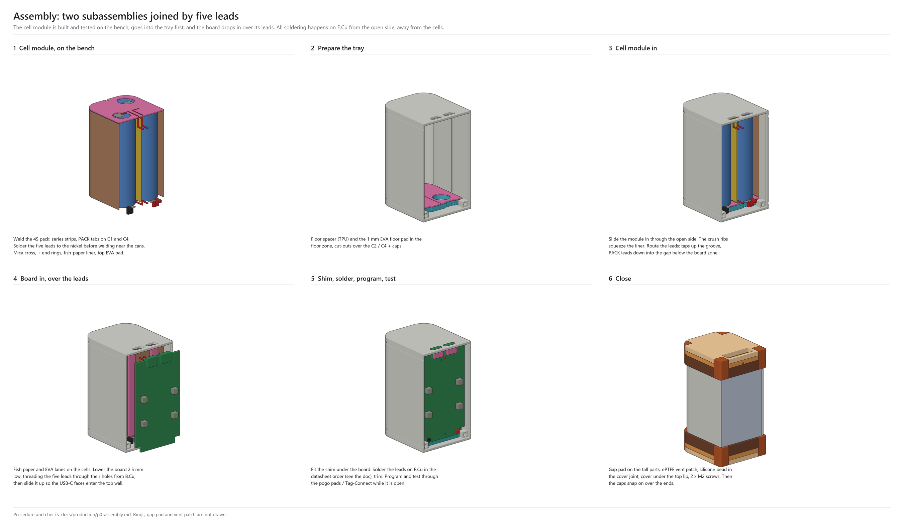

# P0 assembly: cell module, tray, board

How a Monolith P0 goes together. It's drawn from the mechanical model in `mechanical/` (side tray, 2026-10-21) and shown step by step in `mechanical/monolith_side_assembly.png`.

**Status:** a plan. Nothing has been built yet, so expect it to change at the first fit print.

## Why two subassemblies

The tray opens on one side only, and the board has to make two moves:
1. It drops in through the open side.
2. It slides 2.5 mm toward the top, so the USB-C faces pass into their holes in the top wall.

The cells can't make that slide, because there's only 1 mm of foam above them. So the cells and the board go in separately, and the connections are made inside the tray.

Five flying leads from the cell module join the two. They take the slide, vibration and the different expansion of the parts. Nickel wrapped round the board edge (the 2026-10-18 plan) couldn't do that.

| Lead | From | Wire | Board hole (KiCad, mm) |
|---|---|---|---|
| PACK− | tab on the C1 bottom | 18 AWG silicone, about 30 mm | (86.0, 134.6), 1.6 mm drill, 3.4 mm pad |
| PACK+ | tab on the C4 bottom | 18 AWG silicone, about 30 mm | (114.0, 134.6), 1.6 mm drill, 3.4 mm pad |
| CELL1 | C1+ / C2− strip, top | 28 AWG silicone | (98.0, 71.5) |
| CELL3 | C3+ / C4− strip, top | 28 AWG silicone | (102.0, 71.5) |
| CELL2 | C2+ / C3− strip, bottom | 28 AWG silicone | (102.0, 133.5) |

These positions come from `SB_LEAD_HOLES` and `SB_TAP_HOLES` in `mechanical/monolith_shell.py`, and they're on the `TAB_PADS` layer of `monolith_side_pcb.dxf`.

**Board change needed:** PACK− and PACK+ become plated through-holes for 18 AWG wire, replacing the F.Cu strip pads.

## Materials and tools

- **Cells:** 4 × EVE INR21700-58E, matched to within 10 mV and checked for internal resistance.
- **Nickel:** 0.15 × 7 mm, for the three series strips and the two PACK tabs. You'll need a spot welder.
- **Wire:**
    - 18 AWG silicone, red and black.
    - 28 AWG silicone in three colours.
- **Sheet stock:**
    - 0.2 mm mica, for the cross between the cells.
    - 0.2 mm fish paper: the liner, the sheet on the board side and four + end rings.
    - 1 mm EVA: floor and top pads, the EVA lanes and the USB-C hold-downs.
- **Printed parts:**
    - the tray (MJF PA12);
    - the caps, floor spacer and shim (TPU).
- **Cover and fixings:**
    - the anodized cover;
    - 2 × M2 thread-forming screws with a nylon patch.
- **Other:**
    - a thermal gap pad (0.5 mm);
    - an ePTFE vent patch;
    - neutral-cure silicone (not the vinegar-smelling acetoxy kind);
    - conformal coat, applied to the board before this procedure.
- **Tools:** soldering iron, flux, a multimeter, and the gauge and programming setup (EV2400 on the SMBus pogo pads, XDS110 with Tag-Connect).

## Steps

### 1. Cell module, on the bench
1. **Check the cells.** Measure each cell's voltage and internal resistance. Reject any outliers.
2. **Make the PACK leads before welding.**
    - Solder each 18 AWG lead to the end of its nickel tab first, then weld the tab to the cell. That keeps soldering heat off the cans.
    - Leave the joint where it will end up past the can's edge, in the gap behind the board.
3. **Weld the module:**
    - Mica cross between the cells.
    - The series strips: C1+→C2− at the top, C2+→C3− at the bottom, C3+→C4− at the top.
    - The PACK− tab on the C1 bottom and the PACK+ tab on the C4 bottom.
    - The cell order and + ends are `SB_CELLS` in the model. Check them against your welding plan.
4. **Sense leads:** solder the CELL1, CELL2 and CELL3 leads to their strips, away from the + caps. Leave them long and trim at step 5.
5. **Insulation:**
    - Fish-paper rings on the four + ends.
    - The fish-paper liner round the −x and ±y faces.
    - The top EVA pad, with its cut-outs over the C1 and C3 + caps and slots for the CELL1 and CELL3 leads.
6. **Check the module:** pack voltage, each tap voltage, and no short from any can to any lead.

### 2. Prepare the tray
1. Put the TPU floor spacer in the floor zone, then the 1 mm EVA floor pad on top. The cut-outs go over the C2 and C4 + caps, and the CELL2 lead runs in the spacer's channel.
2. Check that the crush ribs are clean and the port holes are reamed to size.

### 3. Cell module in
1. Slide the module in through the open side. The crush ribs squeeze the liner, so expect it to be firm.
2. **Route the leads:**
    - CELL1 and CELL3 run up the groove between C1 and C4.
    - PACK− and PACK+ drop into the floor-zone gap behind where the board will sit.
    - All five end up out through the open side.

### 4. Board in, over the leads
1. Lay the fish-paper sheet on the cells' board-side face, then the EVA lanes (3 × 1 mm) along the two cell tangent lines.
2. **Thread and lower:** hold the board 2.5 mm below its final position. Thread the five leads through their holes from the B.Cu side, then lower the board onto the lanes.
3. **Slide it up 2.5 mm** until the USB-C faces sit in the top-wall holes and the board's top edge bears on the stops.
    - The PACK leads have a sideways loop in the floor-zone gap to take this slide.
    - Don't pull the leads tight.

### 5. Shim, solder, program, test
1. Fit the TPU shim under the board's bottom edge.
2. **Solder the leads on F.Cu**, then trim them flush.
    - **Order:** solder bottom-up, PACK− first, then CELL1, CELL2, CELL3, and PACK+ last.
    - The BQ40Z50-R2 datasheet (SLUSCS4C, §9.2.2.1.3) only asks for Kelvin connections at 1N and 4P. I found no connection-order rule in it.
    - The BQ294700 protector's datasheet hasn't been checked for one yet. Check it before the first build.
3. **Program and set up:**
    - Flash the CC2340.
    - Load the BQ40Z50 golden file and run gauge training on the SMBus pogo pads (see `p0-bringup-and-training.md`).
    - Load the BQ25756 and TPS25751 configuration.
4. **Function test while it's open:** charge and discharge on each port, the gauge readings, and BLE.

### 6. Close
1. Gap pad on the tall parts, kept clear of the vent area.
2. ePTFE vent patch inside the cover, over its hole.
3. A thin bead of neutral-cure silicone along the cover joint, which has 0.3 mm all round.
4. **Cover:**
    - Tuck its top edge under the top-wall lip, then lay it in the rebates.
    - Drive the 2 M2 screws into the bottom pillars.
    - The four cover standoffs (H101–H104) should sit 0.2 mm under it.
5. USB-C hold-downs (2 × 1 mm EVA) go on before the cover if they aren't already stuck to it.
6. Snap the TPU caps on over both ends. The bead in each band clicks into the tray groove.

## Open items
- **Board:**
    - PACK± become 18 AWG plated holes.
    - Confirm that the copper from PACK+ to the protection FETs is sized for 7–9 A.
    - Run the Kelvin sense from the hole pads.
- **Connection order:** check the BQ294700 datasheet.
- **Fit check:** at the first fit print, confirm the lead lengths, the loop, and that the leads thread through as the board drops in.
