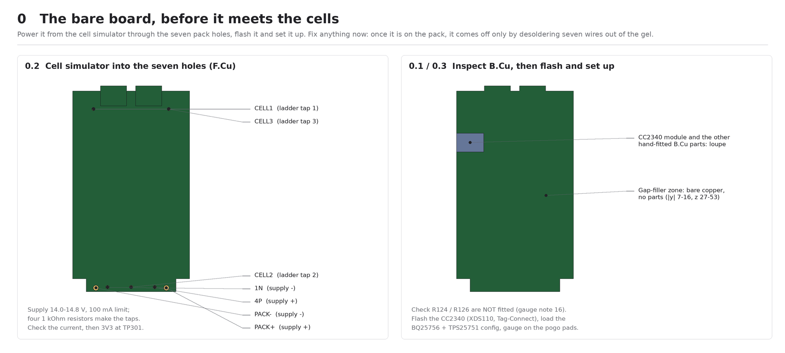
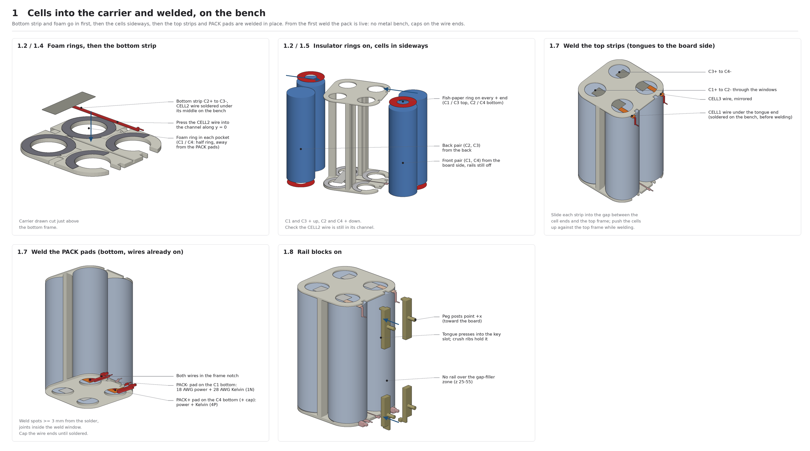
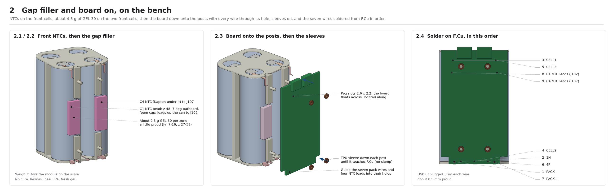
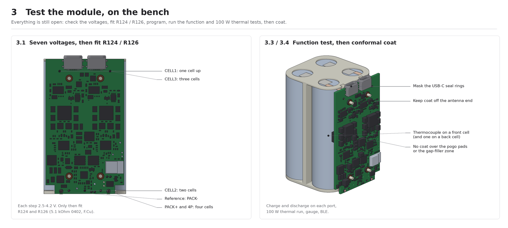
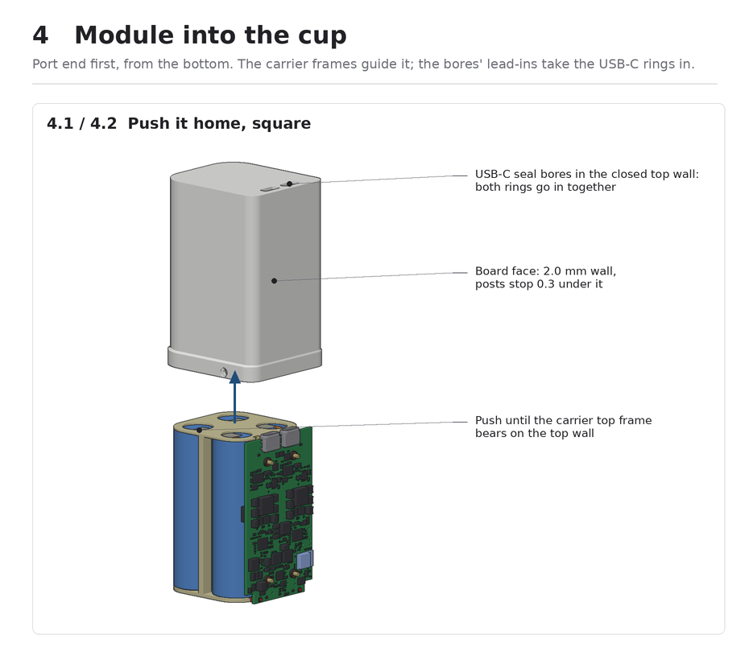
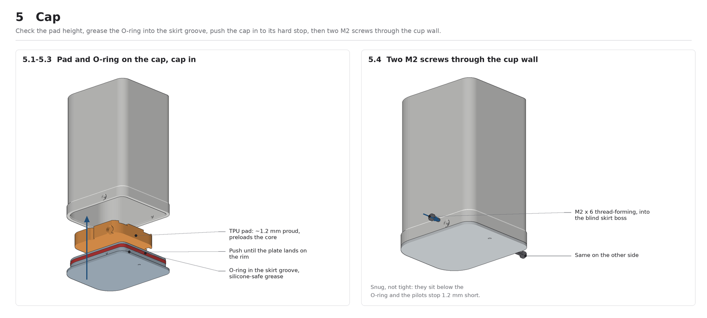
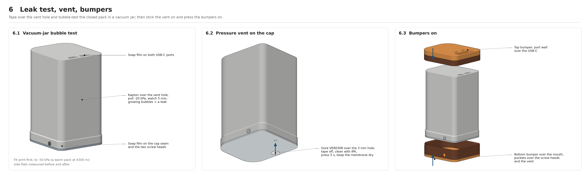

# P0 assembly: one power module, then the cup

How a Monolith P0 goes together, from the mechanical model in `hardware/mechanical/` (**the cup**, `monolith_cup.py`; adopted 2026-10-21, it replaces the side tray). Parts and views: `hardware/mechanical/monolith_cup_exploded.png` and `monolith_cup_sections.png`, and a picture sheet for each step below (`hardware/mechanical/assembly_steps/`); the connections are in the table below (the old nickel-tail drawing, `monolith_side_tabs.png`, is history: removed 2026-10-29, in git at `5cf521e`).

**Status:** a plan. Nothing has been built yet, so expect it to change at the first fit print. Cells: BAK N21700CX-65E 6500 mAh (`docs/spec.md`, Cells and pack). Which of the board changes below are already on the `Production` branch is tracked in the spec's P0 checklist.

## The idea

The cells, their PA12 carrier and the board become **one rigid power module, built and tested on the bench**:
- **Every connection is a wire** (Logan, 2026-10-24): the two PACK leads are 18 AWG PTFE, and the five sense leads (CELL1–CELL3, the 1N / 4P Kelvin leads) are 28 AWG PTFE, each soldered into a plated hole on F.Cu. No nickel goes into the board, and there's no connector or spring contact.
- The board sits on four clip-on rail blocks that key into the carrier's frames, so cells and board move together; the wires only take up tolerance, not drops. The rails' peg posts run through the board to just under the cup's board-face wall, so a hit on that face goes into the cells, not the parts.
- The board is powered and programmed on its own first (step 0), then joined to the pack, tested at 100 W with everything open, and only then goes into the cup.
- Nothing is soldered in the cup.

The cup is closed on five sides, with the two USB-C seal bores in its top wall. The module goes in **from the bottom**, port end first, and is pushed home until the USB-C faces seat in the top wall. A bottom cap seals it with one radial O-ring; an outer collar on the cap holds the cup's mouth against the O-ring, and two M2 screws through the collar and the wall into blind bosses hold the cap. There is no aluminium: the power stage's heat goes into the front cells through thermal vias and a dispensed gap filler, and the carrier's full-length PA12 webs share it with the back pair.

**Changed on 2026-10-24** after the five-reviewer mechanical review (report: https://claude.ai/artifact/3tGQPMVpdSpkVSX3okK4EF): the sense wires; insulator rings on the + ends; foam preload rings under the cells; clip-on rails; posts to the board-face wall and a 2.0 mm wall there; the cap collar, blind screw pilots, a taller skirt and overtravel posts; a softer pad; a 1.85 mm top wall with resized USB-C bores; R124 / R126 left off the board until the pack is wired; and a bare-board step 0.

## Connections

| Connection | From | Lead | Hole (KiCad x, y) |
|---|---|---|---|
| PACK− | C1 bottom (can) | 0.2 × 7 nickel pad + 18 AWG PTFE wire, through the C1 notch | J108, Ø1.5 at (86.97, 135.73) |
| 1N (gauge Kelvin) | PACK− pad | 28 AWG PTFE wire, same notch | J115, Ø0.8 at (91.28, 135.48) |
| CELL2 | middle of the C2+ / C3− strip, bottom | 28 AWG PTFE wire, along the channel in the bottom frame | J110, Ø0.8 at (100.00, 135.45) |
| 4P (gauge Kelvin) | PACK+ pad | 28 AWG PTFE wire, through the C4 notch | J116, Ø0.8 at (108.72, 135.48) |
| PACK+ | C4 bottom (+ cap) | 0.2 × 7 nickel pad + 18 AWG PTFE wire, same notch | J112, Ø1.5 at (113.03, 135.73) |
| CELL1 | C1+ / C2− strip, top | 28 AWG PTFE wire from the strip's tongue, down behind the board | J109, Ø0.8 at (86.10, 69.48) |
| CELL3 | C3+ / C4− strip, top | the same, mirrored | J111, Ø0.8 at (113.90, 69.48) |

The positions come from `sb_slots()` and `sb_pack_holes()` in `hardware/mechanical/monolith_shell.py`. The five sense holes sit where the plated slots for the old nickel tails were, each Ø0.8 in a 1.5 × 1.4 mm pad (2026-10-24: the old 4.2 mm oval pads at J109 / J111 overlapped the USB-C courtyards, and nothing was routed to them yet). They're on the `SENSE_WIRE_HOLES` / `SENSE_WIRE_PADS` layers of `monolith_side_pcb.dxf`.

**Details:**
- **PACK wire tails (option C, 2026-10-24).** Each PACK end is a 0.2 × 7 mm nickel pad welded to the cell inside the weld window, with two wires soldered to it on the bench before welding: an 18 AWG PTFE power wire and a 28 AWG PTFE Kelvin wire. No wire fits the 0.25 mm gap between the frame and the cell end, so both run through one notch per side in the carrier's bottom frame (`wire_notches()` in `monolith_cup.py`; two notches left a loose chip of frame between them), cross the 2.6 mm gap and go into the board. The Kelvin wire carries no current, so it gives the gauge a true sense at the pad. 1N and 4P must stay separate nets on the board, routed to VC0 / SRN side and VC4.
- **Sense wires (2026-10-24).** 28 AWG silver-plated PTFE (0.74 mm OD at most), the same wire as the Kelvin leads.
    - **CELL1 / CELL3:** the top strip runs on past its cell as a 3 mm wide tongue, out to 1.45 mm past the top frame (`SB_TONGUE_X`). Solder the wire under the tongue's end on the bench, before the strip goes in; the wire drops about 6 mm down the gap behind the board and turns into its hole.
    - **CELL2:** solder the wire to the middle of the bottom strip on the bench (that spot is under the frame, between C2 and C3, not under a window). The wire runs in a 1.0 × 0.95 mm channel in the bottom frame's cell-side face along y = 0, with a 3 mm pocket under the joint, between the C1 and C4 rims, out past the frame and up into its hole. About 40 mm long.
    - The wires take up cell-length tolerance and board movement by bending, with no kink to form and no bending jig.
- **Power loss:** about 0.66 mΩ per PACK end (7 mm of pad plus 15 mm of 18 AWG), so about 0.06 W each at 9.4 A. The sense wires carry only balancing current.
- **Short risk:** keep every solder joint inside the weld window, over the pad, and at least 3 mm from a weld spot. On C4 the bottom is the + cap and the rim is the can (−), so a joint out at the rim could short the cell.
- **+ ends:** a 0.2 mm fish-paper ring on each + end (C1 and C3 top, C2 and C4 bottom), on the crimp shoulder, under the nickel. The frames bear on the nickel outside the Ø14 windows, which is over the shoulder, at the cell's own negative; without the ring, a strip pushed into a window in an end-on drop could short the cell. Measure the BAK + cap diameter and how far it stands proud before cutting the rings (`INSUL` in the model: 21.2 OD, 9.4 ID).
- **Cell preload:** the carrier's frames are a fixed 71.95 mm apart, and the 65E is 71.0 mm at most, so the cells would float 0.55 mm or more on their welds. A silicone foam ring in a 0.6 mm pocket under each cell's bottom end pushes the cells up onto the top frame. On C1 and C4 only the half away from the PACK pads gets foam. Measure the gap with the cells in and pick the foam thickness so it compresses about 30 %.
- **Behind B.Cu:** the sense wires cross the gap in the old tail-run areas (`BCU_TAIL_RUNS`, the board's `KO_B_tail_*`), about 1 mm behind B.Cu: only low parts (≤ 0.6 mm) there. The PACK and Kelvin wires cross in the `BCU_WIRE_RUNS` areas: no B.Cu parts at all there.
- **Board rails (2026-10-24):** four clip-on PA12 blocks, bottom and top on each side, each with a tongue that slides into a key slot in the frame's board-side face. Two crush ribs on each tongue (0.15 mm into the slot walls, 2026-10-28) hold the blocks in until the board is soldered; in the cup, the board-face wall, the top wall and the cap pad capture them. As part of the carrier they blocked the front cells from going in. They stand 0.15 mm off the front cans and carry the board's four peg posts. Below z 7.3 the bottom blocks keep only a stub at |y| ≤ 7.6 mm (`RAIL_RELIEF_Y`), clear of the PACK wires.
- **Posts and sleeves:** the Ø2 peg posts run through the board's 2.6 × 2.2 mm slots to 0.3 mm under the board-face wall, which is now 2.0 mm thick. A small Ø4 TPU sleeve pushed down each post onto F.Cu holds the board on the rails; in the cup the board-face wall sits 0.5 mm over the sleeves, so the board can't come off the posts even if a sleeve slips. The slots (2026-10-24, were Ø2.2 holes) give the board ±0.3 mm of float across its width, so the USB-C seal bores centre the ports along the rings' long side when the cup goes on. They stay ±0.1 mm along the board's length, so a cable push can't slide the board down and pull the rings out of the top wall. Push the sleeves down until they touch F.Cu, not hard enough to clamp the board.

**Board changes (on the `Production` branch):**
- Five sense holes, Ø0.8 in 1.5 × 1.4 mm pads: J109–J111 (CELL1–CELL3), J115 / J116 (1N / 4P). Done 2026-10-24; DRC still to run.
- Two Ø1.5 mm plated holes with a 0.4 mm ring for the 18 AWG PACK wires (J108, J112). Done 2026-10-24.
- **R124 and R126 are DNP** (gauge sheet note 16, 2026-10-24). They connect the BQ294700 output and the gauge FUSE pin to Q104's gate. With them off, nothing can blow F102 while the pack is being wired; fit them by hand after the seven voltages read right (step 3.1).
- Route 1N and 4P as Kelvin nets to the gauge.
- Keep-outs: the carrier rails (`BCU_FRAME_BARS`, split: no rail at z 25–55 mm), the tail runs (`BCU_TAIL_RUNS`), the wire runs (`BCU_WIRE_RUNS`), and the **gap-filler zone** on B.Cu (|y| 7–16 mm, z 27–53 mm: no parts, solid copper, a dense thermal-via array to the power stages on F.Cu).
- Four slots for the peg posts (2.6 × 2.2 mm NPTH, long across the board, H101–H104 at y ±8.6, z 14 and 68). The Ø4 sleeves reach 2.3 mm from a slot's centre across the board at full float. H101–H103 have nothing on F.Cu that close, but U405's pins 16–20 are 2.0 mm from H104 as placed on 2026-10-24: move U405 about 0.6 mm in −x (KiCad), which also clears the H104 courtyard (±1.8 mm in x).

## Materials and tools

- **Cells:** 4 × BAK N21700CX-65E 6500 mAh, same batch, matched to within 10 mV and to within 1 mΩ on an AC (1 kHz) meter. Measure each cell's diameter and length: the cup is designed to 21.85 × 71.1 mm, and the datasheet gives 21.7 × 71.0 maximum.
- **Nickel:**
    - 0.2 × 10 mm pure nickel for the three series strips (loss cut 4). The top two run on past their cells as 3 mm wide tongues for the CELL1 / CELL3 wires.
    - 0.2 × 7 mm pure nickel for the two PACK pads, about 10 mm long.
- **Wire:** 18 AWG silver-plated PTFE for the two PACK power leads (M22759/11-18, 19/30 strand, 1.68–1.78 mm OD per AWC; the frame notches and B.Cu keep-outs are sized for 1.8 mm since 2026-10-24); 28 AWG thin-wall PTFE for the five sense leads (M16878/6 Type ET, BCE 19/40 or BCB 7/36, 0.64–0.74 mm OD). Anything thicker than 1.8 / 0.75 mm doesn't fit. About 25 mm each, 45 mm for CELL2.
    - Source, and how to check the nickel is real: `spot-welding.md`.
- **Insulation:** four 0.2 mm fish-paper rings for the + ends (self-adhesive "barley" rings, cut to fit the measured + cap). Kapton tape.
- **Foam:** silicone foam sheet (about 1 and 1.6 mm), cut into four preload rings.
- **Printed parts:**
    - the cup (1.2 mm walls, 2.0 mm on the board face, 1.85 mm top wall) and the bottom cap with its collar (MJF PA12);
    - the cell carrier (MJF PA12): two frames, spines and the front-back webs;
    - the four board-rail blocks (MJF PA12);
    - in TPU: the pad (inside the cap, 15 % gyroid), the four post sleeves, and the two bumpers.
- **Seal and fixings:** a 2.0 mm silicone O-ring (60A, ~25 % squeeze in the skirt groove), 2 × M2 × 6 mm thread-forming screws for plastic (the collar, wall and boss stack is 6.55 mm in the model), silicone grease. No vent: the pack is sealed for good (2026-10-28).
- **Thermal:** Parker Chomerics THERM-A-GAP GEL 30, one 10 cc syringe (65-00-GEL30-0010), about 4.5 g between the board and the two front cells. A 0.01 g scale and a 14–16 gauge tapered tip.
- **Other:** conformal coat.
- **Tools:** an AWithZ P20B spot welder with handheld pens (`spot-welding.md`), soldering iron, a multimeter, calipers, the gauge and programming setup (EV2400 on the J302 "GAUGE" Tag-Connect, XDS110 on J301, one TC2030-IDC-NL cable for both), a current-limited bench supply and a cell simulator for step 0, and a clear vacuum jar with a hand pump and gauge (a food-vacuum or resin-degassing pot) plus leak-detection fluid or soapy water for the leak test.
- **Cell simulator** (for step 0): a bench supply at 14.0–14.8 V, current-limited to 100 mA, and a ladder of four equal resistors (1 kΩ) across it, with pins that drop into the seven holes: PACK− and 1N on the supply's −, the three taps on the ladder's joints, 4P and PACK+ on its +.

## Steps

Each step has a sheet of pictures, numbered to match the sub-steps below. Each panel draws what's already built in muted colours and the parts that step adds in full colour, pulled out along the way they go on. They're rendered from the same model as the STLs by `hardware/mechanical/monolith_cup_assembly_steps.py`, so re-run it after a geometry change. The NTCs, gel bead and solder joints aren't modelled; they're shown as callouts.

### 0. The bare board, before it meets the cells

1. **Inspect** the hand-fitted B.Cu parts (19, including the CC2340 module) under a loupe, and check that R124 and R126 are not fitted.
2. **Power it from the cell simulator** through the seven holes. Check the current draw, then 3V3 at TP301.
3. **Flash the CC2340**, load the BQ25756 and TPS25751 configuration, and check the gauge talks through J302 (wake it from USB or TP113 per `p0-bringup-and-training.md`).
4. If anything is wrong, fix it now: once the board is on the pack it can't come off without desoldering seven wires, and it is bedded in gel.

### 1. Cells into the carrier and welded, on the bench

1. **Check the cells.** Measure each cell's voltage, AC resistance, diameter and length; reject outliers. Measure a + cap's diameter and height above the shoulder.
2. **Insulator rings** on the four + ends (they are the + ends at C1 and C3 top, C2 and C4 bottom).
3. **Prepare the strips and pads on the bench,** with no cell present (strip and tin each wire, solder it, let it cool):
    - CELL2: the wire under the middle of the bottom strip, about 3 mm of lap, pointing +x.
    - CELL1 / CELL3: the wire under the end of each top strip's tongue, about 1.5 mm of lap, pointing down.
    - PACK pads: the power wire on the pad's outer side (toward the PACK hole), the Kelvin wire on the inner side, about 3 mm from the board-side end.
4. **Bottom strip and foam first:** lay the foam rings in their pockets, then the bottom strip (C2+ → C3−) on the empty bottom frame, with its CELL2 wire pressed into the channel.
5. **Cells into the carrier**, loaded sideways: the back pair (C2, C3) from the back and the front pair (C1, C4) from the board side, with the rail blocks still off. The webs hold the front and back pairs apart. Positions per `SB_CELLS`: C1 and C3 + up, C2 and C4 + down. Check that the CELL2 wire is still in its channel.
6. **Qualify the weld first** on two spare cells (`spot-welding.md`), at the settings you'll use.
7. **Weld,** pushing the cells up against the top frame while you weld (the foam does this once the strips are on):
    - the bottom strip through the C2 and C3 windows;
    - the top strips, slid into the gap between the cell ends and the top frame, tongues and wires toward the board side: C1+ → C2−, C3+ → C4−;
    - the PACK pads, with their wires already soldered: PACK− on the C1 bottom, PACK+ on the C4 bottom. Keep every weld spot at least 3 mm from the solder, and lay both wires in the frame notch.
    - From the first strip on, the pack is live (see *Working on the live pack* below).
8. **Rail blocks on:** press the four blocks' tongues into the frame key slots, posts pointing +x, until each block's face is flat on the frame. The crush ribs should make it a firm push. If a block is loose (the print came out small), put a drop of CA glue in its slot; if it won't go in, shave the ribs with a blade rather than forcing it. Even with the board soldered on, never lift the module by the board.

### 2. Gap filler and board on, on the bench

1. **NTCs:** the front cells' NTCs (TH101 on C1 / TS1, TH104 on C4 / TS4) are SMD parts on B.Cu since 2026-10-28, so there is nothing to fit on C1 and C4 (`research_notes/Pack thermal BAK 65E/smd-ntc.md`). Back cells (C2, C3): NTC at mid-length, facing the pack centre, as before.
2. **Dispense the gap filler** on the two front cells where the rails stop (|y| 7–16 mm, z 27–53 mm), a little proud, so the board squeezes it. Take it right into the zone's bottom outer corner (|y| 14–16 mm, z 27–31 mm): TH101 / TH104 sit there and read the cell through the gel. Tare the module on the scale and lay about 2.3 g of GEL 30 per zone. It is stiff, so push the syringe by hand through a wide tip. It needs no cure. To rework, peel it off, wipe the rest with IPA and use fresh gel.
3. **Board on:** lower it onto the peg posts, guiding the seven pack wires into their holes from B.Cu. Push the four TPU sleeves down the posts onto F.Cu.
4. **Solder on F.Cu,** USB unplugged, in the gauge sheet's note-15 order: PACK− first, then 1N and the taps bottom-up (CELL1, CELL2, CELL3), then 4P, and PACK+ last. Trim each wire about 0.5 mm proud. With R124 / R126 off, a wire touching its barrel out of order can't blow F102, but keep to the order anyway.

### 3. Test the module, on the bench

1. **Check the seven voltages** at the pads against PACK−: each step should be one cell (2.5–4.2 V). Only then **fit R124 and R126** (5.1 kΩ 0402, F.Cu).
2. **Program and set up:** load the BQ40Z50 golden file and run gauge training through J302 (`p0-bringup-and-training.md`).
3. **Function test:** charge and discharge on each port, the 100 W thermal run (thermocouples on a front and a back cell), the gauge readings, and BLE.
4. **Conformal coat**, last. Keep the coat off the antenna end, the J301 / J302 Tag-Connect pads, the gap-filler zone and the USB-C seal rings (mask the rings).

### 4. Module into the cup

1. Port end first, push the module up into the cup from the bottom. The carrier's frames guide it to ±0.2 mm; the bores' lead-ins take the USB-C seal rings in. Keep it square so both rings enter together.
2. Push home until the carrier's top frame bears on the top wall. The board's top edge then sits 0.1 mm under the top wall, as a backstop for the rings.

### 5. Cap

1. Measure the cap: the gap from the cup rim to the carrier frame's underside, with calipers, against the pad's printed height. The pad should be about 1.2 mm proud; shim or trim it if not.
2. O-ring into the skirt groove, lightly greased with silicone grease that is safe on silicone rubber (a PTFE-based or silicone-compatible grease, not a silicone oil grease, which swells it).
3. TPU pad onto the cap, then push the cap in until the plate lands on the cup rim (hard stop). The collar's crush ribs go over the outside of the cup's mouth; the pad preloads the core against the top wall.
4. Drive the two M2 thread-forming screws through the collar and the cup wall into the blind skirt bosses. Snug, not tight: they are below the O-ring, and the pilots stop 1.2 mm short of the inside.

### 6. Leak test, bumpers

1. **Leak test** in a vacuum jar. There is no vent, so the closed pack keeps its own air and a vacuum round it loads the seals the way altitude does. Brush leak-detection fluid or soapy water over the collar edge, both screw heads and both USB-C ports, stand the pack in the dry jar and pull **−20 kPa** (about an airliner cabin). Watch for 5 min: a bubble or foam that keeps growing at a joint is a leak. Let the air back in slowly and wipe the pack dry. Don't submerge the pack for this test: if a seal leaks, the jar's water is pulled in when the air goes back in.
2. **First pack only:** take the empty fit print (cup, cap, O-ring and screws, no core) to **−50 kPa** (a warm pack at 4300 m) for 10 min. Measure across both side flats before and after, and look for cracks round the screw holes. If the flats take a set, thicken the side walls before building more.
3. Press the TPU bumpers on, top (port well) and bottom (over the collar, pockets over the screw heads).

## Working on the live pack

From the first weld until the cap is on, the pack is a bare 14 V, 91 Wh source with no fuse in front of it.
- Cap the PACK wire ends with Kapton or heat-shrink until they're soldered, and never lay the module on a metal bench.
- Collect nickel and wire trimmings as you cut them; a loose trimming in the carrier can bridge two strips.
- Keep the welder's pens and the soldering iron off any strip that isn't the one you're working on, and use insulated tweezers.
- Keep a metal bucket of sand nearby.

## Open items
- **Board:** run KiCad DRC on the `Production` board after the sense-hole and DNP changes, and set the DNP flags in the JLC BOM export.
- **Fit (coupons before the full cup):**
    - USB-C bore ladder: a 1.85 mm wall printed in the cup's orientation, bores at ring − 0.1 to − 0.5 mm per axis. Pick the one that gives 0.12–0.18 mm squeeze and passes a 1 m dunk with a connector pushed in blind. Measure the rings on 5 connectors from the batch first.
    - Cup mouth + collar cap + O-ring: measure the squeeze in the middle of each flat (clay or feelers), dunk at 1 m / 30 min, and pull-test the cap.
    - Carrier + rail blocks with real cells: load all four cells, check the key slots and the foam, and fit a bare board on the posts.
    - How hard the module pushes home.
- **Drop:** a dummy-core drop series (dead cells or steel slugs, dummy board) at 1 m onto concrete: board face down, back down, cap down, port down, end-on both ways. Before and after: joint resistance, putty marks between the wall and the parts, the groove root, the ring position.
- **Label:** apply the printed vinyl wrap label (`hardware/label/`, StickerApp matte) in the cup's label relief; check its thickness fits the relief first.
- **Service:** the board can't come off the cells without desoldering seven wires, and the cap is screwed. A bad cell means rework at the bench.
- **Connection order:** check the BQ294700 datasheet.
