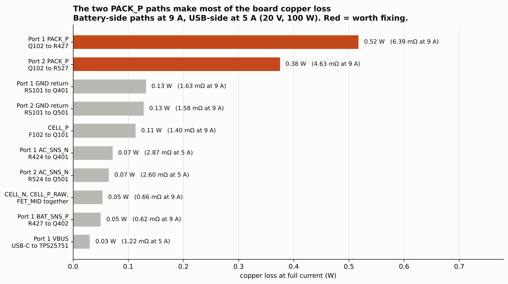
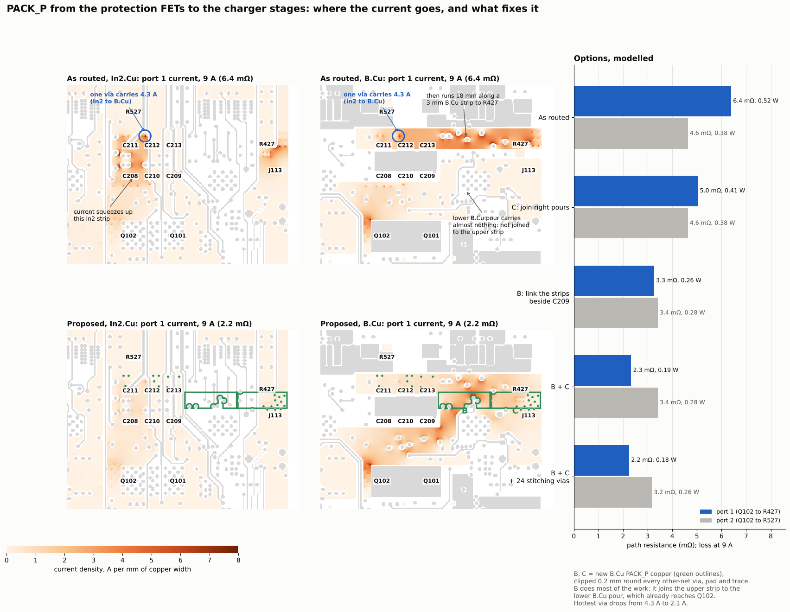
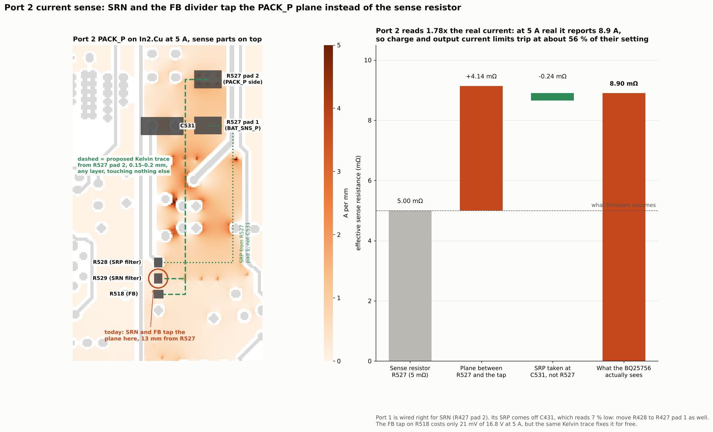
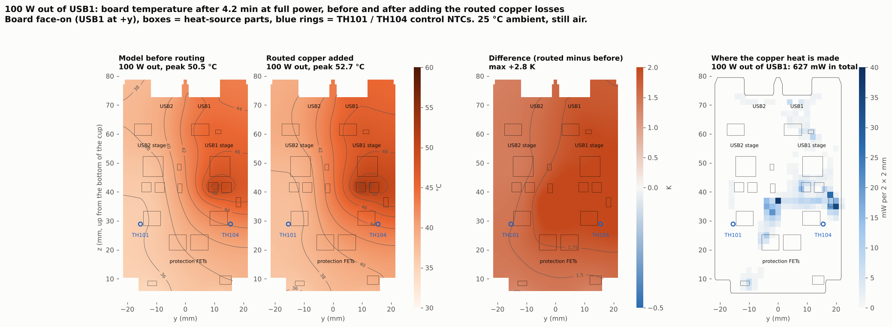
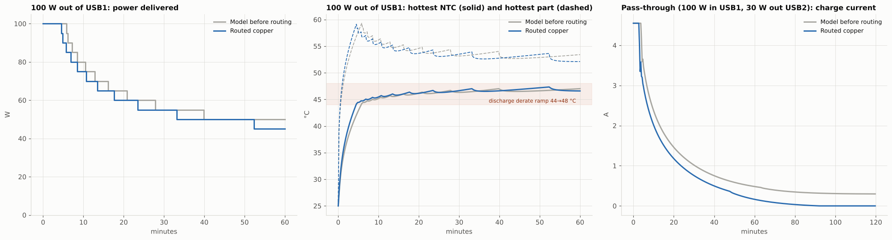
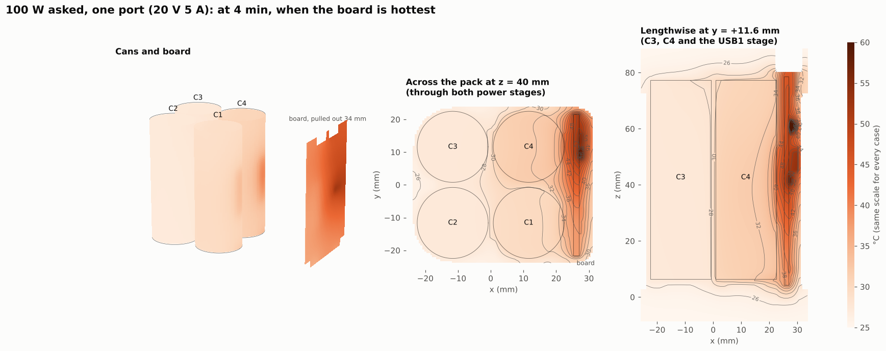
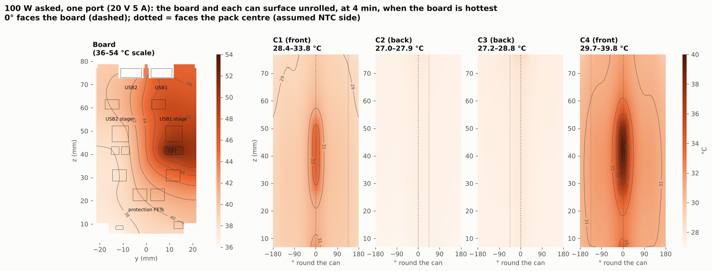

# P0 routed board review (2026-10-30)

Review of the first fully routed Monolith P0 board (`hardware/Production/Monolith.kicad_pcb`): DRC, copper resistance of every power path, the current-sense taps, and what the routed copper does to the thermal model. It is design review only; nothing has been built or measured.

**Board version.** The numbers below are from Logan's local save of 2026-10-30 04:02 UTC. `master` holds the 03:50 commit (8fd8b74 "Board Layout Done Going to review"), which is the same board minus two CELL_P vias and a few SDA segments. Where they differ it's noted.

## Open items before fab

DRC on the 04:02 save: 604 items, 8 errors, 0 unconnected.

### Must fix

- [ ] **New clearance error (04:02 save only).** The CELL_P via at (109.60, 119.51) is 0.13 mm from the 3V3 via in R305 pad 1 at (109.62, 120.09); the Power class needs 0.15 mm. It shows up as 6 errors, one per layer.
- [ ] **Port 2 current sense reads about 1.8× high.** R529 pad 1 (SRN) and R518 pad 1 tie to PACK_P through the plane via at (94.89, 111.28) instead of Kelvin to R527 pad 2. The BQ25756 sees 8.90 mΩ instead of 5 mΩ, so its current limits trip at about 56 % of the set value. Fix: a 0.2 mm Kelvin trace from R527 pad 2 to R529.1 and R518.1, and drop that via from the sense net. While there, take R528 (SRP) from R527 pad 1 instead of C531. Port 1 SRP is taken at C431 and reads about 7 % low; move R428 to R427 pad 1. See figure 3.
- [ ] **Antenna keep-out.** U301 (CC2340R5MODA) has its antenna keep-outs on F.Cu and In1 only. Update U301 from the MonolithDev library; that also clears the footprint-mismatch warning.
- [ ] **J1–J4 exclude from BOM.** The four back-cell NTC wire pads have no `exclude_from_bom`, so they'll show up as BOM lines.
- [ ] **F102 heater return (low priority).** Q104 pin 2 to CELL_N is a 0.2 mm In2 trace, 195 mΩ. The heater is 11–20 Ω (0.5–1.5 A), so it only drops about 0.3 V. Widen it if there's room.

### Should fix

- [ ] **Port 1 PACK_P resistance.** 6.4 mΩ (0.52 W at 9 A) against 4.6 mΩ on port 2. A B.Cu link beside C209 (x 105.8–113.8, y 105.4–107.8) that joins the upper strip to the lower pour, plus joining the right-hand pours (x 113.6–121.2), models at 2.3 mΩ, saving about 0.33 W at 100 W. See figure 2.
- [ ] **Hot via.** The single PACK_P via at (99.77, 103.73) carries 4.3 A at 9 A (3.2 A on port 2). Add 3–4 vias around it; with the links above and 24 stitching vias the hottest via drops to 2.1 A.
- [ ] **Narrow neck.** 0.12 mm copper neck on B.Cu at (105.23, 109.18), under the 0.15 mm minimum.
- [ ] **Pour overlap.** The two port 2 BAT_SNS_P zones overlap at (92.33, 102.24) (2 DRC errors). Merge them or give them different priorities.
- [ ] **TH104 spacing.** The port 1 PACK_P B.Cu fill comes 0.19 mm from TH104's pads (TH101 has about 3 mm). Legal, but a 1 mm pull-back keeps paste and rework clear. Thermally it makes no difference.
- [ ] **Via arrays.** 178 hole_to_hole warnings from the 0.508 mm via arrays (0.21 mm web). Check against the fab's minimum hole spacing before ordering.

### Cleanup

- [ ] 5 dangling vias: (99.57, 122.30), (104.09, 77.47), (103.78, 76.69), (103.58, 134.83), (98.34, 128.05).
- [ ] 3 dangling track ends: (98.17, 128.77), (80.26, 93.85), (110.76, 104.39).
- [ ] Silkscreen: 199 overlaps, 199 over copper, 10 at the board edge.
- [ ] Mechanical check of the TS2 wire route to J1/J2 at |y| 12–14 mm.

### Done since the first routed review (03:38 save)

- [x] TPD6S300 pins 7/8 were swapped in `tools/tpd6s300.py`, which put CC1 on GND (U405, U505). Fixed in the symbol and schematic.
- [x] GPIO6 drives DRV9_OFF to Q409/Q509 again (the 9 V gate drive could never turn on); GPIO4/5 back on GND.
- [x] All nets connected (0 unconnected).
- [x] Port 1 PACK_P down from 35 mΩ (In2 cut) to 6.4 mΩ.

Coordinates are KiCad board coordinates in mm.

## Copper resistance

A DC grid solver at 0.1 mm over all six layers, including vias. The pack-side paths add up to 2.06 mΩ, which matches the 2 mΩ the thermal model already assumed. The per-port paths are new heat the model didn't have before.

| Path | Port 1 (mΩ) | Port 2 (mΩ) | Loss at test current |
|---|---|---|---|
| PACK_P, Q102 to RBAT (R427 / R527), 9 A | 6.39 | 4.63 | 0.52 / 0.38 W |
| GND, RS101 to stage (Q401 / Q501), 9 A | 1.63 | 1.58 | 0.13 / 0.13 W |
| BAT_SNS_P, RBAT to leg B, 9 A | 0.62 | 0.51 | 0.05 / 0.04 W |
| AC_SNS_N, RAC to leg A, 5 A | 2.87 | 2.60 | 0.07 / 0.06 W |
| VBUS, receptacle to TPS25751, 5 A | 1.22 | 1.10 | 0.03 / 0.03 W |
| PPHV, TPS25751 to RAC, 5 A | 0.37 | 0.33 | 0.01 / 0.01 W |
| CELL_P, F102 to Q101, 9 A | 1.40 | | 0.11 W |
| CELL_N, J108 to RS101, 9 A | 0.32 | | 0.03 W |
| CELL_P_RAW, J112 to F102, 9 A | 0.25 | | 0.02 W |
| FET_MID, Q101 to Q102, 9 A | 0.09 | | 0.01 W |
| F102 heater return, Q104 to RS101 | 195 | | (0.5–1.5 A, ~0.3 V) |

On the `master` board (03:50) PACK_P is 6.56 / 4.80 mΩ.

**PACK_P options (port 1 / port 2):** as routed 6.39 / 4.63 mΩ; link B only 3.26 / 3.41; B + C 2.33 / 3.41; B + C + 24 stitching vias 2.25 / 3.17.

| 1. Loss by path at 100 W | 2. PACK_P current, as routed vs proposed links |
|---|---|
|  |  |

**3. Port 2 sense tap.** SRN and FB pick up the PACK_P plane voltage, not the resistor pad, so the plane drop adds to the 5 mΩ sense voltage.

## Thermal

The 3-D pack model (`research_notes/Pack thermal BAK 65E/`, p0f layout, TH101/TH104 at (15.5, 29) mm as the control NTCs, d44 policy, 25 °C still air), run with and without the routed copper losses. Same code both columns, so only the copper differs.

The routed copper adds about 0.63 W at 100 W out of port 1. Temperatures stay within 0.3 K, because the derate firmware holds the limits; the extra heat shows up as a shorter full-power burst and slower charging instead.

| Case | Before routing | Routed copper |
|---|---|---|
| 100 W out of USB1: full power | 5.8 min | 4.5 min |
| 100 W out of USB1: energy in first 40 min | 46.4 Wh | 44.2 Wh |
| 100 W out of USB2: full power | 6.0 min | 5.0 min |
| 100 W out of USB2: energy in first 40 min | 46.3 Wh | 44.5 Wh |
| Charge on USB1 (100 W charger), 5 to 95 % | 98 min | 103 min |
| Pass-through (USB1 in, 30 W out of USB2), charge after 2 h from 20 % | 48 % | 39 % (charging stops at about 90 min) |
| Hottest can, any case | 46.4 °C | 46.2 °C |
| Hottest board part, any case | 60.1 °C | 60.2 °C |
| Peak TH104 reading, 100 W out of USB1 | 47.7 °C | 47.7 °C |

Where the extra heat goes at 100 W on USB1: 0.52 W in the battery-side copper and 0.11 W on the USB side. About 40 % of it sits in the board centre (|y| < 7 mm) and 16 % in the gap-filler zone; almost none is within 4 mm of TH104. At equal power the board runs 1.5–2.8 K warmer. The PACK_P links above win back about 0.33 W; the bigger levers are the part losses (the half-bridge FETs alone are 2.25 W) and the d44 thresholds.

| Board temperature at 100 W, before vs routed | Timeline, before vs routed |
|---|---|
|  |  |
| **Pack in 3-D at 100 W, routed** | **Board and cans at 100 W, routed** |
|  |  |

## Method and assumptions

- **Copper:** outer layers 2 oz (0.246 mΩ/sq), inner layers 0.5 oz (0.983 mΩ/sq), via barrels 20 µm plating. Zone fills are the ones saved in the file (not refilled).
- **Copper heat in the 3-D model:** each path's loss is mapped into 2 mm tiles at the solver's loss density and placed at the board's position in the cup (model y = KiCad x − 100, z = 141.47 − KiCad y). Battery-side copper scales with battery current squared, USB-side copper with USB current squared.
- **Not modelled:** the USB-side GND return, the switch nodes and PP5V (short, or little current).
- **Tools:** [`tools/`](tools/) has the copper solver. `python3 run2.py` prints every path in the table for the repo's board; `PCB=path/to/other.kicad_pcb python3 run2.py 0 1` runs just the two PACK_P cases on another file. Needs numpy, scipy and Pillow.

## Earlier reviews

- **Placement review (2026-10-29)**, before routing. Found the TPD6S300 pin 7/8 swap and the disconnected GPIO6 → DRV9_OFF (both fixed above), U405 under the H104 peg sleeve, L502 against the cup corner fillet, Q401 orientation and C430/C438 in the switch path, and RF match parts parked off-board. Added 3D models for every footprint (PR #38).
- **First routed review (2026-10-30 03:38 save).** DRC clean apart from the pour overlap; found the port 1 PACK_P In2 cut (35 mΩ), the port 2 SRN tap, the antenna keep-out, the F102 heater return and the J1–J4 BOM flag. This review is the follow-up.
- **Mechanical review (2026-10-24)** of the cup, carrier and seals, and the **power-stage IC review (2026-10-27)** that kept TPS25751D + BQ25756: decisions are in [`docs/spec.md`](../../spec.md).
