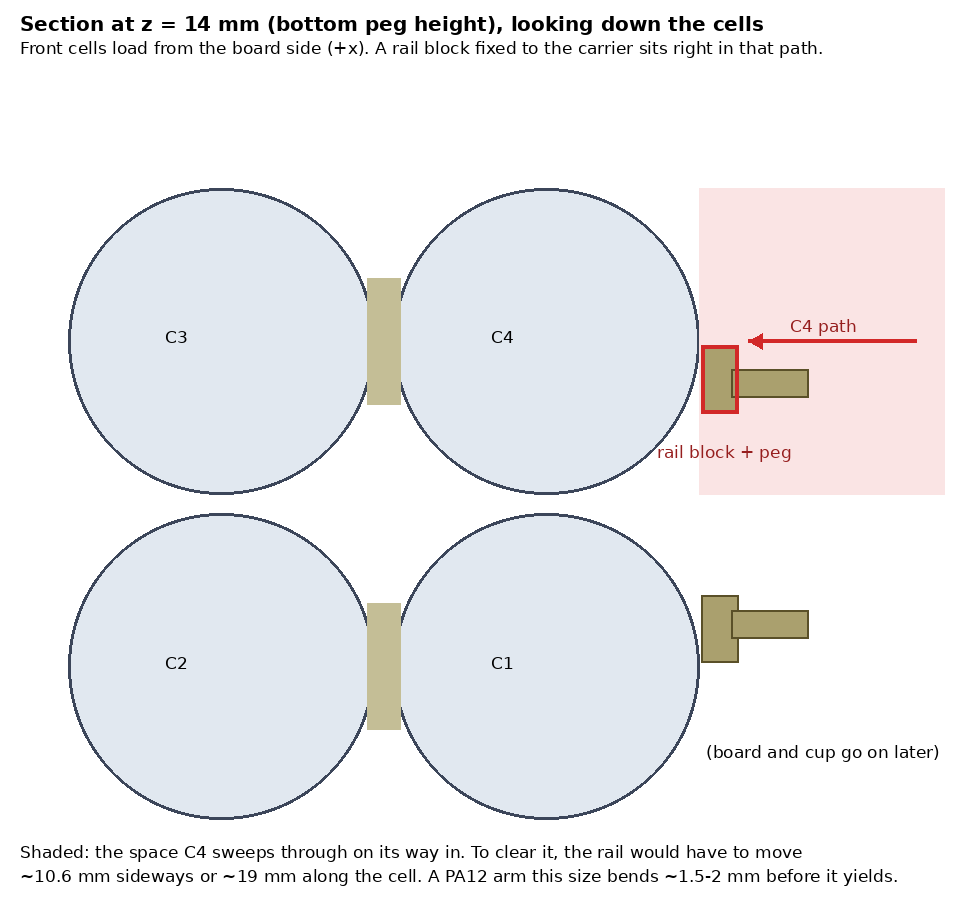
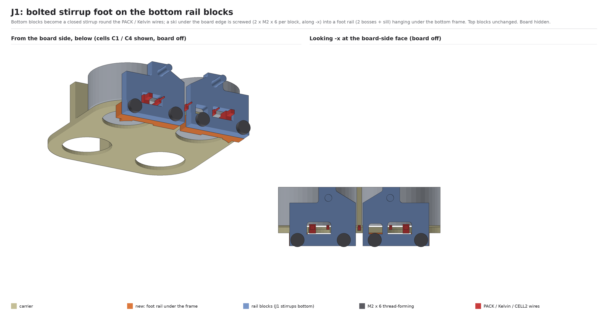
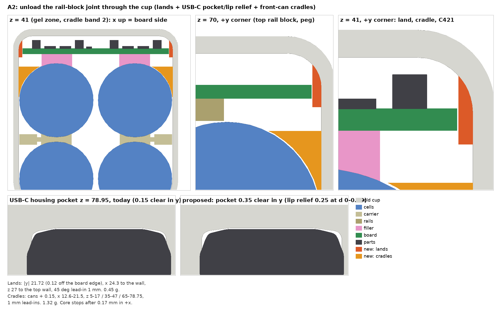
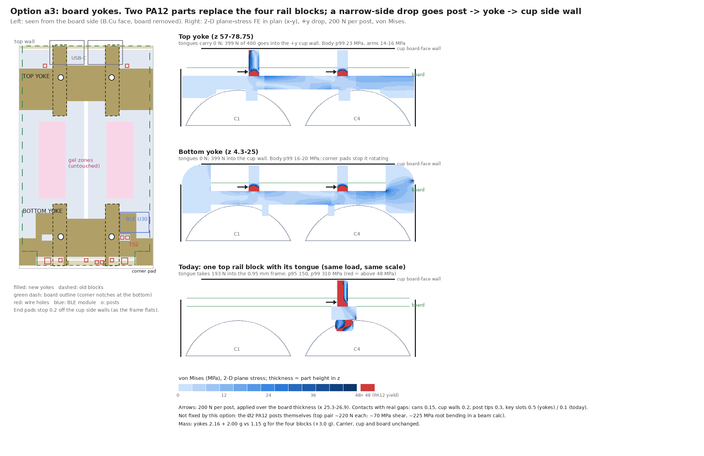
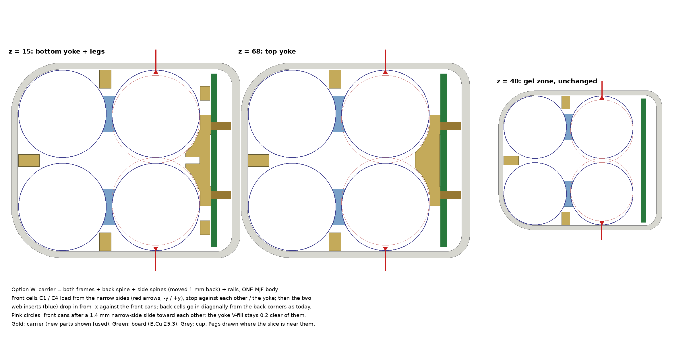
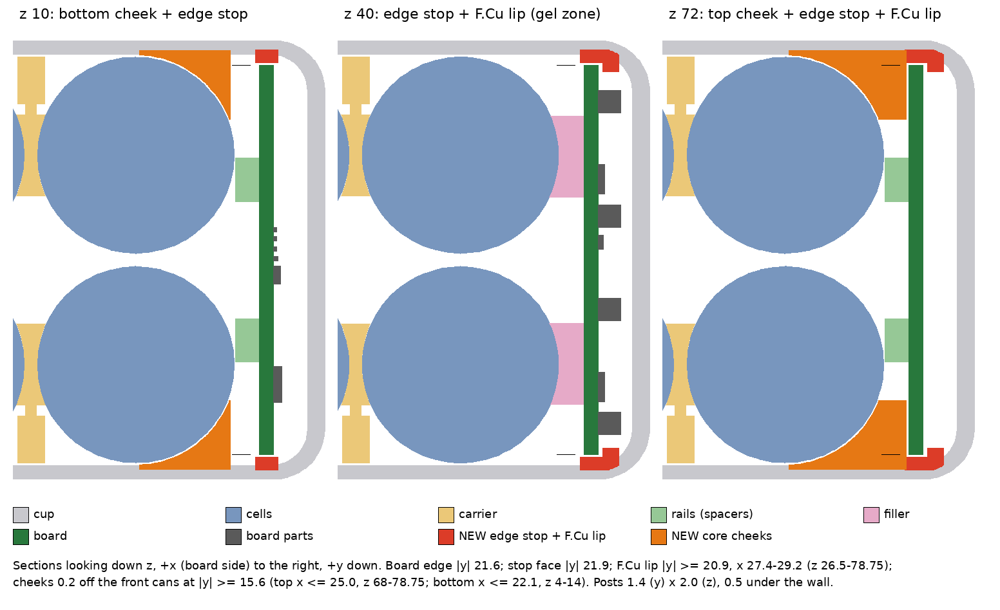
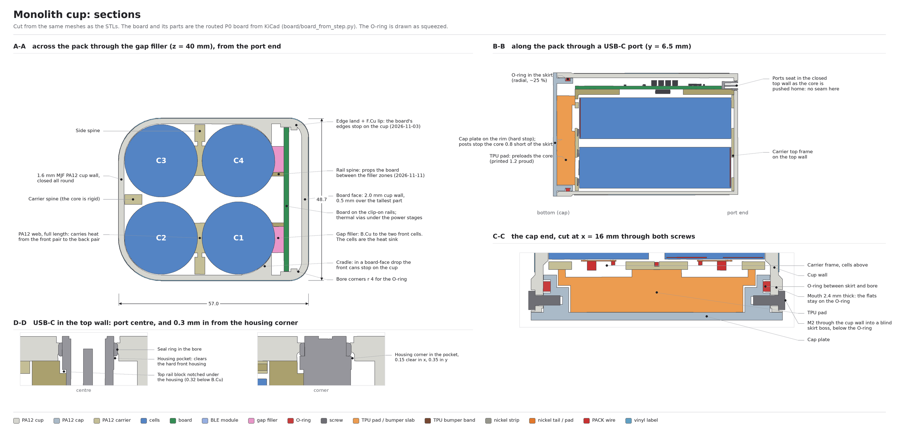

# Rail block retention (2026-11-03)

> **Status (2026-11-13).** Cup and carrier geometry, checked at the time against the hand-routed board's part meshes (the script-built board, the design since 2026-11-13, passes the same model checks: `docs/mechanical-design.md`). Options 2 and 5 were built (PR #61, 2026-11-03) and are still in `monolith_cup.py`; the 3-D drop runs of 2026-11-11 (`docs/analysis/2026-11-11-drop-3d/`) added rail spines, B.Cu edge lands and 0.7 mm wall pockets over L401 / L501 on top of them. The cradle squeeze and the contact drop rerun below were taken up by that study; the land-gap and seal-entry checks are left for the first printed cup (no coupons, Logan 2026-11-07).

Logan didn't trust the rail blocks' glued, crush-rib tongue joint to the cell carrier. Five agents each worked one concept against the mech model on master (`ece80e6`). The chosen fix, options 2 and 5 merged, is in `hardware/mechanical/monolith_cup.py`: **the cup carries the drop loads**, and the tongues and posts only locate parts on the bench.

## What was wrong with the old design

| Load case | Finding |
|---|---|
| Tongue joint, 1 m narrow-side drop | About 200 N per peg. A 2-D FE of the top block puts the tongue at 150 MPa (p95) and 310 MPa (p99) against PA12's 48 MPa. Glue doesn't help: the problem is the bending moment from a peg 8 to 10 mm off a 1 to 1.6 mm frame plate. |
| Ø2 PA12 posts, same drop | About 57 to 71 MPa shear and about 200 MPa root bending. A gap-impact run with the 4013 g pulse suggests the peg load could reach about 560 N once the board rattles across its 0.3 mm slot float. |
| Board-face drop, whole core | About 300 g at about 2500 g is roughly 7.5 kN. Nothing stopped the core except the four post tips (about 1.9 kN each). In the model the cells and carrier could move 7.5 mm toward the board face without touching the cup. The 2026-10-31 drop FE missed this because its 1 mm voxels bonded the cells to the walls. |
| Cap-end drop (found after the PR went up) | About 250 N of board, rail blocks and spacers at the 1182 g of the cap-end drop hung on the pegs, and the rail blocks are held along z only by their tongues' crush ribs (the key slots are open top and bottom). The board could slide down until its corners hit the cap skirt 1.15 mm lower, and 0.63 mm of slide pulls the USB-C seal rings out of their bores. |
| USB-C | The housings (0.15 mm off their pockets) and shell lips (0.20 mm off the bore) were the first sideways stop, inside the 0.3 mm peg float. |

Printing the rail blocks in one piece with the carrier doesn't work either: they sit in the front cells' only loading path.

## The five options

| Option | What changes | Tongue | Posts (narrow side) | Core (board face) | Mass |
|---|---|---|---|---|---|
| 1 Bolted stirrup | Bottom blocks become stirrups screwed (4 × M2) to a foot rail under the bottom frame | bottom only | no | no | +2.3 g |
| 2 Cup lands + cradles | Cup ribs on the board's long edges, opened USB-C pockets, cradles in front of the front cans | unloaded | unloaded | yes, 0.17 mm | +1.8 g |
| 3 Cross-beam yokes | Each pair of blocks joined into one yoke with arms out to the cup side walls | unloaded | no | bottom half only | +3.0 g |
| 4 One-piece carrier | Rails printed with the carrier, front cells load from the narrow sides, webs become drop-in inserts | gone | no | no | +2.5 g |
| 5 Cup holds board + core | Edge stops and F.Cu lips in the cup, cheeks on the front cans, slimmer posts, PA12 spacers | unloaded | never bear | yes, 0.20 mm | +2.0 g |

| | |
|---|---|
|  |  |
|  |  |
|  | |

## What was built (options 2 + 5)

- **Edge lands** on both cup side walls, 0.12 mm off the board's long edges (face at |y| 21.72), from z 27 to the top wall with a 1 mm lead-in. Starting at z 27 keeps PA12 off the BLE module (U301). A narrow-side drop puts about 800 N into 52 mm of board edge: about 10 MPa steady, about 39 MPa at the rattle peak.
- **F.Cu lips** over the board's long edges, 0.5 mm off F.Cu, 1.8 mm thick, reaching in to |y| 20.9, from z 27 up. The board can't lift off its posts into the wall in a board-face drop.
- **Front-can cradles**: the cup follows the front cans plus 0.15 mm in three bands (z 5–17, 35–47, 65 to the top), clear of the gel. The core stops after 0.17 mm, before the posts at 0.3.
- **Opened USB-C pockets**: housing clearance 0.15 → 0.35 mm in y, and 0.25 mm relief in front of the seal ring band. The lands now stop the board before the connectors do. Seal squeeze is unchanged.
- **Slimmer posts**: 1.8 (y) × 2.0 (z) obround, so they never touch the slot walls sideways (land gap + 0.09 mm deflection < peg float).
- **PA12 post spacers** replace the TPU sleeves: Ø4 tubes with crush-rib bores, from F.Cu up to 0.4 mm under the wall. They still cover the slots by ≥ 0.3 mm at ±0.4 mm float and clear R313 and C207.
- **Board feet** on the cap: four PA12 ribs on the skirt's inside face, 0.2 mm under the board's bottom edge at |y| 3–6 and 14.4–16.2. The board stops on the cap after 0.2 mm in a cap-end drop (the core stops on the overtravel posts after 0.3), with about 26 MPa on the board edge if only the inner two bear, and 0.43 mm of seal ring band left in the bore.
- **Unchanged**: carrier, rail blocks and tongues (no glue now), cell loading, welding, board.

All 123 model checks pass, including the insertion sweep of every board part past the new ribs (≥ 0.2 mm) and a 0.4 mm board lift. Pack mass is 401.8 g (+2.2 g), size 60.9 × 52.7 × 95.5 mm.

## Still to check on the first prints

- The cradles push the front cans toward each other (contact is about 25° off +x). Friction and the web seats take most of it, and the backstop is can-to-can contact across the 1.4 mm gap, which already happens in a narrow-side drop. Check in the drop series.
- Rerun the drop analysis with real contact instead of 1 mm voxels.
- MJF tolerance on the 0.12 mm land gap: FR4 go/no-go strips of 43.40 mm (must slide) and 43.80 mm (must not) in the first cup. The gap is one parameter (`LAND_GAP`) if a reprint needs it.
- The seal ring entering over the relieved pocket lead-in (bore-ladder coupon), and antenna behaviour with PA12 a little closer to U301.
