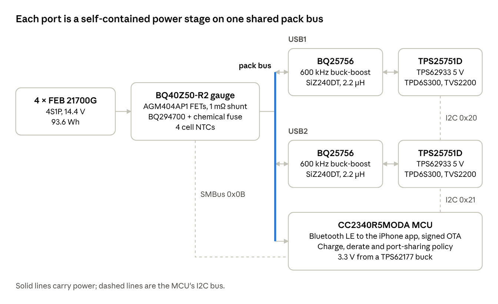

# Monolith Battery Bank: Current Design Spec

Last updated 2026-10-28. This file is the single source of truth for the Monolith design; it replaces `docs/project/monolith-next-actions.md`. Update it when a decision changes.

## Overview

Monolith is an ultralight 91 Wh backpacking power bank: four BAK N21700CX-65E cells in 4S1P, two identical bidirectional USB-C PD ports (100 W burst, about 40 W sustained), a BQ40Z50-R2 gauge, and a TI CC2340 Bluetooth LE MCU that talks to an iPhone app. The design of record is the production P0 board inside the MJF nylon "cup" enclosure. Nothing has been built or bench-tested yet, so every number here is a design value.

This spec reflects the repo's `master` at commit a490f98 (2026-10-21). Where sources disagree, the newest one wins and the conflict is listed under Contradictions. In order of authority: the repo README and `hardware/Production/README.md` (10-21), `docs/firmware/charge-and-thermal-policy.md` (10-21), the `app` branch GATT spec (10-16), the project's `monolith-next-actions.md` (10-16), then older notes and memory.

| Item | Current design |
| --- | --- |
| Energy | 91 Wh typical, 88.9 Wh minimum (about 93 Wh measured at 1 A), under the 100 Wh carry-on limit |
| Pack voltage | 14.0 V nominal (4 × 3.5 V, BAK datasheet), 16.8 V full, 11.2 V floor (2.8 V per cell) |
| Ports | 2 × USB-C PD, each bidirectional, 5–20 V, up to 5 A |
| Output | 100 W while the hottest cell NTC (the front cells' NTCs are on the board, over the gap filler) is at or below 44 °C, then a linear derate to about 40 W sustained |
| Charging | Up to 4.55 A into the pack, following a temperature ramp. About 1.6 h from 5 % to 95 % on one 100 W charger at 25 °C (modelled) |
| Wireless | Bluetooth LE (CC2340R5MODA), custom GATT service, signed OTA updates |
| Board | One 43.2 × 74.35 mm 6-layer board along one face of the cells |
| Enclosure | MJF PA12 cup with an O-ring bottom cap and TPU bumpers. No metal, no potting |
| Size and mass | 60.9 × 52.7 × 95.9 mm, about 398.8 g (modelled 2026-10-31 with the routed board's parts, after the bumper / pad trim, the thick cup mouth, the drop fixes and the 1.6 mm side walls) |
| Cost (estimate) | About $105 per board at 5 boards, about $165 per finished pack with the 65E cells |

## System architecture

The gauge sits between the cells and a shared pack bus; each port's BQ25756 can charge from or source to its USB-C connector, and the MCU sets policy over one I2C bus without carrying power itself.

## Cells and pack

The pack is four BAK N21700CX-65E 6500 mAh cells in 4S1P, adopted on 2026-10-23 in place of the FEB 21700G (which was chosen on 10-21 over the EVE 58E and Tenpower 60XG). At the same mass the 65E has about a third of the FEB's AC resistance and about 1.5× its discharge rating. The cell figures come from BAK's product specification N21700CX-65E, version A/00, dated 2025-04-10 ([PDF hosted by Convoy](https://convoylight.com/uploads/72553/cart/resources/20250901/e7772d4426c2842dadb5e9466e077fbc.pdf)), with measured values from BatteryRealData via [diy500amp](https://diy500amp.com/products/bak-65e-21700-6500mah-25a-battery-high-capacity-energy-cell). A copy is in `datasheets/bak-n21700cx-65e.pdf`.

| Item | Value |
| --- | --- |
| Capacity | 6500 mAh typical, 6350 mAh minimum (6584 mAh measured at 1 A); 3.5 V nominal; 22.75 Wh typical, 22.23 Wh minimum per cell |
| Charge | 4.20 V. 4.25 V absolute. 3.175 A standard (0.5C), 12.7 A max (2C), 0–45 °C; surface ≤ 65 °C, recharge only once ≤ 45 °C. The datasheet has no temperature-stepped table (BAK supplies one on request), so firmware keeps the old FEB ramp, capped at 4.55 A, until it arrives |
| Discharge | 19.05 A max (3C), −20–60 °C; surface ≤ 80 °C, resume once ≤ 60 °C. End voltage 2.5 V, absolute floor 2.0 V; floor used: 2.8 V per cell. Capacity ≥ 85 % at 0 °C and ≥ 80 % at −20 °C |
| Resistance | AC ≤ 8 mΩ at 1 kHz; DC not specified (12–16 mΩ estimated, to measure) |
| Size and mass | 21.7 × 71.0 mm max (reseller figures; the datasheet gives it only in a drawing), ≤ 75 g (300 g for four) |
| Cycle life | ≥ 80 % at 501 cycles (0.5C charge / 1C discharge, 4.2–2.5 V) |
| Price | $9.25–9.75 each, bare, no protection. Sold out at both US sellers on 10-23 |

- **Interconnect:** spot-welded pure nickel, with an AWithZ P20B (`docs/production/spot-welding.md`). Series strips 0.2 × 10 mm. **Every lead to the board is a wire (2026-10-24).** PACK− / PACK+ (option C): a 0.2 × 7 mm nickel pad welded to the cell, with an 18 AWG PTFE power wire (M22759/11-18, up to 1.8 mm OD) into a Ø1.5 mm plated hole. **Sense leads (Logan, 2026-10-24):** the three cell taps (J109–J111) and the two Kelvin leads (J115 / J116) are 28 AWG thin-wall PTFE wires (M16878/6 Type ET, up to 0.75 mm OD) into Ø0.8 mm plated holes in 1.5 × 1.4 mm pads. CELL1 and CELL3 wires solder to a short flat tongue on the top strips; the CELL2 wire solders to the middle of the bottom strip and runs in a 1.0 × 0.95 mm channel in the carrier's bottom frame. All wires are soldered to the nickel on the bench, then to F.Cu. No springs or connectors.
- **Matching:** all four from one batch, within 10 mV and 1 mΩ (AC 1 kHz). Measure each diameter; the cup is designed to 21.85 mm.
- **Carrier:** an MJF PA12 carrier holds the cells at 23.25 mm pitch, with webs between the front and back pairs. The board's heat goes into the two front cells, so those run hottest.
- **Short circuit:** about 220–270 A from the cells' DC resistance (estimated at 12–16 mΩ, since BAK gives no DC figure), and up to about 370 A from the datasheet's ≤ 8 mΩ AC figure, which is closer to how a cell behaves in the first 100 µs of a short. It was 150–200 A with the FEB. This is why the protection FETs change to the BSC007N04LS6 (see Battery management and protection).
- **Future trial:** the carrier should accept a Molicel P60B/P60C later (lower resistance still; the short-circuit checks done for the 65E cover most of it).

## Battery management and protection

A TI BQ40Z50-R2 gauge is the pack's authority on cell voltage, current, temperature and state of charge, with three independent protection layers behind it.

| Layer | What | Trips on |
| --- | --- | --- |
| 1. Gauge | BQ40Z50-R2 (SMBus 0x0B), BSC007N04LS6 CHG/DSG FETs, 1 mΩ 1206 shunt | OTC 45 °C, UTC 0 °C, OTD 60 °C, OCC ≈ 5 A, OCD1 ≈ 12 A, OCD2 ≈ 14 A, CUV at ≥ 2.8 V per cell |
| 2. Hardware | BQ294700 per-cell OVP firing a TLC WSFB1514 15 A chemical fuse (F102) through Q104 | Cell overvoltage, independent of the gauge |
| 3. Firmware | MCU cross-checks and the charge/thermal policy | Everything above, with smoother limits |

- **Temperature inputs:** four 10k NTCs, one per cell, on TS1–TS4 (the front cells' are SMD on the board, the back cells' are wired), plus the gauge's FET temperature and die. The policy acts on the hottest cell, which in the cup is a front cell.
- **Front-cell NTCs (2026-10-28, `research_notes/Pack thermal BAK 65E/smd-ntc.md`):** TS1 (C1) and TS4 (C4) are SMD 0402 NTCs on B.Cu, TH101 / TH104 (NCP15XH103F03RC), in the outer bottom corner of each gap-filler zone at |y| 15.5 mm, z 29 mm, outboard of port 1's BQ25756 and under the gel. They read the board there, which the model puts 0.6–3.8 K above the hottest point of that cell's can in every case and never below it. Next to the FETs or inductor the board read up to 8–10 K high, with an error that changes with load, so the spot has to be rechecked if the port stage moves (`smd.py`, `SMD_LAYOUT=p0b`). They replace the wired beads on the cans' hot stripe of 2026-10-24 (`ntc-placement.md`), which read within 0.3 K but needed foam caps, taped leads and the J102 / J107 pads. The back-cell NTCs (TS2, TS3) stay wired at mid-length facing the pack centre. The gauge's over-temperature checks use the hottest of TS1–TS4 and its under-temperature checks the coldest (TRM §2.8); set `Temperature()` (which the charge ranges use) to the hottest, `DA Configuration[CTEMP1:0]` = 0, 0.
- **JEITA ranges in data flash:** T1 0 / T2 5 / T3 15 / T4 44 / T5 45 °C with 650 / 3250 / 4550 / 2275 mA. T4 moved from 40 to 44 °C on 2026-10-24 so the gauge's warm current stays under the firmware ramp instead of cutting in with a step. OTC recovery 42 °C.
- **Ship mode:** gauge SHUTDOWN, pack drains 3–4 µA. Entered from the app, after two weeks idle, or at RSOC ≤ 5 %, never with a cable attached. Wakes when a charger is plugged in (wake-on-USB is unproven; TP113 to TP106 is the manual wake).
- **Training on P0:** there is no separate training board. BQStudio and the EV2400 clone connect through the J302 "GAUGE" Tag-Connect, with J113/J114 wire pads for the learning-cycle load. The BAK 65E needs a new chemistry ID (likely a GPCCHEM run), then a learning cycle per TI SLUA903, and the golden image goes in the repo.
- **Considered and not adopted:** BQ41Z50 (not a drop-in, $7.44 vs $1.96, and still needs an external second-level protector). Worth a look for a later spin.
- **Protection FETs (decided 2026-10-23):** Q101/Q102 are the Infineon **BSC007N04LS6** (LCSC C534274; TDSON-8 FL 5 × 6 mm, 0.70 mΩ max at 10 V, Qg 94 nC, Qgd 11.2 nC, ID,pulse 1524 A, EAS 674 mJ, 175 °C; 1,471 at LCSC, about $1.25). This is a package change from the 3.3 × 3.3 AGM404AP1: a standard power-SO8 land (S 1–3, G 4, D 5–8 plus tab), about +22 mm² and +0.1 g per FET, and the common drain can be one shared pour. It replaces the BSZ018N04LS6 picked earlier the same day (only 93 in stock) and the XRS120N04D before it. Both FETs together lose about 0.09 W at 100 W, against 0.23 W for the BSZ018 and about 0.7 W for the AGM. **Short circuit with the 65E:** about 400 A (the BAK ≤ 8 mΩ AC figure). Each FET then runs fully on at about 150 W for about 135 µs (tDETECT, the 61 µs SCD1 delay, and the gate falling to its plateau through the 5.1 kΩ resistor), about 15 K. Q102 then turns off through its Miller plateau in about 15 µs at about 1.2 kW average (1.8 kW peak at 8.4 V and 210 A), about 17 mJ and about 35 K. That is about half the BSZ018's rise. The BSC007 has the smallest Qgd of the sub-1 mΩ parts, which is why it needs no gate speed-up; parts with 20–25 nC of Qgd (TPHR8504PL, NTMFS5C410NL) would sit 30 µs in the linear region. These figures are modelled from the BSZ018's Zth. Before ordering, check that 8.4 V / 210 A sits under the 10 µs line of the SOA (Diagram 3) and replace the model with Diagram 4. Options and model: `research_notes/protection-fets/options.md`. Gauge settings: SCD1 with RSNS = 1 at about 133–155 A with a 61 µs delay, and SCD2 at about 89–100 A with ≤ 244 µs. Try SCD1 at 0 µs on P0: it roughly halves the full-current heating if nothing nuisance-trips. F102 needs no change. It is not what clears a short (its 50 A break rating was already below the FEB's short current), and a 400 A trip cleared in about 150 µs passes about 25 A²s, against roughly 270–600 A²s to melt it. A FET that fails shorted remains a gap that no 15 A fuse can close. The 1 mΩ shunt takes about 25 mJ per trip, which is a few kelvin.

## Ports, charging and power policy

Each USB-C port is an identical, self-contained power stage, so either port can charge the pack or source up to 20 V / 5 A. Both stages share one pack bus (PACK\_P) behind the gauge shunt, so the gauge sees net current during pass-through and dual-port charging.

**Per port (P0 part numbers):**

| Function | Part | Notes |
| --- | --- | --- |
| PD controller | TPS25751D | I2C 0x20 (USB1) / 0x21 (USB2), SafeMode dead-battery strap, own 512 Kbit EEPROM. It is the I2C master for its charger; the MCU reaches the BQ25756 through `I2Cr`/`I2Cw` |
| Buck-boost charger | BQ25756 | 500 kHz (R412 49.9k), ICHG pin 0 Ω to PGND with EN\_ICHG\_PIN = 0 (charge limit set by ICHG\_REG only), DIS\_STAT\_PINS = 1, own TS NTC on the FET copper |
| Power FETs | 2 × Vishay SiZ240DT | 40 V half-bridge per leg. LCSC had only 2 in stock on 10-19; supply them to JLC yourself |
| Inductor | Coilcraft XGL7030-332MEC, 3.3 µH (loss cut 3) | 3.1 mm, on the APS0730 pads; consigned (not at JLC). P0 A/B against the APS0730M2R2F |
| Sense resistors | 5 mΩ RAC (0805) and RBAT (1206) | TI fixes RBAT at 5 mΩ |
| 5 V source rail | TPS62933 | Feeds PP5V and VCONN; enabled per port (EN\_5V1/2) |
| Port protection | TPD6S300 on CC, TVS2200 on VBUS | No liquid detection on P0 |
| Connector | Shou Han TYPE-C 16PCB1.6 IP68 (C55629729) | Right angle, 5 A / 20 V, seals in the cup's top wall |
| Bulk caps | USB side 4 × 22 µF + 2 × CA55 47 µF polymer tantalum; PACK\_P 3 × 22 µF per port + 6 shared | All parts ≤ 3.1 mm tall |

The 3.3 V rail is a TPS62177 buck with a sleep pin the MCU controls (3V3\_SLEEP).

**Power-stage review (2026-10-27): keep the P0 parts.** Logan asked whether a different IC set or GaN would package better at the system level ([report](https://claude.ai/artifact/1BiHmf1qpk2iYvnEFZNc6p)). Answer: no, and Logan approved keeping everything as it is.

- **Why mass doesn't move:** the board outline is set by the cell face, so freeing area doesn't shrink the board, carrier or cup. The F.Cu height zone (3.2 mm, set by the inductor) could drop to about 2.5 mm at best, because the 1210 bulk caps are about 2.5 mm tall: about 0.5 g and 3.5 cc. Any IC swap saves at most about 1 g per port. Each port is 95 parts and 739 mm² of courtyard (69 % of the board's part area, `Production` at 6fa088e).
- **Considered and not adopted:** BQ25798 (a TPS25751-supported charger with integrated FETs, about −125 mm² per port, but OTG tops out at 3.32 A, about 60–65 W per port); MP2760 (integrated FETs, but not a TPS25751-supported charger, so firmware would retune it on every PD contract); Infineon PMG1-B1 and Richtek RT7885 (PD + buck-boost + MCU in one chip, but still four external FETs plus external VBUS FETs, and a second firmware project per port); IP2366/IP2368 and SC8815-class power-bank SoCs; BQ25758 (a converter, not a charger).
- **GaN, not adopted:** the BQ25756 can't drive GaN (silicon dead time, unclamped bootstrap, 600 kHz ceiling, and the ~6 V GaN gate limit rules out the 9 V drive). A GaN stage built on another controller (Richtek RT6190 with EPC 40 V FETs) would save about 0.2–0.4 W at 100 W over silicon with the 9 V drive and the leg-B split, at the cost of a new power stage and new charger control firmware.
- **Port protection stays the TPD6S300.** Dropping it for ESD diodes was checked and rejected: TI's own TPS25751 EVM protects CC with a TPD4S201, and the TPS25751's CC pins are only ±1 kV HBM. The 3 µA TPD2S300 would save about 170 µA of idle current (about 1 % of charge over the two weeks before ship mode), but its 0.4 mm-pitch WCSP needs a 0.15 mm via in the centre ball, which is why it was replaced on 10-18. The U405 / H104 peg clash is fixed by moving parts (`hardware/Production/README.md`), not by a part change.

**Charging (decided 2026-10-21).** Firmware writes `ICHG = min(gauge ChargingCurrent, ramp(hottest cell), 4.55 A)` once a second, split across both chargers if both ports are sinking.

| Hottest cell | Charge current |
| --- | --- |
| ≤ 0 °C | 0 |
| 1–5 °C | 0.65 A |
| 5 → 6.5 °C | ramp to 3.25 A |
| 6.5–15 °C | 3.25 A |
| 15 → 16.5 °C | ramp to 4.55 A |
| 16.5–42 °C | 4.55 A |
| 42 → 44.5 °C | ramp to 0 (gauge OTC at 45 °C is the backstop) |

- Stop at the max SOC setting (default 95 %, 60–100 % from the app), with a periodic 100 % balancing charge, a "charge to 100 % once" command and trip mode. An optional "longevity" charge to 4.10 V is proposed.
- Solar: the Dark Energy 15 W panel is the reference source, including plain 5 V with no PD. BQ25756 VINDPM and MPPT, riding through panel dropouts.
- Dual-port charging, pass-through (charge setpoint raised by the output load), and loop detection when a cable joins the pack's own two ports.

**Discharge: burst, then sustain (retuned 2026-10-28 for the front NTCs on the board).** The PD offer stays at 100 W until the hottest cell NTC reaches 44 °C, then ramps down to 40 W at 48 °C. The board NTCs read 1–3 K above the can under load, so the ramp sits 2 K above the 10-24 one (42 → 46 °C, set for NTCs on the can); that gives back the same energy (`smd-ntc.md`). The charge ramp stays where it was.

| Hottest cell NTC | Allowed output |
| --- | --- |
| ≤ 44 °C | 100 W |
| 44 → 48 °C | ramp 100 → 40 W |
| 48–52 °C | 40 W |
| 52 → 59 °C | ramp to 0 |
| ≥ 60 °C | 0 (gauge OTD) |

- `P_allow` also takes the board ramp (55 → 70 °C on the charger TS) and a low-pack-voltage limit. It changes the offer by re-advertising Source Capabilities in 5 W steps: down at once, up only after 2 K of cooling and 10 s.
- Model results with the front NTCs on the board (TH101 / TH104), port 1's stage where Logan's 10-27 layout puts it and the 10-28 thresholds (`research_notes/Pack thermal BAK 65E/smd-ntc.md`), at 25 °C in still air:
  - 100 W from one port: about 6.0 min of full power, then 40 W; 47.1 Wh in the first 40 min (the wired design gave 47.2 Wh). Hottest can 46.6 °C, hottest board part 58.0 °C, outer face over the board 47.4 °C.
  - 60 W: 40.2 Wh in 40 min, hottest can 46.6 °C (wired: the same energy, 46.2 °C).
  - Charging from one 100 W charger: about 98 min from 5 % to 95 % (wired: 93 min); hottest can 41.8 °C. Pass-through: 53 % charged after 2 h (wired: 65 %). Straight onto a charger after a 100 W run to empty: the can stays at or below 43.7 °C while current flows.
- Model results with the wired NTC on the hot stripe and the 10-24 thresholds (42 → 46 °C; `research_notes/Pack thermal BAK 65E/ntc-placement.md`), at 25 °C in still air, stage where the model first assumed it:
  - 100 W from one port: about 6.8 min of full power (the 55 °C board ramp ends it), then 40 W; 46.9 Wh in the first 40 min, against 40.8 Wh with the 10-23 policy. Hottest can 45.9 °C, hottest board part 59.5 °C, outer face over the board 48.7 °C. Empty at about 93 min with the same 89 Wh. At 35 °C ambient: 1.3 min of full power, 33.2 Wh in 40 min, hottest can 50.3 °C.
  - A 44 → 48 °C ramp gives another 2 Wh in 40 min for a 47.6 °C can and a 50 °C outer face: worth trying on P0.
  - Charging from one 100 W charger: about 93 min from 5 % to 95 %, trimmed by the 42 °C ramp after about 25 min; hottest can 42.9 °C. With the old NTC the charge took 89 min, but the stripe reached 44.6 °C while the NTC read 41 °C.
  - Pass-through (100 W in on USB1, 30 W out on USB2): board part 60 °C, can 44.3 °C, outer face 50 °C; 64 % charged after 2 h. With the old NTC it reached 83 %, but only by running the stripe at 48 °C, above BAK's 45 °C charge limit.
  - Not rerun with the new policy (10-23 runs): split 65 + 35 W, about 8 min of full power; 60 W, full power for about 30 min, then 40 W; 30 W, nothing derates and the pack lasts about 3 h, cans at or below 37 °C; two 45 W chargers, about 85 min.
- Heat at 100 W out is about 6.1 W: 2.3 W in the cells and 3.8 W on the board (the FEB-cell estimate was about 12 W, 6.5 W in the cells). The power stage is now the main heat source; it heats the front cell under it through the gap filler, so a front-cell NTC ends the burst, with the stage about 1 K short of the 55 °C board ramp.
- Check the thresholds on P0 against thermocouples on each front can's stripe (z 40–48 mm) and on the can facing TH101 / TH104. If TS1 / TS4 read more than 1 K differently from the offsets in `smd-ntc.md`, move the discharge ramp by the difference. Leave the charge ramp unless the 100 W-then-charge test says otherwise.

**Port sharing (decided 2026-10-23): a user setting.** Both ports share `P_allow`. In **USB1 priority** mode (the default), USB2 keeps a guaranteed minimum (10–30 W, default 20 W) and USB1 gets the rest. In **Balanced** mode, the port with the larger contract gives way first. Either way, the two contracts never add up to more than `P_allow`, even briefly: lower one contract before raising the other.

**Loss cuts (adopted 2026-10-23; see Decided: the four loss cuts)** (about −1.6 W at 100 W; the gate drive is fitted but off by default): BSC007N04LS6 protection FETs in 5 × 6 (was XRS120N04D, then BSZ018N04LS6); a 9 V gate-drive LDO (TPS7A4101, U406/U506) per port, enabled by TPS25751 GPIO6 low (`GPsl` on, `GPsh` off) and only while REGN is up; Coilcraft XGL7030-332 at 500 kHz; thicker nickel (0.2 × 10 mm).

## MCU, sensing and Bluetooth

The MCU is a TI CC2340R5MODA Bluetooth LE module (Cortex-M0+, 512 KB flash / 64 KB RAM, integrated antenna), bought from TI.com at about $4 and consigned to JLC. It replaced the STM32WB1MMC on 2026-10-14 for cost and stock.

| Signal | Pin | Notes |
| --- | --- | --- |
| I2C0 SCL / SDA | DIO6 / DIO8 | One bus: gauge 0x0B, TPS25751 0x20 and 0x21 |
| IRQ\_N | DIO11 | Wire-OR of both TPS25751 IRQs and the gauge BTP |
| CHG\_INH | DIO24 | 47k pull-up, so reset, hang or a blank MCU stops charging. MCU drives it low to allow charging |
| EN\_5V1 / EN\_5V2 | DIO3 / DIO4 | Per-port TPS62933 enables |
| 3V3\_SLEEP | DIO21 | TPS62177 sleep mode. CCFG bootloader trigger on DIO21 is off |
| Free on P0 | DIO12, DIO18, DIO20 | LED, reset button and UART headers were dev-board only |

- **Debug:** SWD over a Tag-Connect TC2030 (J301) with the XDS110 on an LP-MSPM0G3519 LaunchPad. Use a `.ccxml` set to "Target supplied power"; the default drives 3.3 V into the board's rail (measured 2026-10-20).
- **Toolchain:** LPF3 SDK 9.23, TI Arm Clang, SysConfig and gmake from CCS 21, UniFlash. Board files exist for the LaunchPad and the dev board; there is no P0 board file yet.
- **Board temperatures:** the TMP1075 sensors were removed in dev board rev A8 (2026-10-17). Temperatures now come from the gauge (`DAStatus2`: TS1–TS4, FET temperature, die) and each BQ25756's TS NTC (`TS_ADC`, read through the TPS25751). The USB-C receptacles have no sensor.
- **Bluetooth:** custom GATT service per the `app` branch spec v1.1, LE Secure Connections, Just Works in v1. Writes need a bond. Buttonless pairing window: 2 min after a cable attaches, or whenever no phone is bonded yet. Up to 4 bonds.
- **OTA:** TI OAD with MCUboot, ECDSA P-256 signed images, swap-with-revert, anti-rollback on production. The signing key lives on Logan's MacBook plus an offline backup.
- **Idle current:** about 230 µA on the dev board estimate, plus about 175 µA for P0's two TPD6S300s, so roughly 400 µA (about 4–5 % per month). Bluetooth advertising rate is the biggest unknown.

## Boards and enclosure

The production P0 board is the design of record and the first board planned to be built. It is fully routed (Logan's `8fd8b74`, 2026-10-30) and in review: [`docs/reviews/2026-10-30-routed-board/`](reviews/2026-10-30-routed-board/README.md) is the current list of what to fix before fab, and supersedes the pre-routing items in the checklist below.

| Board | State (repo, 2026-10-30) | Key facts |
| --- | --- | --- |
| Production P0 (`hardware/Production/`) | Schematic generated and netlist-checked; routed 2026-10-30, 0 unconnected, in review (fixes listed in the review) | 283 parts, 43.2 × 74.35 mm, 6 layers, 1.6 mm, 2 oz outer / 0.5 oz inner, ENIG, filled vias. JLC assembles F.Cu; 19 B.Cu parts are hand-fitted, including the CC2340 module by hot air |
| Dev board MonolithDev rev A8 (`hardware/DevBoard/`) | Routed, DRC clean, fab files generated. Repo says it was skipped on 10-18 and never ordered (see Contradictions) | 196 × 115 mm, about 430 parts, cell holders, test points, sleep-current section |

**P0 board changes still to apply:**

- [x] PACK− / PACK+ wire holes (option C, 2026-10-24, on the `Production` branch): J108 / J112 are Ø1.5 mm plated holes with a 0.4 mm ring at KiCad (86.975, 135.7255) and (113.025, 135.7255), locked, and the four `KO_B_wire_*` keep-outs (`BCU_WIRE_RUNS`) replace the old PACK / Kelvin finger tail keep-outs. The five sense holes already sit at the 6500 mAh positions
- [ ] Run KiCad DRC on the `Production` board after the wire-hole change (so far only a script check: outline, 0.25 mm edge rule, ring, courtyards of the placed parts, B.Cu parts in the wire runs)
- [x] Loss cuts 1–3 in the schematic (2026-10-28): Q101/Q102 BSC007N04LS6 on `MonolithDev:Infineon_PG-TDSON-8_6.15x5.15mm_D5-8`, the 9 V gate drive per port (U406, D410 in place of R420, D411, Q409, R452–R455, C457, C458; GPIO6 freed from the GND rail), L401/L501 XGL7030-332, R412/R512 49.9k, C411/C511 4.7 µF 25 V 0805. Checked by a script connectivity diff only (no KiCad in the cloud)
- [ ] Run ERC, then Update PCB from Schematic, and place and route the new parts (the loss-cut parts, including U406 / U506, D410, Q409, Q101 / Q102 BSC007N04LS6, L401 and R412, are on the board since `ed56285`; ERC and routing are still to confirm): about 25 mm² per port for the gate drive, Q101/Q102 grow from 3.3 × 3.3 to 5 × 6 (R413/R513 = 0 Ω is still to change in the schematic too). Check the TDSON footprint against the BSC007N04LS6 datasheet's footprint drawing, and look up an LCSC code for R412/R512 (0201WMF4992TEE)
- [ ] Cup changes: B.Cu gap-filler zone with a dense thermal-via array, split carrier rails, four 2.6 × 2.2 mm peg slots for the Ø2.0 pegs (H101–H104, in place of the cover standoffs), rerun `make_board.py --keepouts` for the cup
- [ ] Fix DRC: port 1's stage (U403, Q402, C434, R446, R447) sits in the antenna keep-out; L401 is on B.Cu and belongs on F.Cu
- [ ] Make C302–C304 0402 instead of 0201; remove the four stranded VBUS traces
- [ ] Check SiZ240DT stock
- [x] Sense wires (2026-10-24): J109–J111, J115, J116 are now Ø0.8 mm round plated holes in 1.5 × 1.4 mm pads (footprint `SolderWire-28AWG_PTFE_1x01_D0.8mm_Pad1.5x1.4mm`; the old 4.2 mm pads overlapped the USB-C courtyards), so no plated slots are needed. R124 / R126 are DNP from JLC, so neither U102 nor the gauge FUSE pin can fire F102 through Q104 while the pack is wired up; fit them by hand once all seven pack voltages read right at the pads (gauge note 16). Mark them DNP in the JLC BOM. DRC still to run in KiCad
- [x] Front-cell NTCs (2026-10-24, on the `Production` branch): J107 pads at KiCad (114.7, 77.48) and (114.7, 73.48), J102 at (85.3, 77.48) and (85.3, 73.48), turned 90° so the 4 mm pitch runs along KiCad y, locked. That is |y| 14.7 mm, 1.3 mm outboard of the note's 13.4: at 13.4, J107's pad overlapped the GND pad of C406 (port 1 VBUS cap). The leads still run up the can at |y| 12–14.5 and bend out 0.2 mm to the pads. B.Cu keep-outs `KO_B_ntc_C1` (x 83.95–88.5) and `KO_B_ntc_C4` (x 111.5–116.05), both y 72.13–96.48, from `sb_ntc_runs()`. C421 moved to B.Cu (101.6, 88.0), 90°, in the centre strip behind port 1's AC_SNS_N bank (C424 / C427). DRC still to run in KiCad. Superseded 2026-10-28 by the SMD NTCs below
- [x] Front-cell NTCs on the board (2026-10-28, `smd-ntc.md`): J102 / J107 and `KO_B_ntc_C1` / `_C4` removed; TH101 / TH104 (0402 NCP15XH103F03RC, LCSC C77131) on B.Cu at KiCad (84.5, 112.48) / (115.5, 112.48), 90°, locked (`sb_ntc_smd()`), in 1.1 × 2.2 mm notches at the outer edges of `KO_B_gap_filler_L` / `_R`. Gauge sheet note 4 updated. Route each low side to CELL_1N by its own trace, keep the inner planes under the parts; re-run the spot check if port 1's stage moves. DRC and Update PCB from Schematic still to run in KiCad

**Enclosure: the cup (adopted 2026-10-21).** The cells, carrier and board are built and tested on the bench as one power module, which slides into the cup from the bottom until the USB-C faces seat in the top wall.

- MJF PA12 cup closed on five sides, with two USB-C seal bores in the top wall.
- MJF PA12 bottom cap with one 2.0 mm silicone O-ring (60A, about 25 % squeeze). The cup's wall is 2.4 mm thick over the bottom 7.5 mm (the O-ring band), so the mouth flats don't bow off the O-ring; two radial M2 thread-forming screws go through it into blind pilots below the seal. This replaced the cap's 1.5 mm outer collar on 2026-10-31: a plate model (`docs/reviews/2026-10-31-mouth-band/`) showed the collar flexing off the cap plate, leaving ~16 % squeeze at the worst spot on a flat, against ~19 % for the thick mouth, which is also 1.3 g lighter. Four overtravel posts stop the cap on the frame so the screws can't over-squeeze the pad.
- Cup walls 1.2 mm, 2.0 mm on the board face, 1.85 mm top wall. The USB-C seal bores are the connector's rev A4 ring (10.35 × 4.57 mm) minus 0.15 mm a side, ring-shaped (rounded rectangle), over a 0.47 mm pocket round the connector's front housing with a 0.25 mm lead-in (2026-10-30).
- The board's four peg posts run to 0.3 mm under the board-face wall, with TPU sleeves, so a drop on that face loads the carrier, not the inductors.
- Fish-paper insulator rings on all four + ends, and foam preload rings under the cells so they can't float axially. The board rails are four clip-on blocks fitted after the cells.
- TPU 95A bumpers at both ends and a TPU pad on the cap (1.2 mm proud for preload). Pressure vent back since 2026-10-31 (Logan: behind a bumper, no hole in the label): a 12 mm adhesive ePTFE patch (VOSAREA car-lamp vent, 100 for about $13; not IP-rated, so dunk-test it; a Gore VE80308, 7.6 mm and IP67, fits the same hole and pocket) over a 3 mm hole on the outside of the cap plate, in the free strip between the cells and the board, sitting in a pocket through the bottom bumper slab with a breather groove out to the board-face edge. No label hole and no PCB change. It equalises altitude pressure, so the walls only carry it if the vent clogs (then a warm 4300 m pushes out by about 50 kPa: 1.6 mm side flats about 17 MPa and under 1.7 mm of bulge, 8.7 MPa at an airliner's +25 kPa; about 120 N on the cap screws; `sealed_pressure()` in `monolith_cup.py`). The leak test is a vacuum-jar bubble test with the vent hole taped, before the vent goes on. Review and fix list: `docs/production/p0-assembly.md` and [the review](https://claude.ai/artifact/3tGQPMVpdSpkVSX3okK4EF).
- No metal and no potting: the power stage's heat goes into the front cells through thermal vias and about 4.5 g (1.5 cc) of 3–3.6 W/m·K gap filler, between the B.Cu via zone and the two front cells over each stage. The board gets conformal coat.
- Gap filler (2026-10-23 thermal model): the bond line is 2.75 mm at the can tangent and about 3.8 mm at the zone edges, so use a dispensable gel or cure-in-place filler, not a pad. Material (decided 2026-10-24, P0 and gift packs): Parker Chomerics THERM-A-GAP GEL 30 (3.5 W/m·K, SG 3.1, about 4.5 g; one part, supplied cured, so no mixing, gun or cure time; peels off for rework; 8 kV/mm, 10¹⁴ Ω·cm, UL94 V-0; 18-month shelf life at 10–32 °C). One 10 cc Luer-Lok syringe (65-00-GEL30-0010, about €51 at Farnell, also Newark and DigiKey) covers five or six packs. Bergquist TGF 3600 (two part, 15 h at 25 °C) was the runner-up but comes in 50 cc cartridges with a 5-month shelf life and needs a 1:1 gun and static mixers. Laird Tflex CR350S is out: its datasheet gives only an oven cure (2 h at 70 °C plus 0.5 h at 100 °C), which the fitted cells can't take. In the model, 1.5 / 3 / 6 W/m·K put the hottest part at 60.0 / 58.5 / 55.7 °C at 100 W with a 5.2 / 6.2 / 5.8 min burst, so more conductivity than this doesn't help. Comparison: `research_notes/Pack thermal BAK 65E/gap-filler-options.md`. Without it the board ramp ends the 100 W burst after 2 min. Higher-k grades, wider zones, beads between cells and a parts-to-wall pad cost 4–11 g for a few kelvin and are not worth it; filler between the cans and the cup wall does nothing.
- Outside size 60.9 × 52.7 × 95.9 mm, about 398.8 g modelled (2026-10-31: cells 300 g, board with parts ~20 g, cup 32.8 g with 1.6 mm side walls, cap 7.6 g, bumpers 15.2 g, carrier and rails 10.2 g, filler 4.5 g, label 2.9 g, pad 1.5 g). The board in the model is the routed P0 board from KiCad (`hardware/mechanical/board/`). The design came from a five-concept study (`reports/Ground-up mechanical design.md`) and replaced the side tray with its aluminium cover.

## Contradictions between sources

Twenty conflicts turned up. The first eight changed what gets built or coded; Logan settled them all on 10-23. The rest were stale text; the docs were cleaned up on 2026-10-24 and the superseded ones moved to `docs/archive/`. "Project notes" means `/mnt/project-files/knowledge/claude/monolith-next-actions.md` (10-16); "repo checklist" means `docs/project/monolith-next-actions.md` as it stood on `master` at a490f98 (now retired).

| # | Topic | Older source says | Newer source says | Spec uses |
| --- | --- | --- | --- | --- |
| 1 | Dev board built? | Chat 10-20 and memory: dev board in hand, LEDs lit, probe measured 3.3 V back-feed | README and P0 docs: dev board skipped 10-18, never ordered | **Skipped (decided 10-23)** |
| 2 | Port sharing | Project notes, GATT `usb2_min_w`: USB1 priority, USB2 guaranteed 20 W (10–30 W setting) | Thermal policy: the port with the higher contract gives way first | **User setting, both modes (10-23)** |
| 3 | Charge rate and fast mode | Project notes, GATT `fast_charge`: 0.5C default, opt-in 1C at 20–80 %. Bring-up checklist: single port 5.5 A by default | Thermal policy: temperature ramp to 4.55 A, no fast mode mentioned | Ramp; fast toggle **kept, clamped to the cell table (10-23)** |
| 4 | Charge ceiling resistor | Thermal policy: R\_ICHG 11.5 kΩ | README, P0 README, FEB notes: 11.8 kΩ | 0 Ω, register only (decided 10-23); **see Decided: resistor** |
| 5 | Output and throttle | Project notes, GATT: 100 W thermally limited; when hot every port drops to 20 W; full power while 3 of 4 board sensors work | Thermal policy: 100 W burst, linear ramp to \~40 W sustained on the hottest cell | Ramp |
| 6 | Board temperature sensors | Project notes, GATT Temperatures 5–9: TMP1075 T1–T3 (+T4/T5 DNP) | Dev board rev A8 (10-17): TMP1075s removed; gauge and charger TS only; USB-C receptacles unmonitored | Rev A8 |
| 7 | LED and button | GATT: `led_mode`, `IDENTIFY`, ship mode woken "by a charger or the button" | P0: LED, reset and wake buttons all removed | P0 |
| 8 | IP rating | Memory: IP65 (FR4 era). Mechanical brief: IP67 if possible | Cup docs state no target | **IP67 (decided 10-23)** |
| 9 | Cells | Project notes, GATT `design_mah` 5600, EEPROM notes: EVE 58E, 82 Wh. Memory 10-14: switch to Amprius SA112 | Repo 10-21: FEB 21700G, 93.6 Wh. Logan 10-23: BAK 65E | BAK 65E (adopted 10-23) |
| 10 | Enclosure | Memory, project notes: FR4 walls with printed end caps, top-cap board, aluminium heatsink plate | 10-18 side tray + aluminium cover; 10-21 the cup | Cup |
| 11 | Potting | GATT §8, EEPROM notes, repo checklist: potted pack | Mechanical design 10-18: no potting | No potting |
| 12 | Port protection | Project notes: TPD4S201 with liquid detection | P0 10-18: TPD6S300, liquid detection removed | TPD6S300 |
| 13 | Charger FETs and inductor | Project notes, dev board: 4 × PGQ04N070, XAL7030-222 | P0: 2 × SiZ240DT, XGL7030-332 at 500 kHz (loss cut 3, in the schematic 2026-10-28) | P0 parts |
| 14 | Idle current | Project notes: \~230 µA. P0 low-profile section: "\~150 µA budget" | P0 README: TPD6S300s add \~175 µA | \~400 µA |
| 15 | Pack wiring on P0 | `p0-bringup-and-training.md`: 16 AWG wire pads J108/J112 | `p0-assembly.md`: nickel tails through plated slots | All wires (10-24): PACK± 18 AWG in Ø1.5 plated holes; cell taps and Kelvin 28 AWG in Ø0.8 plated holes |
| 16 | Production board size | Project notes, repo checklist: \~44 × 44 mm double-sided board at the top cap, 0.8 mm, 4 layers | P0: 43.2 × 74.35 mm side board, 1.6 mm, 6 layers | P0 |
| 17 | Checklist docs | Repo checklist: 10-11 base with STM32WB pin map, ProtoFlow, 10-18 header | Project notes: 10-16 rewrite for the CC2340. Both predate the FEB cells and the cup | This spec |
| 18 | MCU in older notes | EEPROM programming notes: STM32WB, separate IRQ pins | CC2340, one IRQ\_N line | CC2340 (method unchanged) |
| 19 | Mass | Early plan: \~345 g | FEB notes: \~384 g; README: \~400 g with the board | About 398.8 g modelled with the board's parts, after the bumper / pad trim, the thick cup mouth, the drop fixes and the 1.6 mm side walls (10-31) |
| 20 | Learning-cycle load | P0 README: "\~C/5 ≈ 1.2 A" (58E math) | C/5 of 6.5 Ah = 1.3 A | 1.3 A |

## To do: areas not yet specified or built

Firmware is a bring-up skeleton, the GATT spec predates the 10-21 policy, the app exists only on the unmerged `app` branch, and no enclosure part has been printed.

### Firmware (CC2340, LPF3 SDK)

Today: a NoRTOS skeleton (banner, reset reason, heartbeat, IRQ\_N logging) with LaunchPad and dev-board targets, about 10 KB. It runs on the LP-EM-CC2340R53 LaunchPad: Day 1 and tests T1, T3, T5 and T6 passed on 2026-10-20 (`docs/devboard/launchpad-cc2340-plan.md`); not yet on P0.

- [ ] P0 board file (`boards/p0.syscfg`): pin map, safe initial states, CCFG
- [ ] Move to FreeRTOS with the BLE5 stack; supervision loop on an RTC wake, watchdog that can't be stopped
- [ ] Gauge driver: SBS reads, `DAStatus2`, Lifetime Data via `ManufacturerBlockAccess()`
- [ ] TPS25751 driver: 4CC commands, `I2Cr`/`I2Cw` passthrough to the BQ25756, `GPsh`/`GPsl`, IRQ\_N decode and event masks
- [ ] TPS25751 patch bundle from TI's Application Customization Tool (4S, bidirectional, 5–20 V / 5 A, BQ25756 ICHG\_REG default 3.25 A with EN\_ICHG\_PIN = 0, GPIO6 = DRV9\_OFF: output, initial value high, so the 9 V gate drive starts off); EEPROM self-programming and repair on every boot
- [ ] Charge loop per the 10-21 policy; read back ICHG\_REG, EN\_ICHG\_PIN and EN\_CHG every second and before releasing CHG\_INH, rewriting the value or inhibiting charge on a mismatch; dual-port split; solar MPPT and dropout ride-through; pass-through; max SOC hold and recharge point; balancing charge; loop detection
- [ ] Discharge `P_allow` with Source Capability re-advertising, hysteresis, and both port-sharing modes (USB1 priority, Balanced)
- [ ] Gate-drive LDO sequencing: enable converter, then `GPsl` (only with PACK\_P ≥ 10 V and a contract ≥ 45 W); `GPsh` before disable or on charge-done/fault
- [ ] Ship mode entry and exit rules; settings in flash with CRC and safe defaults
- [ ] MCUboot: signed images, swap-with-revert, self-confirm checks, key generation and backup
- [ ] Measure idle current against the \~400 µA estimate and tune advertising

### BLE protocol (GATT)

The spec is v1.1 from 10-16 (`docs/app/ble-gatt-spec.md` on `app`). It needs a revision for the BAK 65E cells, P0 hardware and the 10-21 policy.

- [ ] `design_mah` 6500; product name and hardware revision strings for P0 (`hw_rev` 2)
- [ ] Settings: keep, as a future field clamped to the cell table, `fast_charge`; add a port-sharing mode (USB1 priority / Balanced) beside `usb2_min_w` (the guaranteed USB2 minimum); reserve `led_mode`; consider a `longevity_4v10` flag
- [ ] Charge stages and limit reasons for a ramp model (e.g. `DERATED` with the active limit), replacing `FAST` and the 20 W `THROTTLE`
- [ ] Temperatures record: remove TMP1075 indices, add the two charger TS readings and the gauge FET temperature
- [ ] Gauge Health: replace the three throttle constants with the derate start/end temperatures and sustain power
- [ ] Commands: `IDENTIFY` has no LED on P0; ship-mode wake is charger only
- [ ] Decide Just Works vs a printed passkey, and whether OTA images are encrypted

### iPhone app

Today on `app` (10-16): SwiftUI + CoreBluetooth app with dashboard, charging, temperatures, pack life, settings and developer views, the `MonolithKit` codec package with round-trip tests, a built-in demo pack and the FakePack macOS simulator. Not merged to `master`.

- [ ] Update MonolithKit and the views to the revised GATT spec
- [ ] OTA flow: TI OAD client, MCUboot header and signature check, revert detection
- [ ] First connection to real hardware (LaunchPad, then P0)
- [ ] Decide on the $99/year Apple Developer Program vs 7-day free installs

### Enclosure

- [ ] Fit print of the cup, cap and carrier (JLC3DP MJF) and check the board and cells fit
- [ ] Three coupons before the full print: the cup mouth on its cap (O-ring squeeze and screw hold), a clip-on rail block, and a USB-C bore with the connector's ring
- [ ] Drop series on the fit print: board face, top, bottom, a corner
- [ ] O-ring dunk coupon and vacuum-jar leak test (soap film on the joints, −20 kPa; the empty fit print to −50 kPa, side flats measured before and after)
- [ ] IP67: a 1 m / 30 min dunk of the sealed pack
- [ ] Gap-filler dispense pattern (GEL 30, about 2.3 g per zone, dispensed by weight)
- [ ] Outside label: 91 Wh, 14.0 V, USB1 / USB2, ratings

### Mass reduction (400 g accepted; keep working on it)

The four cells are 300 g of the \~398.8 g modelled pack (2026-10-31, board parts included), so the housing and board have about 99 g between them to work on.

Trim study 2026-10-31 (Logan approved): top bumper slab 8 → 6 mm, top band 9 → 7 mm, bottom slab 4 → 3 mm, bumper slabs 30 → 20 % gyroid, cap pad 15 → 10 % gyroid: −8.0 g modelled and 3 mm shorter; the label grew 2 mm to keep its tuck under the shorter band. Then (Logan, 2026-10-31) the cap collar was replaced by a 2.4 mm thick cup mouth: −1.3 g, 1.2 mm narrower, a stiffer seal. The 1 m drop analysis then put the bumper slabs back to 30 % (the 6 mm port-end slab bottomed out at 20 %: 2685 g, now 569 g), counterbored the M2 heads 0.8 mm into the mouth so they sit 0.5 mm below the bumper band (M2 × 5 screws now), and pocketed the board-face wall 0.5 mm over L401 / L501 (the board bows 0.68 mm toward it in a board-face drop): +2.9 g. Not taken: carrier webs trimmed to the filler zone (−1.1 g, needs a thermal run), label without laminate (−1.3 g). Rejected: a thinner board-face wall (it would flex onto L401 at airliner pressure), a thinner cap plate or collar (they hold the seal under internal pressure). The model's cells are 75 g each (datasheet max), so weighing real cells may take more off the figure.

- [ ] Confirm the bumpers (6 / 3 mm slabs, 30 % gyroid) and pad (10 %) in the 1 m drop series
- [ ] Weigh printed bumpers: FDM skins make them heavier than the infill-only model
- [ ] Check cup and cap wall thickness against the IP67 dunk and drop results
- [ ] Weigh the P0 board populated and replace the modelled figure
- [ ] Revisit cells when a higher Wh/kg 21700 is buyable from a real distributor (the cells are the biggest lever)

### Testing and certification

- [ ] Bring-up per `docs/production/p0-bringup-and-training.md`: rails, flash, PD EEPROM load, gauge training
- [ ] Thermal: 100 W full-to-empty logging every sensor, at 10, 25 and 35 °C ambient; tune the derate start and sustain power (start at 44 → 48 °C with the board NTCs; try 46 → 50 °C). Add thermocouples on C4's board-facing stripe (z ≈ 40 mm), beside each front NTC, C3, the USB1 FETs, the inductor and the outer face over the board, and compare with the 10-24 model
- [ ] Measure the 65E DC resistance (10 s pulse at 50 % and 10 % charge) and update the thermal model's 14 mΩ
- [ ] Front NTC offset: compare TS1 / TS4 (TH101 / TH104 on the board) with the stripe thermocouples through a 100 W run, a charge and a 100 W run straight into a charge (model: 0.6–3.8 K high, never low)
- [ ] Cut a dummy module after dispensing to check the filler wets both the board and the cans across the zone
- [ ] Charging: 100, 65 and 30 W chargers, dual-port, solar in sun and shade; measure the 65E resistance curve
- [ ] Switching: SW1/SW2 ringing with 0 Ω gate links, inductor and SiZ240DT temperatures
- [ ] Drop: 1 m onto rock on the bumpers, then a leak test
- [ ] PD interoperability with a set of phones, laptops and chargers (a PD analyzer if one is available)
- [ ] No formal certification (personal use and gifts). Write down a per-pack safety test set (cell match, protection trips including a controlled short circuit with the 65E cells, 100 W thermal run, dunk test) and run it before gifting; hand-deliver gifts rather than ship them

## Decisions (2026-10-23)

Logan answered the open questions on 2026-10-23. He approved all four loss cuts the same day. The charge-ceiling resistor was settled the same day: 0 Ω (next section).

| Question | Decision | What it changes |
| --- | --- | --- |
| Dev board | Skipped for good; P0 is the Mk 1 build | `hardware/DevBoard/` stays in the repo as the reviewed reference only |
| Port sharing | A user setting in the app | Two modes: **USB1 priority** (USB2 keeps a guaranteed minimum, 10–30 W, default 20 W) and **Balanced** (the port with the larger contract gives way first). Default: USB1 priority, to match the port labels. Needs a GATT setting and firmware support for both |
| Fast-charge toggle | Kept in the app and GATT for future packs | Firmware always clamps to the cell's datasheet table. With the BAK 65E (12.7 A max, 2C) the toggle has real headroom, but it stays clamped to BAK's datasheet table once that is in hand |
| Max SOC default | 95 %, settable 60–100 % | No change |
| Waterproofing | **IP67**: dust-tight, 1 m immersion for 30 min | The O-ring and both USB-C seals must pass a 1 m / 30 min dunk. The ePTFE vent patch on the cap (since 2026-10-31) keeps altitude pressure off the seals and must pass the same dunk: the lamp patch has no published rating (a Gore VE80308, IP67, is the fallback) |
| Scope | Personal use and gifts to friends | No formal UL, IEC or FCC certification. Hand-deliver gifts: shipping a lithium pack by carrier needs UN38.3. Run a documented safety test set on each pack before gifting it |
| Mass | About 400 g is fine; keep reducing | Mass reduction added to the to-do list |
| Cell data | BAK's datasheet (A/00, 2025-04-10) found on 10-23; ask BAK for its temperature-stepped charge profile and keep the FEB ramp until then | No design change |
| Cells | BAK N21700CX-65E replaces the FEB 21700G | 91 Wh typical (88.9 Wh minimum). Short-circuit current rises to about 220–300 A (checks under Battery management). Firmware keeps the 4.55 A ceiling and the FEB ramp until BAK's table is confirmed. New chemistry ID |
| Source of truth | This spec goes in the repo as `docs/spec.md` and replaces both next-actions files | Repo PR opened |
| Spot welder (10-23) | AWithZ P20B; the kWeld plus kCap is dropped | Mains powered, rated 0.3 mm nickel; handheld pens weld through the carrier windows (`docs/production/spot-welding.md`) |
| PACK tails (10-24) | Wire tails (option C), 18 AWG power wires | Two Ø1.5 plated holes on the board, carrier frame notches (one per side since the 10-24 review merged each pair), wires soldered to the nickel pads on the bench. Options compared in `docs/archive/pack-tail-options.html` |
| Vent (10-28) | Removed from the cup and the board | No ePTFE patch or hole in the board-face wall, no `KO_F_cup_vent` on F.Cu, no label hole (the sun stays, solid). The cup is sealed for good: the seals and walls carry the altitude pressure (about +50 kPa at a warm 4300 m), and the leak test is a vacuum-jar bubble test |
| Vent (10-31) | Back, on the cap under the bottom bumper | A 12 mm adhesive ePTFE patch (VOSAREA car-lamp vent, 100 for about $13; not IP-rated, so dunk-test it; a Gore VE80308, 7.6 mm and IP67, fits the same hole and pocket) over a 3 mm hole on the outside of the cap plate, in the free strip between the cells and the board, sitting in a pocket through the bottom bumper slab with a breather groove out to the board-face edge. No label hole and no PCB change. Fitted after the leak test |

## Decided: the charge-ceiling resistor (R413 / R513)

Original recommendation: keep **11.8 kΩ**. It is the only value of the two that stays under the cell's 4.55 A limit at every tolerance corner, and it costs well under a minute of charge time. Decision (2026-10-23): fit 0 Ω (ICHG pin to PGND) with EN\_ICHG\_PIN = 0, so a future cell needs only a software change. A charger overcurrent then needs two faults at once (a charger register reset while the MCU holds CHG\_INH low, and firmware failing to catch it), and the input-current limit caps it at about 6.5–8 A into the cells. Conditions: firmware reads back ICHG\_REG every second and before releasing CHG\_INH; the TPS25751 configuration loads ICHG\_REG = 3.25 A; gauge OCC ≈ 5 A is the hardware backstop. The comparison below is kept for reference.

**What the resistor does.** Each BQ25756 has an ICHG pin. The resistor on it sets a hardware charge-current ceiling for that charger: I = K\_ICHG / R, with K\_ICHG = 48–52 A·kΩ for the 5 mΩ RBAT (BQ25756 datasheet §5.5). Firmware normally writes a lower limit over I2C. The resistor is the backstop that still holds if the TPS25751 configuration never loads, the MCU is blank, or firmware writes a wrong value. Software cannot raise the current above the pin: with EN\_ICHG\_PIN = 1 the charger uses the lower of the pin limit and the ICHG register, and the only way past the pin is to clear EN\_ICHG\_PIN, which removes the backstop. So the conservative-default scheme works the other way round: the resistor sits at the cell maximum, the TPS25751 configuration loads a conservative register default (3.25 A, the 5–15 °C cell limit), and the MCU raises the register toward the pin limit once it is running and reading cell temperatures. The dev board used the same scheme (EN\_ICHG\_PIN = 1, EN\_CHG\_BIT\_RESET\_BEHAVIOR = 0, so a watchdog expiry stops charging instead of falling back to the pin).

|  | 11.5 kΩ (policy doc, 10-21 plan) | 11.8 kΩ (applied in the P0 schematic) |
| --- | --- | --- |
| Ceiling, nominal resistor | 4.17–4.52 A | 4.07–4.45 A |
| Worst case with a 1 % resistor at its low end | **4.57 A, above the cell's 4.55 A** | 4.49 A, under |
| Worst-case unit's charging at the top of the ramp | 4.17 A | 4.07 A |
| Effect on charge time | The constant-current stretch is about 2 % faster | Baseline |
| Part | Needs an 11.5 kΩ 0402 1 % part picked and stock-checked | UNI-ROYAL 0402WGF1182TCE (C93752), already in the schematic; 12 kΩ (C25752) is the fallback |

The ceiling is per charger. With both ports charging, two chargers could together push past 4.55 A in hardware, and only firmware and the gauge stop that. So whichever value you pick, set the gauge's charge overcurrent (OCC) just above 4.55 A, around 5 A, as the pack-level backstop.

## Decided: the four loss cuts for P0

Decision (2026-10-23): take all four, with the 9 V gate drive fitted but switchable (default off) so P0 can A/B test it. Together they cut about 1.6 W of the \~12 W the pack made at 100 W with the FEB cells (about 13 %), which buys longer 100 W bursts before the derate starts. With the 65E cells and all four cuts the 10-23 thermal model puts the total at about 6.1 W. Only the inductor change helps much at trail loads.

The numbers come from the 2026-10-21 loss study (`research_notes/Loss reduction/`), which modelled the EVE cells. The 6500 mAh packs carry nearly the same currents, so the savings carry over. All are estimates, not measurements.

| Change | 30 W | 100 W | 100 W near empty | 88 W charging | Cost per board | Board impact |
| --- | --- | --- | --- | --- | --- | --- |
| 1. Protection FETs → XRS120N04D | 0.03 W | 0.45 W | 0.77 W | 0.18 W | +$0.14 | Part fields only |
| 2. 9 V gate drive per port | 0 | 0.38–0.43 W | 0.72 W | 0.22 W | +$2–4 | \~25 mm² per port, new parts |
| 3. XGL7030-332 inductor + 500 kHz | 0.16 W | 0.49 W | 0.76 W | 0.26 W | +$3.2 | Same footprint; one resistor change |
| 4. Thicker nickel strips, wire PACK tails | 0.02 W | 0.23 W | 0.41 W | 0.12 W | \~$5 | Two Ø1.5 plated holes replace the power slots; carrier frame notches |
| **Total** | **\~0.2 W** | **\~1.6 W** | **\~2.65 W** | **\~0.8 W** |  |  |

### 1. Protection FETs: AGM404AP1 → XNRUSEMI XRS120N04D (BSC007N04LS6 since 10-23)

- **What:** Q101/Q102 are the gauge's back-to-back main switches; every amp in or out passes through both. The XRS120N04D (LCSC C50314144) has 2.8 mΩ max at the gauge's \~10 V gate drive, against 6.0 mΩ for today's part. Same package and pinout, so only the part fields change.
- **Extra benefits:** about a third of the heat per FET during a short-circuit delay (about 104 W against 300 W), a softer inrush into the bus capacitors because it turns on more slowly, and 5,010 in stock at JLC against 477.
- **Risks:** an obscure vendor with a sloppy datasheet; turn-off at a short is about 3× slower (about 13 µs), still inside its rating; the gauge's short-circuit delay must stay at ≤ \~120 µs. Fallback on the same footprint: Infineon BSZ018N04LS6 ($1.10, fully characterised, only \~200 in stock).
- **Check on P0:** measure the FET pair's resistance with a Kelvin probe at 5 A and 10 A, scope the gate and a controlled short-circuit trip.
- **Verdict:** yes. Cheapest and lowest-risk of the four. Superseded on 10-23: the 65E's short-circuit current first made the BSZ018N04LS6 the pick, but only 93 were in stock, so the final pick is the BSC007N04LS6 in a 5 × 6 package (see Battery management and protection). It costs about $2.2 more per board than the XRS and saves about 0.2 W more at 100 W.

### 2. 9 V gate drive (DRV\_SUP) per port

- **What:** the BQ25756 drives its FET gates from its internal \~5 V REGN rail, and the SiZ240DTs have noticeably higher resistance at 5 V than at 9–10 V. A TPS7A4101 LDO per port, fed from the pack bus, supplies 9 V instead. A Schottky from REGN keeps the old \~5 V drive whenever the LDO is off, so dead-battery wake-up still works. C411/C511 move to 25 V 0805 parts.
- **The rule that shapes it:** TI requires DRV\_SUP to be off whenever the converter is off, and REGN alone isn't proof of that because the ADC can wake REGN. So the LDO enable is an AND of REGN and a control signal, and firmware only turns it on for contracts of 45 W or more.
- **Which control signal:** the study used each TPS25751's GPIO6 (commands `GPsl`/`GPsh`) because the CC2340 had no spare pins. P0 has since freed DIO12, DIO18 and DIO20, so two MCU pins could drive it directly, which is simpler to sequence. The schematic (2026-10-28) uses GPIO6, as adopted: it stays on the USB sheet, with no new traces across the board.
- **Schematic (2026-10-28, `hardware/Production/usb_port.kicad_sch`, port 1 refs):** U406 TPS7A4101DGNR (LCSC C111739) from PACK\_P with C457 1 µF 50 V in and C458 22 µF 25 V out; R452 40.2k / R453 5.6k set about 9.6 V, and D411 (LRB520S-40) ORs it onto DRV\_SUP at about 9.3 V. D410 (LRB520S-40) replaces R420 from REGN, so DRV\_SUP is REGN − VF whenever U406 is off. EN comes from REGN through R454 (100k) and Q409 (AO3400A) holds it low unless GPIO6 (net DRV9\_OFF, R455 100k pull-up to LDO\_3V3) is low: GPIO6 Hi-Z or high means 9 V off, `GPsl` on, `GPsh` off. The output diode is there because the TPS7A41 allows OUT and EN only 0.3 V above IN; firmware enables it only with PACK\_P ≥ 10 V. C411/C511 are 4.7 µF 25 V 0805.
- **Risks:** faster switching edges mean more ringing (the 0 Ω gate links can become 2.2–4.7 Ω without a respin); a short window after the charger stops on its own where 9 V stays on until firmware reacts (worth asking TI); more parts on a crowded board; firmware sequencing to get right.
- **Check on P0:** a free A/B test: toggle the enable at 100 W and read the efficiency change directly.
- **Verdict:** fit it, default off. If firmware isn't ready, the board behaves exactly as today.

### 3. Inductor: Coilcraft XGL7030-332MEC, switching at 500 kHz

- **What:** today's Coilank APS0730M2R2F (2.2 µH, $0.56) sags to about 1.6–1.7 µH under load, which is below the BQ25756's 2.2 µH minimum. The 3.3 µH XGL7030-332 stays at or above 2.2 µH up to 13 A and has lower losses. R412/R512 change from 40.2 kΩ to 49.9 kΩ to move switching from 598 kHz (the chip's maximum) to about 500 kHz.
- **Fit:** today's pads fully cover the Coilcraft terminals, same 3.1 mm height, about +0.3 g each. Coilcraft isn't stocked at JLC, so it is consigned like the SiZ240DT, at about $1.6 more per part in small quantities.
- **Risks:** at the 117 W worst case it runs about 2.2 W, close to its current rating; single source. The 2.2 µH version at 600 kHz saves about the same but keeps the below-minimum problem.
- **Check on P0:** fit the APS0730 on one port and the XGL on the other; compare temperatures and scope the inductor current at the worst case.
- **Verdict:** yes. It is the only cut that helps at 30 W, and it fixes an existing datasheet violation.

### 4. Thicker nickel strips and wire PACK tails (option C, 2026-10-24)

- **What:** series strips go from 0.15 × 7 mm to 0.2 × 10 mm pure nickel. The PACK tails become a nickel pad welded at the cell end, with an 18 AWG power wire and a 28 AWG Kelvin wire soldered to it on the bench (in place of the copper tails the 10-21 study proposed). Each PACK end is about 0.66 mΩ (0.06 W at 9.4 A). The interconnect drops from about 8.5 mΩ to about 4.6 mΩ. The savings in the table are scaled from the study by resistance (3.9 of 4.4 mΩ).
- **Cost:** about $5 of strip and wire, under 1 g. Board: the two PACK power slots become Ø1.5 mm plated holes at z 5.75 (`sb_pack_holes()`), with `BCU_WIRE_RUNS` keep-outs. Carrier: one wire notch per side through the bottom frame (`wire_notches()`; two per side until the 2026-10-24 review merged them).
- **Risks:** the welder has to weld 0.2 mm reliably (the AWithZ P20B is rated to 0.3 mm); buy from a source that sells real nickel, since nickel-plated steel is 2–3× worse. The solder joint must stay inside the weld window, at least 3 mm from the weld spots. The notches thin the bottom frame, and the wires span only the 2.6 mm gap to the board, so they add little flex.
- **Check:** 4-wire joint resistance on a test coupon before welding the real pack (`docs/production/spot-welding.md`). Check the notched frame on the first carrier fit print.
- **Verdict:** yes. It can be decided any time before welding.
