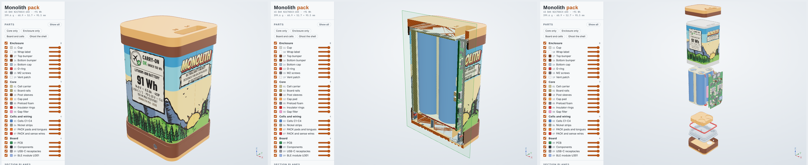

# Monolith 3D viewer

`monolith_viewer.html` is a self-contained page with the whole pack in 3D: download it and open it in any current browser
(it loads three.js from jsDelivr, so it needs internet; the meshes are inside the file).



What it does:

- **Parts**: every part of the pack (cup, label with the print art, bumpers, cap, O-ring, screws, vent, carrier, rails,
  sleeves, pad, foam, insulator rings, gap filler, cells, nickel, PACK tails and wires, PCB, components, USB-C, BLE module)
  with a show/hide box and an opacity slider each, a box per group, and presets (core only, enclosure only, board and cells,
  ghost the shell).
- **Section planes** on X, Y and Z, each with a position slider in mm and a flip box; they combine. Cut faces are drawn
  hatched in the part's colour.
- **Explode** slider, in assembly order (same offsets as `monolith_cup_exploded.png`).
- **Click a part** for its number, description, material and mass from the parts table; on the board, a click names the
  refdes and footprint. Hide / isolate / ghost the rest from there.
- View presets (iso, board face, back, side, ports, cap), edges, orthographic, turntable. Keys: F fit, H hide, I isolate,
  Esc clear.

Frame: as `monolith_cup.py`, z along the cells (ports at +z, cap at -z), +x toward the board, y across.

## Rebuilding

The page is generated from the model, so re-run it after any geometry change:

```
cd hardware/mechanical
python monolith_viewer.py              # -> docs/viewer/monolith_viewer.html
python monolith_viewer.py --fragment X # page body only, for publishing as a claude.ai artifact
```

It needs the mechanical venv (numpy, pillow, manifold3d, matplotlib) plus `cairosvg` for the label art, and
`board/monolith_board.npz` for the real board. The page layout and script live in `template.html`.

Not drawn: copper, silkscreen and solder (the PCB is a plain green slab), the NTCs on wires and the solder joints.
Board part colours are by part type, not from the KiCad models.
