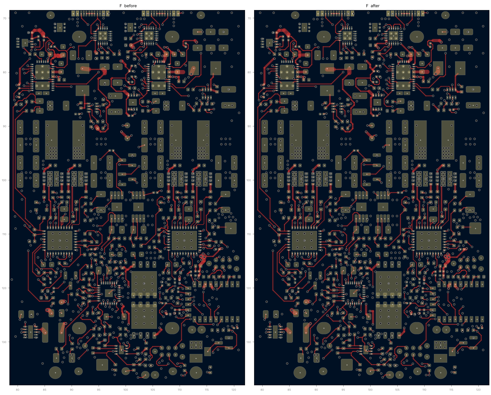
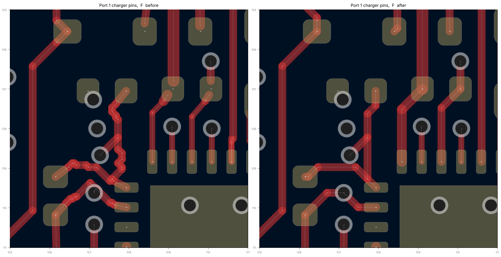
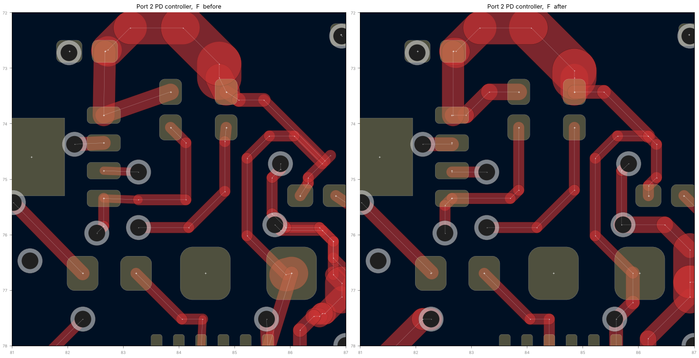
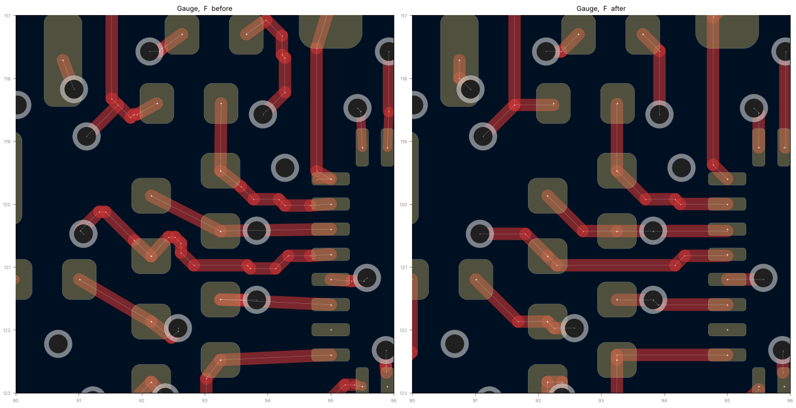
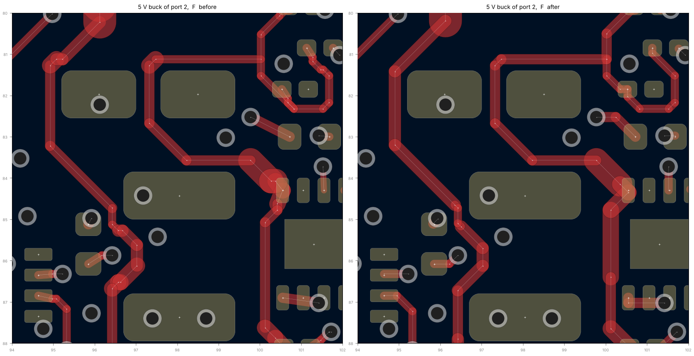
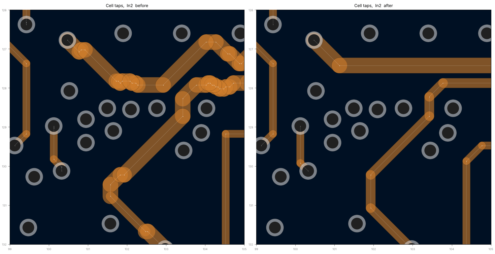
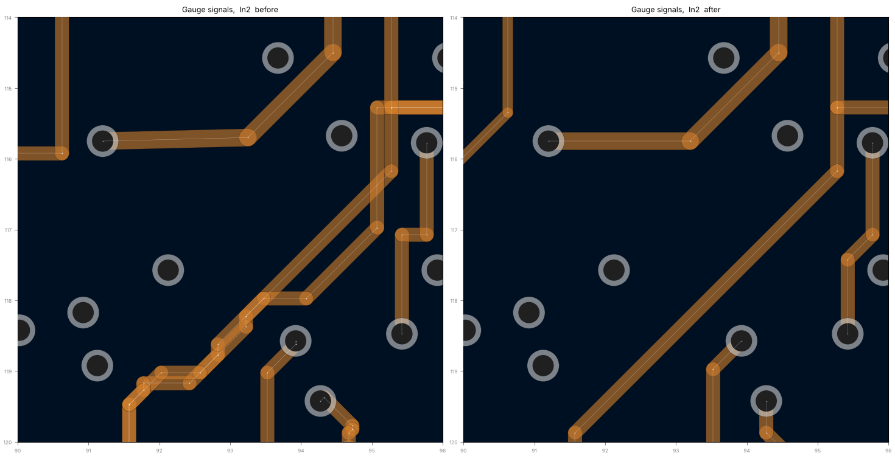
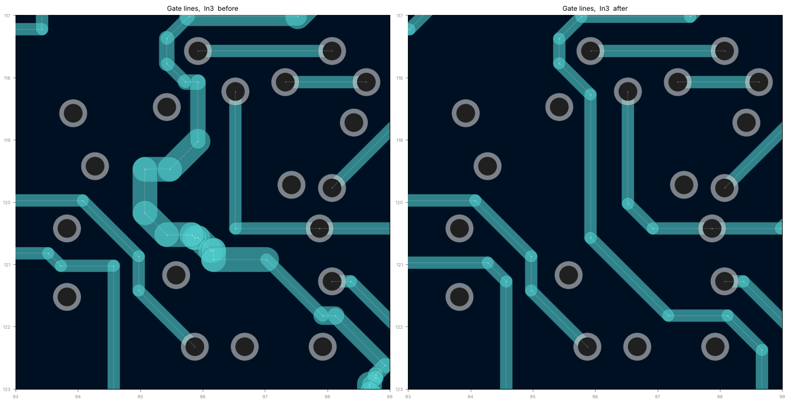
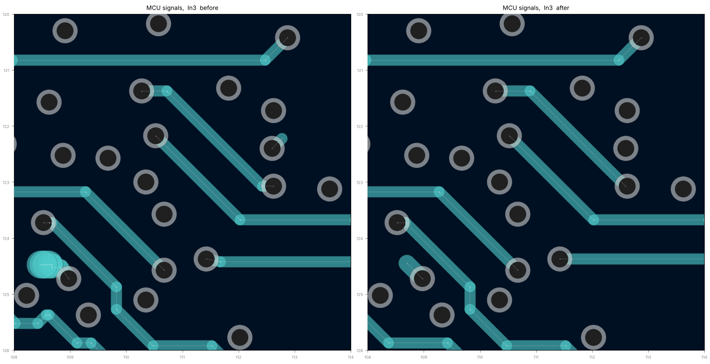

# Track clean-up pass, 2026-11-17

Logan's request, after looking at the board in KiCad:

- "lots of the traces don't come together clean at intersections and there is strange over lap"
- "the trace widths are randomly changing"
- "some traces aren't 45 diagonals but random angles, generally not done"

This pass redraws the track segments of `hardware/Production/Monolith.kicad_pcb` in place so that they meet at
exact points, lie only at 0, 45 and 90 degrees, do not lie on top of each other and keep one width along a run.
**Only track segments changed.** No part, pad, via, zone outline, rule area or rule moved, no track changed layer,
no via was added, and every net joins exactly the pads and vias it joined before. It is not a re-route: each track
stays in the channel it was in, on the same side of every pad, via and foreign track.

It was done by a team of agents in three rounds (see [How it was done](#how-it-was-done)) on top of the
straightening pass of 2026-11-16 ([`../kink1/`](../kink1/README.md)); "before" below is the board after that pass.



Inner and back layers: [`whole_In2.png`](whole_In2.png), [`whole_In3.png`](whole_In3.png),
[`whole_B.png`](whole_B.png).

## What changed

| | Before | After |
|---|---|---|
| Track segments | 3430 | 2598 (2664 removed, 1832 drawn) |
| Nets changed | | 152 of the 167 nets with tracks |
| Track ends that only touch by overlapping copper, with no common point | 550 | 24 (11 of them on the RF nets) |
| Track ends that stop short of or beside another track's end | 199 | 4 |
| Tracks ending off the via centre | 218 | 62 |
| Tracks ending off the pad centre | 114 | 36 |
| T-junctions where the through track has no node | 49 | 0 |
| Pieces of one net lying on each other, or crossing without a node | 86 | 0 |
| Acute corners | 38 | 4 |
| Pieces shorter than 0.1 mm | 494 | 83 |
| Segments off the 45 degree grid | 629 | 5 (all on the RF nets) |
| Width changes in the middle of a run | 103 | 16 (all on power and gate-drive nets) |
| T-junctions where the branches have different widths | 42 | 10 (all on power and gate-drive nets) |
| Nets drawn in one width (of the 149 routed as tracks) | 74 | 126 |
| Bends (same 149 nets) | 2195 | 1511 |
| Track length | 3490.4 mm | 3398.7 mm |
| DRC errors / unconnected / schematic parity | 0 / 0 / 0 | 0 / 0 / 0 |
| DRC warnings | 22 | 17 (five "connection too narrow" warnings gone) |

The counts are from [`tools/audit.py`](tools/audit.py) (`checks/audit_before.json`, `checks/audit_after.json`) and
from `../compare/tidy.py` (`checks/tidy_before_after.txt`). Where a number is not zero, the rest is listed under
[What is left](#what-is-left-and-why).

How each complaint was handled:

- **Joins.** Every track end is now exactly on the end of the track it joins, on a via centre or on a pad centre. At a
  T the through track is cut at the junction, so the three ends share one point. A corner or junction that was made
  of three to six nodes within a tenth of a millimetre is one node.
- **Overlap.** Duplicate pieces, collinear pieces lying on each other, parallel pieces of one net with overlapping
  copper, stubs that led nowhere and tracks of a net crossing each other are gone. Twenty pieces had the same two ends as another
  piece.
- **Widths.** A run (pad, via or junction to the next) has one width. Signal nets are 0.2 mm everywhere and 0.15 mm
  only where a fine-pitch pin needs it. Power, high-current, ground and gate-drive tracks were never made narrower
  than the narrowest piece their run already had, and no neck on them was made longer.
- **Angles.** Every new piece is exactly horizontal, vertical or at 45 degrees. The off-angle pin escapes of the grid
  router are replaced by a straight piece on the pad's centre line and one 45 degree bend. Corners of 90 degrees in
  open space became 45 degree corners where there was room.

## Pictures

Before on the left, after on the right, same window and scale. Tracks are drawn see-through with their centre line
and nodes, so that blobs and overlaps show.










## Proof that the board is otherwise the same

- `../boarddiff.py` on the two board files (`checks/boarddiff.txt`): footprints (289), vias (949), zones (56:
  outline, net, layers, priority, settings), drawings, text, stack-up and setup are identical. Only track segments
  and zone fills differ.
- `tools/chk.py` on dumps of the two boards (`checks/chk.txt`): on every net the same pads and vias are joined; no
  clearance is smaller than the rules allow (0.15 mm, 0.25 mm between the high-current class and the rest, 0.2 mm to
  holes, 0.25 mm to the edge), or where the old track was already closer, not closer than it was; no new piece is
  off the 45 degree grid; no duplicates; the largest move of a centre line from the old copper of its net is
  0.73 mm.
- KiCad 10, zones refilled, full rule set (`checks/kicad_drc_pours_boarddiff.txt`, `checks/drc.json`): 0 errors,
  0 unconnected, 0 parity. Warnings 17: 7 connection too narrow (12 before), 6 silk overlap, 3 silk over copper,
  1 text height, the last ten as before.
- `../pourcheck.py` (`checks/pourcheck.json`): no pour lost a connection at any neck width tested. 36 of the 47
  pours are unchanged. The ground pour on the back went from 28 pieces to 27 because a 10 mm² piece near
  (89.7, 134.6) is now joined to its neighbour.
- One via changed how KiCad draws it: the 3V3 via at (113.925, 114.1745) no longer has a pad on In2. Before, a
  0.6 mm 3V3 track on In2 brushed past it and KiCad counted that as a connection. The track now runs through the
  centres of the two vias beside it. The via still joins F, In3 and B.
- `../topocheck.py` is the check of the straightening pass. It reports the pads, vias, zones, rule areas, outline
  and net classes as identical, and by design it fails on this pass, because this pass cuts T-junctions and makes
  widths uniform, which changes the track graph that tool compares.

The solvers of `../compare/` on both boards (`checks/solver_before_after.txt`; rerun with
`cd ../compare; python3 cmpsum.py kink clean`):

| | Before | After |
|---|---|---|
| 16 power path resistances | | all the same to 0.01 mΩ |
| Sense tap error, port 1 battery / port 1 input | -0.10 % / -0.56 % | -0.06 % / -0.58 % |
| Sense tap error, port 2 battery / port 2 input | -0.03 % / +0.95 % | +0.02 % / +0.94 % |
| Gauge shunt tap error, port 1 / port 2 current | +0.81 % / +0.83 % | +0.78 % / +0.81 % |
| Hot loop, VBUS leg, port 1 / port 2 | 0.496 / 0.498 nH | 0.506 / 0.508 nH |
| Hot loop, pack leg, both ports | 0.555 nH | 0.557 nH |
| Hot loops of the 5 V bucks and the 3V3 buck | | unchanged |
| Gate loops, sum of 8 | 44.3 nH | 43.6 nH |
| Highest via current | 2.26 A | 2.25 A |
| Switch-node pick-up, port 2 TS / port 1 TS | 131.7 / 95.4 mV | 126.7 / 91.0 mV |
| Switch-node pick-up, EN_5V2 | 6.9 mV | 6.7 mV |
| Switch-node pick-up, port 2 5 V feedback | 5.9 mV | 6.5 mV |
| Switch-node pick-up, port 1 I2CC_SCL | 4.0 mV | 4.4 mV |
| Gate-driver supply DRV_SUP, capacitance to its two switch nodes, port 1 / port 2 | 147 / 152 fF | 140 / 146 fF |
| Nets over 10 mV | 2 | 2 (the two TS nets, as before) |

Three lines moved the wrong way, all by small amounts:

- The VBUS-leg hot loops are 0.01 nH larger. The ground link from C430 pin 2 and C530 pin 2 to the vias at
  (107.926, 98.4) and (84.9, 98.4) was a bent track and is now one straight 45 degree piece; the capacitor's own
  loop went from 0.37 to 0.39 nH.
- Port 2 5 V feedback picks up 0.6 mV more and port 1 I2CC_SCL 0.4 mV more per switching edge. Both stay far under
  the 10 mV line. (The straightening pass had shown that pulling I2CC_SCL fully straight takes it to 17.5 mV, so
  on that net only corners were chamfered and two small jogs removed.)
- `senspair.py` prints a larger enclosed area for the sense pairs (28.9 to 37.6 mm²). That is the tool, not the
  copper: on the old board it lost the port 2 battery-sense minus track at a via where the track ended off-centre
  and measured 7.6 mm of it; now it follows all 17.4 mm. The Kelvin tap errors above are the measure of the taps.

## Changes that are more than tidying

Listed so that nothing in the diff is a surprise.

- **Widths that went down.** The gauge's charge and discharge gate lines (CHG_G, DSG_G) had 0.4 mm pieces inside
  0.2 mm runs and are 0.2 mm now where the run was 0.2 mm (mean width 0.36 to 0.29 mm and 0.36 to 0.31 mm). The
  HIDRV2 gate-drive escapes on both ports lost short 0.2 mm bulges in 0.15 mm runs. Total 0.4 mm track went from
  80 to 65 mm and 0.8 mm track from 11.8 to 8.4 mm. One of these is a real narrowing of a power branch: the 1.5 mm
  3V3 track into C503 pin 1 went from 0.8 to 0.6 mm, the width of the 3V3 bar it joins. 0.15 mm track went from
  363 to 281 mm, most of it widened to 0.2 mm.
- **Sensitive nets moved further than 0.30 mm** (the limit set for power, sense, gate-drive and noise-critical
  nets). Most are track ends extended into the centre of the net's own pad: BAT_SNS_P on both ports 0.35 mm,
  CELL_1N 0.34 mm (B) and 0.71 mm (In2), CELL2 0.73 mm (B), CELL_4P 0.70 mm (In3), CELL3 0.71 mm (In2). Others:
  CHG_G on In3 near (95.9, 119 to 121.8), where a "<" shaped kink became a straight piece, 0.53 mm; port 1
  LDO_3V3 on F 0.41 mm; the gauge SRN tap on In2 0.39 mm (a staircase removed); 3V3 on In3 0.32 mm; port 1 SRP_F on
  In3 0.32 mm.
- **One sense tap point moved**: the SRP track leaves filter capacitor C106 pin 1 0.21 mm from where it did. All
  other Kelvin taps leave the sense resistors where they did, within 0.05 mm.
- **Redundant copper removed**: stubs that lay wholly inside a via or pad, among them the 0.05 mm FET_MID stub on B
  at the via (100.975, 117.0245), which is still inside its pour, the stub from the via at (95.325, 127.3745) into
  C111 pin 1 (the via sits in the pad). At C511 pin 1 the two port 2 DRV_SUP tracks that each ended inside the pad
  are one 0.2 mm track that bends inside the pad; the 0.7 mm pin escape there was 0.25 mm wide.
- **Same-net loops opened** where two tracks of a net ran side by side between the same two points, for example
  the CELL_1N tap on In2 near (94, 117.5).
- **Tracks on In4** (the ground plane layer that carries a few signal tracks): 117 pieces to 106, joins and
  duplicates only.

## What is left and why

- **The RF path** (`/MCU/RFIO`, `/MCU/ANT_IN`, `Net-(C313-Pad2)`) was not touched. It holds the 5 remaining
  off-angle pieces and 21 other audit marks, for example the staircase near (116 to 118, 116.6 to 117.4) on F.
  Tidying it changes the antenna feed, which needs its own check.
- **Necks on power and gate-drive tracks that clearance forces** (the 16 width changes and 10 mixed-width T's):
  `/P1_LDO_3V3` beside the ground pads of C543, C544 and U402 pin 7; `/USB Port 2/PP5V` from C542 pin 1 to R533
  pin 1 (0.30 mm with two 0.2 mm necks beside C544 pin 2); `/USB Port 2/LDO_3V3` from C508 pin 1 to R503 pin 1;
  3V3 at (86.925, 76.3 to 77.1) and around the via cluster at (114.3, 114.3); the LODRV2 pin escapes on both ports;
  the DSG_G T at (100.225, 116.674). They could only be made one width by narrowing the wide part, which this pass
  does not do.
- **Track ends 0.03 to 0.1 mm off a via centre (62) or pad centre (36).** Where a via is a tenth of a millimetre
  off the track's line, the track makes one 45 degree jog under the via's copper (the audit lists 67 such hidden
  jogs as correct). Removing them means moving vias. Ends inside the big pads (FET tabs, inductors, sense
  resistors, capacitor banks) and the Kelvin taps inside the sense-resistor pads are where they should be.
- **Ties from a via or pad into the net's own pour** (21, counted as "dangling"): deliberate.
- **Three acute corners**, each inside a pad or via: C401 pin 1 (101.65, 76.62), Q509 pin 3 (99.33, 96.35), and CHG_G
  on In2 folding back at the via (106.275, 127.4245).
- **Jogs and dog-legs that a neighbouring via forces**, checked by distance: SCL on In2 at (100.5, 114.95), VC4 on F
  at (94.2, 119.95), DRV9_OFF on In2 at (112.55, 84.55), I2CC_SDA on In3 at (115.5, 86.45), TS2 on B at
  (110.4 to 111.7, 124), 3V3 on B at (100.575, 132.8 to 133), the ILIM and CE_N stubs on In2 at (108.625, 121.42)
  and (110.675, 120.17), and about ten more of the same kind.
- **Left because the clean form needs a move over the limit on a sensitive net**: port 1 VBUS on F at
  (109.35, 81.0) (port 2's form needs 0.28 mm), the DRV_SUP staircase on In3 at (88.8 to 90.6, 109 to 110.8)
  (0.5 mm), the port 2 LDO_3V3 corner at (91.275, 75.324) (0.6 mm), the long stretches of I2CC_SCL, EN_5V1, TS4,
  SBU_FLT and the charger feedback nets.
- **Left because a 45 degree corner would be too close to something**: `Net-(U403-ICHG)` on B at
  (115.575, 116.3745) (0.205 mm from a CELL_1N via, 0.25 mm needed).
- **Not looked at tile by tile**: In4 (overview picture and a duplicate check only), and after the last round the
  board was checked by the audit, the checks above and pictures of every changed spot, not by a second full pass
  over every tile.

Still owed after a merge, as after the straightening pass: `../../jlc/make_package.sh` (the order package describes
the board before these passes), the renders in `docs/hardware/`, and a look by a person in KiCad.

## How it was done

The board is turned into a geometry dump in integer nanometres (`../dumpgeo.py`). Every edit is a *spec*, a list of
track ids to delete and track segments to add; `tools/chk.py` checks a spec in about four seconds in plain python,
and `tools/kfull.sh` applies it in KiCad 10 (Docker), refills the zones and runs the full DRC, the pour check and
the file diff. `tools/audit.py` is the yardstick: it lists every defect of the kinds in the table above with its
position, and `tools/pic.py` / `tools/ba.py` draw a window of the board, or before and after side by side, so each
spot can be looked at.

1. **Round 1, three agents, one tool each**, then run one after the other over the whole board by
   `tools/pipeline.sh`: `fix_overlaps.py` (duplicates, overlaps, stubs, crossings), `rethread.py` (junctions, pad and
   via entries, angles: it redraws each run through exact points on the 45 degree grid inside its channel) and
   `runwidth.py` (one width per run by the rules above), followed by `../straighten.py`. 3430 tracks became 2668.
2. **Round 2, seven agents, one rectangle of the board each.** Each rendered every 6 mm tile of its rectangle on
   every layer, and fixed by hand what the tools could not solve under their own rules: about 200 spots, each a
   few lines of `tools/fixlib.py` (delete the pieces of the spot, draw the clean polyline through exact points).
3. **Round 3, two agents, one half of the board each**, for the tracks that crossed the borders of round 2 and a
   last look at every 8 mm tile: about 30 more spots, and four corners on the border between the halves.

After each round the specs were merged, checked and applied in KiCad, and the solvers were run on the result. The
scripts of the hand rounds are kept in `hand/` as a record. They were written against the dumps of the
intermediate boards (track ids of those boards, paths under `/tmp/clean1`), which are not in the repository, so
they do not run as they stand. What reproduces the board is `spec.json`:

```
# on the commit before this one
tools/kfull.sh spec.json /tmp/clean1_k           # applies spec.json to ../../Monolith.kicad_pcb in KiCad, refills, DRC
cp /tmp/clean1_k/out/Monolith.kicad_pcb ../../Monolith.kicad_pcb
```

To use the tools on another state of the board:

```
# dump (KiCad python, in Docker as in tools/kfull.sh):  dumpgeo.py board.kicad_pcb geo.json
python3 tools/audit.py geo.json audit.json                       # what is wrong and where
tools/pipeline.sh geo.json /tmp/p1                               # round 1 -> /tmp/p1/spec.json, checked step by step
python3 tools/chk.py geo.json /tmp/p1/spec.json --out=after.json # the acceptance check of any spec
python3 tools/ba.py geo.json after.json spot.png 94 80 102 88 --px=100 --layers=F
tools/kfull.sh /tmp/p1/spec.json /tmp/k1 board.kicad_pcb         # KiCad: apply, refill, DRC, pours, file diff
```

`fix_overlaps.py` carries a reviewed list of spots by track id for this board; on another board its mechanical part
(exact duplicates, collinear overlaps, vias on a track with no node) still applies and the list does nothing.

Things learned that the tools now carry:

- A track end 0.03 mm from a via centre reads as centred; one straight piece that ends 0.02 mm off is better than a
  0.03 mm jog.
- KiCad applies the high-current clearance to the bare barrel of a high-current via on layers where it has no pad.
- The python model joins a track to a pour only if the track's end point is inside the fill. Shortening a tie into
  a pour can pass `chk.py` and still be unconnected in KiCad, so every merge was confirmed in KiCad.
- New tracks need unique ids from the start. Sequential ids collided when specs were chained and tracks went
  missing without an error; `geolib.apply_spec` now gives each new track a random id.
- `rethread.py` and `straighten.py` undo each other on about 13 nets, so the pipeline stops after three loops; the
  hand rounds settled those nets.
