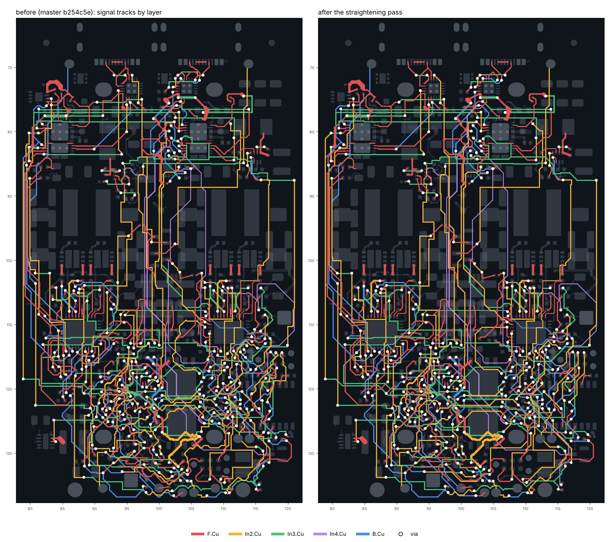
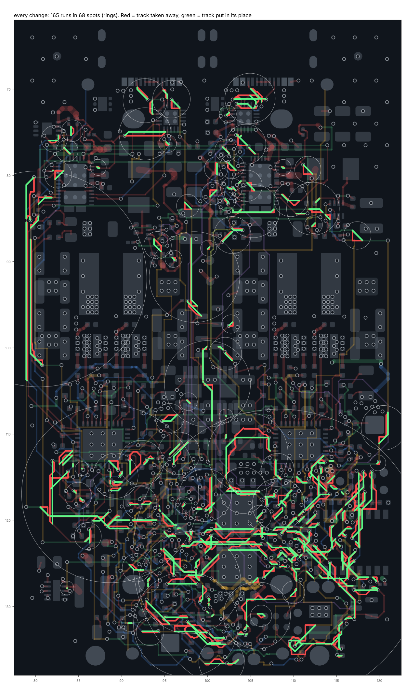
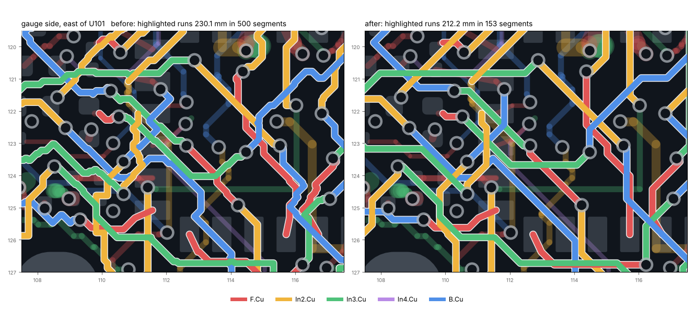
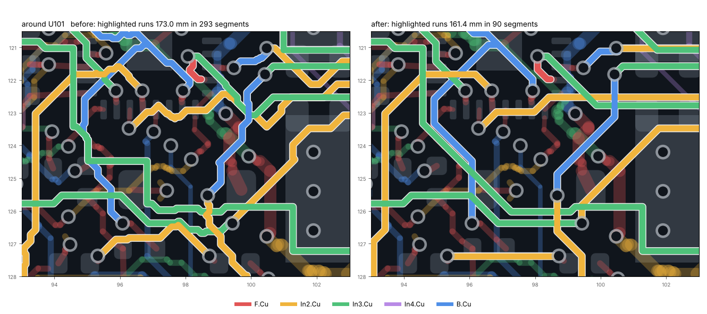
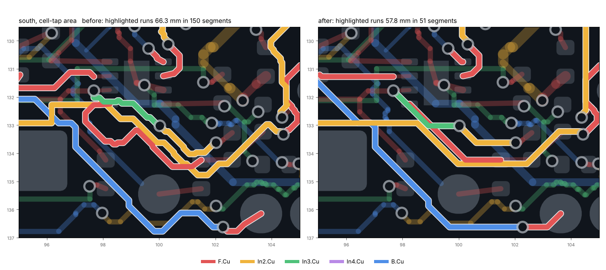
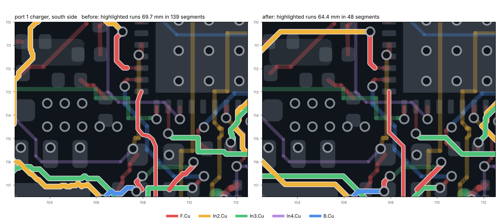
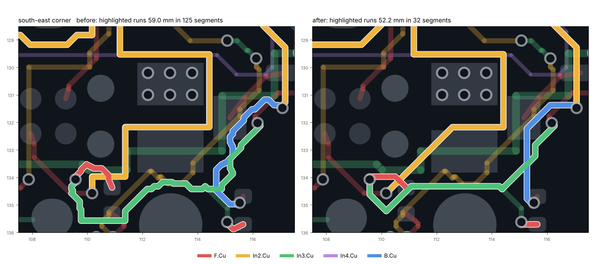
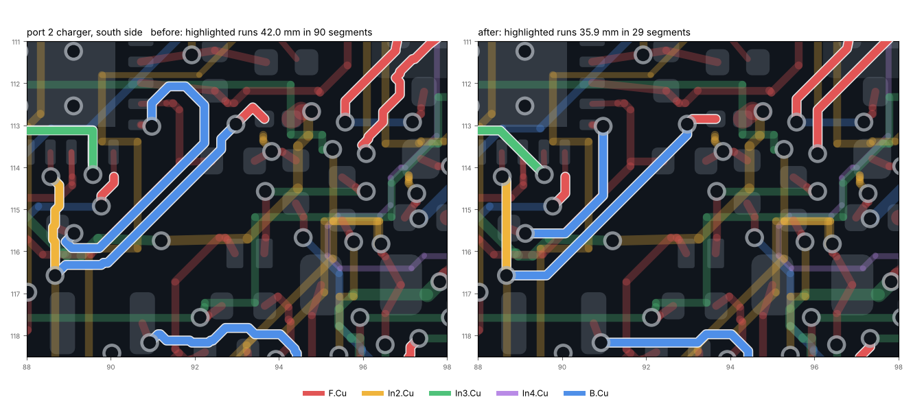
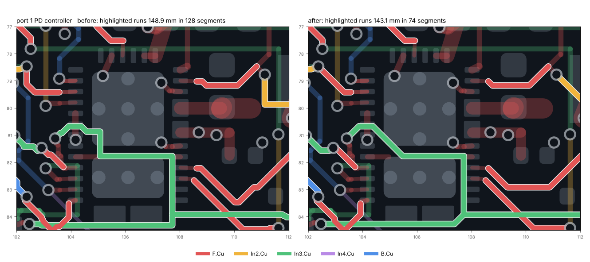
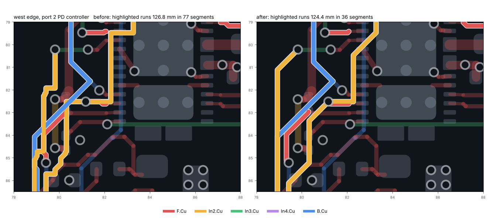

# Straightening pass, 2026-11-16

Logan's request: "There's still some odd routings out there where there's just kinks in some of these traces that
don't need to be there, that just add needless room", and "I don't want to do a tear up. I just want to optimize."

This pass takes kinks, staircases, jogs and small detours out of the existing signal tracks of
`hardware/Production/Monolith.kicad_pcb` (the script-built board, `master` b254c5e) in place. Nothing was
ripped up and routed again. The tool is `../straighten.py`; what it does and how to rerun it is in
[`../README.md`](../README.md#straightening-pass-2026-11-16).

## What changed

| | Before | After |
|---|---|---|
| Nets changed | | 63 of the 167 nets with tracks |
| Runs drawn again (a run is the track between two fixed points) | | 165 of the 556 runs of the nets it may touch (65 on F, 40 on In2, 33 on In3, 27 on B) |
| Track segments on the board | 4366 | 3430 (1587 removed, 651 added) |
| Segments shorter than 0.2 mm | 1196 | 732 |
| Track length, all tracks | 3560.2 mm | 3490.4 mm |
| The 63 changed nets: length | 1403.6 mm | 1333.8 mm |
| The 63 changed nets: segments / under 0.2 mm / bends | 1973 / 657 / 1662 | 1037 / 182 / 705 |
| How far a run moved sideways | | median 0.30 mm, nine in ten under 0.78 mm, most 1.35 mm |

Twelve more runs were written again with the same shape (same corners, fewer pieces). No changed net is longer or has more bends than before. Three exact duplicate tracks (the same two ends twice, on
BTP_INT, port 2 CE_N and SCL) were removed with the runs they sat on.

The tidiness table of `compare/tidy.py` (149 nets routed as tracks; `compare/tidy_fix2.json` against
`compare/tidy_kink.json`, table in `compare/tidycmp_fix2_kink.json`):

| | Before | After |
|---|---|---|
| Track length | 3233 mm | 3163 mm |
| Length / shortest tree over the pads | 1.53 | 1.50 |
| Segments | 3895 | 2959 |
| Segments under 0.2 mm | 1120 | 645 |
| Bends | 3152 | 2195 |
| Vias | 388 | 388 |
| Nets over 1.5 times the shortest tree | 47 | 44 |
| Nets over 2 times | 17 | 15 |
| Nets in one / two / three or more widths | 74 / 65 / 10 | 74 / 65 / 10 |
| Width changes, all / away from a pad | 142 / 29 | 142 / 29 |
| Segments off the 45 degree grid, over 0.3 mm | 317 | 292 |
| Segments off the 45 degree grid, any length (exact) | 703 | 629 |

No new segment is off the 45 degree grid. The off-grid segments that remain are the old ones: pin escapes of the
grid router and tracks of protected nets.

## Pictures

Every change on one picture (old track in red, new track in green, a ring around each changed spot):

Eight of the most visible spots, before on the left and after on the right at the same scale. The changed runs are
in full colour by layer, everything else is dimmed.

## Proof that the structure is the same

`../topocheck.py` on dumps of the two boards (`topocheck.json`), and `../boarddiff.py` on the two files:

- Pads (1176), vias (949: id, position, size, drill, net, layers, layers with a pad), zones (56 in the file:
  outline, net, layers, priority, settings), rule areas (21), board outline, net classes, footprints (289),
  drawings and text: identical. Only track segments and zone fills differ in the file.
- Tracks: 1587 ids gone, 651 new, none altered in place. No protected net among the changed nets.
- Per net, the reduced track graph (fixed points, and one edge per run with its layer and width) is identical on
  all 167 nets with tracks.
- Per net, the same pads and vias are joined (geometric check, the 147 nets without a pour).
- The set of track widths per net and layer, and the layers each net uses: identical.
- No via and no part moved. The schematic, project file and rule file were not touched.

Zone fills (refilled by KiCad, `pourcheck.json`): 43 of 47 pours are unchanged. The four that changed all gained
copper and lost no connection, also when every neck under 0.2 mm or under 0.4 mm is taken away:

| Pour | Area change | Pieces |
|---|---|---|
| GND, F | +6.63 mm² | 48 to 47 |
| GND, B | +8.65 mm² | 29 to 28 |
| PACK_P plane, In2 | +9.39 mm² | 13 to 13 |
| 3V3 plane, In3 | +3.31 mm² | 8 to 8 |

DRC with the full rules and schematic parity (`../results/drc_groundup_kink1.json`; before:
`../results/drc_groundup_fix2.json`): 0 errors, 0 unconnected, 0 parity, 22 warnings, before and after. The warnings
are the same 22 (12 narrow connections, 9 silkscreen, 1 text height); three narrow-connection warnings on the
untouched CHG_G staircase at (105.5, 127.6) name other segments of the same staircase.

Running the tool on the result changes nothing (0 runs).

## Solver checks

All of `compare/runfix.sh` was run on the board before (tag `kink0`) and on the result (tag `kink`), on the same
machine on the same day; `python3 compare/cmpsum.py kink0 kink` prints the two side by side.

| Check | Before | After |
|---|---|---|
| Path resistance, 16 power paths (0.1 mm grid) | | 15 within 0.1 µΩ; port 2 ground return 1.2716 to 1.2705 mΩ |
| PACK_P to the stage, 0.05 mm grid, port 1 / port 2 | 2.53 / 1.45 mΩ | 2.53 / 1.45 mΩ |
| Kelvin tap error, four charger resistors | −0.101, −0.559, −0.028, +0.953 % | the same to 0.001 % |
| Kelvin tap error, gauge shunt, port 1 / port 2 current | +0.825 / +0.862 % | +0.805 / +0.833 % |
| Hot loops: four charger legs, two 5 V bucks, 3V3 buck | 0.4957, 0.5552, 0.4976, 0.5552, 0.2957, 0.3917, 1.2188 nH | identical, with the same capacitors |
| Gate loops, eight, own layer and next plane | 3.26 to 7.97 nH, sum 45.447 nH | identical to 0.0001 nH |
| Port 2 low-side leg A, both planes | 4.4561 nH | 4.4561 nH |
| Gate-drive track statistics | | identical |
| Signals that take over 10 mV from one switch edge | 2 | 2 |
| Port 2 TS / port 1 TS | 131.729 / 95.396 mV | 131.729 / 95.396 mV |
| EN_5V2 | 6.892 mV | 6.865 mV |
| Port 2 5 V feedback | 5.939 mV | 5.856 mV |
| Port 1 I2CC_SCL / EN_5V1 | 4.036 / 1.736 mV | 4.036 / 1.737 mV |
| Port 1 ACUV | 0.471 mV | below the solver's 0.2 fF floor |
| From all switch nodes into the listed signals | 388.4 fF | 388.0 fF |
| Highest current in one via / vias over 3 A | 2.258 A / 0 | 2.258 A / 0 |
| Area enclosed by the five sense pairs | 28.876 mm² | 28.876 mm² (file identical) |
| Vias / ground vias / under the two gap-filler pads | 949 / 219 / 133 and 122 | the same |
| Copper cover F / In2 / In3 / B | 71.39 / 60.33 / 72.60 / 77.26 % | 71.51 / 60.42 / 72.54 / 77.46 % |

Three listed signals moved up, each by under 0.002 mV: EN_5V1 1.7355 to 1.7372 mV (not touched; 1.5 aF more from
the port 1 pack leg; a trial without the nearest changed net, port 1 I2CC_SDA, gave the same value, so the cause is
not one known run, and the PACK_P plane it runs in was refilled), port 2 I2CC_SCL 0.2062 to 0.2080 mV and port 2 CC2 5.3538 to 5.3544 mV (both touched; the
coupled capacitance is the same, the shorter track has a little less capacitance to ground in the solver's model).
Everything else in the list is equal or lower.

Two things the solver loop caught on the way, and what was done:

- **Port 1 I2CC_SCL** went from 4.0 to 17.5 mV per edge in a trial when it was straightened. It and the other nets
  that fix pass 2 moved because of the coupling solver (port 2 SBU_FLT, TS4, the two charger feedback nets) are now
  protected, like EN_5V1.
- **DRV_SUP** (the gate-driver supply of each charger, beside the switch nodes): straightening it raised its own
  pick-up from the switch nodes by 0.3 fF on port 1 and by 2.2 and 3.5 fF on port 2, and raised port 1 TS from
  95.396 to 95.491 mV. With DRV_SUP protected both are back to the old value exactly.

Not rerun: the thermal model (copper cover moved by 0.2 points at most and no power path changed) and anything on
Logan's PC. Not covered by any solver here: crosstalk between two signals. As a screen for it, the length of track
that lies on top of a track of another net on the facing layer (In2 over In3, within 0.15 mm, stretches of 1 mm
or more) went from 44.7 mm in 19 pairs to 38.1 mm in 12 pairs; 18.4 mm of it is the port 1 input sense pair, which
is stacked on purpose.

## What was left alone

**Protected nets** (85 nets with tracks; the tool treats them as obstacles). Reasons: net class HighCurrent (21
nets), GateDrive (18), Kelvin (17), Power (10), GND (1); listed by name (9: EN_5V1, the five solver-repaired nets,
the RF path); a track on a ground-plane layer (5: SDA, EN_5V2, port 1 TS and CHG_INT, port 2 TS); pattern (4: the
two gate-driver supplies DRV_SUP and the two DPDN_DCP nets). Every net with a pour is in one of these classes. Some of them
have kinks that look just like the ones fixed here. A dry run of the tool with the protection off (not applied,
`protected_dryrun.json`) shows what it would do to them: 137 runs in 36 nets, 855 to 798 mm, bends 832 to 334.

| Net | Why it is protected | Runs | Length, mm | Bends | Segments |
|---|---|---|---|---|---|
| CELL_1N | class HighCurrent | 33 | 108.0 to 100.0 | 190 to 54 | 223 to 88 |
| CHG_G | class GateDrive | 6 | 22.9 to 19.3 | 69 to 12 | 75 to 18 |
| CELL_4P | class HighCurrent | 8 | 45.2 to 39.7 | 67 to 12 | 75 to 20 |
| CELL2 | class HighCurrent | 1 | 14.1 to 12.7 | 26 to 5 | 27 to 6 |
| P1 I2CC_SCL | listed | 6 | 65.2 to 58.3 | 46 to 26 | 53 to 32 |
| EN_5V1 | listed | 4 | 42.6 to 40.2 | 30 to 11 | 34 to 15 |
| Net-(U101-VC1) | class Kelvin | 4 | 13.6 to 12.3 | 29 to 10 | 33 to 14 |
| CELL3 | class HighCurrent | 6 | 92.5 to 86.9 | 40 to 22 | 46 to 28 |
| Net-(U101-VC2) | class Kelvin | 4 | 9.3 to 7.9 | 25 to 7 | 29 to 11 |
| P1 ACN_F | class Kelvin | 4 | 35.6 to 35.3 | 36 to 20 | 41 to 24 |
| P2 SRN_F | class Kelvin | 4 | 15.0 to 13.3 | 22 to 10 | 26 to 14 |
| Net-(C313-Pad2) | listed | 1 | 4.3 to 2.4 | 14 to 2 | 15 to 3 |
| P1 SRP_F | class Kelvin | 1 | 9.2 to 8.1 | 14 to 3 | 15 to 4 |
| P1 DRV_SUP | pattern | 5 | 20.6 to 19.7 | 19 to 10 | 25 to 17 |
| DSG_G | class GateDrive | 4 | 6.6 to 6.3 | 13 to 5 | 17 to 9 |
| TS4 | listed | 4 | 33.6 to 31.1 | 24 to 16 | 28 to 20 |
| P1 ACP_F | class Kelvin | 3 | 30.8 to 30.6 | 22 to 14 | 26 to 17 |
| CELL1 | class HighCurrent | 5 | 70.9 to 69.3 | 30 to 23 | 35 to 28 |
| RFIO | listed | 2 | 3.5 to 3.4 | 9 to 3 | 11 to 5 |
| SRN | class Kelvin | 2 | 9.4 to 9.3 | 9 to 4 | 11 to 6 |
| P1 SRN_F | class Kelvin | 2 | 6.5 to 6.1 | 9 to 5 | 11 to 7 |
| P2 ACP_F | class Kelvin | 1 | 22.5 to 21.7 | 6 to 2 | 7 to 3 |
| P2 DRV_SUP | pattern | 4 | 26.4 to 24.8 | 11 to 7 | 15 to 11 |
| Net-(U101-VC3) | class Kelvin | 2 | 4.4 to 3.5 | 7 to 3 | 9 to 5 |
| Net-(U403-FB) | listed | 3 | 10.4 to 9.9 | 13 to 9 | 16 to 13 |
| P1 HIDRV2 | class GateDrive | 1 | 7.0 to 6.4 | 5 to 2 | 6 to 3 |
| P2 HIDRV2 | class GateDrive | 1 | 7.0 to 6.4 | 5 to 2 | 6 to 3 |
| Net-(U503-FB) | listed | 2 | 6.7 to 6.6 | 6 to 4 | 8 to 6 |
| P1 REGN | class Power | 3 | 24.3 to 23.3 | 10 to 9 | 13 to 12 |
| P2 REGN | class Power | 4 | 42.0 to 39.4 | 10 to 9 | 14 to 13 |
| P2 SBU_FLT | listed | 2 | 22.2 to 22.2 | 2 to 1 | 5 to 3 |
| Net-(U101-PACK) | class Kelvin | 1 | 5.2 to 5.2 | 4 to 3 | 5 to 4 |
| Net-(U101-VC4) | class Kelvin | 1 | 2.0 to 2.0 | 5 to 4 | 6 to 5 |
| /P1_LDO_3V3 | class Power | 1 | 11.4 to 10.7 | 2 to 2 | 3 to 3 |
| P2 SW_5V | class Power | 1 | 1.5 to 1.1 | 1 to 1 | 2 to 2 |
| Net-(U101-BAT) | class Kelvin | 1 | 3.0 to 2.8 | 2 to 2 | 3 to 3 |
| **36 nets** | | **137** | **855.5 to 798.1** | **832 to 334** | **974 to 475** |

The worst to look at are the cell-tap tracks CELL_1N and CELL_4P, the protection-FET gates CHG_G and DSG_G, the
gauge's cell-sense inputs (U101 VC1 to VC3) and port 1's ACN_F / SRP_F sense tracks. They can be straightened with
the same tool (`--protect=file.json` with a shorter list), each with its own check: path resistance for the cell
taps, the Kelvin solver for the sense nets, the coupling solver for I2CC_SCL, EN_5V1, TS4 and the feedback nets.
The charger gate nets (HIDRV, LODRV, HG, LG, BTST) were not touched either; the dry run finds one small change on
each port (HIDRV2, 5 bends to 2). Nets with a pour or with a track in the In4 ground plane (SDA, EN_5V2, the two
TS nets, port 1 CHG_INT) are skipped even in the dry run.

**Frozen runs** (27, listed in `straighten_log.txt`): 19 short pieces where a track touches its own net away from
a track end (tangles at a pad on NRST, port 1 I2CC_SDA, port 2 CC1 and C_CC2, Q104 gate, U403 ACUV, SCL) and 8
that pass through a pad or via of their own net without a corner in it (SWDIO, the PD_DRAIN pad rows). The tool
cannot tell what such a piece is for, so it leaves it.

**Runs it tried and could not improve.** A run stays as it is when every tighter shape would break a clearance,
change the side on which it passes a pad or via, or cut a pour. The most common blockers were the ground, PACK_P
and 3V3 vias and the cell-tap vias in the gauge area (`straighten_log.txt`, "rejected candidates by reason").

**Detours that need a re-route, not a straightening.** After the pass 15 nets are still over twice their shortest
tree. The ones this pass was allowed to touch: U403 ACUV (23.4 mm for 6.4 mm), U506 FB (16.7 for 4.6), port 2
BST_5V (4.3 for 1.6), U503 ICHG (21.6 for 8.7), port 1 VBIAS (9.0 for 3.9), U403 ICHG (19.5 for 8.7), port 1 CC2
and CC1 (26.6 for 12.2, 25.1 for 11.7), port 1 C_CC2 (7.9 for 3.8), port 1 I2CC_SDA (72.5 for 35.9). Their path
goes round other tracks or changes layer; making them direct means moving vias or other nets, which this pass
does not do.

## Every changed net

Numbers from `compare/tidy.py` (whole net, all layers), sorted by bends removed.

| Net | Length, mm | Segments | Under 0.2 mm | Bends |
|---|---|---|---|---|
| SCL | 120.9 to 117.0 | 142 to 75 | 64 to 15 | 126 to 56 |
| GAUGE_FUSE | 39.9 to 37.2 | 100 to 37 | 43 to 9 | 91 to 27 |
| CHG_INH | 59.5 to 55.3 | 110 to 48 | 38 to 11 | 99 to 37 |
| Net-(U102-OUT) | 34.6 to 33.3 | 79 to 27 | 31 to 6 | 71 to 18 |
| TS2 | 24.7 to 22.5 | 63 to 14 | 29 to 1 | 60 to 11 |
| IRQ_N | 132.4 to 127.3 | 102 to 57 | 29 to 3 | 87 to 39 |
| BTP_INT | 20.7 to 18.6 | 68 to 24 | 35 to 5 | 61 to 17 |
| Net-(U403-ACUV) | 25.6 to 23.4 | 66 to 21 | 26 to 4 | 58 to 14 |
| Net-(Q104-G) | 28.0 to 25.2 | 74 to 34 | 34 to 12 | 66 to 23 |
| 3V3_SLEEP | 37.8 to 36.0 | 64 to 31 | 21 to 9 | 55 to 21 |
| Net-(U403-ICHG) | 20.2 to 19.5 | 53 to 23 | 22 to 5 | 48 to 17 |
| SWCLK | 15.2 to 14.2 | 42 to 12 | 16 to 2 | 39 to 9 |
| UART_TX | 21.2 to 18.8 | 43 to 14 | 12 to 1 | 38 to 9 |
| P1 I2CC_SDA | 75.9 to 72.5 | 72 to 45 | 22 to 9 | 61 to 32 |
| SWDIO | 15.1 to 13.0 | 41 to 12 | 23 to 5 | 37 to 9 |
| TS3 | 27.1 to 25.7 | 44 to 21 | 12 to 3 | 40 to 17 |
| P1 ILIM | 12.0 to 11.6 | 32 to 10 | 11 to 2 | 28 to 6 |
| P2 I2CC_SCL | 54.8 to 53.0 | 47 to 25 | 12 to 1 | 37 to 16 |
| P1 CE_N | 15.9 to 15.6 | 42 to 24 | 21 to 6 | 35 to 15 |
| Net-(U102-V3) | 13.6 to 13.1 | 33 to 17 | 11 to 4 | 25 to 7 |
| Net-(U506-FB) | 17.0 to 16.7 | 29 to 13 | 10 to 1 | 26 to 9 |
| Net-(U102-V2) | 9.2 to 6.7 | 19 to 4 | 6 to 0 | 18 to 2 |
| P2 CE_N | 15.8 to 14.4 | 30 to 13 | 10 to 4 | 22 to 7 |
| TS1 | 24.6 to 23.1 | 24 to 12 | 6 to 1 | 21 to 9 |
| Net-(U101-SMBD) | 11.3 to 10.5 | 23 to 11 | 12 to 5 | 20 to 8 |
| P1 C_CC2 | 8.3 to 7.9 | 21 to 11 | 8 to 2 | 17 to 6 |
| Net-(U101-SMBC) | 9.9 to 9.0 | 19 to 10 | 6 to 2 | 15 to 6 |
| Net-(C110-Pad2) | 4.5 to 3.8 | 11 to 4 | 5 to 2 | 8 to 0 |
| Net-(U102-CD) | 3.1 to 2.9 | 16 to 9 | 8 to 3 | 13 to 5 |
| P1 SBU_FLT | 27.1 to 26.9 | 38 to 32 | 8 to 4 | 32 to 25 |
| P2 I2CC_SDA | 54.1 to 53.5 | 30 to 23 | 3 to 2 | 23 to 16 |
| Net-(U403-FBG) | 4.1 to 3.8 | 15 to 9 | 10 to 4 | 12 to 5 |
| Net-(U503-FBG) | 8.7 to 4.8 | 13 to 7 | 1 to 1 | 10 to 4 |
| NRST | 42.3 to 40.1 | 34 to 29 | 1 to 1 | 26 to 21 |
| P1 CC1 | 25.2 to 25.1 | 18 to 14 | 4 to 2 | 13 to 8 |
| P1 C_CC1 | 12.2 to 11.1 | 22 to 18 | 6 to 7 | 16 to 11 |
| P1 FSW | 6.2 to 5.9 | 9 to 4 | 0 to 0 | 8 to 3 |
| Net-(U102-V4) | 5.3 to 4.3 | 8 to 4 | 0 to 1 | 7 to 2 |
| Net-(U503-ICHG) | 22.6 to 21.6 | 12 to 8 | 1 to 0 | 9 to 5 |
| P1 CC2 | 27.7 to 26.6 | 21 to 17 | 7 to 3 | 15 to 12 |
| P1 VBIAS | 9.8 to 9.0 | 12 to 9 | 0 to 0 | 8 to 5 |
| P2 CC2 | 15.9 to 15.6 | 11 to 8 | 2 to 1 | 6 to 3 |
| P2 C_CC1 | 7.4 to 7.0 | 14 to 10 | 5 to 3 | 8 to 5 |
| P2 DRV9_OFF | 43.0 to 42.0 | 24 to 21 | 1 to 0 | 18 to 15 |
| Net-(Q409-D) | 5.9 to 5.9 | 9 to 7 | 1 to 0 | 6 to 4 |
| Net-(Q509-D) | 10.2 to 10.0 | 12 to 10 | 2 to 3 | 11 to 9 |
| Net-(U406-FB) | 4.8 to 4.8 | 8 to 6 | 3 to 2 | 7 to 5 |
| DSG | 3.5 to 3.5 | 7 to 6 | 1 to 0 | 4 to 3 |
| P1 LDO_1V5 | 2.1 to 2.1 | 4 to 3 | 0 to 0 | 3 to 2 |
| P1 SS_5V | 3.1 to 3.1 | 5 to 4 | 1 to 1 | 4 to 3 |
| P2 CHG_INT | 37.5 to 37.5 | 14 to 13 | 2 to 2 | 10 to 9 |
| P2 C_CC2 | 5.9 to 5.9 | 9 to 8 | 2 to 1 | 5 to 4 |
| P2 ILIM | 11.3 to 11.3 | 12 to 11 | 2 to 1 | 8 to 7 |
| P2 LDO_1V5 | 2.1 to 2.1 | 4 to 3 | 0 to 0 | 3 to 2 |
| P2 SS_5V | 3.2 to 3.2 | 7 to 6 | 1 to 1 | 6 to 5 |
| P2 VBIAS | 7.6 to 7.0 | 7 to 6 | 1 to 1 | 4 to 3 |
| Net-(D511-A) | 8.8 to 8.8 | 10 to 9 | 2 to 1 | 7 to 6 |
| P1 DRV9_OFF | 42.0 to 40.9 | 25 to 25 | 2 to 2 | 19 to 19 |
| P2 FSW | 6.1 to 5.9 | 7 to 7 | 1 to 1 | 4 to 4 |
| Net-(U403-ACOV) | 11.2 to 10.5 | 14 to 14 | 2 to 2 | 9 to 9 |
| Net-(U503-ACOV) | 11.5 to 10.8 | 12 to 12 | 1 to 1 | 7 to 7 |
| Net-(U503-ACUV) | 10.7 to 10.2 | 9 to 8 | 0 to 0 | 7 to 7 |
| Net-(U504-FB) | 5.7 to 5.5 | 8 to 8 | 1 to 1 | 5 to 5 |
| **63 nets** | **1403.6 to 1333.8** | **1973 to 1037** | **657 to 182** | **1662 to 705** |

## Files

| File | What |
|---|---|
| `spec.json` | every changed run: net, layer, width, old and new corner points (nm), the removed track ids and the added segments |
| `straighten_log.txt` | per-net summary, frozen runs, protected nets with the reason, rejected candidates by reason |
| `pass_output.txt` | console output of `../straighten.sh`: DRC summary, `boarddiff`, `topocheck`, `pourcheck` |
| `topocheck.json`, `pourcheck.json` | results of the two checks |
| `protected_dryrun.json` | the dry run on the protected nets (not applied) |
| `pk_kink0.txt`, `pk_kink.txt` | PACK_P path on the 0.05 mm grid, before and after (`compare/k/pk.py`) |
| `../results/drc_groundup_kink1.json` | full-rule DRC report of the result |
| `../compare/*_kink0.json`, `../compare/*_kink.json`, `../compare/k/*` | solver results before and after |
| `../compare/tidy_fix2.json`, `tidy_kink.json`, `tidycmp_fix2_kink.json` | tidiness numbers before and after |
| `*.png` | the pictures above (`../kinkpic.py`, `../sigpic.py`) |
