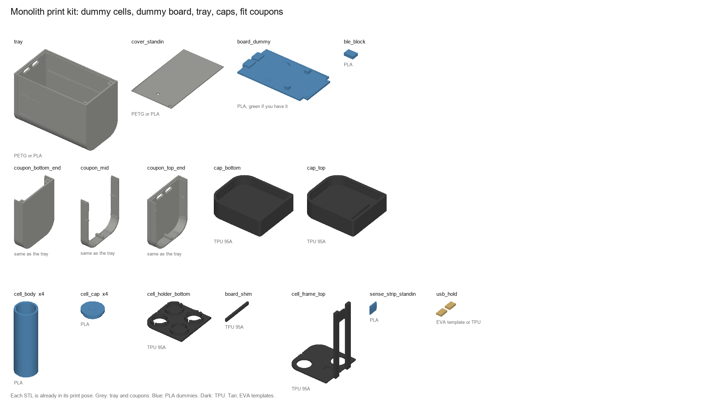

# Monolith print kit

A home-printable (FDM) mock-up of the side-board pack. It has dummy cells, a dummy board and every printed part. Use it for fit checks, assembly practice and the dummy-mass drop test. `monolith_print_kit.py` generates everything from the same parameters as the production model (`monolith_shell.py`, `monolith_parts.py`). Re-run it after changing an `SB_*` value.

Each STL is already in its print pose, sitting on the bed at z = 0, so load it as-is.

## Print the coupons first

The tray is dimensioned for MJF PA12 (±0.3 mm). FDM holes and slots usually print 0.1–0.3 mm small. The three coupons are thin slices of the tray, printed in the same orientation, so they take minutes instead of hours.

| Coupon | What to check |
|---|---|
| `00a_coupon_bottom_end` | Screw pillars and M2 insert pilots (3.2 mm); the floor zone. |
| `00b_coupon_mid` | Two dummy cells (or real cells) drop into the pockets; the centre rib; the cover sits in the side rebates. |
| `00c_coupon_top_end` | The board dummy's USB-C blocks slide up into the port holes; the cover's top edge tucks under the lip; the board's top edge seats on the stops. |

**Crush ribs.** The cell pockets have 1 × 0.4 mm crush ribs on their walls. They are meant to flatten in nylon. They interfere with a bare cell by about 0.45 mm, or 0.25 mm through the fish-paper liner. PLA and PETG won't crush much. If the cells won't go in, scrape the ribs down with a deburring tool rather than scaling the whole tray.

## Parts

| File | Qty | Material | Settings / notes |
|---|---|---|---|
| `01_tray` | 1 | PETG (or PLA) | Open side up, no supports. 3 walls, 20 % infill. The port holes and the cover slot bridge. |
| `02_cover_standin` | 1 | PETG / PLA | Flat. Stands in for the 1.0 mm aluminium cover: 2 × M2 clearance holes plus the vent hole. |
| `03_cell_body` | 4 | PLA | Upright, 3 walls. A 21.5 mm can, open at the + end for ballast. |
| `04_cell_cap` | 4 | PLA | Spigot down, nub up. Glue it into the can: this is the + end. |
| `05_board_dummy` | 1 | PLA (green) | B.Cu face down. 1.6 mm board with the USB-C envelopes, the 4 cover standoffs, the 2 PACK lead holes and the BLE locating pocket. |
| `06_ble_block` | 1 | PLA | Glue it into the pocket on the B.Cu face. That makes the 7 × 10 × 2.3 mm CC2340 module envelope. |
| `07_cap_bottom` | 1 | TPU 95A | Crush slab down. Load it with `_mod_soft` and `_mod_corner` as modifiers (see below). |
| `08_cap_top` | 1 | TPU 95A | Same as the bottom cap. This one has the port well and the drain. |
| `09_cell_holder_bottom` | 1 | TPU 95A | Cell frame, bottom holder: base plate and a slotted spring ring under each cell. Printed 0.4 mm proud on purpose, to preload the cell stack. |
| `10_board_shim` | 1 | TPU 95A | Tiny. Print it alongside the spacer. |
| `11_cell_frame_top` | 1 | TPU 95A | Cell frame, top part: top plate, the two bars that hold the cells off the board, and the web that carries the sense strip. Plate on the bed. |
| `12_sense_strip_standin` | 1 | PLA | Stand-in for the 0.6 mm ENIG sense strip; glue it into the web pocket. |
| `13_usb_hold` | 1 | EVA template or TPU | Two 2 mm pads (2 × 1 mm EVA). |

**Cap modifiers:** in PrusaSlicer, Bambu Studio or Orca, add the two `_mod_` STLs as *modifiers* to the cap (right-click → Add modifier → Load). Do not add them as separate objects. They are already registered to the cap. Set their infill as follows:

| Zone | Infill |
|---|---|
| Soft (outer 4 mm of the slab) | 15 % gyroid |
| Rest of the slab (the body default) | 30 % gyroid |
| Corner noses | 60 % |

Give the band solid walls: about 4 perimeters with 0 % infill, or just let the walls fill it.

## Dummy-cell ballast

| | Mass |
|---|---|
| Real cell (EVE 58E) | 71 g |
| Printed can + cap at solid PLA | about 11 g |
| Ballast to add per cell | about 60 g |

The cavity is 17.5 cm³.

- **Steel BBs** (4.5 mm, about 4.7 g/cm³ poured) fill to about 82 g, so stop at about 13 cm³ and weigh as you go.
- **Lock the ballast:** loose shot rattles and spoils an accelerometer trace. Fill the voids with thin epoxy or melted wax, or top up with dry sand and seal with a blob of hot glue.
- **Weigh each cell:** aim for 71 ± 1 g, then glue the cap on with CA or epoxy.

For a plain fit mock-up, skip the ballast and just glue the caps on.

## Assembly order (as production)

1. Bottom holder into the floor zone, rings up.
2. Fish-paper liner (optional for a mock-up), then the 4 cells. The + nubs go to the ends shown in `../monolith_side_exploded.png`: C1 and C3 + up, C2 and C4 + down.
3. Mica cross (optional), then the top frame over the cells (plate on the + ends, bars down the board side).
4. Board dummy: drop it in, then slide it +z until the USB-C blocks pass through the top wall and the top edge seats on the stops. Board shim under the bottom edge.
5. USB-C hold pads, then the cover: top edge under the lip, then 2 × M2 into the bottom pillars. The screws are M2 thread-forming, or M2 × 3 × 3.2 heat-set inserts in the pilots.
6. TPU caps over each end. The bead snaps into the groove round the tray.

## Shopping list

- 2 × M2 × 4 low-head screws (thread-forming for plastic; the pilots are 4 mm deep), or M2 heat-set inserts plus machine screws.
- Steel BBs, about 250 g for 4 cells, plus epoxy or wax.
- CA glue.
- The sheet stock you already have: 0.2 mm mica, 0.2 mm fish paper (1 mm EVA only for the USB-C hold-downs now).

## What the dummy board does and doesn't show

It is the real outline: 43.2 × 74.35 mm, 1.6 mm thick, with the pillar notches. It carries the USB-C bodies, the cover standoffs (3.6 mm) and the BLE module, so the clearances to the cover and the cells are real.

It does not model the F.Cu components. The model reserves 3.2 mm for them (`SB_OUT_H`), and most production parts are still staged off the board in KiCad.

For the drop test, the real board weighs more than this PLA slab. Tape about 10 g of shot or a coin to the F.Cu face if you want the mass right.
